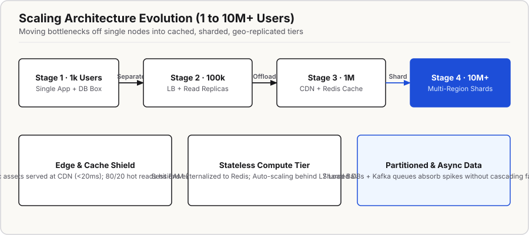
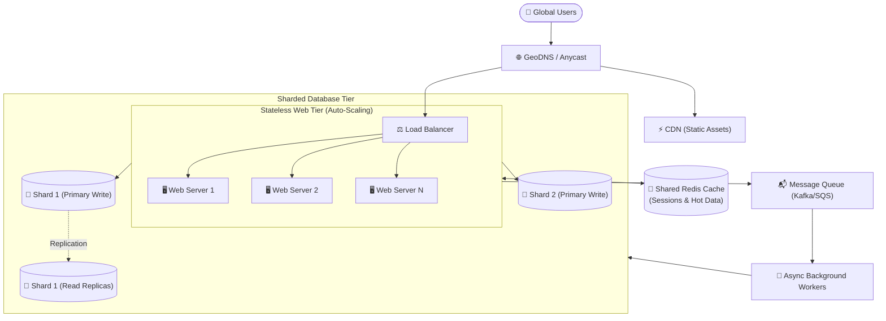

# 26 · Scaling from One to Millions of Users

> **Part 0 · Foundations** · ⏱️ ~25 min read · Prerequisites: None (Foundational)

---

> 🏢 **Real-world case studies**: how **Google** & **Netflix** evolved from single-machine monolithic scripts to global multi-region infrastructures, in [REAL_WORLD_EXAMPLES.md](./REAL_WORLD_EXAMPLES.md).

---

## 🧒 The 30-second version

Every giant platform (Google, Netflix, Instagram) started on a single physical computer. Scaling is not about building a 100-million-user system on day one; it is a **step-by-step evolutionary sequence**:

1. **Step 1 (Single Box)**: Web app, database, and files on 1 machine.
2. **Step 2 (Separate Layers)**: Move database to its own dedicated machine.
3. **Step 3 (Horizontal Scaling & Load Balancer)**: Add multiple web servers behind a reverse proxy.
4. **Step 4 (Database Replication)**: Primary for writes, multiple read replicas for queries.
5. **Step 5 (Caching & CDN)**: Cache hot queries in RAM (Redis); push static images to edge CDNs.
6. **Step 6 (Stateless Web Tier)**: Move user sessions out of server memory into a shared cache.
7. **Step 7 (Data Centers & GeoDNS)**: Route users across worldwide data centers.
8. **Step 8 (Async Message Queues)**: Decouple slow background tasks (emails, video processing) with Kafka/RabbitMQ.
9. **Step 9 (Database Sharding)**: Partition tables horizontally across multiple database clusters.

---

## 🍕 Everyday analogy: The Food Truck to Global Restaurant Empire

Imagine opening a small food business:

- **Day 1 (Food Truck)**: You take orders, cook burgers, and handle cash in a single truck. If 10 customers arrive at once, the line stalls. (**Single-Server Monolith**).
- **Month 2 (Separation of Concerns)**: You hire a cashier so you can focus strictly on cooking. (**Separating Web Server from Database**).
- **Year 1 (Load Balancing)**: You buy 3 trucks and place a host at the entrance directing customers to the truck with the shortest line. (**Load Balancer + Horizontal Scaling**).
- **Year 3 (Central Prep Kitchen)**: Instead of slicing onions per order, a central kitchen preps ingredients overnight and stores them in cooling trays. (**Caching Tier**).
- **Year 5 (Franchise Sharding)**: Opening locations in Tokyo, London, and New York. Each kitchen handles local customers independently. (**Geo-Distribution & Database Sharding**).

| Business Milestone | System Architecture Equivalent |
| :--- | :--- |
| **One Food Truck** | Single box hosting web app, DB, and static assets |
| **Dedicated Cashier** | Database separated from web tier |
| **Entrance Host** | Layer 7 Load Balancer (Nginx / ALB) |
| **Pre-sliced Ingredients** | In-Memory Cache (Redis / Memcached) |
| **Wholesale Depot** | Content Delivery Network (CDN) |
| **Order Slips to Kitchen** | Message Queues (Kafka / SQS) |
| **Regional Franchises** | Multi-Region Active-Active Sharding |

---

## 🧩 The Problem It Solves

When an application experiences exponential growth (e.g., $10 \to 10,000 \to 10,000,000\text{ users}$), scaling by simply buying a larger computer (**Vertical Scaling / Scaling Up**) hits hard physical limits:
1. **CPU & RAM Ceilings**: Even a server with 128 cores and 1TB RAM maxes out during traffic spikes.
2. **Cost Asymmetry**: High-end enterprise servers cost exponentially more than equivalent commodity servers.
3. **Single Point of Failure (SPOF)**: If your one giant server suffers a power glitch, hardware defect, or kernel panic, your entire business goes dark.

**Horizontal Scaling (Scaling Out)** solves this by adding commodity servers in parallel, achieving virtually unlimited throughput and high availability.

---

## 🖼️ Picture It: The 9-Stage Evolution

<p align="center">
  
</p>



---

## 🔢 Walk-Through with Real Numbers

Let's trace how infrastructure demands change from **1,000 users to 10,000,000 Daily Active Users (DAU)**:

### Scale Milestones:
1. **At 1,000 Users**:
   - $1,000\text{ DAU} \times 20\text{ requests/day} = 20,000\text{ requests/day} \approx \mathbf{0.23\text{ requests/second}}$.
   - Single \$10/mo VPS (2 vCPUs, 4GB RAM) handles this comfortably.
2. **At 100,000 Users**:
   - $100,000\text{ DAU} \times 50\text{ requests/day} = 5,000,000\text{ req/day} \approx \mathbf{58\text{ RPS average (150 RPS peak)}}$.
   - Separate web server from PostgreSQL database. Add Redis for caching hot queries.
3. **At 10,000,000 Users (The 10M Milestone)**:
   - $10,000,000\text{ DAU} \times 100\text{ requests/day} = 1,000,000,000\text{ req/day}$.
   - **Average QPS**: $\frac{10^9}{86,400\text{s}} \approx \mathbf{11,574\text{ QPS}}$.
   - **Peak QPS ($2\times$)**: $\approx \mathbf{23,000\text{ QPS}}$.
   - **Infrastructure Required**:
     - 40–60 Stateless web application containers behind load balancers.
     - 10+ Redis cache cluster nodes serving $90\%$ of reads in $<1\text{ms}$.
     - 4–8 Horizontally sharded database clusters with primary-replica replication.
     - CDN absorbing $95\%$ of all bandwidth egress.

---

## ⚙️ How It Works Under the Hood

### 1. Decoupling State: Why Stateless Web Servers Are Mandatory
If Web Server A stores User Alice's login session in its local RAM:
- Alice's subsequent requests *must* hit Web Server A (**Sticky Sessions**).
- If Web Server A crashes or auto-scales down, Alice is logged out.
- **The Solution**: Web servers store zero session state. All session tokens live in a fast, distributed **Redis cluster**. Any web server can handle any request from any user seamlessly.

### 2. Database Sharding: Horizontal Partitioning
When database writes exceed the I/O capacity of a single primary database:
- Tables are sharded by a **Shard Key** (e.g., `user_id % 4`).
- Shard 0 handles users with IDs ending in 0; Shard 1 handles IDs ending in 1.
- Sharding allows linear write scaling across commodity database hardware.

---

## ⚖️ Trade-Offs & Decision Matrix

| Evolution Step | Primary Benefit | Operational Cost / Trade-Off | When to Implement |
| :--- | :--- | :--- | :--- |
| **Separate DB Box** | Eliminates CPU contention between app & DB | Additional network latency hop (1–2ms) | $>1,000\text{ users}$ |
| **Load Balancer** | Eliminates single point of failure | SSL termination overhead; health checking | $>10,000\text{ users}$ |
| **In-Memory Cache** | Drops DB read load by 80–95% | Cache invalidation complexity; stale data risk | $>50,000\text{ users}$ |
| **Message Queue** | Absorbs traffic spikes; non-blocking APIs | Eventual consistency; dead-letter queue handling | $>100,000\text{ users}$ |
| **Database Sharding** | Unlimited horizontal write scaling | Joins across shards are impossible; resharding | $>1,000,000\text{ users}$ |

---

## 🚫 Common Mistakes & Production Pitfalls

1. **Premature Microservices & Sharding**:
   - *Pitfall*: Designing a 50-service microservice mesh with database sharding on day one with 500 users.
   - *Result*: Massive deployment overhead, distributed network failures, and months of engineering delay. Build a clean modular monolith first, scale database reads with caching, and shard only when write bottlenecks emerge.
2. **Stateful Web Servers**:
   - *Pitfall*: Storing user uploads or session files on the web server's local disk.
   - *Result*: Auto-scaling deletes user uploads when instances terminate. Always use cloud object storage (S3) and shared caching (Redis).
3. **No Database Connection Pooling**:
   - *Pitfall*: Allowing 50 web servers with 200 threads each to open 10,000 direct connections to PostgreSQL.
   - *Result*: PostgreSQL crashes from connection memory overhead. Use PgBouncer or proxy connection pools.

---

## 💻 Try It Yourself

The companion script [`demo.py`](./demo.py) simulates the step-by-step traffic collapse of a single server and demonstrates how each architectural layer (Load Balancer, Cache, Database Read Replicas) restores sub-millisecond latencies under surging traffic.

Run it directly in your terminal:
```bash
python demo.py
```

### What to explore in `demo.py`:
1. Watch the single server choke and drop requests when concurrency exceeds capacity.
2. See the **Cache Layer** absorb 85% of queries instantly.
3. Observe how the **Load Balancer** distributes traffic uniformly across parallel worker nodes.

---

## 🌍 Where You'll See It in Production

- **Instagram**: Scaled from 1 server to 14 million users in 1 year with just 3 engineers by relying on simple PostgreSQL master-replica replication, Memcached, and AWS EC2.
- **Shopify**: Sustains millions of concurrent shoppers during Black Friday by keeping the web tier completely stateless and caching catalog data in Redis.
- **Netflix**: Distributes 100% of video streaming workloads across stateless microservices in AWS, serving global metadata across multiple cloud regions.

---

## 🎯 Top 5 Interview Questions & Deep Answers

### Q1: "When should you scale vertically versus horizontally?"
<details>
<summary>💡 Click to reveal the ideal senior engineering answer</summary>

- **Vertical Scaling (Scale Up)** is best in early startup stages: it introduces zero distributed systems complexity, requires no network coordination, and maintains strict single-node ACID transactions.
- **Horizontal Scaling (Scale Out)** is mandatory when:
  1. Traffic exceeds single-node hardware limits (memory bus, CPU sockets, NIC bandwidth).
  2. Business requirements demand **High Availability (HA)** without single points of failure.
  3. Cost optimization dictates using pools of cheap commodity cloud instances rather than high-tier bare-metal instances.

</details>

---

### Q2: "Why must web application servers be stateless to support auto-scaling?"
<details>
<summary>💡 Click to reveal the ideal senior engineering answer</summary>

If a web server maintains client state (e.g. session data, cart contents, in-flight file buffers) in local memory:
1. The load balancer must use **sticky sessions** (source-IP affinity), preventing even load distribution.
2. If traffic drops and the auto-scaler terminates 5 idle instances, all users pinned to those instances lose their session state and are logged out.
By moving state to external stores (Redis for sessions, S3 for files), web servers become interchangeable workers that can scale from 2 to 200 instances without user disruption.

</details>

---

### Q3: "How does a CDN improve both latency and backend server stability?"
<details>
<summary>💡 Click to reveal the ideal senior engineering answer</summary>

A CDN delivers two distinct architectural benefits:
1. **Latency Reduction**: Edge servers terminate TCP/TLS handshakes geographically close to the user (5–15ms RTT vs 150ms+ to origin) and serve cached static assets (images, CSS, JS bundles) instantly.
2. **Origin Shielding**: By serving $>95\%$ of asset requests from edge memory, the CDN absorbs traffic spikes, preventing origin web servers and database connections from being overwhelmed by static asset requests.

</details>

---

### Q4: "What are the biggest challenges when sharding a relational database?"
<details>
<summary>💡 Click to reveal the ideal senior engineering answer</summary>

1. **Cross-Shard Joins**: Joining tables that reside on different physical database servers is slow and requires application-level stitching.
2. **Celebrity / Hotspot Keys**: If a viral user (e.g. celebrity with 50M followers) hashes to Shard 2, Shard 2 collapses from write saturation while other shards sit idle.
3. **Resharding Complexity**: When data growth outgrows the current number of shards, rebalancing keys across new shards requires consistent hashing or complex live data migrations.

</details>

---

### Q5: "What is the difference between Read Replicas and Database Sharding?"
<details>
<summary>💡 Click to reveal the ideal senior engineering answer</summary>

- **Read Replicas** scale **read throughput**: All replicas contain a complete copy of the database. All writes still funnel through the single primary database, meaning read replicas *cannot* scale write capacity.
- **Database Sharding** scales **write throughput and storage volume**: Data is partitioned so each shard contains a unique subset of the total rows. Multiple shards accept writes concurrently, enabling unlimited horizontal write scaling.

</details>

---

## ✅ Check Yourself

1. **If your primary database is handling 2,000 writes/sec and reaches 95% CPU, will adding 5 read replicas fix the issue?**
<details>
<summary>View Answer</summary>
No. Read replicas only offload read queries (`SELECT`). Every write (`INSERT`/`UPDATE`/`DELETE`) must still be committed by the primary database and replicated to all replicas. To scale write capacity, you must implement database sharding, caching writes, or asynchronous message queuing.
</details>

---

2. **Why should user uploads (images, PDFs) never be stored on local web server disk in an auto-scaled cloud environment?**
<details>
<summary>View Answer</summary>
Because cloud instances are ephemeral. When traffic subsides, auto-scaling groups automatically terminate excess instances, permanently deleting all files stored on local disks. Uploads must be stored in durable cloud object stores (like Amazon S3 or Google Cloud Storage).
</details>

---

## 📚 Go Deeper
- **System Design Interview – An Insider's Guide (Volume 1)** by Alex Xu: Chapter 1 (*Scale from Zero to Millions of Users*).
- **Web Scalability for Startup Engineers** by Artur Ejsmont: Chapter 1 (*Core Concepts & Scalability Principles*).
