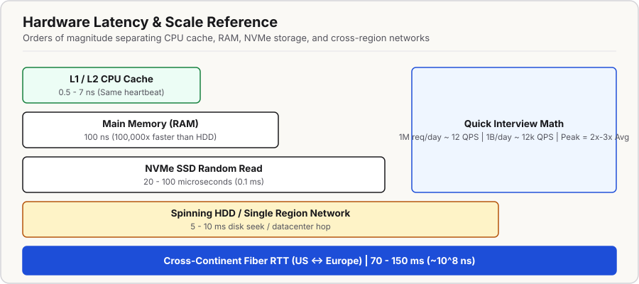

# 27 · Back-of-the-Envelope Estimation

> **Part 0 · Foundations** · ⏱️ ~20 min read · Prerequisites: None (Foundational)

---

> 🏢 **Real-World Deep Dives**: Detailed case studies of how **Google** (Jeff Dean's latency rules) & **Netflix** (capacity planning for 260M subscribers) execute real-world estimations are documented in [REAL_WORLD_EXAMPLES.md](./REAL_WORLD_EXAMPLES.md).

---

## 🧒 The 30-second version

Back-of-the-envelope estimation is the art of **rapidly calculating system scale (QPS, memory, disk storage, network bandwidth)** before writing a single line of architecture. It is not about finding the exact decimal; it is about finding the **order of magnitude** ($10\text{ RPS}$ vs $10,000\text{ RPS}$; $10\text{ GB}$ vs $10\text{ TB}$).

- **Powers of 10 shortcuts**:
  - $1\text{ Million requests/day} \approx \mathbf{12\text{ requests/second (RPS)}}$.
  - $1\text{ Billion requests/day} \approx \mathbf{12,000\text{ RPS}}$.
  - Peak traffic is typically estimated at $\mathbf{2\times \text{average}}$.
- **Hardware Latency Reality**: Reading from RAM ($\approx 100\text{ ns}$) is **100,000 times faster** than reading from a spinning disk ($\approx 10\text{ ms}$) and **1,500,000 times faster** than a cross-ocean network round trip ($\approx 150\text{ ms}$).

---

## 🍕 Everyday analogy: Planning a Wedding Banquet

Imagine planning a wedding:
- You don't need to know if Uncle Bob eats exactly $412\text{ grams}$ or $420\text{ grams}$ of chicken.
- You estimate: *"150 guests $\times$ 1 main dish $\approx$ 150 meals. Plus 20% buffer for hungry eaters $\approx$ 180 portions."*
- If your rough estimate said 150 portions and you prepared for 15, your guests starve. If you prepared for 15,000, food rots and you go bankrupt.

Back-of-the-envelope estimation gives you the exact ballpark to pick the right server size, database tier, and caching budget.

---

## 🧩 The Problem It Solves

Without back-of-the-envelope estimations:
1. **Architectural Over-Engineering**: A candidate proposes a multi-datacenter Kafka cluster with Cassandra sharding for a service receiving $5\text{ requests/minute}$.
2. **Catastrophic Under-Provisioning**: A team provisions a standard \$20/mo SQL database for a service expected to ingest $50\text{ GB of telemetry logs per second}$, causing Day 1 production crashes.
3. **Interview Disqualification**: Top-tier tech companies (Google, Meta, Amazon) explicitly score candidates on whether they can calculate QPS, storage growth, and RAM sizing in under 3 minutes.

---

## 🔢 The Cheat Sheet: Powers of 2 & 10

<p align="center">
  
</p>

| Power of 2 | Exact Bytes | Approximate (Powers of 10) | Standard Unit | Real-World Context |
| :--- | :--- | :--- | :--- | :--- |
| $2^{10}$ | 1,024 | $1\text{ Thousand } (10^3)$ | **1 KB** | Small JSON API response |
| $2^{20}$ | 1,048,576 | $1\text{ Million } (10^6)$ | **1 MB** | High-res thumbnail / photo |
| $2^{30}$ | 1,073,741,824 | $1\text{ Billion } (10^9)$ | **1 GB** | 1 hour of SD video stream |
| $2^{40}$ | 1,099,511,627,776 | $1\text{ Trillion } (10^{12})$ | **1 TB** | Standard server NVMe SSD |
| $2^{50}$ | 1,125,899,906,842,624 | $1\text{ Quadrillion } (10^{15})$ | **1 PB** | Daily YouTube upload ingestion |
| $2^{60}$ | 1,152,921,504,606,846,976| $1\text{ Quintillion } (10^{18})$ | **1 EB** | Total storage of global cloud providers |

---

## ⏱️ Latency Numbers Every Software Engineer Must Know

*Original figures compiled by Google Senior Fellow Jeff Dean, updated for modern NVMe hardware:*

| Operation | Real-World Time | Scaled to Human Time (1ns = 1s) |
| :--- | :--- | :--- |
| **L1 CPU Cache Reference** | $0.5\text{ ns}$ | 0.5 seconds (A single heartbeat) |
| **Branch Mispredict** | $5\text{ ns}$ | 5 seconds |
| **L2 CPU Cache Reference** | $7\text{ ns}$ | 7 seconds |
| **Mutex Lock / Unlock** | $25\text{ ns}$ | 25 seconds |
| **Main Memory (RAM) Reference**| $100\text{ ns}$ | 1.6 minutes |
| **Compress 1KB with Snappy** | $2,000\text{ ns } (2\text{ }\mu\text{s})$ | 33 minutes |
| **Read 1MB Sequentially from Memory** | $5,000\text{ ns } (5\text{ }\mu\text{s})$ | 1.4 hours |
| **Read 1MB Sequentially from NVMe SSD** | $10,000\text{ ns } (10\text{ }\mu\text{s})$ | 2.8 hours |
| **SSD Random Read (NVMe)** | $20,000\text{ ns } (20\text{ }\mu\text{s})$ | 5.5 hours |
| **Send 1KB Packet over 1Gbps LAN** | $10,000\text{ ns } (10\text{ }\mu\text{s})$ | 2.8 hours |
| **HDD Spinning Disk Seek** | $10,000,000\text{ ns } (10\text{ ms})$ | **4 months!** |
| **Round Trip Time (RTT): US to Europe** | $150,000,000\text{ ns } (150\text{ ms})$ | **5 years!** |

### The Core Architectural Takeaways:
1. **RAM is $100,000\times$ faster than disk seeks**: Keep hot data in cache.
2. **Sequential disk I/O matches network speed**: Log-structured storage (Kafka, LSM-trees) is fast because it uses sequential disk writes.
3. **Cross-region network latency dominates everything**: Avoid synchronous cross-datacenter round-trips on write paths.

---

## 📐 The Master Estimation Template

Whenever an interviewer gives you a design problem:

### 1. Traffic (QPS) Math
- **Input**: Daily Active Users (DAU) and average actions per user per day.
- **Formula**:
  $$\text{Average QPS} = \frac{\text{DAU} \times \text{Requests per user}}{86,400\text{ seconds}}$$
- **Rule of Thumb**: Round $86,400$ to **$100,000$** for fast mental math:
  $$\text{Average QPS} \approx \frac{\text{Total Daily Requests}}{100,000}$$
- **Peak QPS**: $\text{Peak QPS} = \text{Average QPS} \times 2$.

### 2. Storage Estimation Math
- **Formula**:
  $$\text{Daily Storage} = \text{Daily Writes} \times \text{Average Payload Size}$$
  $$\text{5-Year Storage} = \text{Daily Storage} \times 365 \times 5 \approx \text{Daily Storage} \times 2,000$$

### 3. Memory (Cache Sizing) Math: The 80/20 Rule
- **The Pareto Principle**: $20\%$ of hot content generates $80\%$ of read traffic.
- **Formula**:
  $$\text{RAM Required} = \text{Daily Read Volume (Bytes)} \times 0.20$$

---

## 💻 Try It Yourself

The companion script [`demo.py`](./demo.py) is an interactive estimation tool that takes DAU, read/write ratios, and payload sizes to generate complete infrastructure sizing reports in milliseconds.

Run it directly in your terminal:
```bash
python demo.py
```

---

## 🌍 Where You'll See It in Production

- **Google Search**: Capacity engineers use QPS estimates to provision Borg container tasks worldwide ahead of major global events (Olympics, elections).
- **Netflix Open Connect**: Uses 80/20 cache estimations to determine how many 200TB flash storage appliances (OCAs) must be deployed in each regional ISP.
- **Amazon AWS**: EC2 auto-scaling groups use capacity prediction curves based on historical back-of-the-envelope models.

---

## 🎯 Top 5 Interview Questions & Deep Answers

### Q1: "How do you quickly estimate QPS from Daily Active Users (DAU) in an interview?"
<details>
<summary>💡 Click to reveal the ideal senior engineering answer</summary>

State your assumptions clearly:
1. *"Assume $100\text{M DAU}$ and each user makes 10 requests per day."*
2. Total requests $= 1\text{ Billion requests/day}$.
3. Divide by $100,000$ seconds (rounding $86,400$):
   $$\text{Average QPS} \approx \frac{1,000,000,000}{100,000} = \mathbf{10,000\text{ QPS}}$$
4. Apply peak multiplier ($2\times$):
   $$\text{Peak QPS} = 10,000 \times 2 = \mathbf{20,000\text{ QPS}}$$
Interviewers reward fast, clean arithmetic over struggling with exact decimals.

</details>

---

### Q2: "Estimate the storage required for Twitter over 5 years."
<details>
<summary>💡 Click to reveal the ideal senior engineering answer</summary>

1. Assume $300\text{M DAU}$. $100\text{M}$ users post 2 tweets/day $= 200\text{M tweets/day}$.
2. Each tweet is 280 chars $+$ metadata (User ID, timestamp) $\approx 500\text{ bytes}$.
3. Assume 20% of tweets contain an image ($200\text{ KB}$):
   - Text storage: $200\text{M} \times 500\text{B} = 100\text{ GB/day}$.
   - Media storage: $40\text{M} \times 200\text{ KB} = 8,000\text{ GB/day} = 8\text{ TB/day}$.
   - Total daily storage $\approx 8.1\text{ TB/day}$.
4. 5-Year Storage:
   $$8.1\text{ TB} \times 365 \times 5 \approx 8.1\text{ TB} \times 1,825 \approx \mathbf{14.8\text{ Petabytes}}$$

</details>

---

### Q3: "How do you size the RAM needed for a Redis caching tier?"
<details>
<summary>💡 Click to reveal the ideal senior engineering answer</summary>

Apply the **80/20 Pareto rule**:
1. Calculate daily read volume. If daily active data volume is $5\text{ TB}$.
2. To satisfy 80% of reads from RAM, you need:
   $$5\text{ TB} \times 0.20 = \mathbf{1\text{ TB of RAM}}$$
3. Account for Redis memory overhead (pointers, hash tables, slab allocation) $\approx 25\%$ extra buffer:
   $$\text{Total RAM} \approx 1\text{ TB} \times 1.25 = \mathbf{1.25\text{ TB}}$$
4. Provision four $256\text{ GB}$ or eight $128\text{ GB}$ Redis cluster instances.

</details>

---

### Q4: "Why is sequential disk access comparable in speed to RAM access?"
<details>
<summary>💡 Click to reveal the ideal senior engineering answer</summary>

Disk latency is dominated by physical seek times (moving the mechanical head or initializing NAND flash row buffers). Once the initial seek occurs, hardware controllers read contiguous blocks at the physical bus bandwidth limit (up to 3–7 GB/s on PCIe 4.0 NVMe). Sequential disk access bypasses seek overhead, which is why log-structured engines (Kafka, LSM-trees) achieve near-RAM write throughput on standard disks.

</details>

---

### Q5: "Estimate the network egress bandwidth for YouTube."
<details>
<summary>💡 Click to reveal the ideal senior engineering answer</summary>

1. Assume 1 Billion hours of video watched per day.
2. Average bitrate across mobile and desktop: $2.5\text{ Mbps}$.
3. Continuous egress bandwidth:
   $$\text{Bandwidth} = \frac{1,000,000,000\text{ hrs} \times 3600\text{s} \times 2.5\text{ Mbps}}{86,400\text{s}} \approx \mathbf{104\text{ Terabits per second (Tbps)}}$$
4. With a 98% CDN cache offload, origin egress drops to only $\approx 2\text{ Tbps}$.

</details>

---

## 📚 Go Deeper
- **System Design Interview – An Insider's Guide (Volume 1)** by Alex Xu: Chapter 2 (*Back-of-the-envelope Estimation*).
- **Jeff Dean's Original Stanford Talk**: *Numbers Everyone Should Know* (Google Research).
