# 29 · Database Transactions & Isolation Levels

> **Part 2 · Storing data** · ⏱️ ~25 min read · Prerequisites: [06 · Relational vs NoSQL](../06-relational-and-non-relational-databases/)

---

> 🏢 **Real-World Deep Dives**: Detailed case studies of how **Google** (Cloud Spanner Serializable Snapshot Isolation via TrueTime) and **Netflix** (handling financial billing isolation in relational databases) implement transaction safety are documented in [REAL_WORLD_EXAMPLES.md](./REAL_WORLD_EXAMPLES.md).

---

## 🧒 The 30-second version

A **transaction** is a safety shield: it bundles multiple database reads and writes into a single logical execution. Either **everything succeeds (Commit)**, or if anything goes wrong, **everything is completely undone (Abort/Rollback)**.

Without transactions:
- If a server crashes midway through transferring money between bank accounts, money vanishes from Account A but never reaches Account B.
- If two users try to book the last seat on a flight at the exact same millisecond, both get confirmed.

The **Isolation Level** determines how well concurrent transactions are shielded from each other:
1. **Read Committed**: No dirty reads (you only read data that has been permanently committed).
2. **Snapshot Isolation / Repeatable Read**: Readers see a consistent snapshot of the database as of the transaction start time; readers never block writers, and writers never block readers.
3. **Serializable**: The gold standard. Transactions execute with the mathematical guarantee of running one-at-a-time, completely preventing race conditions like **Write Skew**.

---

## 🍕 Everyday analogy: The Shared Google Doc vs Meeting Rooms

Imagine multiple coworkers booking meeting rooms:

- **Dirty Read (Read Uncommitted)**: Bob starts drafting an email saying *"Room 101 booked"*, then changes his mind and deletes it. Alice peeked at Bob's draft screen and wrongly assumes Room 101 is taken.
- **Lost Update**: Alice and Bob both read the inventory: *"Items remaining: 5"*. Alice sells 1 item and writes back $4$. Bob sells 1 item and writes back $4$. Two items were sold, but the counter says 4 instead of 3!
- **Write Skew**: A hospital requires at least 1 doctor on call. Doctors Alice and Bob are both on call. Both simultaneously request to go off duty. Under Snapshot Isolation:
  - Alice's transaction checks: *"Is another doctor on call?"* Yes (Bob). Alice logs off.
  - Bob's transaction checks: *"Is another doctor on call?"* Yes (Alice). Bob logs off.
  - **Catastrophe**: Zero doctors remain on call! Only **Serializable isolation** catches this race condition.

| In everyday life | In Database Architecture |
| :--- | :--- |
| **Peeking at an unsaved draft** | **Dirty Read** |
| **Overwriting someone's draft** | **Dirty Write** |
| **Two people selling the same item** | **Lost Update** |
| **Two doctors logging off simultaneously** | **Write Skew (Phantom Read)** |
| **Locking the door while in the room** | **Pessimistic Locking (2PL)** |
| **Checking if anyone changed the room before leaving** | **Optimistic Concurrency Control (SSI)** |

---

## 🧩 The Problem It Solves

In high-concurrency production systems, executing transactions without strict isolation triggers catastrophic race conditions:

1. **Lost Updates**: Concurrent increments or JSON modifications overwrite each other.
2. **Non-Repeatable Reads**: Query 1 reads an account balance of \$100. Query 2 (in the same transaction 10ms later) reads \$50 because an external transaction committed in between.
3. **Write Skew**: Two concurrent transactions read the same data, make independent decisions based on that data, and write to different rows, violating global business constraints.

---

## 🖼️ Picture It: The 4 SQL Standard Isolation Levels

```mermaid
flowchart TD
    subgraph Levels["The Isolation Spectrum (Weakest to Strongest)"]
        L1["1. Read Uncommitted<br/>(Suffers from Dirty Reads)"]
        L2["2. Read Committed<br/>(No Dirty Reads, No Dirty Writes)"]
        L3["3. Snapshot Isolation / Repeatable Read<br/>(MVCC, Consistent Snapshot, Prevents Lost Updates)"]
        L4["4. Serializable<br/>(Guarantees Total Sequential Execution; Prevents Write Skew)"]
    end
    
    L1 --> L2 --> L3 --> L4
    
    style L1 fill:#161b22,stroke:#f85149,stroke-width:2px;
    style L2 fill:#161b22,stroke:#d29922,stroke-width:2px;
    style L3 fill:#161b22,stroke:#58a6ff,stroke-width:2px;
    style L4 fill:#161b22,stroke:#3fb950,stroke-width:2px;
```



---

## 🔢 The Race Conditions & Anomalies Matrix

| Isolation Level | Dirty Read | Lost Update | Non-Repeatable Read | Write Skew / Phantoms | Default In |
| :--- | :---: | :---: | :---: | :---: | :--- |
| **Read Uncommitted** | ❌ Allowed | ❌ Allowed | ❌ Allowed | ❌ Allowed | Rarely used |
| **Read Committed** | ✅ **Prevented** | ❌ Allowed | ❌ Allowed | ❌ Allowed | **PostgreSQL, Oracle, SQL Server** |
| **Repeatable Read (Snapshot)** | ✅ **Prevented** | ✅ **Prevented** | ✅ **Prevented** | ❌ Allowed | **MySQL InnoDB** |
| **Serializable** | ✅ **Prevented** | ✅ **Prevented** | ✅ **Prevented** | ✅ **Prevented** | CockroachDB, Google Spanner |

---

## ⚙️ How It Works Under the Hood

### 1. Multi-Version Concurrency Control (MVCC)
Modern databases (PostgreSQL, MySQL InnoDB, CockroachDB) implement Snapshot Isolation using **MVCC**:
- When a row is updated, the database does *not* overwrite the old data in place.
- Instead, it appends a new version of the row with creation and expiration transaction IDs:
  `(row_id, value, created_by_tx, deleted_by_tx)`
- When Transaction 42 starts, it is assigned a **read watermark** of 42.
- It only sees row versions created *before* Transaction 42 that were not deleted before 42.
- **The Superpower**: Readers never block writers, and writers never block readers!

### 2. Preventing Write Skew: Two-Phase Locking (2PL) vs Serializable Snapshot Isolation (SSI)
- **Two-Phase Locking (2PL)**: Pessimistic. Acquires shared locks (`SELECT ... FOR UPDATE`) on read data. If another transaction wants to write, it blocks.
- **Serializable Snapshot Isolation (SSI)**: Optimistic. Transactions read and write concurrently without blocking. At commit time, the database tracks read-write conflicts. If two transactions exhibited write skew, the database aborts one and forces the client to retry.

---

## ⚖️ Trade-Offs & Decision Matrix

| Strategy | Performance / Throughput | Concurrency Anomalies | Operational Cost | Best Use Case |
| :--- | :--- | :--- | :--- | :--- |
| **Read Committed** | Highest Throughput | Vulnerable to non-repeatable reads & lost updates | Lowest CPU/RAM | Standard CRUD dashboards |
| **Snapshot Isolation** | High Throughput (MVCC) | Vulnerable to Write Skew | Medium RAM (old row versions) | Financial ledgers & carts |
| **Serializable (2PL)** | Low Throughput (Lock waits) | Zero Anomalies | High lock contention & deadlocks | Rare single-node high-stakes |
| **Serializable (SSI)** | High on low-conflict | Zero Anomalies | Abort/retry handling in app code | Distributed SQL (Spanner/Cockroach) |

---

## 🚫 Common Mistakes & Production Pitfalls

1. **Blind Overwrite Instead of Atomic Updates**:
   - *Pitfall*: `balance = SELECT balance; balance += 10; UPDATE SET balance = balance;`
   - *Result*: Lost Update under Read Committed.
   - *Fix*: Use atomic database expressions: `UPDATE accounts SET balance = balance + 10 WHERE id = 1;` or `SELECT FOR UPDATE`.
2. **Long-Running Transactions Holding Locks**:
   - *Pitfall*: Opening a database transaction, making an external Stripe API call (taking 1.5s), and then committing.
   - *Result*: Database connection pool starvation and lock timeouts. Never place third-party HTTP network calls inside database transactions!
3. **Table Bloat in MVCC**:
   - *Pitfall*: High-frequency updates without PostgreSQL `VACUUM` maintenance.
   - *Result*: Millions of dead tuple row versions consume disk space and degrade sequential scans.

---

## 💻 Try It Yourself

The companion script [`demo.py`](./demo.py) simulates concurrent multi-threaded transactions demonstrating:
1. The **Lost Update Anomaly** under naive execution vs. atomic Compare-And-Swap (CAS).
2. The **Write Skew Anomaly** (the classic Doctors on Call problem) under Snapshot Isolation vs. Serializable enforcement.

Run it directly in your terminal:
```bash
python demo.py
```

---

## 🌍 Where You'll See It in Production

- **Google Cloud Spanner**: Provides globally distributed Serializable transactions using TrueTime atomic clocks to serialize transactions worldwide.
- **PostgreSQL**: Defaults to **Read Committed**, using MVCC to serve fast non-blocking reads while providing Serializable Snapshot Isolation (SSI) for mission-critical tables.
- **Stripe**: Enforces strict database transaction isolation and idempotency keys to ensure that a customer is never double-charged during API retries.

---

## 🎯 Top 5 Interview Questions & Deep Answers

### Q1: "What is Write Skew, and why does Snapshot Isolation fail to prevent it?"
<details>
<summary>💡 Click to reveal the ideal senior engineering answer</summary>

Write Skew occurs when two concurrent transactions read the same data, make a decision based on that premise, and update *different rows* in a way that violates a global invariant (e.g. the Doctors on Call scenario, or reserving the same conference room).
Snapshot Isolation fails because it only detects **Dirty Writes on the same row** (first-committer-wins). Because Transaction A updates Row 1 and Transaction B updates Row 2, Snapshot Isolation sees zero row conflict and allows both to commit! Write Skew can only be prevented by:
1. **Explicit Locking**: `SELECT ... FOR UPDATE` (Pessimistic).
2. **Serializable Isolation**: SSI tracks read-write dependency cycles and aborts one transaction.

</details>

---

### Q2: "How does Multi-Version Concurrency Control (MVCC) eliminate read locks?"
<details>
<summary>💡 Click to reveal the ideal senior engineering answer</summary>

Instead of overwriting rows in-place, MVCC creates a new timestamped version of the row for every mutation. When a transaction starts, it receives a logical snapshot watermark. Any read operation simply seeks row versions created before that watermark, ignoring later writes. Because readers only inspect immutable past versions, **readers never acquire locks and never block concurrent writers**.

</details>

---

### Q3: "What is the Lost Update problem, and what are 3 ways to prevent it?"
<details>
<summary>💡 Click to reveal the ideal senior engineering answer</summary>

A Lost Update happens when Transaction 1 and Transaction 2 both read value $V$, compute new values independently, and write back, with the second write blindly overwriting the first.
Three ways to prevent it:
1. **Atomic Database Operations**: `UPDATE counters SET val = val + 1 WHERE id = 10;`
2. **Pessimistic Locking**: `SELECT val FROM counters WHERE id = 10 FOR UPDATE;`
3. **Optimistic Locking (Compare-And-Swap)**: Add a version column: `UPDATE counters SET val = 20, version = 2 WHERE id = 10 AND version = 1;` If 0 rows are updated, the app retries.

</details>

---

### Q4: "Why should you never execute external HTTP network calls inside a database transaction block?"
<details>
<summary>💡 Click to reveal the ideal senior engineering answer</summary>

Database transactions hold row-level locks and occupy a dedicated connection from the server's connection pool (typically limited to 50–200 connections). External HTTP calls (e.g., Stripe, Twilio) can take seconds or time out. Holding a database transaction open during network I/O exhausts the connection pool, locks other transactions, and triggers cascading system failure. Always execute database writes and external HTTP calls in separate decoupled steps using the **Transactional Outbox Pattern**.

</details>

---

### Q5: "What is the difference between Two-Phase Locking (2PL) and Two-Phase Commit (2PC)?"
<details>
<summary>💡 Click to reveal the ideal senior engineering answer</summary>

- **Two-Phase Locking (2PL)** is a **concurrency control mechanism** on a *single database* ensuring Serializable isolation: transactions acquire locks during the growing phase and release them during the shrinking phase.
- **Two-Phase Commit (2PC)** is an **atomic distributed consensus protocol** across *multiple independent databases/nodes* (Prepare phase $	o$ Commit phase) ensuring all nodes commit or all abort.
They are completely different concepts despite sharing the "Two-Phase" name!

</details>

---

## 📚 Go Deeper
- **Designing Data-Intensive Applications** by Martin Kleppmann: Chapter 7 (*Transactions & Isolation Levels*).
- **A Critique of ANSI SQL Isolation Levels** (Berenson et al., 1995): The foundational paper establishing modern isolation definitions.
