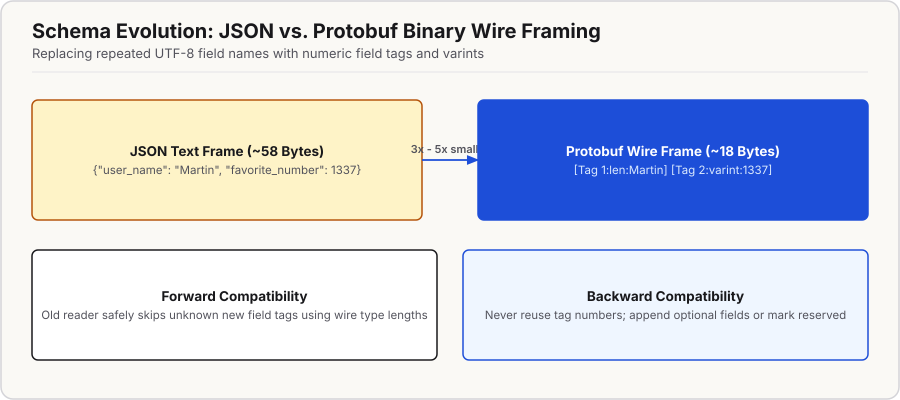

# 30 · Data Encoding & Schema Evolution

> **Part 2 · Storing data** · ⏱️ ~20 min read · Prerequisites: None (Foundational)

---

> 🏢 **Real-world case studies**: how **Google** (Protocol Buffers standard across Borg RPCs) and **LinkedIn / Netflix** (Apache Avro Schema Registries) manage schema evolution, in [REAL_WORLD_EXAMPLES.md](./REAL_WORLD_EXAMPLES.md).

---

## 🧒 The 30-second version

Programs keep data in memory as objects, structs, or arrays (optimized for CPU pointers). When you want to send that data over the network or save it to disk, you must convert it into a byte sequence. This process is called **Serialization / Encoding**.

- **Text Formats (JSON, XML)**: Human-readable, easy to debug, but slow to parse and bulky over the wire because field names are repeated in every single message.
- **Binary Formats (Protocol Buffers, Apache Thrift, Apache Avro)**: Ultra-compact, fast to serialize, and use **numeric field tags** instead of text keys.
- **Schema Evolution**: Code changes constantly in large organizations. Rolling updates mean old servers and new servers run concurrently. **Backward Compatibility** ensures new code can read old data. **Forward Compatibility** ensures old code can read new data without crashing.

---

## 🍕 Everyday analogy: The Government Application Form

Imagine a printed paper form for renewing a passport:

- **JSON (Verbosely Labeling Every Box)**: Every citizen submits a blank sheet of paper writing: `"First Name: Alice, Last Name: Smith, Age: 30"`. Printing the labels `"First Name"` over and over wastes ink and envelope weight.
- **Protocol Buffers (Numbered Boxes)**: The government issues a standardized template: Box 1 = First Name, Box 2 = Last Name, Box 3 = Age. The citizen only submits: `1: Alice, 2: Smith, 3: 30`.
- **Schema Evolution (Adding a New Box)**:
  - Next year, the government adds Box 4: `"Middle Name (Optional)"`.
  - An old citizen who uses the previous year's form omits Box 4. The new officer accepts it safely (**Backward Compatibility**).
  - A citizen who uses the new form submits Box 4 to an old officer. The old officer simply ignores Box 4 and processes Boxes 1, 2, and 3 (**Forward Compatibility**).

---

## 🧩 The Problem It Solves

In production distributed systems with thousands of microservices:
1. **You Cannot Deploy Everything Simultaneously**: Large systems rely on **Rolling Upgrades** (updating 5% of servers at a time over hours). During this window, `v1` services talk to `v2` services.
2. **Database Longevity**: A record written to disk 5 years ago by `v1` code must still be readable by today's `v5` code.
3. **Bandwidth & CPU Waste**: Parsing text JSON strings consumes massive CPU cycles and inflates network bandwidth. Binary serialization reduces payload size by **60% to 80%** and cuts serialization CPU time by up to **$10\times$**.

---

## 🖼️ Picture It: JSON vs Protocol Buffers Binary Encoding

```mermaid
flowchart TD
    subgraph JSON["JSON Format (Bulky Text with Repeated Keys: 58 Bytes)"]
        J1["{'user_id': 1001, 'user_name': 'Alice', 'is_active': true}"]
    end

    subgraph Protobuf["Protocol Buffers (Compact Binary with Varints & Tags: 12 Bytes)"]
        P1["[08][E9 07] [12 05 'Alice'] [18 01]"]
        P2["Tag 1 (Varint) + Tag 2 (String) + Tag 3 (Boolean)"]
    end
    
    JSON -->|60-80% Size Reduction| Protobuf
    
    style JSON fill:#161b22,stroke:#f85149,stroke-width:2px;
    style Protobuf fill:#161b22,stroke:#3fb950,stroke-width:2px;
```

<p align="center">
  
</p>



---

## 🔢 The Binary Varint Encoding Mechanics

How does Protocol Buffers store an integer like `300` in just 2 bytes instead of 4 or 8 bytes? Using **Varints (Variable-Length Quantities)**:
- Standard 32-bit integer always takes **4 bytes (32 bits)** even for the number `1`.
- Varints use the most significant bit (MSB) as a **continuation bit**:
  - `MSB = 1`: More bytes follow.
  - `MSB = 0`: Last byte of the number.
- Small numbers (0 to 127) take only **1 single byte**!

---

## ⚙️ How Schema Evolution Works in Production

### The 4 Golden Rules of Protobuf / Avro Compatibility:
1. **Never Change an Existing Field's Tag Number**: The tag number *is* the field's identity over the wire. Changing Tag 2 from `name` to `email` corrupts all existing data.
2. **Never Make a New Field Required**: If you add a required field, old code emitting messages without that field will cause new code to fail validation. Always make new fields optional or provide default values.
3. **Never Reuse a Deleted Tag Number**: When removing a field, mark its tag number as `reserved` in the `.proto` file so future developers don't reuse it.
4. **Unknown Fields Preservation**: When older code reads data with new tag numbers, it preserves those unknown bytes in memory and re-emits them if forwarding the message.

---

## ⚖️ Trade-Offs & Decision Matrix

| Serialization Format | Human Readable | Performance & Size | Schema Required | Best Use Case |
| :--- | :---: | :---: | :---: | :--- |
| **JSON** | ✅ Yes | Slow / Large (100%) | ❌ No | Public-facing REST APIs, web UIs |
| **Protocol Buffers** | ❌ No (Binary) | Ultra-Fast / Small (20–30%) | ✅ Yes (`.proto`) | Internal inter-service gRPC RPCs |
| **Apache Avro** | ❌ No (Binary) | Ultra-Fast / Smallest | ✅ Yes (Schema Registry)| Kafka event streams & Big Data lakes |
| **FlatBuffers** | ❌ No (Binary) | Zero-copy access | ✅ Yes | Gaming, mobile, real-time graphics |

---

## 🚫 Common Mistakes & Production Pitfalls

1. **Renaming or Reordering Numeric Tags in Protobuf**:
   - *Pitfall*: Changing `string email = 3;` to `string email = 4;`.
   - *Result*: Instant serialization corruption and runtime exceptions in production.
2. **Sending Large JSON Payloads Inside Internal RPC Call Trees**:
   - *Pitfall*: Microservice A calls B calls C, each converting 1MB JSON back and forth.
   - *Result*: Enormous CPU garbage collection spikes from JSON string parsing. Use binary gRPC/Protobuf for internal east-west traffic.
3. **Missing Schema Registry for Kafka**:
   - *Pitfall*: Emitting Avro binary events into Kafka without a centralized Confluent Schema Registry.
   - *Result*: Consumers crash because they cannot fetch the writer schema needed to decode binary bytes.

---

## 💻 Try It Yourself

The companion script [`demo.py`](./demo.py) implements:
1. A binary varint serializer and tag packer demonstrating the exact byte layout of Protocol Buffers.
2. A side-by-side payload size benchmark: JSON vs Binary Serialization.
3. A live Schema Evolution test proving forward and backward compatibility when adding new optional fields.

Run it directly in your terminal:
```bash
python demo.py
```

---

## 🌍 Where You'll See It in Production

- **Google**: Every internal RPC across all Google services runs exclusively on **Protocol Buffers** and gRPC.
- **Netflix & Uber**: Ingest trillions of daily events into Apache Kafka formatted as **Apache Avro** managed by centralized schema registries.
- **Apple**: Uses binary serialization for push notifications (APNs) to maximize mobile radio efficiency.

---

## 🎯 Top 5 Interview Questions & Deep Answers

### Q1: "What is the difference between Backward Compatibility and Forward Compatibility?"
<details>
<summary>💡 Click to reveal the ideal senior engineering answer</summary>

- **Backward Compatibility**: New code can read data that was generated by older code (essential when loading historical records from a database or storage).
- **Forward Compatibility**: Old code can read data that was generated by newer code (essential during rolling server updates where old servers receive requests from new canary instances).
Systems that support both are **Fully Compatible**.

</details>

---

### Q2: "Why is Protocol Buffers so much smaller and faster than JSON?"
<details>
<summary>💡 Click to reveal the ideal senior engineering answer</summary>

1. **Numeric Tags Instead of Strings**: Protobuf replaces text field names (`"user_id"`) with 1-byte numeric tags (`1`), saving dozens of bytes per field.
2. **Varint Encoding**: Integers are stored using variable-length quantities rather than fixed 4/8 bytes or ASCII digit strings.
3. **No String Parsing Delimiters**: JSON requires scanning for quotes, colons, braces, and commas. Protobuf stores length-prefixed strings, enabling fast memory copies without string tokenization.

</details>

---

### Q3: "How does Apache Avro handle schema evolution differently from Protocol Buffers?"
<details>
<summary>💡 Click to reveal the ideal senior engineering answer</summary>

Protocol Buffers encodes field tag numbers directly inside the binary message payload.
Apache Avro does **not** include tag numbers or field names in the message payload. Instead:
- It relies on two schemas: the **Writer's Schema** (used to serialize the message) and the **Reader's Schema** (used to deserialize it).
- In streaming pipelines (Kafka), messages carry only a 4-byte Schema ID pointing to a centralized **Schema Registry**. The reader fetches the schema once, compares schemas, and decodes the payload, producing the most compact byte representation possible.

</details>

---

### Q4: "What happens if an older service receives a Protobuf message containing a newly added field?"
<details>
<summary>💡 Click to reveal the ideal senior engineering answer</summary>

The older service's Protobuf parser inspects the tag number, realizes it does not recognize the tag, and skips over the field using the wire-type length header. In modern Protobuf (proto3), the parser preserves the unknown field bytes in memory so that if the service forwards the message to another service, the new field is not lost!

</details>

---

### Q5: "When should you still use JSON instead of binary protocols?"
<details>
<summary>💡 Click to reveal the ideal senior engineering answer</summary>

1. **Public APIs**: External third-party developers expect standard JSON over HTTP without having to compile `.proto` files into their language SDKs.
2. **Browser Frontend Clients**: Browsers have native, highly optimized C++ JSON parsers (`JSON.parse()`).
3. **Debugging and Ad-Hoc Inspection**: JSON can be inspected in curl, Postman, and raw logs without specialized decoding tools.

</details>

---

## 📚 Go Deeper
- **Designing Data-Intensive Applications** by Martin Kleppmann: Chapter 4 (*Encoding and Evolution*).
- **Google Protocol Buffers Documentation**: *Encoding Specification* (protobuf.dev).
