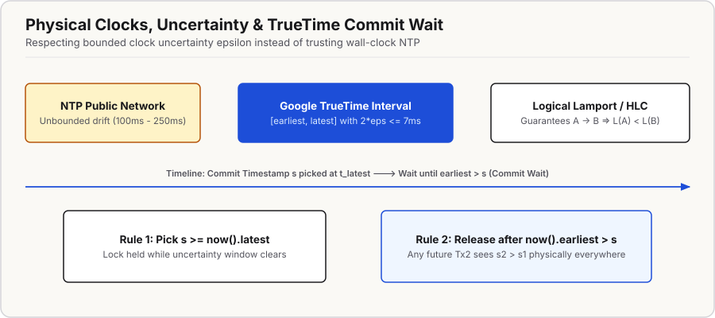
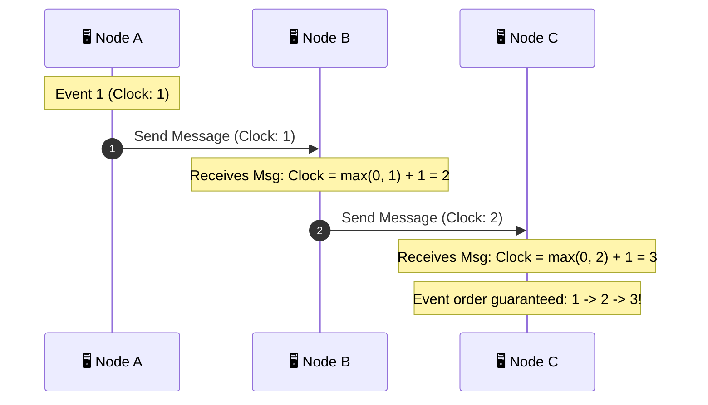

# 31 · Time, Clocks & Ordering

> **Part 4 · Distributed-systems thinking** · ⏱️ ~25 min read · Prerequisites: [14 · Consistency Models](../14-consistency-models/)

---

> 🏢 **Real-world case studies**: how **Google** (TrueTime API bounding clock uncertainty with atomic clocks) and **Amazon** (Dynamo Vector Clocks for shopping carts) manage distributed time, in [REAL_WORLD_EXAMPLES.md](./REAL_WORLD_EXAMPLES.md).

---

## 🧒 The 30-second version

In a single computer, finding out what happened first is trivial: you check the CPU clock. 

In a distributed system across 1,000 servers, **physical wall clocks cannot be trusted**:
- Network Time Protocol (NTP) synchronizes clocks over the internet, but network jitter and quartz crystal temperature variations cause clocks to drift by **100ms to 250ms**.
- A server clock can abruptly jump backwards when NTP adjusts for leap seconds.
- If Server A's clock is 50ms fast and Server B's clock is 50ms slow, assigning timestamps based on wall clocks will reverse the apparent order of cause and effect: a bank withdrawal could appear to occur *before* the deposit that funded it!

Distributed systems solve this using **Logical Clocks**:
1. **Monotonic Clocks**: For measuring durations locally (`clock_gettime(CLOCK_MONOTONIC)` never jumps backwards).
2. **Lamport Timestamps**: A simple incrementing integer counter shared across nodes providing a total ordering of events.
3. **Vector Clocks**: An array of logical counters tracking causal dependencies and detecting concurrent write conflicts.

---

## 🍕 Everyday analogy: Two Broken Wristwatches

Imagine two detectives in different cities investigating a crime:

- Detective 1's watch is 10 minutes fast. Detective 2's watch is 15 minutes slow.
- Detective 1 writes: *"Witness interviewed at 2:05 PM"*.
- Detective 2 writes: *"Suspect arrested at 2:00 PM"*.
- Looking at the wall times, it appears the suspect was arrested *before* the witness was interviewed! In reality, Detective 2's watch was just running slow.
- **The Solution (Logical Ordering)**: The detectives exchange numbered police dispatch messages:
  `Dispatch #101` $\to$ `Dispatch #102` $\to$ `Dispatch #103`.
  Regardless of what their broken wristwatches say, Dispatch #103 is guaranteed to have happened *after* Dispatch #102.

---

## 🧩 The Problem It Solves

Relying on physical time-of-day clocks (`System.currentTimeMillis()`) in distributed systems causes catastrophic production bugs:

1. **Last-Write-Wins (LWW) Data Loss**: In Cassandra or Riak, if Server 1's clock is 100ms slow, its writes are permanently discarded because Server 2's writes carry a higher timestamp, even if Server 1's write occurred later in real world time!
2. **Lease Expiration Failures**: A master server believes its 10-second lease has 2 seconds remaining, but due to clock drift or a 3-second garbage collection pause, its lease already expired on other nodes, leading to **Split-Brain** disasters.
3. **Reversed Financial Causality**: Transactions appear out of order, corrupting ledgers.

---

## 🖼️ Picture It: Lamport Timestamps vs Vector Clocks

<p align="center">
  
</p>



---

## ⚙️ How It Works Under the Hood

### 1. Monotonic Clocks vs Time-of-Day Clocks
- **Time-of-Day Clock (`CLOCK_REALTIME`)**: Measures absolute wall time since Unix epoch (`1970-01-01`). Subject to NTP adjustments, step corrections, and can jump backwards! *Use only for displaying the date/time to users.*
- **Monotonic Clock (`CLOCK_MONOTONIC`)**: Guaranteed to only move forward at a steady tick rate. *Always use monotonic clocks to measure timeouts, circuit breaker durations, and request latency!*

### 2. Lamport Timestamps (Total Order)
Every node maintains a single integer counter `L`:
1. Before executing an event, increment counter: $L = L + 1$.
2. When sending a message, attach $L$ to the payload.
3. When receiving a message with timestamp $L_{\text{msg}}$:
   $$L_{\text{local}} = \max(L_{\text{local}}, L_{\text{msg}}) + 1$$
- **Limitation**: If $L(A) < L(B)$, you cannot tell whether $A$ caused $B$ or if they occurred concurrently without knowledge of each other.

### 3. Vector Clocks (Detecting Concurrency)
For a cluster of $N$ nodes, each node maintains a vector of size $N$:
$$V = [v_1, v_2, \dots, v_n]$$
- When Node $i$ performs an event: $V[i] = V[i] + 1$.
- When Node $i$ receives vector $V_{\text{msg}}$ from Node $j$:
  $$V[k] = \max(V[k], V_{\text{msg}}[k]) \quad \text{for all } k$$
- **Causality Invariant**:
  - Event $A$ happened before Event $B$ if every element in $V_A \le V_B$ and at least one element is strictly $<$.
  - If neither $V_A \le V_B$ nor $V_B \le V_A$, the events are **concurrent conflicts** that require application-level reconciliation (e.g. merging shopping carts).

---

## ⚖️ Trade-Offs & Decision Matrix

| Clock Mechanism | Coordination | Causality Detection | Overhead | Best Use Case |
| :--- | :--- | :---: | :---: | :--- |
| **Physical NTP** | Zero runtime coordination | ❌ Unreliable (clock drift) | Zero | Approximate log viewing |
| **TrueTime (Google)**| Hardware GPS + Atomic | ✅ Strict Linearizability | Hardware CapEx | Global ACID (Spanner) |
| **Lamport Timestamps**| Attach integer to messages | ❌ Total order only | 4–8 bytes | Distributed locks & queues |
| **Vector Clocks** | Attach vector to messages | **✅ True Concurrency** | Grows with node count ($O(N)$) | Shopping carts, Riak, Dynamo |

---

## 🚫 Common Mistakes & Production Pitfalls

1. **Using Wall Clocks to Measure Request Latency**:
   - *Pitfall*: `start = System.currentTimeMillis(); ... elapsed = System.currentTimeMillis() - start;`
   - *Result*: If NTP steps back by 1 second during the call, `elapsed` reports a **negative latency**! Always use `System.nanoTime()` or `time.monotonic()`.
2. **Vector Clock Bloat**:
   - *Pitfall*: Adding a vector clock entry for every ephemeral client or container.
   - *Result*: Vectors grow to thousands of entries, bloating message payloads. Use pruning algorithms (removing entries that haven't updated in 24 hours).
3. **Unbounded Last-Write-Wins (LWW)**:
   - *Pitfall*: Using local server NTP timestamps to resolve concurrent writes in Cassandra.
   - *Result*: A server with a clock running 100ms fast will overwrite all writes from healthy servers.

---

## 💻 Try It Yourself

The companion script [`demo.py`](./demo.py) implements:
1. A live demonstration of **NTP Clock Skew** corrupting Last-Write-Wins ordering.
2. A multi-node **Lamport Timestamp** simulation guaranteeing causal ordering across asynchronous message passing.
3. A **Vector Clock** implementation proving how concurrent write conflicts are detected mathematically.

Run it directly in your terminal:
```bash
python demo.py
```

---

## 🌍 Where You'll See It in Production

- **Google Cloud Spanner**: Solved clock uncertainty using the **TrueTime API**, installing physical atomic clocks and GPS receivers in every datacenter to bound uncertainty $\epsilon < 7\text{ms}$.
- **Amazon Dynamo (Original)**: Used **Vector Clocks** to allow shoppers to add items to carts during datacenter partitions without dropping items.
- **Git**: Commit hashes form a directed acyclic graph (DAG) of logical causal history, independent of the developer's computer clock!

---

## 🎯 Top 5 Interview Questions & Deep Answers

### Q1: "Why can't distributed databases rely on physical wall clocks for ordering transactions?"
<details>
<summary>💡 Click to reveal the ideal senior engineering answer</summary>

Physical clocks synchronize over the internet using NTP, which is subject to network latency jitter, asymmetric routing, and quartz oscillator drift (typically 100ms–250ms). Furthermore, NTP step adjustments or leap seconds can cause physical clocks to jump backwards. Relying on physical timestamps for ordering leads to causality reversal, silent data loss in Last-Write-Wins schemes, and premature lease expirations in leader election protocols.

</details>

---

### Q2: "What is the difference between a Monotonic clock and a Time-of-Day clock?"
<details>
<summary>💡 Click to reveal the ideal senior engineering answer</summary>

- **Time-of-Day Clock (`CLOCK_REALTIME`)**: Returns calendar date and time. It can jump backwards or forward if the operating system adjusts the clock via NTP. It should only be used to format timestamps for display to humans.
- **Monotonic Clock (`CLOCK_MONOTONIC`)**: Measures elapsed time from an arbitrary point (like system boot). It is guaranteed to never jump backwards, making it the only clock that should ever be used to measure timeouts, circuit breaker thresholds, and request latencies.

</details>

---

### Q3: "How do Vector Clocks detect whether two events are causally related or concurrent?"
<details>
<summary>💡 Click to reveal the ideal senior engineering answer</summary>

Given two vector timestamps $V_A$ and $V_B$:
- $V_A \le V_B$ if every element $V_A[k] \le V_B[k]$ for all nodes $k$. If $V_A \le V_B$ and at least one element is strictly smaller, $A$ causally preceded $B$ ($A \to B$).
- If neither $V_A \le V_B$ nor $V_B \le V_A$ (for example, $V_A = [2, 1]$ and $V_B = [1, 2]$), the events occurred **concurrently without causal knowledge of each other**, signaling a write conflict that must be resolved.

</details>

---

### Q4: "How did Google Spanner eliminate the need for Vector Clocks?"
<details>
<summary>💡 Click to reveal the ideal senior engineering answer</summary>

Google deployed dedicated **GPS receivers and Rubidium atomic clocks** in every datacenter and created the **TrueTime API**. TrueTime bounds physical clock uncertainty to a guaranteed interval $[t - \epsilon, t + \epsilon]$ where $\epsilon < 7\text{ms}$. When committing a transaction, the leader waits out the uncertainty window ($2\epsilon$) before releasing locks (**Commit Wait**). This guarantees that any subsequent transaction anywhere in the world receives a strictly larger timestamp, achieving linearizability without Vector Clocks.

</details>

---

### Q5: "What is the main limitation of Lamport Timestamps compared to Vector Clocks?"
<details>
<summary>💡 Click to reveal the ideal senior engineering answer</summary>

Lamport Timestamps enforce a **consistent total order**, but they **cannot detect concurrency**. If Event A has Lamport timestamp 2 and Event B has timestamp 3, you cannot tell whether A caused B, or if they were completely independent concurrent events. Vector Clocks track individual node causality, providing the mathematical proof of whether two writes collided.

</details>

---

## 📚 Go Deeper
- **Designing Data-Intensive Applications** by Martin Kleppmann: Chapter 8 (*The Trouble with Distributed Systems*) & Chapter 9 (*Consistency & Consensus*).
- **Time, Clocks, and the Ordering of Events in a Distributed System** by Leslie Lamport (1978): The seminal Turing Award-winning paper that established modern distributed computing.
