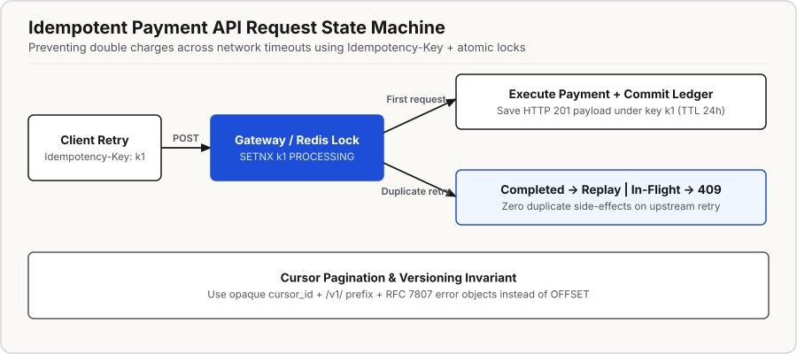
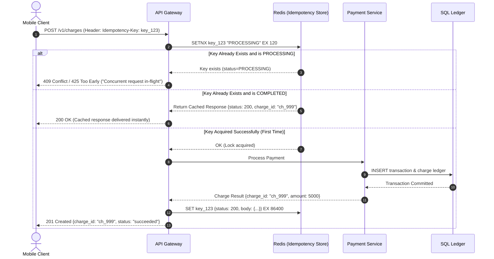

# Module 32: REST API Design & Idempotency

> Deep-dive architectural guide covering RESTful resource modeling, HTTP semantics, idempotent request semantics, idempotency key locking protocols, and safe retries in distributed systems.

---

## Prerequisites
Before diving into REST API design and idempotency, you should be familiar with:
* [01 - Client-Server Networking](../01-client-server-networking/README.md) (TCP, HTTP request/response lifecycles, and headers)
* [04 - API Gateways & Proxies](../04-api-gateways-and-proxies/README.md) (Reverse proxies, routing, and header mutation)
* [20 - Fault Tolerance & Resilience](../20-fault-tolerance-and-resilience/README.md) (Network retries, exponential backoff, and duplicate delivery)

---

## ELI5 (30-Second Summary)
Imagine ordering a pizza on a food delivery app with an unstable mobile connection. You tap "Submit Order" and charge \$30. The loading spinner spins, but before your phone gets a confirmation, your Wi-Fi flickers and cuts out. Did the restaurant get your order? Did your card get charged?

If you frantically tap "Submit Order" three more times without an **Idempotency Key**, you might get 4 pizzas and be billed \$120. With an **Idempotent API**, your client attaches a unique request token (`Idempotency-Key: req_abc123`). No matter how many times your phone retries that exact same token over network hiccups, the server processes the charge exactly once and returns the exact same stored receipt every time.

---

## Physical Analogy
Think of a **Postal Mailbox with an Anti-Theft One-Way Drop Slot**:

| Postal Analogy | REST & Idempotency Concept | Technical Description |
| :--- | :--- | :--- |
| **Tracking Number on Envelope** | `Idempotency-Key` Header | Client-generated UUID ensuring deduplication across retries. |
| **Mailbox Drop Slot** | API Endpoint / Route | Well-defined URI representing resources (`/orders`, `/payments`). |
| **Looking into the glass display** | `GET` Request | Safe, read-only operation; never modifies server state. |
| **Dropping a new letter** | `POST` Request | Unsafe, non-idempotent by default unless guarded by an idempotency layer. |
| **Replacing a form with an exact copy** | `PUT` Request | Idempotent by definition; overwrites state to identical target state. |
| **Tearing up an old registered letter** | `DELETE` Request | Idempotent; removing an already deleted item yields same terminal state. |
| **Postal Registry Log** | Idempotency KV Store | In-memory Redis store tracking key status (`PROCESSING`, `RESOLVED`). |

---

## The Problem It Solves
In distributed microservices, network communication is inherently unreliable (Fallacies of Distributed Computing #1: *The network is reliable*). When a client sends a mutating HTTP request (such as charging a credit card or issuing a bank transfer):
1. **Request Drops Before Server**: Server never received it; state didn't change.
2. **Server Crashes Mid-Execution**: State partially changed; client receives TCP RST or connection reset.
3. **Response Drops on the Return Path**: Server completed the mutation successfully, but the network connection timed out before the 200 OK reached the client.

Without idempotency, a client retry leads to double-billing, duplicate records, and corrupted ledger states. Idempotency guarantees that executing an operation multiple times produces identical server state as executing it once:

$$\forall x, \quad f(f(x)) = f(x)$$

---

## Visual Architecture

<p align="center">
  
</p>



---

## Real Numbers & System Sizing

Consider a global payment gateway like Stripe handling 2,000 payment API requests per second at peak:

* **Key Storage Size**: UUIDv4 string (36 bytes) + SHA-256 hash of payload (32 bytes) + Cached Response Body (1 KB) $\approx 1.1\text{ KB}$ per idempotency record.
* **Daily Volume**: $2,000\text{ req/s} \times 86,400\text{ s/day} \approx 172.8\text{ million requests/day}$.
* **Active Working Set (24-Hour Retention)**: $172.8\text{M} \times 1.1\text{ KB} \approx 190\text{ GB}$ of Redis memory required.
* **Storage Cluster**: A 3-node Redis cluster with 128 GB RAM per node with LRU eviction provides sub-millisecond duplicate checks ($< 1.2\text{ ms}$).

---

## Deep Dive: Under the Hood

### 1. HTTP Method Semantics
According to RFC 7231 / RFC 9110:
* **Safe Methods**: `GET`, `HEAD`, `OPTIONS`. Calling them creates no server state mutations.
* **Idempotent Methods**: `PUT` (full replacement), `DELETE` (removal), `GET`, `HEAD`. Calling them $N$ times has the same net side-effect as calling them once.
* **Non-Idempotent Methods**: `POST` (resource creation), `PATCH` (partial modification, e.g., append/increment operations).

### 2. The Idempotency Key Lifecycle
An enterprise idempotency engine implements a 4-state lifecycle:
1. **Acquire Atomic Lock (`SETNX`)**: When a request arrives with `Idempotency-Key`, the gateway attempts an atomic `SET key status=PROCESSING EX 60 NX`.
2. **Handle In-Flight Conflicts**: If `SETNX` returns 0 and status is `PROCESSING`, another thread or server is actively processing the payload. The gateway rejects the concurrent attempt with HTTP `409 Conflict` (or `425 Too Early`) and an advisory `Retry-After: 2` header.
3. **Payload Fingerprinting**: Along with the key, store a SHA-256 hash of the request path, verb, and body (`sha256(verb + path + body)`). If a subsequent request arrives with the same `Idempotency-Key` but a *different* body or target endpoint, immediately return HTTP `422 Unprocessable Entity` ("Idempotency key reused with different parameters").
4. **Commit & Cache**: Upon successful transaction completion, update the cache entry to `status=COMPLETED`, saving the HTTP status code, headers, and body with a 24-hour TTL. Subsequent retries return this exact payload without touching downstream databases.

---

## Trade-offs & Decision Matrix

| Mechanism | Pros | Cons | Best Used For |
| :--- | :--- | :--- | :--- |
| **No Idempotency Protection** | Zero storage overhead; simplest implementation | High risk of double-billing, duplicate rows, data corruption | Non-critical read APIs or internal telemetry ingestion |
| **Database Unique Constraints** | Guarantees uniqueness at DB engine level; ACID protected | High DB load; tight coupling to DB schema; cannot cache full HTTP response | Order IDs, user email registration, unique slug generation |
| **Distributed Cache Key Store (Redis)** | Sub-millisecond lookup; caches full response body; decoupled from backend | Requires Redis cluster maintenance; cache loss may allow duplicate execution | Public APIs, payment gateways, e-commerce checkout |
| **Optimistic Concurrency (ETags / Version)** | Prevents lost updates; standard HTTP protocol compliance | Client must manage and provide version headers (`If-Match`) | Resource updates, collaborative document editing |

---

## Common Pitfalls & Anti-Patterns

1. **Reusing Idempotency Keys Across Different Payloads**: A buggy client sends `Idempotency-Key: abc` for a \$10 transfer, and then reuses `abc` for a \$500 transfer. If the server does not validate the SHA-256 payload fingerprint, it will silently return the cached \$10 receipt without charging the \$500!
2. **Releasing the Lock on Downstream Timeout**: If the payment processor times out after 10 seconds, deleting the idempotency key allows the client to retry. But the payment processor may have actually charged the card! The key state must transition to `FAILED` or hold until reconciliation completes.
3. **Using URL Query Parameters for Mutating State**: Calling `GET /v1/delete_user?id=123` violates HTTP safety principles. Web crawlers and prefetch engines will trigger user deletions! Always use `DELETE` or `POST`.

---

## Try It Yourself
A runnable, zero-dependency Python simulation demonstrating RESTful endpoints, atomic idempotency locking, duplicate request prevention, payload hash collision detection, and cached replay is included in this directory.

Run the simulation:
```bash
python demo.py
```

---

## Production References & Further Reading
* [Stripe Engineering: Designing Robust and Predictable APIs with Idempotency](https://stripe.com/blog/idempotency)
* [IETF RFC 9110: HTTP Semantics - Section 9.2 (Idempotent Methods)](https://www.rfc-editor.org/rfc/rfc9110.html#section-9.2)
* [IETF Draft: The Idempotency-Key HTTP Header Field](https://datatracker.ietf.org/doc/draft-ietf-httpapi-idempotency-key-header/)
* [Google Cloud API Design Guide: Standard Methods and Custom Methods](https://cloud.google.com/apis/design)

---

## Top 5 Interview Questions with Model Answers

### Q1: What is the exact mathematical and architectural definition of an Idempotent API?
**Model Answer**: An API operation is idempotent if making multiple identical requests has the same net server state effect as making a single request. Formally, $f(f(x)) = f(x)$. In HTTP, `GET`, `PUT`, `DELETE`, and `HEAD` are defined as idempotent by specification. `POST` is non-idempotent by default because repeated invocations append or trigger additional resources or transactions. In distributed systems, non-idempotent endpoints are made idempotent by incorporating an `Idempotency-Key` header with atomic deduplication storage.

### Q2: Why is `POST` not idempotent, but `PUT` is idempotent?
**Model Answer**: `PUT` represents a complete resource replacement at a specific URI (`PUT /users/42`). If you execute `PUT /users/42` with `{ name: "Bob" }` ten times, the resource state on the database at `/users/42` remains identical after the 1st and 10th execution. In contrast, `POST /users` creates a new resource with a server-generated ID (`/users/101`, `/users/102`). Calling it ten times generates ten distinct database records and side effects.

### Q3: How do you handle concurrent requests that arrive with the exact same `Idempotency-Key` simultaneously?
**Model Answer**: When the first request arrives, the server executes an atomic `SETNX key "PROCESSING" EX <ttl>`. The first request acquires the lock and proceeds to business logic. The second concurrent request fails the `SETNX` check because the key already exists and holds the `PROCESSING` status. The server must immediately abort the second request and return HTTP `409 Conflict` (or `425 Too Early`), preventing two concurrent worker threads from charging the same customer in parallel.

### Q4: What happens if the client reuses an `Idempotency-Key` with a completely different request body?
**Model Answer**: The idempotency layer must compute a cryptographic hash (e.g., SHA-256) of the request verb, URI path, and serialized body upon key creation. When a repeat request arrives, the server verifies whether `sha256(current_body) == stored_hash`. If they do not match, the server must reject the request with HTTP `422 Unprocessable Entity` or `400 Bad Request`, signaling that an idempotency key cannot be mutated to execute a different operation.

### Q5: How do you implement idempotency at the database level without Redis?
**Model Answer**: Using a relational database table with an `idempotency_keys` table inside a local ACID transaction. The primary key or unique index on `idempotency_key` ensures that inserting an in-flight key fails immediately on duplicate submissions with a unique constraint violation, automatically aborting the transaction without mutating ledger balances (see companion `schema.sql` for full schema and transaction flow).

---

## Check Yourself Quiz

<details>
<summary><b>1. Which of the following HTTP methods is defined as safe AND idempotent by RFC specification?</b></summary>
A) POST<br/>
B) PATCH<br/>
C) GET<br/>
D) DELETE<br/><br/>
<b>Answer: C</b>. Safe methods do not alter server state. GET is both safe and idempotent. DELETE and PUT are idempotent but NOT safe because they mutate server state.
</details>

<details>
<summary><b>2. If a client receives a 504 Gateway Timeout on a payment POST request, what should it do?</b></summary>
A) Never retry; assume payment failed.<br/>
B) Retry the exact same request with the exact same Idempotency-Key.<br/>
C) Generate a new Idempotency-Key and retry.<br/>
D) Send a GET request to delete the account.<br/><br/>
<b>Answer: B</b>. A 504 indicates the gateway did not hear back from the upstream service in time. Retrying with the <i>exact same</i> Idempotency-Key guarantees that if the upstream did process the payment, the cached result is returned without double charging.
</details>

<details>
<summary><b>3. What HTTP status code should be returned if a request arrives with an Idempotency-Key that is currently in 'PROCESSING' state?</b></summary>
A) 200 OK<br/>
B) 500 Internal Server Error<br/>
C) 409 Conflict (or 425 Too Early)<br/>
D) 301 Moved Permanently<br/><br/>
<b>Answer: C</b>. HTTP 409 Conflict indicates that the request conflicts with an in-progress operation for that resource key.
</details>

<details>
<summary><b>4. How does ETags and `If-Match` provide idempotency and consistency during updates?</b></summary>
A) By encrypting the payload with RSA.<br/>
B) By ensuring optimistic concurrency control; the update only succeeds if the resource's current ETag matches the client's version.<br/>
C) By compressing the HTTP body with gzip.<br/>
D) By bypassing the API gateway directly to SQL.<br/><br/>
<b>Answer: B</b>. ETags implement optimistic locking over HTTP. If another client updated the resource in the interim, the ETag changes, and the update is rejected with 412 Precondition Failed.
</details>

<details>
<summary><b>5. Why should idempotency keys have an expiration time (TTL)?</b></summary>
A) Because Redis cannot store data permanently.<br/>
B) To prevent memory exhaustion while still covering the realistic retry window of clients (typically 24 to 72 hours).<br/>
C) To allow attackers to double-charge cards after 5 minutes.<br/>
D) Because HTTP headers expire automatically.<br/><br/>
<b>Answer: B</b>. Client network retries occur over seconds or minutes, occasionally hours. Keeping keys indefinitely would consume unbounded memory without operational benefit.
</details>
