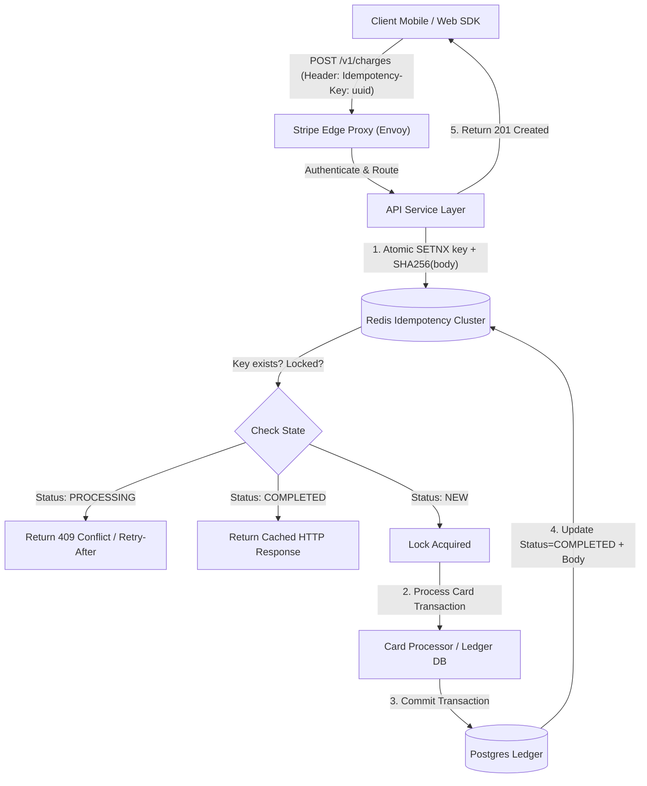
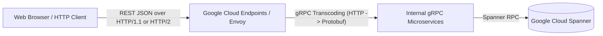
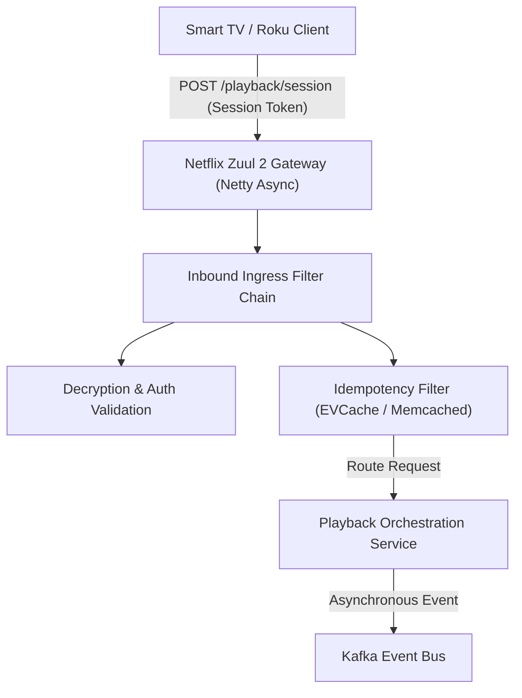

# Real-World Production Implementations: REST & Idempotency

> ⚠️ **Not yet source-checked.** These case studies summarize public engineering posts and talks, and some details may be simplified or wrong. Before you repeat a specific number or design in an interview, check it against the company's own write-up. Found an error, or a source that confirms a section? [Add it to the tracking issue](https://github.com/Aniketchavan7/system-design-illustrated/issues/9). Sourced fixes are the most welcome contribution here.

This document explores how engineering organizations implement REST architecture, HTTP standards, and distributed idempotency at hyperscale.

---

## 1. Stripe: The Industry Gold Standard for API Idempotency

### The Architecture
Stripe processes billions of dollars in volume every day. In distributed networks, mobile payment terminals and e-commerce checkouts frequently lose connectivity after issuing payments. Stripe solved this through their famous `Idempotency-Key` HTTP header.

### Key Technical Mechanisms
1. **Payload Fingerprinting**: Stripe hashes the request path and serialized parameters. If an API client submits `Idempotency-Key: abc` with `amount=1000` and later submits `Idempotency-Key: abc` with `amount=2000`, Stripe immediately responds with HTTP `400 Bad Request` or `422 Unprocessable Entity` ("Keys cannot be reused with different parameters").
2. **24-Hour TTL**: Idempotency keys are preserved for 24 hours in Redis. After 24 hours, the key is safely purged because client retry windows never realistically exceed 24 hours.
3. **Database Fallback**: In the rare event of a Redis cluster restart or eviction, Stripe's underlying primary database (PostgreSQL) maintains unique index constraints on `(account_id, idempotency_key)`, guaranteeing zero double-charges even under complete cache failure.

---

## 2. Google: Cloud API Design & gRPC-HTTP Transcoding

### The Architecture
Google's public services—including Google Cloud Platform (GCP), Google Maps, and YouTube—handle trillions of API calls daily. Google standardizes API design across the entire company using the **Google API Design Guide** and **gRPC Transcoding**.

### Key Technical Mechanisms
1. **AIP Standards (API Improvement Proposals)**: Google enforces strict naming conventions across all APIs:
   - Resource-oriented URLs: `https://pubsub.googleapis.com/v1/projects/{project}/topics/{topic}`
   - Standard methods: `List`, `Get`, `Create`, `Update`, `Delete`.
   - Custom methods: `POST https://service.googleapis.com/v1/{resource}:cancel` or `:batchGet`.
2. **Client-Assigned Request IDs (`requestId`)**: For mutating operations in Google Cloud Spanner and Storage, clients supply a client-generated UUID in the query parameter or JSON body (`requestId=...`). Google Cloud Spanner verifies this token inside atomic TrueTime read-write transactions, ensuring exactly-once execution across globally replicated datacenters.
3. **HTTP-to-gRPC Transcoding**: Engineers define service contracts once in Protocol Buffers (`.proto`). Google's reverse proxy automatically maps REST HTTP verbs to gRPC RPC methods:
   - `GET /v1/books/{id}` $\rightarrow$ `rpc GetBook(GetBookRequest)`
   - `POST /v1/books` $\rightarrow$ `rpc CreateBook(CreateBookRequest)`

---

## 3. Netflix: Zuul Gateway & Distributed Chaos Retries

### The Architecture
Netflix's streaming ecosystem spans thousands of heterogeneous client devices (Smart TVs, gaming consoles, Apple iOS, Android, Roku) that communicate with hundreds of backend microservices via **Zuul API Gateway**.

### Key Technical Mechanisms
1. **Network Chaos Resilience**: Netflix's Chaos Monkey routinely terminates backend instances and drops TCP packets. If a Smart TV client fails to receive a playback session response due to an injected network partition, the Netflix client library automatically retries the request with exponential backoff and jitter using the original session handshake key.
2. **EVCache Deduplication**: The Zuul gateway uses Netflix's globally distributed Memcached architecture (**EVCache**) to detect and eliminate duplicate playback session initializations within milliseconds.
3. **Stateless Fallbacks**: For read endpoints (`GET /catalog/trending`), if backend services fail or time out, Zuul falls back to a warm pre-computed cached response rather than propagating a 500 error to millions of watching subscribers.
