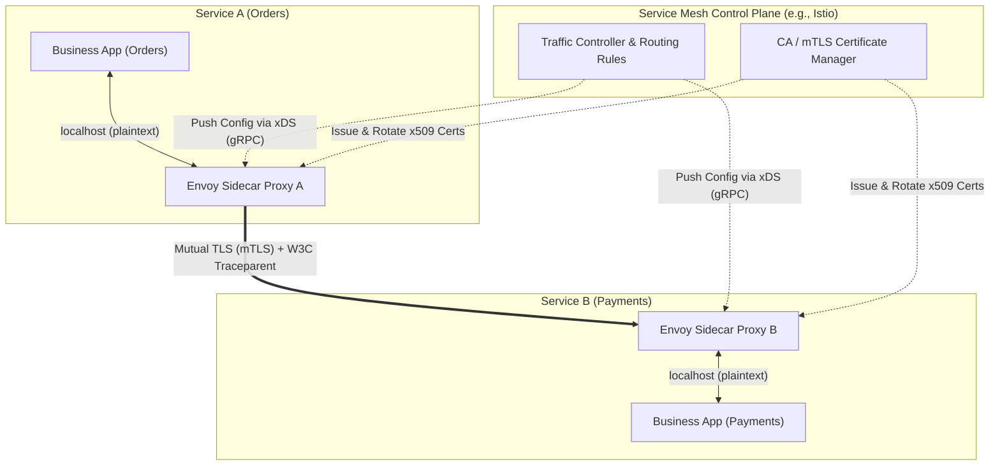

# Module 33: Microservices & Service Mesh

> Deep-dive architectural guide covering microservices decomposition, service discovery, sidecar proxies, distributed tracing, and service mesh data/control planes (Envoy & Istio).

---

## Prerequisites
Before diving into microservices and service meshes, you should be familiar with:
* [03 - Load Balancing](../03-load-balancing/README.md) (Client-side vs server-side load balancing)
* [04 - API Gateways & Proxies](../04-api-gateways-and-proxies/README.md) (Edge routing vs east-west internal traffic)
* [20 - Fault Tolerance & Resilience](../20-fault-tolerance-and-resilience/README.md) (Circuit breakers, deadlines, and fallback strategies)

---

## ELI5 (30-Second Summary)
Imagine a giant restaurant with 100 specialized chefs (one chops onions, one makes pasta, one plates desserts). In a traditional monolith, all 100 chefs share one giant kitchen table; if one chef spills soup on the floor, the entire kitchen halts.

In a **Microservices Architecture**, each chef has their own independent mini-kitchen with separate utensils, ingredients, and electrical breakers. 
However, having 100 independent kitchens creates chaos: how do chefs talk to each other? What if the sauce chef doesn't speak the dessert chef's language? What if the pasta chef gets overloaded?

A **Service Mesh** gives every chef a dedicated personal assistant (a **Sidecar Proxy**). Whenever Chef A wants to send ingredients to Chef B, Chef A hands it to their assistant. The assistants automatically find Chef B's room, check Chef B's health, encrypt the transport, handle retries if Chef B drops a spoon, and log the delivery time—allowing the chefs to focus 100% on cooking!

---

## Physical Analogy
Think of a **Diplomatic Embassy Corps with Dedicated Interpreters**:

| Embassy Analogy | Microservices & Service Mesh Concept | Technical Description |
| :--- | :--- | :--- |
| **Individual Diplomats** | Microservice Instances | Single-purpose application code (Payments, Catalog, Inventory). |
| **Personal Interpreters / Security Detail** | Sidecar Proxy (Envoy) | Co-located process intercepting all inbound and outbound network traffic. |
| **Ministry of Foreign Affairs** | Service Mesh Control Plane (Istio) | Central controller broadcasting routing rules, mTLS certs, and configurations. |
| **Diplomatic Phone Directory** | Service Registry (Consul / Eureka) | Dynamic lookup of healthy instance IP addresses and ports. |
| **Sealed Diplomatic Pouch** | Mutual TLS (mTLS) | Hardware-backed, zero-trust end-to-end encryption between services. |
| **Numbered Diplomatic Dispatch Stamp** | Distributed Tracing (`traceparent`) | W3C standardized header tracing a request across 20 hops. |

---

## The Problem It Solves
As organizations scale beyond hundreds of developers, monolithic applications suffer from:
1. **Deployment Lockstep**: A one-line bug in the recommendation engine blocks the critical checkout service deployment.
2. **Coupled Failures**: A memory leak in one component crashes the entire process for all features.
3. **Library Fatigue ("SDK Hell")**: In early microservices, every language (Java, Go, Node.js, Python) needed separate client libraries for retry logic, circuit breaking, distributed tracing, and mTLS. When a security patch or retry policy changed, thousands of codebases required recompilation and redeployment.

A **Service Mesh** extracts all networking, observability, security, and traffic control out of application code into the infrastructure layer via **Sidecar Proxies**.

---

## Visual Architecture



---

## Real Numbers & Latency Overhead

Adding a sidecar proxy introduces two extra network hops on `localhost` per inter-service call:
* **Proxy Latency Overhead**: A modern Envoy sidecar proxy adds **$\approx 0.8\text{ ms}$ to $1.8\text{ ms}$** of p99 latency per hop under high load.
* **CPU & Memory Footprint**: Envoy typically requires $50\text{ MB} - 120\text{ MB}$ of RAM per container pod and $0.1$ to $0.25$ vCPU cores.
* **Scale Consideration**: In an enterprise cluster with 2,000 microservice pods, 2,000 sidecar proxies consume $\approx 200\text{ GB}$ of RAM and hundreds of CPU cores purely for traffic mediation.
* **Decision Rule**: Adopt a full service mesh only when microservice count exceeds 20-30 services and multi-language polyglot routing, mTLS, or canary releases become unmanageable with centralized API gateways.

---

## Deep Dive: Under the Hood

### 1. The Data Plane vs. The Control Plane
* **Data Plane**: Composed of high-performance proxies (primarily **Envoy**) deployed as sidecars alongside every service instance. It intercepts every inbound and outbound TCP/HTTP packet, performing:
  - Dynamic service discovery and client-side load balancing.
  - Health checks and outlier detection (ejection of failing nodes).
  - Mutual TLS (mTLS) encryption and certificate verification.
  - Telemetry collection (metrics, logs, distributed trace spans).
* **Control Plane** (e.g., **Istio Pilot/Istiod**): Translates human-readable routing configurations (e.g., "Route 10% of traffic to Payments v2") into machine-readable configs and streams them dynamically to thousands of Envoy proxies using the **xDS protocol** (gRPC stream) without restarting proxies.

### 2. Distributed Tracing Mechanics
When a user clicks "Checkout", a single user action may traverse 15 downstream microservices. To debug a slow request, distributed tracing attaches standardized W3C trace headers:
* `traceparent: 00-4bf92f3577b34da6a3ce929d0e0e4736-00f067aa0ba902b7-01`
  - `00`: Protocol version.
  - `4bf92f35...`: 16-byte global **Trace ID** (shared across all hops).
  - `00f067aa...`: 8-byte **Span ID** (unique identifier for this specific hop).
  - `01`: Trace flags (sampled / recorded).

Every microservice or sidecar proxy logs the start and finish timestamp of its Span, reporting them to a collector (Jaeger, Zipkin, OpenTelemetry).

---

## Trade-offs & Decision Matrix

| Dimension | Monolithic Architecture | Traditional Microservices (SDKs) | Service Mesh (Envoy/Istio) |
| :--- | :--- | :--- | :--- |
| **Network Overhead** | In-memory function call ($< 1\text{ µs}$) | 1 network hop ($2-5\text{ ms}$) | 3 hops: App $\rightarrow$ Sidecar $\rightarrow$ Sidecar $\rightarrow$ App ($4-8\text{ ms}$) |
| **Polyglot Support** | Single language / runtime | Painful (must build libraries in Go, Java, Python) | Universal (language-agnostic proxy operates at L4/L7) |
| **Operational Complexity** | Low (single build/deploy unit) | Medium (separate deployments, service discovery) | High (requires Kubernetes, control plane, telemetry pipelines) |
| **Blast Radius** | High (single crash brings down whole app) | Low (isolated processes) | Minimal (isolated processes with circuit breaking) |

---

## Common Pitfalls & Anti-Patterns

1. **Distributed Monolith**: Decomposing a monolith into 50 microservices that all share the exact same PostgreSQL database. Any schema change still requires synchronous coordinated deployments, and DB locks cascade across all services! *Rule: Each microservice must own its own private database.*
2. **Deep Synchronous Call Chains (Death Cascades)**: Service A calls B, which calls C, which calls D, which calls E. If Service E slows down by 2 seconds, all 5 services hold open connections, running out of thread pools and collapsing the entire stack. *Fix: Use asynchronous event-driven messaging (Kafka/RabbitMQ) for non-critical paths.*
3. **Adopting Service Mesh Too Early**: Installing Istio on a 4-service startup application adds massive operational complexity, debugging pain, and latency overhead without solving any real business bottleneck.

---

## Try It Yourself
A runnable, zero-dependency Python simulation demonstrating microservices orchestration, dynamic service registration, client-side load balancing, distributed tracing propagation, and circuit breaker tripping is included in this directory.

Run the simulation:
```bash
python demo.py
```

---

## Production References & Further Reading
* [Envoy Proxy Architecture & Threading Model](https://www.envoyproxy.io/docs/envoy/latest/intro/arch_overview/arch_overview)
* [Istio Service Mesh Architecture Guide](https://istio.io/latest/docs/concepts/what-is-istio/)
* [Martin Fowler: Microservices Definition and Trade-offs](https://martinfowler.com/articles/microservices.html)
* [W3C Recommendation: Trace Context Specification](https://www.w3.org/TR/trace-context/)

---

## Top 5 Interview Questions with Model Answers

### Q1: What is the difference between an API Gateway and a Service Mesh?
**Model Answer**: An **API Gateway** manages North-South traffic (traffic originating from external clients such as web browsers and mobile apps entering the cluster). It handles public authentication, rate limiting, SSL termination, and API monetization. A **Service Mesh** manages East-West traffic (internal service-to-service communication within the data center). It operates via sidecar proxies deployed alongside containers to handle mTLS encryption, internal retries, circuit breaking, and distributed tracing transparently without application code changes.

### Q2: How does a Service Mesh implement Mutual TLS (mTLS) without application changes?
**Model Answer**: When Service A sends an HTTP request to Service B, Service A's application code opens a plaintext connection to its local sidecar proxy on `localhost`. The local sidecar intercepts the packet, wraps it in an encrypted TLS tunnel with an x509 client certificate issued by the mesh Control Plane (e.g., Istio Citadel), and sends it across the network to Service B's pod. Service B's sidecar proxy terminates the TLS connection, validates Service A's identity and certificate, and forwards the decrypted plaintext request to Service B's application container on `localhost`.

### Q3: What is the "Database-per-Service" pattern and why is it mandatory in microservices?
**Model Answer**: The Database-per-Service pattern dictates that each microservice must have its own private, dedicated datastore inaccessible to other services. Other services can only read or mutate that data by calling the service's public API. This ensures:
1. Loose coupling: Internal schema changes do not break external consumers.
2. Independent scaling: Read-heavy services can use Elasticsearch or Redis while transaction-heavy services use PostgreSQL.
3. Resilience: A failure, deadlock, or slow query in one service cannot exhaust connection pools or crash the databases of other microservices.

### Q4: How do you maintain data consistency across multiple microservices without 2-Phase Commit (2PC)?
**Model Answer**: In microservices, distributed 2-Phase Commit (2PC) is an anti-pattern because it holds database locks across network boundaries, severely degrading availability and throughput (CAP theorem). Instead, modern architectures use the **Saga Pattern**:
- A sequence of local ACID transactions.
- Each transaction updates data within a single service and publishes an event or message.
- If a subsequent step fails (e.g., payment rejected), the Saga orchestrator or event bus triggers **Compensating Transactions** that undo preceding steps (e.g., releasing reserved inventory).

### Q5: How does the Circuit Breaker pattern prevent cascading failures in a microservice mesh?
**Model Answer**: A Circuit Breaker monitors the failure rate and latency of downstream calls. It operates in three states:
1. **Closed**: Normal operation; requests pass through. If error rate exceeds a threshold (e.g., 50% failures over 10 seconds), the circuit trips to **Open**.
2. **Open**: The proxy fails fast immediately without making the network call, returning a cached response, fallback, or 503 error, saving CPU and thread pools.
3. **Half-Open**: After a cooldown period (e.g., 15s), the breaker allows a small probe percentage of requests through. If they succeed, the circuit returns to **Closed**; if they fail, it returns to **Open**.

---

## Check Yourself Quiz

<details>
<summary><b>1. What is the primary role of the Data Plane in a Service Mesh?</b></summary>
A) Store persistent customer database tables.<br/>
B) Intercept, route, encrypt, and measure network traffic at every pod via sidecar proxies.<br/>
C) Compile Go and Java code into binaries.<br/>
D) Issue developer access tokens.<br/><br/>
<b>Answer: B</b>. The Data Plane (typically Envoy) intercepts and processes all network packets directly in the data path.
</details>

<details>
<summary><b>2. In distributed tracing, what is the difference between a Trace ID and a Span ID?</b></summary>
A) Trace ID is for SQL queries; Span ID is for HTTP.<br/>
B) Trace ID identifies the entire end-to-end user request across all services; Span ID identifies a single operation within a specific service.<br/>
C) They are identical interchangeable strings.<br/>
D) Span ID identifies the database version.<br/><br/>
<b>Answer: B</b>. A Trace ID connects the entire distributed graph of calls, while each individual hop or sub-operation gets a distinct Span ID.
</details>

<details>
<summary><b>3. Why is 2-Phase Commit (2PC) rarely used for inter-microservice transactions?</b></summary>
A) Because 2PC is not supported on Linux.<br/>
B) Because 2PC is a blocking protocol that holds locks across network partitions, destroying system availability and latency.<br/>
C) Because 2PC requires SSL encryption.<br/>
D) Because microservices do not use SQL.<br/><br/>
<b>Answer: B</b>. 2PC holds locks until all nodes vote, meaning any network partition or slow node locks all participants indefinitely. Sagas with compensating transactions are preferred.
</details>

<details>
<summary><b>4. What protocol does Istio's Control Plane use to push dynamic route configurations to Envoy proxies?</b></summary>
A) FTP<br/>
B) xDS APIs over gRPC<br/>
C) Telnet<br/>
D) DNS TXT records<br/><br/>
<b>Answer: B</b>. Envoy defines the xDS (discovery service) suite of APIs (LDS, RDS, CDS, EDS) streamed via bidirectional gRPC.
</details>

<details>
<summary><b>5. Which architectural pattern prevents one slow microservice from draining the thread pool of upstream callers?</b></summary>
A) Monolithic compilation<br/>
B) Circuit Breaker & Timeout Deadlines<br/>
C) DNS Caching<br/>
D) Round-Robin DNS<br/><br/>
<b>Answer: B</b>. Circuit breakers and aggressive deadlines fail fast when a downstream dependency is unhealthy, keeping upstream threads alive.
</details>
