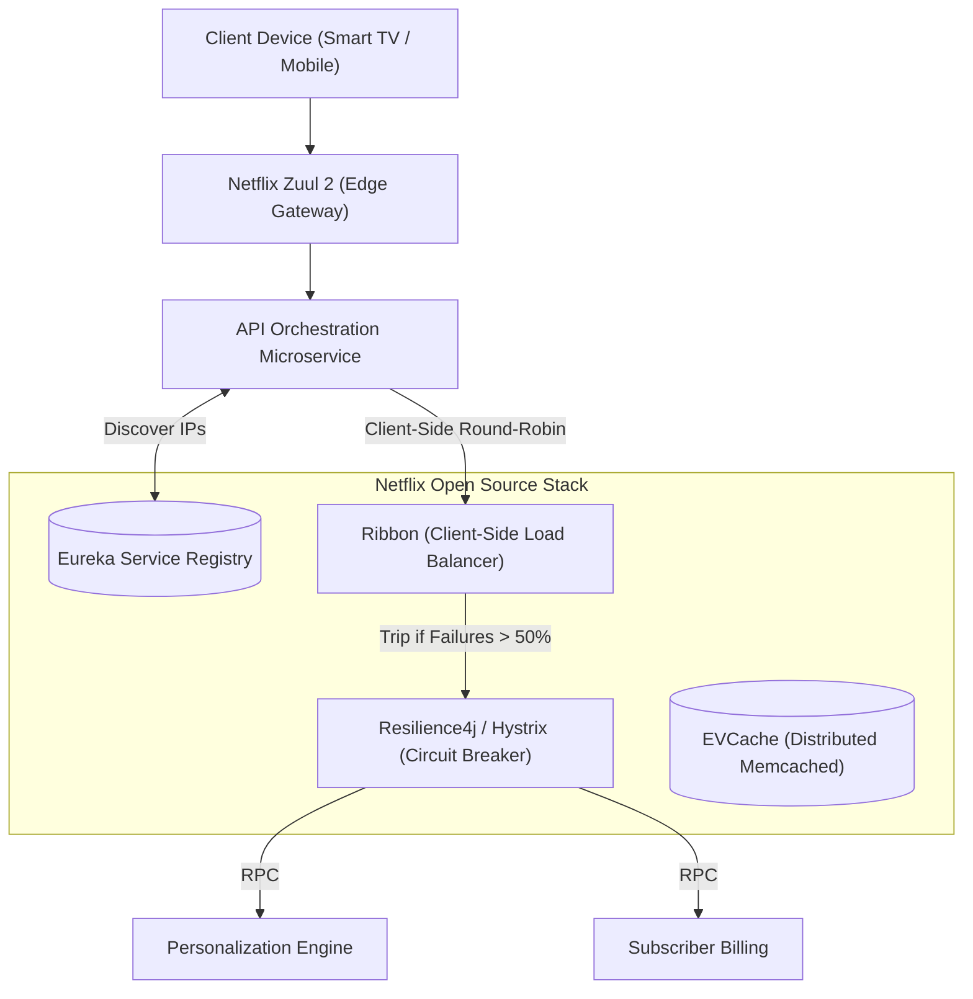
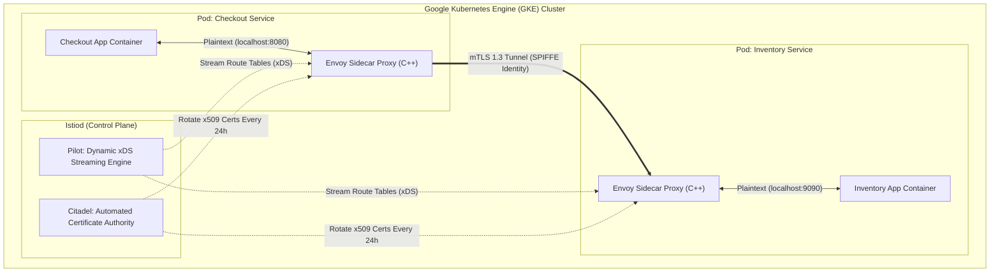

# Real-World Production Implementations: Microservices & Service Mesh

This document explores how Netflix and Google build, deploy, connect, and observe microservice ecosystems at global scale.

---

## 1. Netflix: The Pioneer of Microservices & Spring Cloud OSS

### The Architecture
Netflix transitioned from a monolithic datacenter architecture to AWS microservices starting in 2008. Today, Netflix runs over **1,000 distinct microservices** executing tens of billions of daily inter-service calls.

### Key Technical Mechanisms
1. **Eureka (Service Discovery)**:
   - Microservices register on boot with Eureka servers and send heartbeats every 30 seconds.
   - Eureka favors **Availability over Consistency** (AP system under CAP). If network partitions occur, Eureka keeps stale registrations active rather than dropping them, preventing self-induced cascading outages.
2. **Hystrix & Fallback Cascades**:
   - Every downstream RPC call is wrapped in a thread-pool-isolated or semaphore-isolated Hystrix command.
   - If the Personalized Recommendations microservice fails or times out (exceeding 200 ms), Hystrix trips its circuit breaker and immediately returns a static fallback list of globally popular movies (`Top 10 in the US`), guaranteeing the homepage never displays a blank screen or error spinner.
3. **Mantis & Edgar (Distributed Tracing)**:
   - Netflix built **Edgar**, a system for tracking requests end-to-end across hundreds of microservices. Edgar attaches session IDs and trace headers to capture logs across microservices and diagnose latency regressions for individual user sessions.

---

## 2. Google: The Birth of Envoy, gRPC, and Istio Service Mesh

### The Architecture
Inside Google, tens of thousands of microservices run on Google's internal container orchestrator (**Borg**, the predecessor of Kubernetes). Google communicates almost exclusively via **Stubby** (the internal precursor to **gRPC**). To standardize traffic across external cloud customers, Google co-created **Istio** on top of Lyft's **Envoy Proxy**.

### Key Technical Mechanisms
1. **Envoy Proxy Data Plane**:
   - Written in high-performance C++ with an event-driven, non-blocking asynchronous architecture (libevent).
   - Incurs negligible CPU overhead while processing hundreds of thousands of requests per second per node.
   - Manages connection pools, HTTP/2 multiplexing, active health checks, and outlier detection (automatically evicting instances that return consecutive 5xx errors).
2. **Zero-Trust SPIFFE Identity & Mutual TLS**:
   - Google enforces zero-trust security inside the cluster. Every microservice receives a cryptographic identity document formatted as a SPIFFE ID:
     `spiffe://cluster.local/ns/production/sa/checkout-service-account`
   - Envoy automatically negotiates mTLS 1.3 encryption on every packet, authenticating both the client and server identities and rejecting unauthorized traffic before it ever touches application code.
3. **xDS Dynamic Configuration Streaming**:
   - Envoy does not reload config files on disk. Instead, the Istio control plane streams updates dynamically over persistent bidirectional gRPC streams using the **xDS protocol**:
     - **LDS (Listener Discovery Service)**: Ports and ingress listeners.
     - **RDS (Route Discovery Service)**: Virtual hosts and URL traffic splits (e.g., 90% v1, 10% v2 canary).
     - **CDS (Cluster Discovery Service)**: Upstream service clusters.
     - **EDS (Endpoint Discovery Service)**: Live healthy IP addresses of pods.
