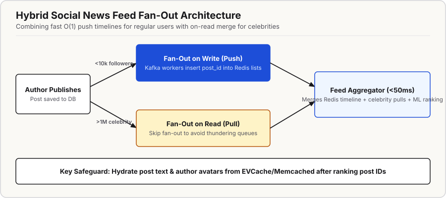

# Module 34: System Design — News Feed System

> Comprehensive architectural breakdown of a large-scale News Feed service (Twitter/X, Facebook/Instagram), covering Fan-out-on-Write (Push), Fan-out-on-Read (Pull), Hybrid Celebrity fanout models, and Redis timeline ranking.

---

## Prerequisites
Before tackling the news feed system, review these core modules:
* [10 - Caching Patterns](../10-caching-patterns/README.md) (Cache-aside, write-through, and timeline storage)
* [16 - Consistent Hashing](../16-consistent-hashing/README.md) (Partitioning feed queues across Redis nodes)
* [17 - Message Queues](../17-message-queues/README.md) (Asynchronous fanout worker pools)
* [28 - Distributed Unique ID Generator](../28-distributed-unique-id-generator/README.md) (Time-sortable Snowflake 64-bit IDs)

---

## ELI5 (30-Second Summary)
Imagine you write a short letter to your 10 friends. You can either walk to each friend's house and drop a copy in their mailbox (**Push / Fan-out-on-Write**), or your friends can walk to your house every morning and read what you wrote on your front porch chalkboard (**Pull / Fan-out-on-Read**).

Push is great because when your friends wake up, their mailboxes are already full—reading their feed is instantaneous! But what if you are a superstar celebrity with 100 million fans? If you post a letter, walking to 100 million houses creates a traffic jam that crashes the city.

A **Hybrid News Feed** pushes posts to regular friends' mailboxes instantly, but for mega-celebrities, fans fetch their posts only when they open the app and merge them into their timeline on the fly!

---

## Physical Analogy
Think of a **Suburban Postal Route vs. Central Newspaper Kiosk**:

| Physical Analogy | News Feed Architecture Concept | Technical Description |
| :--- | :--- | :--- |
| **Author writing an article** | Post Publishing API (`POST /v1/feed`) | Ingests post content, media references, and metadata. |
| **Suburban Mail carrier** | Fan-out Worker Pool (Async Queue) | Reads follower list and pushes post ID into follower inbox caches. |
| **Personal Home Mailbox** | User Feed Timeline (Redis Sorted Set `ZSET`) | Stores pre-computed list of Post IDs sorted by timestamp/rank. |
| **Celebrity Newspaper Kiosk** | Celebrity Outbox Cache (Pull Fan-out) | Standalone feed buffer read on-demand during timeline fetch. |
| **Reading today's breakfast mail** | Feed Retrieval API (`GET /v1/feed`) | Pulls top 20 Post IDs from Redis, hydrating full posts from KV cache. |

---

## The Problem It Solves
Social networks with hundreds of millions of daily active users (DAUs) face severe asymmetric read/write traffic:
1. **Massive Read Dominance**: Users read their feed 50x to 100x more often than they post ($100:1$ read-to-write ratio).
2. **Sub-100ms Latency Expectation**: When a user launches the app, their timeline must render within 100 milliseconds. Joining thousands of followee tables via relational SQL `SELECT * FROM posts WHERE user_id IN (SELECT followee_id...) ORDER BY created_at DESC` locks tables and takes dozens of seconds at scale.
3. **The Celebrity "Hotspot" Problem**: A user with 80 million followers publishing a post requires 80 million database/cache write operations in seconds, overwhelming worker queues.

---

## Visual Architecture

```mermaid
flowchart TD
    subgraph PublishingPath["1. Post Publishing Flow (Fan-out on Write)"]
        ClientPost["User Client"] -->|"POST /v1/posts"| Gateway["API Gateway / LB"]
        Gateway --> PostSvc["Post Service"]
        PostSvc --> DBPost[("Post DB / Blob Store")]
        PostSvc --> FanoutQueue["Kafka / RabbitMQ (Fanout Queue)"]
        FanoutQueue --> FanoutWorkers["Fanout Worker Pool"]
        FanoutWorkers --> FollowerSvc["Graph Service (Get Followers)"]
        FollowerSvc --> FilterCeleb{"Is Author Celebrity (>10k)?"}
        FilterCeleb -->|"No (Normal User)"| PushRedis["Push Post ID to Follower Timelines (Redis ZSET)"]
        FilterCeleb -->|"Yes (Celebrity)"| SkipPush["Write ONLY to Celebrity Outbox Cache"]
    end

    subgraph ReadingPath["2. Feed Generation Flow (Hybrid Merge)"]
        ClientRead["User Client"] -->|"GET /v1/feed?page=1"| FeedSvc["News Feed Service"]
        FeedSvc --> ReadZset["1. Fetch Top 100 Post IDs from User's Redis ZSET"]
        FeedSvc --> FetchCeleb["2. Query Followed Celebrities' Outboxes"]
        FeedSvc --> MergeSort["3. K-Way Merge & Rank Candidates"]
        MergeSort --> Hydrate["4. Hydrate Post Bodies & User Data from Memcached"]
        Hydrate --> ReturnJSON["5. Return Enriched JSON to Client"]
    end
```

<p align="center">
  
</p>



---

## Real Numbers & System Sizing

Consider a platform like Twitter or Instagram with **300 Million Daily Active Users (DAU)**:
* **Posting Volume**:
  - Average posts per user: 2 posts/day.
  - Total posts/day: $300\text{M} \times 2 = 600\text{ million posts/day}$.
  - Average write QPS: $600\text{M} / 86,400 \approx 7,000\text{ posts/second}$.
  - Peak write QPS: $7,000 \times 2 = 14,000\text{ writes/second}$.
* **Feed Generation / Read Volume**:
  - Average feed views per user: 10 views/day.
  - Read QPS: $(300\text{M} \times 10) / 86,400 \approx 35,000\text{ QPS}$.
  - Peak read QPS: $\approx 70,000\text{ reads/second}$.
* **Fan-out Amplification**:
  - If average user has 200 followers:
  - Fan-out write rate: $7,000\text{ posts/s} \times 200 = 1.4\text{ million timeline updates/second}$!
* **Memory Sizing for Timelines (Redis ZSET)**:
  - Keep top 800 post IDs in each active user's timeline.
  - 8-byte Snowflake Post ID + 8-byte score (timestamp) = 16 bytes per entry.
  - $800 \times 16\text{ bytes} \approx 12.8\text{ KB}$ per user timeline.
  - For 300 million active users: $300\text{M} \times 12.8\text{ KB} \approx 3.84\text{ TB}$ of RAM.
  - A Redis cluster of 32 nodes with 128 GB RAM each comfortably handles this in-memory with redundancy.

---

## Deep Dive: Under the Hood

### 1. Fan-Out on Write (Push Model)
* **How it works**: When Alice posts, a background worker queries the social graph for Alice's 200 followers and inserts `alice_post_id` directly into each follower's Redis timeline (`ZADD timeline:user_bob <timestamp> <post_id>`).
* **Pros**: Reading feeds is lightning fast ($O(1)$ to $O(k)$ Redis range query).
* **Cons**: Write amplification. If a celebrity with 50 million followers posts, the worker must execute 50,000,000 cache writes. If inactive users never open the app, those computed timelines represent wasted CPU and RAM.

### 2. Fan-Out on Read (Pull Model)
* **How it works**: Timelines are never pre-computed. When Bob opens the feed, the server fetches the latest posts from all 500 people Bob follows, merges them by timestamp, and returns the top 20.
* **Pros**: Zero write amplification; inactive users consume zero processing power.
* **Cons**: Reading is extremely slow and compute-heavy ($O(N \log k)$ merge over hundreds of followee streams at read time).

### 3. The Hybrid Celebrity Model (Industry Standard)
* Users with $< 10,000$ followers use **Fan-out on Write**.
* Celebrities/Influencers with $> 10,000$ followers use **Fan-out on Read**.
* When Bob opens his feed:
  1. The server fetches Bob's pre-computed Redis timeline (containing posts from his regular friends).
  2. The server queries the outbox caches of the 3 celebrities Bob follows.
  3. The server performs an in-memory $K$-way merge sort across these streams to assemble the final ranked feed.

---

## Trade-offs & Decision Matrix

| Dimension | Fan-out on Write (Push) | Fan-out on Read (Pull) | Hybrid Push-Pull Model |
| :--- | :--- | :--- | :--- |
| **Read Latency** | Ultra-low ($< 10\text{ ms}$) | High ($200 - 800\text{ ms}$) | Very low ($15 - 30\text{ ms}$) |
| **Write Latency / Load** | Massive write amplification | Minimal ($O(1)$ post insert) | Balanced & predictable |
| **Celebrity Handling** | Catastrophic (queue backlogs) | Excellent | Excellent (special outbox routing) |
| **Resource Utilization** | High RAM (stores dormant feeds) | High CPU during read spikes | Optimal (RAM for active, CPU on-demand) |

---

## Common Pitfalls & Anti-Patterns

1. **Hydrating Full Post Objects in the Timeline Queue**: Storing the entire post JSON (text, comments, author profile) inside the follower's Redis ZSET multiplies storage by 1,000x. *Rule: Only store 64-bit Post IDs in the feed timeline; hydrate full post objects from Memcached/Redis KV cache only for the paginated window being viewed.*
2. **Infinite Timeline Retention**: Keeping years of post history in Redis. Most users only browse the most recent 500-1,000 posts. Set a hard limit on Redis ZSET size (`ZREMRANGEBYRANK user:timeline 0 -801`).
3. **Synchronous Fanout in Web Request Handler**: Iterating over followers inside the HTTP `POST /posts` handler blocks the client for minutes. Fanout must always be decoupled into an asynchronous message queue (Kafka).

---

## Try It Yourself
A runnable, zero-dependency Python simulation demonstrating normal user fanout-on-write, celebrity fanout-on-read outbox routing, and real-time hybrid feed merge ranking is included in this directory.

Run the simulation:
```bash
python demo.py
```

---

## Production References & Further Reading
* [Twitter Engineering: Timelines at Scale](https://blog.twitter.com/engineering/en_us/topics/infrastructure/2013/timelines-at-scale)
* [Facebook Engineering: Serving Large-Scale Social Graph Data with Tao](https://www.usenix.org/conference/atc13/technical-sessions/presentation/bronson)
* [Alex Xu: System Design Interview Vol 1 - Chapter 11 (Design a News Feed System)](https://bytebytego.com)

---

## Top 5 Interview Questions with Model Answers

### Q1: How do you handle the "Celebrity Problem" (Hotspot) in a News Feed system?
**Model Answer**: The celebrity problem occurs when an account with millions of followers publishes a post, causing write amplification that chokes message queues. We solve this using a **Hybrid Fan-out Model**:
- Regular users ($< 10\text{k}$ followers) use fan-out on write (pushing Post IDs to follower inboxes upon publishing).
- Celebrities ($> 10\text{k}$ followers) bypass the follower queue entirely; their posts are written only to their personal outbox cache.
- When a follower requests their feed, the system fetches their pre-computed inbox and merges it with the outbox streams of the celebrities they follow using an in-memory priority queue ($K$-way merge).

### Q2: What data structure in Redis is ideal for user news feeds and why?
**Model Answer**: Redis **Sorted Sets (`ZSET`)** are optimal. The member is the unique 64-bit `post_id`, and the score is the integer timestamp (or ranking score). 
- Insertion is $O(\log N)$ via `ZADD`.
- Pagination is instantaneous via `ZREVRANGEBYSCORE` or `ZREVRANGE` ($O(\log N + M)$ where $M$ is the page size of 20 items).
- Trimming old items to enforce an 800-item cap is $O(\log N)$ using `ZREMRANGEBYRANK`.

### Q3: How do you support non-chronological ranked feeds (e.g., machine learning relevance scoring)?
**Model Answer**: Feed ranking operates in a multi-stage pipeline:
1. **Candidate Retrieval**: Fetch the top 500-1,000 recent candidate post IDs from the user's hybrid inbox.
2. **Feature Hydration**: Enrich candidate IDs with author authority, user affinity score, post engagement (likes, comments, recency), and media type.
3. **ML Scoring Model**: Pass feature vectors through a lightweight ranking model (e.g., GBDT or deep neural network) to output an affinity probability $P(\text{click})$.
4. **Re-sorting & Delivery**: Sort the candidate items by score, apply business heuristics (e.g., diversity rules preventing 5 consecutive videos), and return the top 20 to the client.

### Q4: How do you paginate a news feed reliably without missing or duplicating posts?
**Model Answer**: Traditional offset-based pagination (`OFFSET 20 LIMIT 20`) fails in real-time feeds because new posts inserted at the top shift indices, causing duplicate or skipped items across pages. We use **Cursor-Based Pagination** using time-sortable Snowflake IDs:
- The client requests `GET /v1/feed?limit=20&cursor=1789234812349000`.
- The server queries `ZREVRANGEBYSCORE timeline <cursor> -inf LIMIT 1 20`.
- Because Snowflake IDs are monotonically increasing with time, cursor pagination remains completely stable regardless of newly arriving posts.

### Q5: How do you manage timeline storage for inactive users who haven't opened the app in months?
**Model Answer**: We implement **Active User Gating**:
- If a user has not authenticated in 30 days, we mark them as inactive in the user profile table and evict their Redis timeline to reclaim RAM.
- When an author publishes a post, the fanout worker checks follower activity status and skips inactive followers.
- When an inactive user logs back in, we dynamically reconstruct their timeline on demand (Fan-out on Read) by pulling the last 30 days of posts from their followees, seeding their Redis ZSET before returning the feed.

---

## Check Yourself Quiz

<details>
<summary><b>1. Why is Fan-out on Write preferred for read-heavy social platforms with standard users?</b></summary>
A) Because it eliminates the need for database storage.<br/>
B) Because it converts expensive multi-table read joins into instantaneous O(1) cache lookups at read time.<br/>
C) Because it requires zero message queues.<br/>
D) Because it avoids using Redis.<br/><br/>
<b>Answer: B</b>. By pre-computing timelines at write time, user reads are instant cache lookups, satisfying sub-100ms mobile expectations.
</details>

<details>
<summary><b>2. Why should full post content NOT be stored directly in follower timeline caches?</b></summary>
A) Redis cannot store text.<br/>
B) Storing full posts across millions of follower lists causes massive data redundancy and memory exhaustion; storing only 64-bit Post IDs saves 95%+ RAM.<br/>
C) Post content must be encrypted with SSL inside Redis.<br/>
D) Because post IDs cannot be indexed.<br/><br/>
<b>Answer: B</b>. Storing only the 8-byte ID reduces the footprint to a few kilobytes per user; content is hydrated only when viewed.
</details>

<details>
<summary><b>3. What pagination strategy prevents duplicated posts when a user scrolls down while new posts arrive?</b></summary>
A) Offset-based pagination (`OFFSET 50`)<br/>
B) Cursor-based pagination using monotonically increasing Snowflake IDs<br/>
C) Random sampling<br/>
D) Polling every 5 seconds<br/><br/>
<b>Answer: B</b>. Cursor pagination queries strictly earlier timestamp/IDs than the last viewed item, immune to top-of-feed insertions.
</details>

<details>
<summary><b>4. In a hybrid fanout system, how is a post by a celebrity with 20M followers distributed?</b></summary>
A) Pushed to all 20M follower inboxes immediately.<br/>
B) Saved only to the celebrity's outbox cache; merged on-the-fly when followers load their feed.<br/>
C) Sent via SMS to all followers.<br/>
D) Discarded until the next day.<br/><br/>
<b>Answer: B</b>. Writing to the celebrity outbox avoids millions of immediate writes, deferring the merge to read time.
</details>

<details>
<summary><b>5. What cache eviction policy is most suitable for News Feed timeline Redis clusters?</b></summary>
A) LFU (Least Frequently Used)<br/>
B) LRU / TTL-based eviction prioritizing recently active users<br/>
C) Random eviction<br/>
D) Never evict; crash on full memory<br/><br/>
<b>Answer: B</b>. Feeds of dormant users should be evicted first, while active users' timelines remain hot in RAM.
</details>
