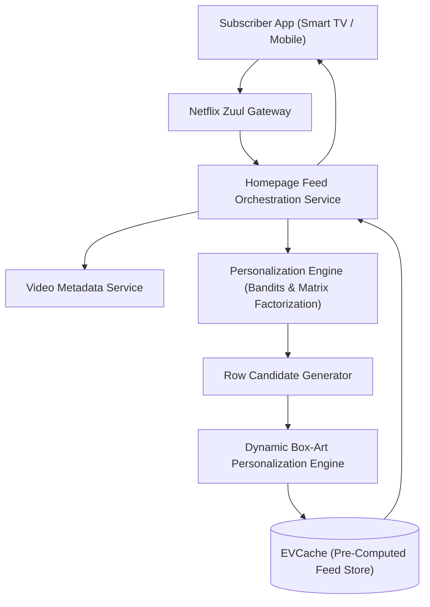
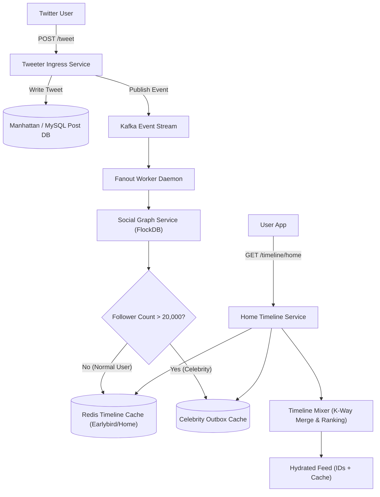

# Real-World Production Implementations: News Feed Systems

> ⚠️ **Not yet source-checked.** These case studies summarize public engineering posts and talks, and some details may be simplified or wrong. Before you repeat a specific number or design in an interview, check it against the company's own write-up. Found an error, or a source that confirms a section? [Add it to the tracking issue](https://github.com/Aniketchavan7/system-design-illustrated/issues/9). Sourced fixes are the most welcome contribution here.

This document explores how **Google**, **Netflix**, **Twitter/X**, and **Meta (Facebook/Instagram)** architect, optimize, and scale real-time feed pipelines.

---

## 1. Google: The YouTube Home Feed & Google Discover Architecture

### The Architecture
Google serves personalized content feeds to billions of users daily across the **YouTube Home Feed** and **Google Discover**. Unlike simple chronological social timelines, Google's feed architecture is heavily driven by real-time neural network candidate generation and ranking.

```mermaid
flowchart LR
    User["Google / YouTube User"] --> Ingress["Edge Gateway (GFE)"]
    Ingress --> FeedEngine["Feed Orchestration Engine"]
    
    subgraph CandidateGeneration["Stage 1: Candidate Generation (Retrieval)"]
        VideoCorpus[("Billions of Videos / Articles")] --> TwoTower["Two-Tower Deep Neural Network"]
        TwoTower --> Candidates["Top 1,000 Candidates"]
    end
    
    subgraph HeavyRanking["Stage 2: Heavy Neural Ranking"]
        Candidates --> FeatureStore[("Bigtable Real-Time Features")]
        FeatureStore --> MultiTaskDNN["Multi-Task DNN (Watch Time & Engagement)"]
        MultiTaskDNN --> RankedItems["Ranked Candidate List"]
    end
    
    subgraph ReRanking["Stage 3: Diversity & Business Logic"]
        RankedItems --> Dedup["Deduplicate & Apply Freshness Filter"]
    end
    
    FeedEngine --> CandidateGeneration
    CandidateGeneration --> HeavyRanking
    HeavyRanking --> ReRanking
    ReRanking --> User
```

### Key Technical Mechanisms
1. **Two-Tower Neural Candidate Generation**:
   - Compresses billions of candidate videos/articles into high-dimensional vector embeddings.
   - The "User Tower" encodes user history, and the "Item Tower" encodes content features.
   - Using Approximate Nearest Neighbor (ANN) search via **ScaNN** (Scalable Nearest Neighbors), Google retrieves the top 1,000 candidates in $< 10\text{ ms}$.
2. **Freshness & Exploration vs Exploitation**:
   - Google balances high-relevance recommendations with fresh breaking news and content exploration, preventing echo chambers.
3. **Edge Caching of Short-Term Feeds**:
   - Feed candidate sets are cached in-memory in regional datacenters so reloads within 60 seconds return consistent feeds with low latency.

---

## 2. Netflix: The Personalized Homepage & Dynamic Row Generation

### The Architecture
When a subscriber opens Netflix, the homepage is an intelligent feed composed of personalized horizontal rows (*"Continue Watching"*, *"Top 10 in your Country"*, *"Trending Now"*, *"Because you watched Stranger Things"*).

### Key Technical Mechanisms
1. **Two-Tier Ranking (Row & Title Ranking)**:
   - **Page Generation**: Selects the optimal set of rows for the subscriber based on their viewing history and time of day.
   - **Row Ranking**: Ranks the titles inside each row from left to right.
2. **Dynamic Artwork Personalization**:
   - Netflix dynamically chooses which poster/thumbnail to show for each title in the feed based on the subscriber's taste (e.g., highlighting an action shot for action fans, or romance for romance lovers).
3. **EVCache Feed Caching**:
   - Because real-time matrix factorization across tens of thousands of titles is compute-intensive, Netflix pre-computes subscriber feed rows offline during off-peak hours and stores them in **EVCache** (distributed Memcached). Live updates only patch dynamic rows like "Continue Watching".

---

## 3. Twitter / X: Timelines at Scale & The Snowflake ID Pipeline

### The Architecture
Twitter was the earliest pioneer of the Fan-out on Write pipeline. Handling over 500 million tweets per day with a median fanout of hundreds of followers, Twitter developed dedicated services for timeline generation (**Timeline Service** and **Fanout Service**).

### Key Technical Mechanisms
1. **The Earlybird In-Memory Search & Feed Cache**:
   - Twitter stores home timelines in Redis clusters as sorted sets of 64-bit Snowflake tweet IDs.
   - For regular users, writing a tweet fans out asynchronously to thousands of followers within 2-5 seconds.
2. **The Celebrity (Heavy Hitter) Hybrid Fanout**:
   - Accounts with $> 20,000$ followers bypass the fanout queue.
   - When a user loads their timeline, the **Timeline Mixer** queries the user's personal timeline cache and dynamically fetches tweets from followed celebrities, performing an in-memory merge sort.

---

## 4. Meta (Facebook / Instagram): TAO Graph & Multi-Stage ML Ranking

- **TAO (The Associations and Objects Store)**: Meta's globally distributed graph data store built on MySQL and Memcached, serving billions of read queries per second with sub-5ms latency.
- **DLRM (Deep Learning Recommendation Model)**: Evaluates hundreds of engagement signals ($P(\text{click}), P(\text{like}), P(\text{comment}), P(\text{share})$) to deliver a personalized engagement-maximizing news feed.
