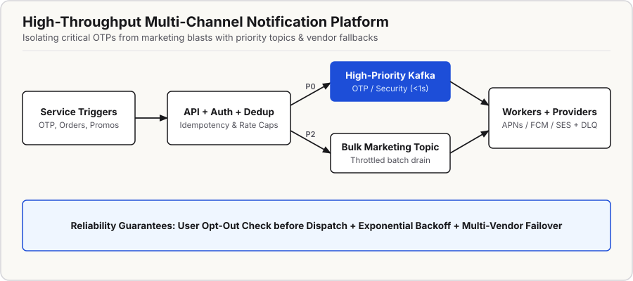
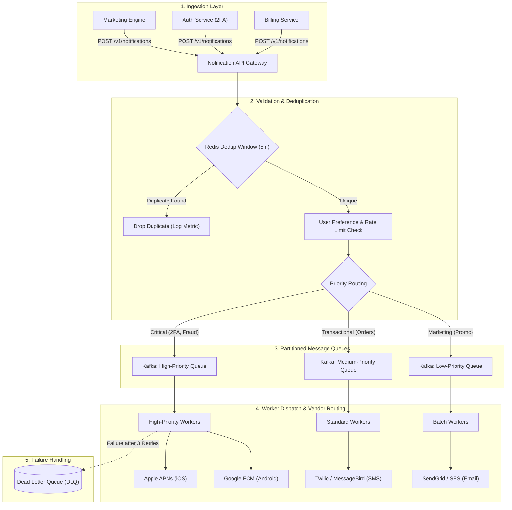

# Module 35: System Design — Notification System

> Comprehensive architectural breakdown of a global multi-channel Notification System (supporting iOS APNs, Android FCM, SMS, and Email), covering priority queues, rate limiting, deduplication windows, and third-party provider failovers.

---

## Prerequisites
Before tackling the notification system, review these core modules:
* [05 - Rate Limiting](../05-rate-limiting/README.md) (Token bucket and user notification frequency caps)
* [17 - Message Queues](../17-message-queues/README.md) (Priority queues, dead letter queues, and consumer groups)
* [20 - Fault Tolerance & Resilience](../20-fault-tolerance-and-resilience/README.md) (Exponential backoff, jitter, and fallback providers)
* [32 - REST API Design & Idempotency](../32-rest-api-design-and-idempotency/README.md) (Idempotency keys preventing duplicate alerts)

---

## ELI5 (30-Second Summary)
Imagine a massive emergency siren system for a city. The city needs to send out tornado warnings immediately, but also sends out parking ticket reminders and library book alerts.

If the city sends parking ticket reminders over the emergency siren, people will go deaf and mute the alerts. Furthermore, if a sensor glitches and detects a storm 10 times in 1 second, you don't want 10 sirens blasting at the same time (**Deduplication**). And if the siren wire to Apple or Google breaks, you need to store the message safely, wait a few seconds, and try again without crashing your servers (**Retry & Dead-Letter Queues**).

A modern **Notification System** prioritizes critical alerts (2FA codes, fraud detection), drops spammy duplicates, respects user quiet hours, and routes each message to the right delivery highway (Apple APNs, Google FCM, Twilio SMS, SendGrid Email).

---

## Physical Analogy
Think of an **Airport Central Dispatch and Paging Desk**:

| Airport Analogy | Notification System Concept | Technical Description |
| :--- | :--- | :--- |
| **Urgent Air Traffic Control Alert** | High-Priority Queue | 2FA codes, account takeover warnings (instant dispatch). |
| **Flight Boarding Call** | Medium-Priority Queue | Order delivery status, ride arrival notifications. |
| **Duty-Free Shopping Discount Flyer** | Low-Priority Queue | Promotional emails, weekly digest newsletters. |
| **Gate Agent Paging Once, Not 5 Times** | Deduplication Window (Redis) | Suppresses identical alerts sent within 5 minutes. |
| **Airport Public Address Speakers** | Mobile Push Gateways | Apple APNs and Google Firebase Cloud Messaging (FCM). |
| **Postal Mail Delivery** | Email Gateways | SendGrid, Amazon SES, Mailgun. |

---

## The Problem It Solves
A notification service must process billions of outbound events daily while solving critical distributed systems challenges:
1. **Unreliable External Vendors**: Apple APNs, Google FCM, Twilio, and SendGrid can experience latency spikes, rate limit exhaustion, or regional outages. Internal systems must not lock or fail when an external vendor is down.
2. **Notification Fatigue & Spam**: Bombarding a user with 50 push notifications an hour leads to users disabling app notifications entirely. Systems must enforce per-user rate limits and quiet-hour schedules.
3. **Race Conditions & Duplication**: Network retries across microservices can cause customers to receive three identical 2FA SMS messages or duplicate credit card debit alerts.

---

## Visual Architecture

<p align="center">
  
</p>



---

## Real Numbers & System Sizing

Consider a system sending notifications for an application with **100 Million Active Users**:
* **Notification Volume**:
  - Average notifications per user per day: 10 (across push, SMS, email).
  - Total volume: $100\text{M} \times 10 = 1\text{ billion notifications/day}$.
  - Average dispatch rate: $1\text{B} / 86,400 \approx 11,570\text{ notifications/second}$.
  - Peak dispatch rate (Black Friday / breaking news): $3\times \approx 35,000\text{ notifications/second}$.
* **Payload Sizing**:
  - Notification event metadata: $\approx 500\text{ bytes}$ (User ID, template ID, variables, channels).
  - Storage bandwidth: $35,000\text{ req/s} \times 500\text{ bytes} \approx 17.5\text{ MB/s}$ network throughput.
* **Deduplication Cache Sizing (Redis)**:
  - Cache key: `sha256(user_id + channel + template_id)` = 32 bytes.
  - Active keys retained for a 10-minute sliding window: $35,000 \times 600 = 21\text{ million keys}$.
  - Total RAM: $21\text{M} \times 64\text{ bytes} \approx 1.34\text{ GB}$ of Redis memory (very lightweight!).

---

## Deep Dive: Under the Hood

### 1. Delivery Channel Providers
* **iOS Mobile Push**: Apple Push Notification service (**APNs**). Uses persistent HTTP/2 connections authenticated with provider tokens (`.p8` JWT).
* **Android Mobile Push**: Firebase Cloud Messaging (**FCM**). Highly scalable HTTP v1 REST/JSON protocol.
* **SMS**: Twilio, AWS SNS, Sinch. High cost per message (\$0.01 - \$0.05); requires fallback routing between multiple telecom carriers.
* **Email**: SendGrid, Amazon Simple Email Service (SES), Mailgun. Requires strict DKIM, SPF, and DMARC DNS records to avoid spam filters.

### 2. Deduplication Algorithm
To prevent burst duplicates (e.g., three network retries from an upstream microservice):
1. Compute fingerprint: `hash = sha256(user_id + channel + content_fingerprint)`.
2. Execute Redis atomic lock: `SET dedup:{hash} 1 EX 300 NX`.
3. If `SETNX` returns 0, the message is a duplicate within the 5-minute window; drop immediately.

### 3. Rate Limiting & User Preferences
* **Opt-Outs & Quiet Hours**: Check user settings in Redis before enqueuing. If user disabled `promotions` or is in local quiet hours (10:00 PM - 8:00 AM), either drop or delay delivery.
* **Frequency Caps**: Token bucket per user allowing at most 3 push notifications per hour for non-critical categories.

---

## Trade-offs & Decision Matrix

| Dimension | Synchronous Direct Dispatch | Asynchronous Queue-Based Dispatch | Multi-Tier Priority Queuing |
| :--- | :--- | :--- | :--- |
| **Latency for 2FA** | Lowest ($< 50\text{ ms}$) | Low ($100 - 300\text{ ms}$) | Ultra-low for High-Q ($< 100\text{ ms}$) |
| **System Resilience** | Terrible (vendor outage crashes caller) | High (queues buffer traffic) | Highest (marketing cannot starve 2FA) |
| **Infrastructure Cost** | Zero queues needed | Moderate (Kafka/RabbitMQ cluster) | High (multiple queue partitions and worker pools) |
| **Burst Protection** | None (downstream vendors throttle) | Full (workers drain at vendor rate limit) | Full with SLA guarantees per tier |

---

## Common Pitfalls & Anti-Patterns

1. **Mixing 2FA and Promotional Campaigns in a Single Queue**: If a marketing campaign pushes 10 million email blasts to the queue, a customer logging in cannot receive their 2FA password reset SMS for 45 minutes! *Rule: Strict separation into independent High, Medium, and Low priority queues.*
2. **Missing Dead-Letter Queues (DLQ)**: If a user uninstalls the app or changes their phone number, APNs/Twilio returns an unrecoverable 400/404 error. Retrying endlessly consumes resources. After 3 attempts, push failing items to a DLQ and mark the device token as invalid.
3. **Hardcoding Vendor Integrations in Application Code**: Coupling services directly to Twilio or SendGrid makes switching vendors during an outage impossible. Always abstract vendors behind a generic Notification Gateway.

---

## Try It Yourself
A runnable, zero-dependency Python simulation demonstrating multi-channel notification dispatch, priority queue scheduling, Redis-style deduplication window suppression, and exponential retry is included in this directory.

Run the simulation:
```bash
python demo.py
```

---

## Production References & Further Reading
* [Apple Developer: Sending Notification Requests to APNs](https://developer.apple.com/documentation/usernotifications/sending-notification-requests-to-apns)
* [Google Firebase: Firebase Cloud Messaging Architecture](https://firebase.google.com/docs/cloud-messaging)
* [Netflix TechBlog: Building Netflix's Multi-Channel Messaging Platform](https://netflixtechblog.com)
* [Alex Xu: System Design Interview Vol 1 - Chapter 10 (Design a Notification System)](https://bytebytego.com)

---

## Top 5 Interview Questions with Model Answers

### Q1: How do you prevent promotional notifications from delaying time-sensitive 2FA verification codes?
**Model Answer**: We enforce **Strict Queue Partitioning by Priority Level**:
- **High-Priority Queue**: Reserved exclusively for critical, latency-sensitive events (2FA verification tokens, payment fraud alerts).
- **Medium-Priority Queue**: Transactional notifications (order status updates, ride dispatch).
- **Low-Priority Queue**: Promotional campaigns, marketing blasts, and weekly digest emails.
Each tier is handled by independent worker thread pools and dedicated rate-limit budgets with downstream vendors, ensuring an influx of 10 million promotional emails never delays 2FA delivery.

### Q2: How do you guarantee exactly-once notification delivery to users?
**Model Answer**: In distributed systems, guaranteed exactly-once delivery across unreliable third-party networks (telecom carriers, APNs, FCM) is impossible due to network splits. Instead, we implement **At-Least-Once Delivery with Aggressive Deduplication**:
1. Client/Producer assigns an `idempotency_key` (or we compute a SHA-256 fingerprint of `user_id + channel + message_digest`).
2. Workers use Redis `SETNX key "LOCKED" EX <window>` to suppress duplicate submissions within a 5-10 minute window.
3. Mobile client apps implement client-side deduplication using notification IDs to ensure identical messages arriving twice only render a single notification in the OS tray.

### Q3: What happens when an external push vendor (e.g., Apple APNs) experiences a major outage?
**Model Answer**:
1. **Circuit Breaking**: The worker pool detects consecutive HTTP 5xx errors from APNs and trips the circuit breaker to avoid wasting connection pools.
2. **Queue Buffering**: Messages accumulate safely in Kafka/RabbitMQ without impacting upstream services.
3. **Fallback Channels**: If configured by business policy, critical alerts can fall back to alternative channels (e.g., if iOS push fails, fall back to SMS).
4. **Exponential Backoff with Jitter**: Once APNs recovers, workers drain the queue gradually to avoid overwhelming the vendor.

### Q4: How do you handle invalid device tokens when users uninstall the app?
**Model Answer**: When APNs or FCM attempts delivery to an uninstalled app, they return a specific status code (e.g., APNs `410 BadDeviceToken` or FCM `UNREGISTERED`). When the worker receives this code:
- The worker immediately aborts retries.
- It asynchronously emits a message to the Device Registry Service to deactivate or delete that device token from the user's profile database, preventing wasted network bandwidth on future campaigns.

### Q5: How do you track delivery status and open rates across millions of notifications?
**Model Answer**: We build an asynchronous analytics feedback loop:
- **Push**: The mobile app includes a Notification Service Extension (iOS) or BroadcastReceiver (Android) that fires a lightweight telemetry beacon (`POST /v1/telemetry/opened`) when the user taps the notification.
- **Email**: SendGrid/SES publish delivery, bounce, and click webhooks back to our Notification Gateway, which streams events into a Kafka analytics topic consumed by ClickHouse/BigQuery.

---

## Check Yourself Quiz

<details>
<summary><b>1. Why are message queues mandatory between the API Gateway and notification vendors?</b></summary>
A) Because databases cannot store phone numbers.<br/>
B) To decouple internal systems from slow, rate-limited, and potentially unavailable third-party APIs.<br/>
C) Because APNs only accepts connections via Kafka.<br/>
D) To encrypt messages with AES-256.<br/><br/>
<b>Answer: B</b>. External vendors can be slow or experience outages. Queues buffer requests and protect system availability.
</details>

<details>
<summary><b>2. How does a deduplication window prevent duplicate notifications?</b></summary>
A) By deleting the user's account.<br/>
B) By checking an atomic Redis SETNX key of the message fingerprint within a rolling time window (e.g. 5 minutes).<br/>
C) By rebooting the phone.<br/>
D) By slowing down the network.<br/><br/>
<b>Answer: B</b>. Hashing message parameters and checking an atomic Redis key ensures duplicate triggers within the window are rejected.
</details>

<details>
<summary><b>3. What should a worker do when receiving HTTP 410 BadDeviceToken from Apple APNs?</b></summary>
A) Retry 50 times.<br/>
B) Deactivate the device token in the database and cease further dispatches to it.<br/>
C) Crash the worker pod.<br/>
D) Switch to email.<br/><br/>
<b>Answer: B</b>. 410 indicates the token is permanently invalid (app uninstalled); retrying wastes bandwidth and risks vendor throttling.
</details>

<details>
<summary><b>4. Why should 2FA alerts use a completely isolated queue from marketing campaigns?</b></summary>
A) Because 2FA uses a different programming language.<br/>
B) To prevent large marketing bursts from blocking the queue and delaying time-sensitive authentication codes.<br/>
C) Because marketing emails are illegal.<br/>
D) Because marketing queues do not support SMS.<br/><br/>
<b>Answer: B</b>. Priority isolation guarantees zero latency degradation for critical authentication and fraud alerts.
</details>

<details>
<summary><b>5. Which mobile push service is used natively for Google Android devices?</b></summary>
A) APNs<br/>
B) Firebase Cloud Messaging (FCM)<br/>
C) SendGrid<br/>
D) Twilio<br/><br/>
<b>Answer: B</b>. FCM is Google's native cloud messaging service for Android.
</details>
