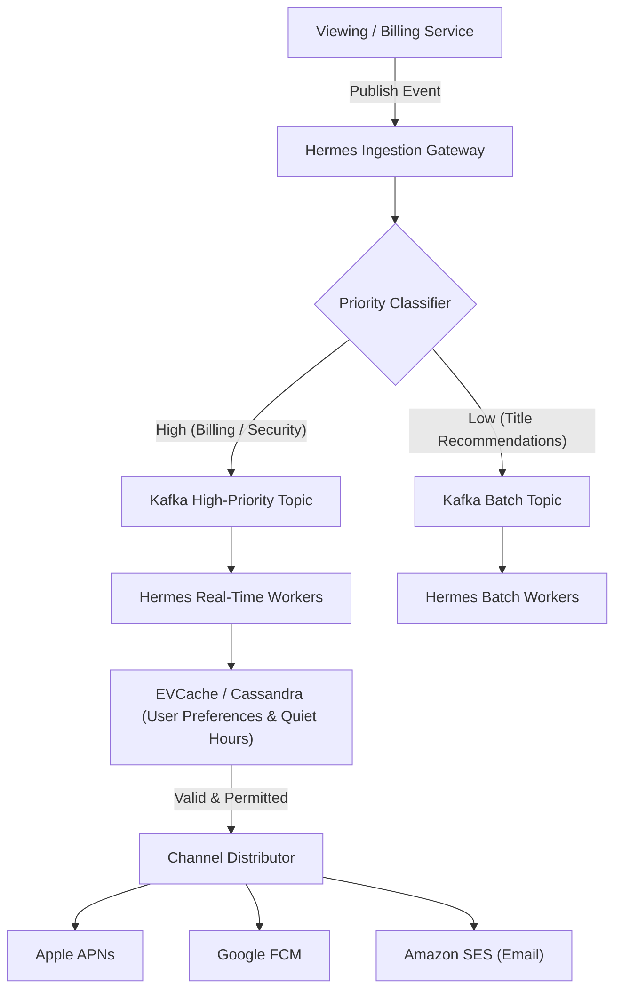
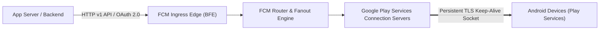

# Real-World Production Implementations: Notification Systems

> ⚠️ **Not yet source-checked.** These case studies summarize public engineering posts and talks, and some details may be simplified or wrong. Before you repeat a specific number or design in an interview, check it against the company's own write-up. Found an error, or a source that confirms a section? [Add it to the tracking issue](https://github.com/Aniketchavan7/system-design-illustrated/issues/9). Sourced fixes are the most welcome contribution here.

This document explores how Netflix and Google build and operate messaging platforms delivering billions of communications daily.

---

## 1. Netflix: Zuul Messaging & The Hermes Notification Platform

### The Architecture
Netflix delivers billions of personalized notifications each month (new season arrivals, payment renewals, account security alerts) across mobile push, email, SMS, and in-app web banners through its **Hermes** messaging platform.

### Key Technical Mechanisms
1. **User Preference & Quiet Hour Intelligence**:
   - Netflix stores customer contact settings and local timezones in EVCache.
   - If a recommendation message for a subscriber in Tokyo is generated at 3:00 AM local time, Hermes holds the event in an Amazon SQS delay queue until 9:00 AM, avoiding annoying sleep interruptions.
2. **Frequency Capping & Fatigue Prevention**:
   - To prevent spamming members with too many promotional suggestions, Hermes enforces strict fatigue caps (e.g., maximum 1 marketing push per week per subscriber), tracked via distributed Redis counters.
3. **Template Personalization Engine**:
   - Notifications are rendered dynamically using templates localized into over 30 languages. Hermes combines subscriber language, personalized movie box art, and deep-link URLs to automatically launch the exact playback timestamp upon tapping.

---

## 2. Google: Firebase Cloud Messaging (FCM) & Google Alert Infrastructure

### The Architecture
Google's **Firebase Cloud Messaging (FCM)** powers push notification infrastructure for millions of mobile and web applications worldwide, sending hundreds of billions of messages per day.

### Key Technical Mechanisms
1. **Single Persistent TCP Connection (Google Play Services)**:
   - On Android devices, individual apps do not keep separate background network sockets open (which would drain the battery in 2 hours).
   - Instead, **Google Play Services** maintains a single persistent, encrypted TCP keep-alive connection per device to Google's connection servers.
   - When FCM receives a message for any installed app, it routes it over this single multiplexed connection, waking the target app only when the packet arrives.
2. **Device Grouping & Topic Messaging**:
   - FCM supports Pub/Sub topic broadcasting (e.g., millions of users subscribed to `/topics/breaking-news`).
   - FCM fans out the message to internal shard clusters, deduplicating messages and delivering to tens of millions of devices in seconds.
3. **Collapsible Messages (`collapse_key`)**:
   - For real-time updates like sports scores or ride-share vehicle locations, new notifications supersede older ones.
   - FCM uses `collapse_key` to store only the newest notification on the server if the device is currently offline, discarding stale intermediate updates.
