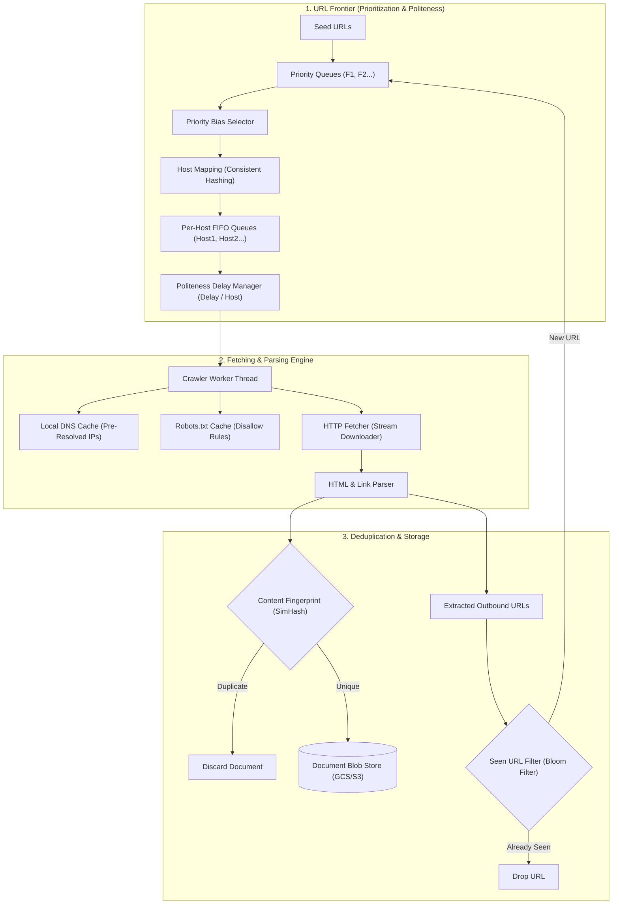

# Module 36: System Design — Distributed Web Crawler

> Comprehensive architectural breakdown of a large-scale Distributed Web Crawler (Googlebot style), covering the URL Frontier, Politeness Queues, Bloom Filter deduplication, DNS pre-resolution, and SimHash content deduplication.

---

## Prerequisites
Before tackling the distributed web crawler, review these core modules:
* [02 - Domain Name System](../02-domain-name-system/README.md) (DNS resolution, caching, and DNS lookup latency)
* [08 - Database Partitioning](../08-database-partitioning/README.md) (Sharding crawled document repositories)
* [16 - Consistent Hashing](../16-consistent-hashing/README.md) (Distributing target hosts across crawler nodes)
* [20 - Fault Tolerance & Resilience](../20-fault-tolerance-and-resilience/README.md) (Worker crashes, timeouts, and spider traps)

---

## ELI5 (30-Second Summary)
Imagine you want to read every book in a 1,000-story library. You start with book #1 on the shelf. In book #1, the author cites 5 other books. You write down those 5 titles on your "To-Read List" (**URL Frontier**).

When you finish book #1, you pick the next book from your list. But wait:
1. What if three different books all cite the same book? You need a quick checklist to make sure you don't read the same book 50 times (**Bloom Filter Deduplication**).
2. What if a mischievous book tells you to read Chapter 1, which tells you to read Chapter 2, which tells you to read Chapter 1 in an infinite loop (**Spider Trap**)?
3. What if you storm into the library counter and demand 1,000 books in one second, crashing into the librarian (**Host Politeness**)?

A **Distributed Web Crawler** uses a polite, intelligent frontier queue system to discover, fetch, parse, and catalog billions of web pages across the entire internet without crashing websites or getting stuck in infinite loops!

---

## Physical Analogy
Think of an **International Fleet of Postal Explorers Mapping Uncharted Islands**:

| Exploration Analogy | Distributed Web Crawler Concept | Technical Description |
| :--- | :--- | :--- |
| **List of Target Islands to Visit** | URL Frontier | Prioritized, politeness-controlled queue of URLs to crawl. |
| **Explorers' Master Map of Visited Islands** | Visited URL Store (Bloom Filter) | High-speed probabilistic filter checking if a URL was already crawled. |
| **Ship Speed Limits per Harbor** | Politeness Delay (1 request / sec / host) | Enforces crawl-delay to prevent overwhelming target web servers. |
| **Harbor Rules Document on Dock** | `robots.txt` Parser & Cache | Respects webmaster access policies and forbidden directories. |
| **Cataloging Flora and Fauna Specimens** | HTML Parser & Content Extractor | Strips boilerplate, extracts text, and discovers new outbound hyperlinks. |
| **Checking if Two Specimens are Identical** | Content Fingerprinting (SimHash) | Detects duplicate or near-duplicate articles across different domains. |

---

## The Problem It Solves
The World Wide Web contains tens of billions of publicly accessible web pages:
1. **Immense Scale**: Crawling 1 billion web pages per month requires fetching $\approx 400$ pages per second continuously 24/7.
2. **Politeness Requirements**: A crawler that fires 100 simultaneous requests at a small mom-and-pop blog is indistinguishable from a Distributed Denial of Service (DDoS) attack.
3. **Spider Traps**: Infinite dynamic calendar links (`/calendar?year=2026&month=13&day=...`) or circular redirects can trap a crawler forever, exhausting memory and disk.
4. **Duplicate Content**: Over 30% of web content consists of mirrored pages, syndicated news stories, or URL parameter variations (`?ref=twitter`). Storing duplicate copies wastes petabytes of storage.

---

## Visual Architecture



---

## Real Numbers & System Sizing

Consider crawling **1 Billion Web Pages per month**:
* **Throughput Required**:
  - 1 Billion pages / $(30\text{ days} \times 86,400\text{ s}) \approx 386\text{ pages/second}$.
  - Peak crawl throughput ($2\times$): $\approx 800\text{ pages/second}$.
* **Bandwidth Sizing**:
  - Average web page size (HTML + metadata): $100\text{ KB}$.
  - Ingress bandwidth: $800\text{ pages/s} \times 100\text{ KB} = 80\text{ MB/s} = 640\text{ Mbps}$ continuous network ingress.
* **Storage Sizing (1 Month Retention)**:
  - Total raw HTML storage: $1\text{B} \times 100\text{ KB} = 100\text{ Terabytes/month}$.
  - Compressed storage (gzip $\approx 3\times$ reduction): $\approx 33\text{ TB/month}$.
* **Bloom Filter for URL Deduplication**:
  - Tracking 1 billion URLs with a false-positive rate $p = 0.01$ (1%):
  - Bits required: $m = -\frac{n \ln p}{(\ln 2)^2} \approx \frac{1\text{B} \times 4.605}{0.48} \approx 9.6\text{ billion bits} \approx 1.2\text{ GB}$ of RAM!
  - 1.2 GB of RAM easily fits inside a single server or Redis instance.

---

## Deep Dive: Under the Hood

### 1. The URL Frontier Design
Mercator-style URL Frontiers split queue management into two distinct layers:
* **Prioritization Layer (Prioritizer)**: Multiple queues ($F_1, F_2, \dots, F_k$) where higher priority is given to authoritative domains (Wikipedia, BBC) and frequently updated pages.
* **Politeness Layer (Politeness Queues)**:
  - URLs are partitioned into separate queues by host domain (`host = parse_domain(url)`).
  - A thread-safe scheduler ensures that at most one connection is made to `example.com` per second, storing the `last_accessed_timestamp` per host in an in-memory heap or queue.

### 2. URL Normalization
Before checking if a URL has been seen, it must be canonicalized:
- Convert scheme and host to lowercase: `HTTP://Example.com/` $\rightarrow$ `http://example.com/`
- Strip default ports: `:80` on HTTP, `:443` on HTTPS.
- Remove tracking fragments and query parameters: `/page#section` $\rightarrow$ `/page`, strip `?utm_source=...`.
- Resolve relative paths: `/news/../sports/index.html` $\rightarrow$ `/sports/index.html`.

### 3. Spider Trap Avoidance
- **Path Depth Limit**: Reject URLs with depth $> 10$ (`/a/b/c/d/e/f/g/h/i/j/k`).
- **Robots Exclusion Standard**: Check `/robots.txt` before crawling any path.
- **Strict Fetch Timeouts**: Set aggressive socket timeouts (e.g., 5 seconds) to avoid hanging on slow HTTP streams.

---

## Trade-offs & Decision Matrix

| Dimension | Breadth-First Search (BFS) | Depth-First Search (DFS) | Priority-Biased Politeness Frontier |
| :--- | :--- | :--- | :--- |
| **Domain Coverage** | Broad coverage of shallow pages | Gets trapped deep in dynamic directories | Controlled balance of high-value sites |
| **Server Politeness** | Hits the same host repeatedly (DDoS risk) | Pounds single host consecutively | Guaranteed inter-request delay per host |
| **Crawl Trap Resilience** | Poor (fills memory with infinite links) | Worst (dives endlessly into loops) | Excellent (depth + length caps) |
| **Engineering Complexity** | Minimal (single queue) | Minimal (single stack) | High (dual-tier priority + politeness queues) |

---

## Common Pitfalls & Anti-Patterns

1. **DNS Bottleneck**: Making a synchronous DNS query for every single URL introduces a $20 - 100\text{ ms}$ latency penalty per link. *Rule: Maintain a dedicated local in-memory DNS cache (e.g., dnsmasq or custom DNS pool) with pre-resolved IP mappings.*
2. **Ignoring `robots.txt`**: Crawling web servers without checking `robots.txt` violates web conventions and can result in legal notices and immediate IP blacklisting. Cache `robots.txt` per host with a 24-hour TTL.
3. **Exact-Match Content Comparison**: Checking if page HTML is 100% identical via SHA-256 fails because minor changes (e.g., dynamic timestamps or copyright years) alter the cryptographic hash. *Use 64-bit SimHash or MinHash to detect near-duplicate pages.*

---

## Try It Yourself
A runnable, zero-dependency Python simulation demonstrating a multi-threaded web crawler with per-host politeness throttling, Bloom filter URL deduplication, robots.txt compliance, and HTML parsing is included in this directory.

Run the simulation:
```bash
python demo.py
```

---

## Production References & Further Reading
* [Mercator: A Scalable, Extensible Web Crawler (Heydon & Najork, 1999)](https://www.cs.princeton.edu/courses/archive/fall06/cos435/papers/mercatortopics.pdf)
* [Google Engineering: Googlebot and Web Crawling Architecture](https://developers.google.com/search/docs/crawling-indexing/googlebot)
* [Alex Xu: System Design Interview Vol 1 - Chapter 9 (Design a Web Crawler)](https://bytebytego.com)

---

## Top 5 Interview Questions with Model Answers

### Q1: How does a Web Crawler guarantee politeness so it doesn't DDoS target websites?
**Model Answer**: Politeness is enforced via the **URL Frontier's Politeness Queue Architecture**:
1. URLs are mapped to host-specific FIFO queues based on domain name (e.g., `queue:nytimes.com`, `queue:wikipedia.org`).
2. A dedicated scheduler assigns worker threads to host queues using a priority heap tracking `next_allowed_crawl_time`.
3. When a worker finishes fetching from `nytimes.com`, it records `timestamp + delay` (typically 500ms to 1s, or specified by `Crawl-delay` in `robots.txt`). No worker is permitted to fetch from `nytimes.com` until that cooldown elapses.

### Q2: How do you detect and avoid "Spider Traps"?
**Model Answer**: Spider traps are websites generating infinite URLs dynamically (e.g., infinite calendar pages or recursive directory links). We combat traps using multiple heuristic filters:
1. **URL Length & Depth Capping**: Discard URLs exceeding 255 characters or path depth $> 8$ segments.
2. **Repeating Pattern Detection**: Regular expression filters detecting repeating path segments (`/blog/archive/blog/archive/...`).
3. **Per-Host Page Limits**: Cap the maximum number of pages crawled per domain (e.g., 50,000 pages max per site).
4. **Content-Based Near-Duplicate Detection**: Using SimHash to identify when structurally identical pages are being dynamically generated.

### Q3: Why is a Bloom Filter preferred over a Hash Set for tracking visited URLs?
**Model Answer**: Scale. Tracking 10 billion URLs in a standard Python/Java Hash Set (each URL $\approx 80\text{ bytes}$) requires at least $800\text{ GB}$ to $1.2\text{ TB}$ of RAM due to object pointer overhead. 
A **Bloom Filter** is an in-memory bit array with multiple cryptographic hash functions:
- Requires only $\approx 9.6\text{ bits}$ per item for a 1% false positive rate.
- 10 billion URLs require only $\approx 12\text{ GB}$ of RAM.
- While a Bloom filter can have false positives (falsely assuming a new URL was visited), in web crawling a 0.5% skip rate is completely acceptable compared to the 98% savings in memory infrastructure.

### Q4: How do you identify duplicate or near-duplicate web pages across different domains?
**Model Answer**: Using **SimHash (Locality-Sensitive Hashing)**:
1. Tokenize document text into words/n-grams.
2. Hash each word into a 64-bit binary vector.
3. Compute a weighted sum vector across all words (incrementing bit positions for 1s, decrementing for 0s).
4. The final 64-bit SimHash fingerprint has the mathematical property that documents with 90%+ identical content differ by only a few bits (Hamming distance $\le 3$).
5. Matching documents with Hamming distance $\le 3$ flags near-duplicates (e.g., republished syndicated news articles) without performing full text comparison.

### Q5: How do you handle DNS lookup bottlenecks when fetching hundreds of pages per second?
**Model Answer**: Standard synchronous DNS resolution takes 20ms to 100ms per domain, which paralyzes crawler worker threads. We resolve this by:
1. **Local DNS Caching**: Maintaining a high-throughput in-memory DNS cache mapping domains to resolved IP addresses with an asynchronous refresh thread.
2. **DNS Pre-fetching**: When outbound URLs are parsed from a page, background workers immediately initiate non-blocking asynchronous DNS queries (`getaddrinfo` async) so IPs are already cached when the URL reaches the head of the frontier queue.

---

## Check Yourself Quiz

<details>
<summary><b>1. What is the primary purpose of the Politeness layer in the URL Frontier?</b></summary>
A) To translate foreign languages.<br/>
B) To ensure target web servers are not overwhelmed with concurrent requests from the crawler.<br/>
C) To remove CSS files.<br/>
D) To encrypt web pages.<br/><br/>
<b>Answer: B</b>. Politeness queues throttle requests per host (typically 1 req/sec) to avoid accidental Denial of Service.
</details>

<details>
<summary><b>2. Why is SimHash preferred over SHA-256 for document deduplication?</b></summary>
A) SimHash is faster to compute.<br/>
B) SHA-256 changes completely on a single character difference, whereas SimHash preserves similarity, allowing near-duplicate detection.<br/>
C) SHA-256 only works on numbers.<br/>
D) SimHash encrypts the URL.<br/><br/>
<b>Answer: B</b>. Locality-Sensitive Hashing (SimHash) produces fingerprints where small text variations yield small Hamming distances.
</details>

<details>
<summary><b>3. What file does a polite web crawler inspect first before requesting pages from a domain?</b></summary>
A) `/index.html`<br/>
B) `/robots.txt`<br/>
C) `/favicon.ico`<br/>
D) `/sitemap.xml`<br/><br/>
<b>Answer: B</b>. `/robots.txt` specifies webmaster crawl permissions, disallow paths, and crawl delays.
</details>

<details>
<summary><b>4. How does URL Normalization prevent redundant crawling?</b></summary>
A) By converting relative paths, lowercase schemes, and removing query fragments so identical pages map to the same URL string.<br/>
B) By deleting foreign characters.<br/>
C) By compressing URLs with gzip.<br/>
D) By purchasing new domain names.<br/><br/>
<b>Answer: A</b>. Normalization canonicalizes URLs (`HTTP://Site.com/a#sec` $\rightarrow$ `http://site.com/a`) so duplicates hit the cache.
</details>

<details>
<summary><b>5. In a Bloom Filter, what does a positive result ("Found") indicate?</b></summary>
A) The item is 100% guaranteed to be in the set.<br/>
B) The item is probably in the set (with a small configurable false positive probability), but never a false negative.<br/>
C) The item was deleted.<br/>
D) The server is down.<br/><br/>
<b>Answer: B</b>. Bloom filters can yield false positives, but never false negatives ("Never False Negative, Sometimes False Positive").
</details>
