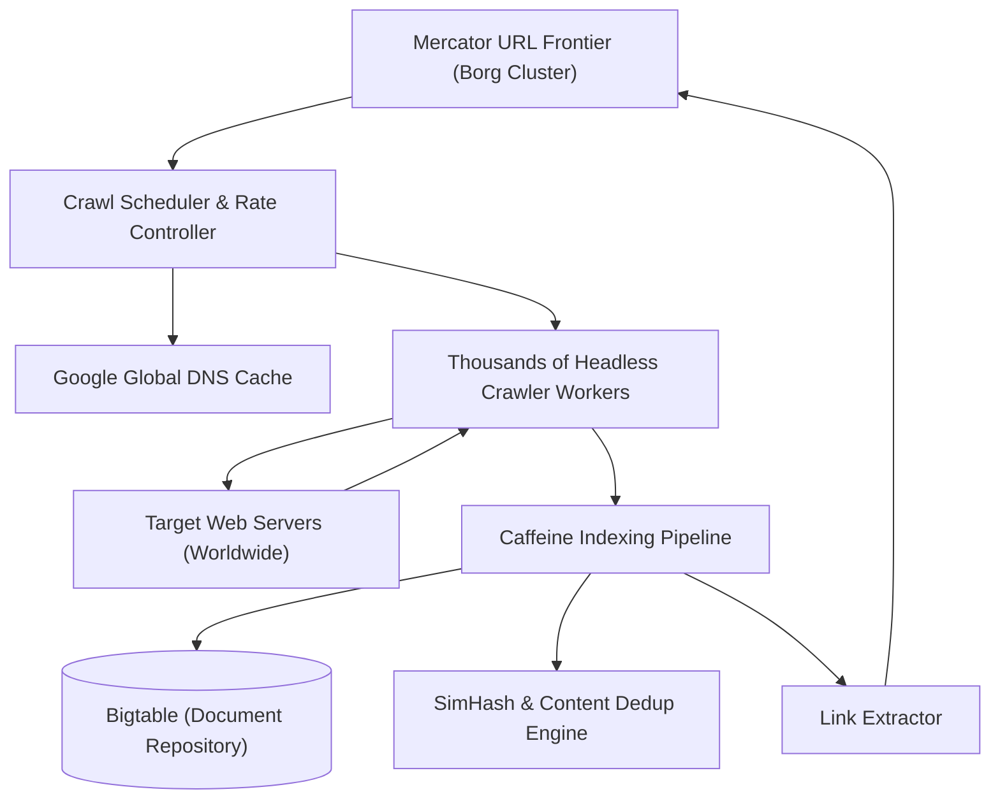
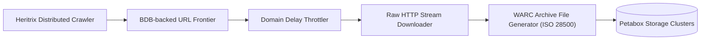

# Real-World Production Implementations: Distributed Web Crawlers

This document explores how Google and Internet Archive crawl the entire public web at planetary scale.

---

## 1. Google: Googlebot Architecture & Planetary Crawling

### The Architecture
Google indexes hundreds of billions of web pages. **Googlebot** operates across thousands of servers distributed in Google data centers worldwide, coordinating via Google's distributed file system (Colossus) and Bigtable.

### Key Technical Mechanisms
1. **Adaptive Host Politeness (Crawl Budget)**:
   - Googlebot dynamically calculates the "Crawl Budget" for every website based on server response time and error rate.
   - If a website returns HTTP 500 errors or response time slows from 200ms to 2,000ms, Googlebot immediately scales down its request frequency to protect the web server.
2. **Two-Stage Crawling (Crawling vs. Rendering)**:
   - **Stage 1 (Immediate Crawl)**: Fetches raw HTML and extracts hyperlinks immediately.
   - **Stage 2 (WRS - Web Rendering Service)**: Because modern websites rely heavily on JavaScript (React, Vue, Angular), raw HTML often contains empty `
` tags. Googlebot queues pages into WRS, which renders the DOM using headless Chromium, executing JavaScript to discover dynamically generated links.
3. **Caffeine Real-Time Incremental Indexer**:
   - Replaced Google's legacy MapReduce batch indexing. Caffeine continuously processes crawled pages within seconds of crawling, pushing breaking news articles into Google Search results almost instantaneously.

---

## 2. Internet Archive: The Wayback Machine & Heritrix Crawler

### The Architecture
The Internet Archive has preserved over **800 billion web pages** since 1996 using its open-source distributed crawler, **Heritrix**.

### Key Technical Mechanisms
1. **WARC (Web ARChive) File Format**:
   - Instead of storing individual web pages as separate disk files (which would exhaust file system inodes), Heritrix streams hundreds of HTTP request/response pairs sequentially into giant **WARC (Web ARChive)** container files (typically 1 GB per WARC).
2. **Long-Term Politeness**:
   - Unlike commercial search engines that crawl aggressively for fresh news, Heritrix is designed for archival permanence. It enforces strict multi-second delays per host to ensure minimal impact on historical and academic web servers.
