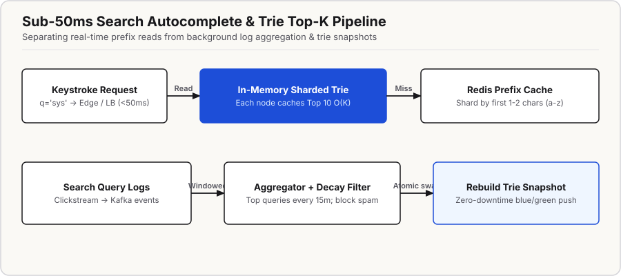
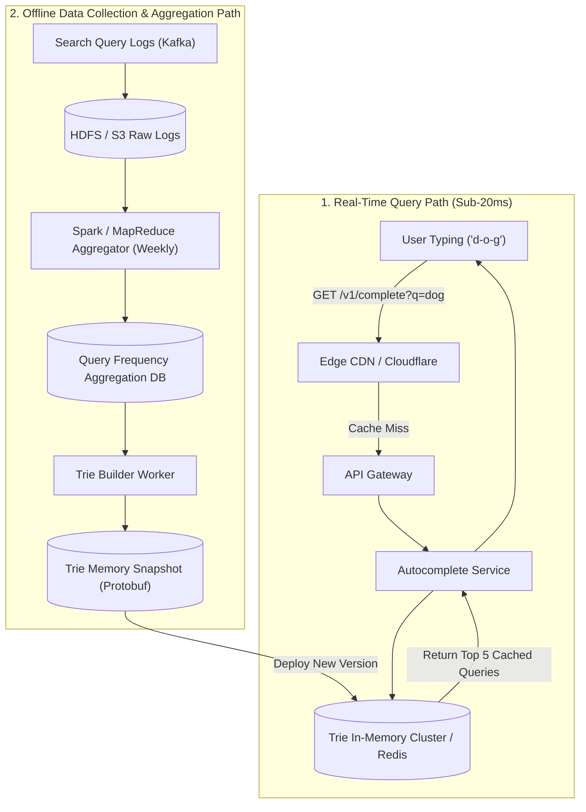

# Module 37: System Design — Search Autocomplete System

> Comprehensive architectural breakdown of a real-time Typeahead / Search Autocomplete Service (Google Instant style), covering Trie data structures, prefix node caching, offline frequency aggregation, and distributed Trie sharding.

---

## Prerequisites
Before tackling search autocomplete, review these core modules:
* [10 - Caching Patterns](../10-caching-patterns/README.md) (Read-through, prefix caching)
* [16 - Consistent Hashing](../16-consistent-hashing/README.md) (Sharding Trie nodes across Redis/memory servers)
* [27 - Back-of-the-Envelope Estimation](../27-back-of-the-envelope-estimation/README.md) (Sizing typeahead QPS and RAM footprints)

---

## ELI5 (30-Second Summary)
When you type the letter **"c"** into Google, a dropdown instantly suggests **"chatgpt"**, **"calculator"**, and **"cnn"** before you even press a second key. If Google searched through billions of web pages for every keystroke, the internet would grind to a halt.

Instead, the search engine keeps a gigantic family tree of words called a **Trie (Prefix Tree)**. At the letter "c" branch, it already has an index card pinned to it that says: *"The top 5 most popular queries starting with 'c' are [chatgpt, calculator, cnn, craigslist, chase]"*.

Because the answers are pre-calculated and cached directly at every letter branch, looking up your suggestions takes less than **10 milliseconds**!

---

## Physical Analogy
Think of an **Old-Fashioned Library Subject Index Rolodex**:

| Library Analogy | Search Autocomplete Concept | Technical Description |
| :--- | :--- | :--- |
| **Rolodex Drawer labeled "S"** | Trie Root / Top-Level Node | First character index partition. |
| **Sub-divider tab "Sy"** | Trie Child Node | Prefix branch representing all phrases starting with "sy". |
| **Sticky note on tab listing 5 best books** | Cached Top-K Queries (`top_k`) | In-memory list of top 5 highest frequency queries stored at that prefix node. |
| **Librarian tallying checkout counts on Friday** | Offline Aggregation (MapReduce / Spark) | Weekly batch job aggregating query log counts and updating Trie weights. |
| **Typing a letter into search box** | Keystroke Autocomplete API (`GET /v1/search?q=sys`) | Returns instant JSON list of top suggestions in under 15ms. |

---

## The Problem It Solves
A real-time search autocomplete system operates under extreme performance constraints:
1. **Ultra-Low Latency SLA**: Humans perceive latency $> 100\text{ ms}$ as lag. The typeahead dropdown must return within **$30 - 50\text{ ms}$** end-to-end (including network transit time).
2. **Keystroke Amplification**: For every 1 search submitted, a user types an average of 5 to 6 keystrokes, triggering 5 to 6 distinct backend API calls ($5\times$ write/read amplification).
3. **Massive Query Distribution**: A search engine like Google handles billions of searches per day across hundreds of millions of unique query terms.

---

## Visual Architecture

<p align="center">
  
</p>



---

## Real Numbers & System Sizing

Consider building autocomplete for a major platform with **100 Million Daily Active Users (DAU)**:
* **Query Volume**:
  - 100M users $\times$ 10 searches/day = $1\text{ billion searches/day}$.
  - Average query length = 4 words $\approx 20$ characters.
  - Assume client debounces typing (sending 1 request every 3 characters) $\rightarrow 6\text{ autocomplete requests/search}$.
  - Total typeahead requests: $1\text{B} \times 6 = 6\text{ billion requests/day}$.
  - Average QPS: $6\text{B} / 86,400 \approx 70,000\text{ QPS}$.
  - Peak QPS ($2\times$): $\approx 140,000\text{ QPS}$.
* **Trie Memory Footprint**:
  - Assume 20 million unique English search queries.
  - Average query length: 30 bytes.
  - To achieve sub-10ms latency, every Trie node caches the top 5 queries.
  - Top 5 queries $\times 30\text{ bytes} = 150\text{ bytes}$ per prefix node.
  - For a pruned 26-ary alphabet Trie with $\approx 30\text{ million nodes}$:
  - Storage required: $30\text{M} \times (150\text{ bytes} + 64\text{ bytes pointer overhead}) \approx 6.4\text{ Gigabytes}$!
  - 6.4 GB easily fits inside a single server's RAM. To handle 140,000 QPS, replicate the Trie across a 10-node read replica cluster.

---

## Deep Dive: Under the Hood

### 1. The Trie Data Structure & Optimization
A standard Trie without caching requires:
1. Traversing down to the prefix node $P$ ($O(L)$ where $L$ is prefix length).
2. Searching all descendant leaf nodes to find completions ($O(N)$).
3. Sorting descendants by frequency to pick the top 5 ($O(N \log K)$).

This naive traversal is too slow for real-time typeahead.
**Optimization: Node-Level Top-K Caching**:
- At every node along the prefix path, store an array of the top 5 highest-frequency queries:
  `Node("d") -> [("discord", 95M), ("disney", 80M), ("doordash", 65M)]`
- Lookups become strictly $O(L)$, where $L$ is the number of typed characters (typically $\le 10$). Finding suggestions is an instantaneous $O(1)$ memory read once the node is reached!

### 2. Client-Side Debouncing
Mobile and web search inputs must implement client-side **Debouncing**:
- Do not fire an HTTP request on every keydown event.
- Wait until the user pauses typing for **150ms** before dispatching the network request.
- This single optimization reduces backend API traffic by over **40%**.

### 3. Asynchronous Log Aggregation
Updating the Trie in real time on every user search would cause catastrophic lock contention across hundreds of thousands of threads. Instead:
- Ingestion workers append raw query events to an append-only log in Kafka.
- A scheduled Spark job aggregates query counts over a rolling 7-day window.
- A new Trie snapshot is constructed offline and swapped into production memory atomically.

---

## Trade-offs & Decision Matrix

| Dimension | Real-Time DB Query (`LIKE 'sys%'`) | ElasticSearch (Edge N-gram) | In-Memory Cached Trie Cluster |
| :--- | :--- | :--- | :--- |
| **Lookup Latency** | Slow ($50 - 200\text{ ms}$) | Fast ($20 - 40\text{ ms}$) | Ultra-fast ($< 5\text{ ms}$) |
| **Memory Footprint** | Low (disk-backed) | Moderate (Lucene inverted index) | High (stored entirely in RAM) |
| **Real-time Updates** | Instantaneous | Near-real-time (1 second) | Batch (weekly/daily rebuild) |
| **Fuzzy Matching / Typo Tolerance** | Poor | Excellent (built-in Levenshtein) | Harder (requires BK-trees or fuzzy Trie) |

---

## Common Pitfalls & Anti-Patterns

1. **Updating the Trie Synchronously on Every Search**: Attempting to increment frequencies directly in the live Trie causes thread deadlocks, cache invalidation thrashing, and memory corruption.
2. **Failing to Filter Harmful / Explicit Queries**: Autocomplete suggestions appear automatically in user viewports without user confirmation. Autocomplete engines must pass suggestions through a real-time blacklist/profanity filter.
3. **Ignoring Geolocation / Language Context**: Searching "metro" in Washington D.C. should suggest WMATA subway schedules, while in Paris it should suggest RATP. Store localized Trie partitions based on country/language code.

---

## Try It Yourself
A runnable, zero-dependency Python simulation demonstrating a Trie prefix tree with pre-computed Top-K caching, frequency-weighted ranking, and fast prefix lookup is included in this directory.

Run the simulation:
```bash
python demo.py
```

---

## Production References & Further Reading
* [Google Research: Official Google Blog - Google Instant: Search at the Speed of Thought](https://googleblog.blogspot.com/2010/09/search-at-speed-of-thought.html)
* [Facebook Engineering: Building Underdog - An In-Memory Autocomplete System](https://engineering.fb.com)
* [Alex Xu: System Design Interview Vol 1 - Chapter 13 (Design Search Autocomplete System)](https://bytebytego.com)

---

## Top 5 Interview Questions with Model Answers

### Q1: How do you reduce the search autocomplete lookup latency to under 30ms?
**Model Answer**:
1. **Pre-computed Top-K Caching at Every Trie Node**: Avoid traversing subtree descendants at query time. Store the top 5 highest-frequency query strings directly at each prefix node ($O(L)$ traversal).
2. **Edge CDN Caching**: Cache common short prefixes (e.g., "g", "go", "a", "am") at Cloudflare/Akamai Edge PoPs with a 1-hour TTL, serving over 20% of requests without touching origin datacenters.
3. **Browser Local Caching**: The client browser caches responses in-memory so typing and backspacing ("d" $\rightarrow$ "do" $\rightarrow$ "d") hits local browser memory instantly ($< 1\text{ ms}$).

### Q2: How do you handle Trie scaling when the dataset exceeds the RAM of a single server?
**Model Answer**: We partition (shard) the Trie using **Prefix-Based Sharding** or **Consistent Hashing**:
- **First-Character Sharding**: Shard 1 handles 'a'-'m', Shard 2 handles 'n'-'z'. However, characters like 's' receive significantly more queries than 'x' or 'z'.
- **Two-Tier Consistent Hashing**: Hash prefixes like `co`, `ch`, `da` across a pool of Redis/in-memory servers.
- A routing layer at the API Gateway inspects the prefix and routes the request directly to the appropriate Trie partition.

### Q3: How do you handle trending or breaking news queries (e.g., World Cup final, celebrity news)?
**Model Answer**: A weekly batch MapReduce job misses sudden breaking news. We implement a **Hybrid Dual-Trie Architecture**:
- **Historical Trie**: Built weekly, capturing stable high-volume queries (e.g., "weather", "youtube", "facebook").
- **Real-Time Trending Trie**: Powered by a streaming engine (Apache Flink / Kafka). Flink aggregates query counts over a rolling 10-minute sliding window with exponential decay.
- When an autocomplete request arrives, the server queries both the Historical Trie and the Trending Trie, merging their top candidates with higher weight given to recent trending velocity.

### Q4: How do you support typo tolerance in search autocomplete (e.g., "iphne" -> "iphone")?
**Model Answer**:
1. **Levenshtein / Edit Distance**: Search neighbor branches in the Trie that differ by an edit distance of 1 (insert, delete, transpose).
2. **BK-Tree (Burkhard-Keller Tree)**: A specialized metric tree indexing words based on edit distance, allowing sub-linear lookup of typo candidates.
3. **Fuzzy N-gram Inverted Index**: Index words by 3-character n-grams (e.g., "iphone" $\rightarrow$ `iph`, `pho`, `hon`, `one`). Searching `iph` intersects with the correct candidate.

### Q5: How do you filter hate speech, offensive suggestions, or personal private data from autocomplete?
**Model Answer**:
1. **Blacklist Bloom Filter**: Before returning suggestions from the Trie node, pass candidate strings through a high-speed in-memory Bloom filter containing banned keywords, slurs, and PII patterns (SSN, credit card numbers).
2. **Model Safety Classifier**: Run an offline classification pass during the weekly Trie construction pipeline to purge toxic or inappropriate query strings before they ever enter the production Trie snapshot.

---

## Check Yourself Quiz

<details>
<summary><b>1. What is the time complexity of looking up top suggestions in a Trie with node-level Top-K caching?</b></summary>
A) O(N log N) where N is all words in the dictionary<br/>
B) O(L) where L is the length of the typed prefix string<br/>
C) O(26^L)<br/>
D) O(1) independent of prefix length<br/><br/>
<b>Answer: B</b>. Traversing down L prefix characters directly reaches the node containing the pre-computed top-k results.
</details>

<details>
<summary><b>2. Why is Trie updating performed via offline batch jobs rather than synchronously on every search?</b></summary>
A) Because Trie pointers cannot be updated in Python.<br/>
B) To avoid thread lock contention, race conditions, and catastrophic latency degradation on live user searches.<br/>
C) Because search queries cannot be logged.<br/>
D) Because Redis does not support writes.<br/><br/>
<b>Answer: B</b>. Millions of searches per second would deadlock Trie nodes; batch aggregation ensures deterministic read-only speed.
</details>

<details>
<summary><b>3. What client-side mechanism delays API calls until the user stops typing for 150ms?</b></summary>
A) Throttling<br/>
B) Debouncing<br/>
C) Polling<br/>
D) WebSockets<br/><br/>
<b>Answer: B</b>. Debouncing resets the timer on each keystroke, firing the network request only when typing pauses.
</details>

<details>
<summary><b>4. How does a hybrid dual-trie setup handle sudden breaking news queries?</b></summary>
A) By rebooting the entire cluster.<br/>
B) By pairing a stable historical Trie with a real-time streaming Trie (Flink/Kafka) that tracks queries over rolling minutes.<br/>
C) By disabling autocomplete during breaking news.<br/>
D) By manually typing news queries into a database.<br/><br/>
<b>Answer: B</b>. A streaming engine captures spikes in near-real-time while the historical Trie provides baseline stability.
</details>

<details>
<summary><b>5. Why is uniform alphabetical sharding (A-Z) an anti-pattern for Trie partitioning?</b></summary>
A) Because letters are stored in Unicode.<br/>
B) Because query distribution across letters is highly non-uniform (e.g. 's' has 100x more queries than 'z'), causing severe hotspotting.<br/>
C) Because servers only accept numbers.<br/>
D) Because consistent hashing is illegal.<br/><br/>
<b>Answer: B</b>. Common English prefixes overload specific letters while others remain idle, creating severe hotspot imbalance.
</details>
