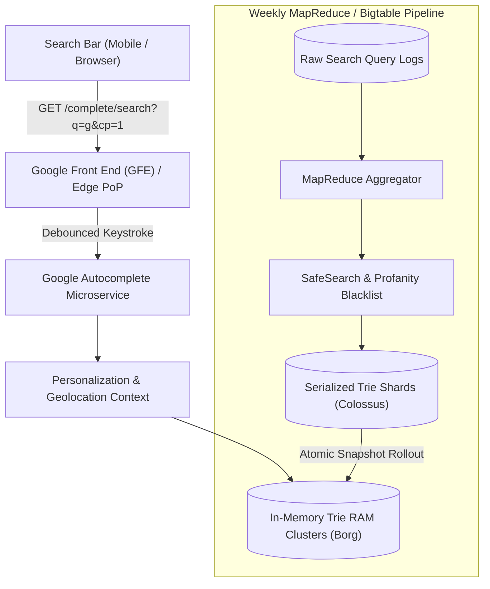
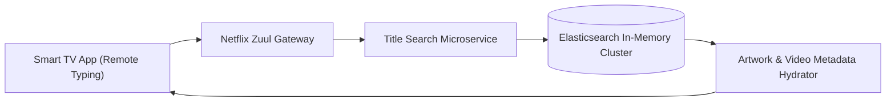

# Real-World Production Implementations: Search Autocomplete

> ⚠️ **Not yet source-checked.** These case studies summarize public engineering posts and talks, and some details may be simplified or wrong. Before you repeat a specific number or design in an interview, check it against the company's own write-up. Found an error, or a source that confirms a section? [Add it to the tracking issue](https://github.com/Aniketchavan7/system-design-illustrated/issues/9). Sourced fixes are the most welcome contribution here.

This document explores how Google and Netflix build ultra-low-latency typeahead and search suggestion architectures.

---

## 1. Google: Google Instant & Planetary Typeahead

### The Architecture
Google's autocomplete serves queries to billions of users, returning suggestions in **$< 15\text{ ms}$**. Google popularized this with **Google Instant**, completing searches before users finished typing.

### Key Technical Mechanisms
1. **Edge-Terminated Short Prefixes**:
   - Single-letter ("a", "b", "c") and two-letter ("go", "am", "fa") queries represent over 25% of all typeahead queries.
   - Google caches these responses directly in Edge Google Front End (GFE) caches worldwide, serving them in $< 5\text{ ms}$ without querying origin datacenters.
2. **Context-Aware Ranking**:
   - Google re-ranks Trie suggestions based on:
     - **Location**: Typing "giants" in San Francisco suggests the SF Giants baseball team; in New York, it suggests the NY Giants football team.
     - **User Search History**: Recently searched topics receive a higher personal score.
     - **Trending Velocity**: Real-time streaming signals elevate breaking news terms.
3. **SafeSearch & Legal Compliance**:
   - Automated classifiers filter out hate speech, explicit sexual queries, and copyrighted download terms before candidates enter the production Trie snapshot.

---

## 2. Netflix: Title Search & Fuzzy Actor Typeahead

### The Architecture
Netflix subscribers search for movie titles, actors, directors, and genres across smart TVs, game consoles, and mobile apps. Because typing with a TV remote is clumsy, Netflix's typeahead emphasizes **Fuzzy Matching** and **Instant Video Artwork Previews**.

### Key Technical Mechanisms
1. **Edge N-Gram Tokenization**:
   - Netflix uses **Elasticsearch Edge N-grams** on media metadata.
   - Searching "stra" matches edge n-grams for "Stranger Things", indexing character sequences from the beginning of words.
2. **Typo Tolerance with Levenshtein Automata**:
   - TV remote typists frequently mistype characters. Netflix's search engine tolerates an edit distance of up to 2 characters (e.g., typing "braking bad" matches "Breaking Bad").
3. **Instant Visual Box-Art Cards**:
   - While Google returns plain text strings, Netflix returns rich image URLs (posters) for top candidate titles directly in the typeahead payload so the UI renders thumbnails instantly.
