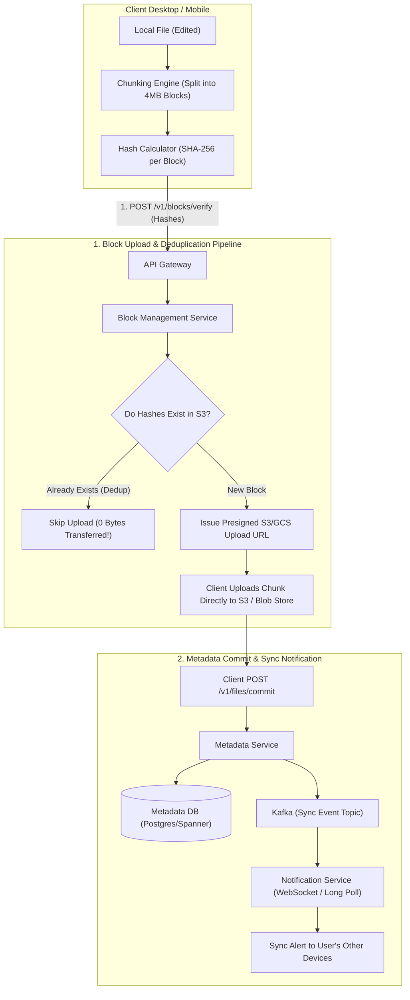

# Module 38: System Design — Cloud File Storage & Sync (Google Drive / Dropbox)

> Comprehensive architectural breakdown of a large-scale Cloud File Storage and Synchronization service (Google Drive / Dropbox), covering block chunking, SHA-256 deduplication, delta sync, and multi-device real-time sync notification.

---

## Prerequisites
Before tackling cloud file storage, review these core modules:
* [08 - Database Partitioning](../08-database-partitioning/README.md) (Sharding file metadata across relational/document stores)
* [17 - Message Queues](../17-message-queues/README.md) (Fanout notification of file change events to connected clients)
* [23 - System Design — Chat Application](../23-system-design-chat-app/README.md) (Long-polling / WebSocket connections for live sync)

---

## ELI5 (30-Second Summary)
Imagine you have a 1,000-page encyclopedia on your laptop and you want it backed up on the cloud. One day, you fix a typo on page 42.

If your backup app re-uploads all 1,000 pages every time you change one word, your battery drains, your Wi-Fi chokes, and cloud storage bills skyrocket.
Instead, a **Cloud File Storage System** cuts your encyclopedia into 4MB numbered blocks (**Chunking**). When you fix the typo on page 42, it calculates the unique fingerprint of each block (**SHA-256**), realizes that 999 blocks didn't change at all, and uploads *only* that single modified page 42 (**Delta Sync**)!

Even better: if your friend uploads the exact same movie you already uploaded, the server notices the matching fingerprint and links your account to the existing file in 0 seconds without uploading a single byte (**Deduplication**)!

---

## Physical Analogy
Think of a **Shipping Container Freight Terminal with Lego Blocks**:

| Shipping Terminal Analogy | Cloud File Storage Concept | Technical Description |
| :--- | :--- | :--- |
| **Cargo Manifest Document** | Metadata Database (SQL) | Tracks user accounts, directories, file names, permissions, and block lists. |
| **Standardized 4MB Cargo Containers** | Block / Chunking Layer | Splits large multi-GB files into uniform 4MB chunks. |
| **Barcode on Container (SHA-256)** | Block Checksum / Hash | Cryptographic identifier uniquely representing chunk binary data. |
| **Deep Storage Warehouse** | Object Storage (S3 / GCS) | Highly durable, immutable key-value store for block binaries. |
| **Replacing Only Broken Pallet** | Delta Sync | Uploading/downloading strictly the modified chunks rather than the whole file. |
| **Radio Dispatch to Port Cranes** | Real-Time Sync Notification (WebSocket) | Alerts a user's other devices (laptop, phone) that a file was updated. |

---

## The Problem It Solves
A global cloud storage service handles petabytes of user data across hundreds of millions of devices while tackling major constraints:
1. **Network Bandwidth Bottleneck**: Re-uploading multi-gigabyte video or Photoshop files on minor edits exhausts mobile data and Wi-Fi throughput.
2. **Redundant Storage Costs**: Millions of users back up identical files (operating system installers, popular music, shared PDF textbooks). Storing 1 million separate copies of a 1GB file costs $1\text{ PB}$ instead of $1\text{ GB}$.
3. **Cross-Device Consistency**: When a user edits a document on their laptop, their tablet and smartphone must reflect the changes in real-time without file conflicts.

---

## Visual Architecture



---

## Real Numbers & System Sizing

Consider a service like Dropbox or Google Drive with **50 Million Active Users**:
* **Storage Footprint**:
  - Assume average user stores 10 GB of data.
  - Total raw storage: $50\text{M} \times 10\text{ GB} = 500\text{ Petabytes}$.
  - With block-level deduplication (typically saving 30-40%): $\approx 350\text{ Petabytes}$ effective storage.
* **Upload / Sync QPS**:
  - Assume 2 file edits/day per user.
  - Edits/day: $50\text{M} \times 2 = 100\text{ million file syncs/day}$.
  - Average sync QPS: $100\text{M} / 86,400 \approx 1,160\text{ syncs/second}$.
  - Peak sync QPS ($3\times$): $\approx 3,500\text{ syncs/second}$.
* **Block Chunk Sizing**:
  - Standard chunk size: **4 Megabytes**.
  - A 100 MB video splits into 25 blocks.
  - 4MB is the optimal balance between HTTP request overhead (too many small blocks) and delta transfer efficiency (too few large blocks).

---

## Deep Dive: Under the Hood

### 1. Chunking and Block Level Deduplication
When a client saves a file:
1. The local client daemon splits the file into fixed (4MB) or variable-sized (Rabin fingerprinting) chunks.
2. It computes the SHA-256 hash for every chunk: `hash = sha256(chunk_bytes)`.
3. It sends the list of hashes to the Block Management Service.
4. The server queries its block index:
   - If `hash_1` already exists in Amazon S3 / Google Cloud Storage, the server flags it as already present.
   - If `hash_2` is missing, the server issues a pre-signed S3 URL for the client to upload `hash_2`.
5. **Cross-User Deduplication**: If User B uploads the same file User A already uploaded, User B's upload completes instantaneously because all blocks exist.

### 2. Delta Sync
When a file is modified:
- Only modified chunks receive new SHA-256 hashes.
- Unchanged chunks retain identical hashes.
- The client uploads *only* the new chunks, saving up to 99% of bandwidth.

### 3. File Conflict Resolution
What happens when two devices edit the same file simultaneously while offline?
- The first device to sync commits Version $N+1$.
- When the second device reconnects, the server rejects its commit due to a version mismatch.
- Rather than overwriting changes, the system creates a **Conflict Copy**:
  `Project_Report (Alice's conflicted copy 2026-11-23).docx`
- The user resolves differences manually, preventing catastrophic data loss.

---

## Trade-offs & Decision Matrix

| Dimension | Full-File Upload | Fixed-Size Chunking (4MB) | Variable-Size Chunking (Rabin) |
| :--- | :--- | :--- | :--- |
| **Bandwidth Efficiency** | Terrible (re-uploads entire file) | High (uploads only changed blocks) | Highest (resilient to byte shifts) |
| **Client CPU Overhead** | Low (simple stream) | Moderate (SHA-256 hashing) | High (sliding window polynomial math) |
| **Storage Deduplication** | Coarse (only identical files) | Fine-grained (shared blocks across files) | Maximum deduplication |
| **Implementation Complexity** | Trivial | Moderate | Complex |

---

## Common Pitfalls & Anti-Patterns

1. **Routing File Binary Uploads Through the API Gateway**: Routing 5GB video uploads through your application servers exhausts worker thread pools and memory. *Rule: Application servers authenticate and issue pre-signed S3/GCS upload URLs; clients stream binary blocks directly to object storage.*
2. **Missing Bandwidth Throttling on Client Daemons**: A desktop sync client maxing out upload bandwidth freezes the user's home Wi-Fi and causes lag in video games or Zoom calls. Clients must implement background upload rate limiting.
3. **Storing File Metadata in Object Storage**: Storing directory trees as JSON files inside S3 makes renaming a folder containing 10,000 files take minutes. *Store directory trees and metadata in a relational database (PostgreSQL/Spanner) where renaming a folder is a single atomic SQL update.*

---

## Try It Yourself
A runnable, zero-dependency Python simulation demonstrating 4MB block chunking, SHA-256 block deduplication, delta sync upload savings, and metadata versioning is included in this directory.

Run the simulation:
```bash
python demo.py
```

---

## Production References & Further Reading
* [Dropbox Tech Blog: How We Scaled Dropbox Sync Engine](https://dropbox.tech/infrastructure/how-we-scaled-the-dropbox-sync-engine)
* [Google Cloud Architecture: Building Scalable Storage on Google Cloud Storage](https://cloud.google.com/storage/docs)
* [Alex Xu: System Design Interview Vol 1 - Chapter 15 (Design Google Drive)](https://bytebytego.com)

---

## Top 5 Interview Questions with Model Answers

### Q1: How does a cloud storage system like Dropbox or Google Drive implement Delta Sync?
**Model Answer**: Delta Sync is achieved through **Block-Level Chunking**:
1. Files are sliced into 4MB chunks.
2. The client calculates the SHA-256 hash of each chunk.
3. When a file is updated, the client re-chunks the file and compares the new chunk hashes with the previous version's hashes.
4. Only chunks with modified hashes are uploaded to the cloud. Unchanged chunks are referenced by their existing block hashes in the metadata database, saving up to 99% of network bandwidth.

### Q2: Why should binary file uploads bypass the application backend and go directly to Cloud Storage (S3/GCS)?
**Model Answer**: If application API servers handle binary uploads, multi-gigabyte file transfers monopolize socket connections, consume server memory buffers, and create network bottlenecks. Instead:
- The client contacts the API service requesting an upload.
- The API service authenticates the user, checks quotas, and generates a time-limited **Pre-signed S3 Upload URL**.
- The client streams the binary chunk directly to S3/GCS over HTTPS.
- Once S3 confirms upload completion, the client notifies the API service to commit the metadata record.

### Q3: How do you handle file synchronization conflicts when two devices edit the same file simultaneously?
**Model Answer**: We use **Optimistic Concurrency Control with Conflicted Copies**:
- Every file metadata record contains a monotonic version number (`version_id`).
- When Device A commits changes, it sends `version: 5`. The server checks the DB; since current version is 5, it increments to 6 and commits.
- When Device B tries to commit with `version: 5`, the server detects that the file has advanced to version 6.
- The server rejects Device B's commit. Device B's client downloads the latest version 6 and saves Device B's local edits as a separate file named `Filename (Conflicted Copy from Device B).txt`, letting the user merge changes without data loss.

### Q4: How does cross-user deduplication work, and what security risk does it introduce?
**Model Answer**: Cross-user deduplication checks if a chunk's SHA-256 hash already exists in the global storage repository. If it exists, the server maps the new user's metadata pointer to the existing chunk without uploading.
- **Security Risk (Hash Sniffing / Information Leak)**: An attacker who knows the SHA-256 hash of a confidential file (e.g., a leaked court document) could query the API. If the server says "Already exists, upload skipped", the attacker proves someone on the platform possesses that document.
- **Mitigation (Proof of Ownership)**: Services require the client to supply a challenge-response proof (e.g., hashing a random byte offset of the file) to prove they physically possess the file before linking it to their account.

### Q5: How do client devices receive instant sync notifications when a file changes on another device?
**Model Answer**: Using a persistent **Notification Service** powered by WebSockets or HTTP/2 Server-Sent Events (SSE):
- When a file commit succeeds on Device A, the Metadata Service publishes an event to a Kafka topic.
- A cluster of Notification Service workers maintains persistent bidirectional WebSocket connections with connected client devices.
- The Notification Service pushes a lightweight payload `{ file_id: "xyz", new_version: 7 }` to Device B.
- Device B's client wakes up, fetches the modified block delta from the server, and updates its local disk folder.

---

## Check Yourself Quiz

<details>
<summary><b>1. What is the optimal block size commonly used in cloud file sync engines?</b></summary>
A) 4 Kilobytes<br/>
B) 4 Megabytes<br/>
C) 1 Gigabyte<br/>
D) 1 Byte<br/><br/>
<b>Answer: B</b>. 4MB balances HTTP connection overhead with fine-grained delta transfer efficiency.
</details>

<details>
<summary><b>2. Why are binary file uploads sent directly to S3 via pre-signed URLs?</b></summary>
A) Because S3 is free.<br/>
B) To prevent large binary payloads from exhausting API gateway connections and memory buffers.<br/>
C) Because Python cannot upload files.<br/>
D) To avoid using HTTPS.<br/><br/>
<b>Answer: B</b>. Bypassing application servers offloads petabyte-scale streaming traffic directly to object storage.
</details>

<details>
<summary><b>3. What happens when two users concurrently edit the same document in Dropbox?</b></summary>
A) Both edits are permanently lost.<br/>
B) The server creates a Conflicted Copy so neither user's work is overwritten.<br/>
C) The computer crashes.<br/>
D) The database drops the table.<br/><br/>
<b>Answer: B</b>. Generating a conflicted copy preserves both revisions and prevents silent data overwrites.
</details>

<details>
<summary><b>4. How does block-level deduplication reduce storage costs?</b></summary>
A) By deleting files after 7 days.<br/>
B) By identifying identical SHA-256 block hashes and storing only a single physical copy across multiple users.<br/>
C) By compressing files with zip.<br/>
D) By storing files in plaintext.<br/><br/>
<b>Answer: B</b>. Multiple users uploading the same operating system ISO or music file share references to the same physical blocks.
</details>

<details>
<summary><b>5. Which protocol is best suited for waking client desktop apps to sync changes immediately?</b></summary>
A) DNS polling<br/>
B) Persistent WebSockets / HTTP/2 Server-Sent Events (SSE)<br/>
C) FTP<br/>
D) SMTP Email<br/><br/>
<b>Answer: B</b>. WebSockets provide persistent low-latency push notifications to trigger local background sync daemons.
</details>
