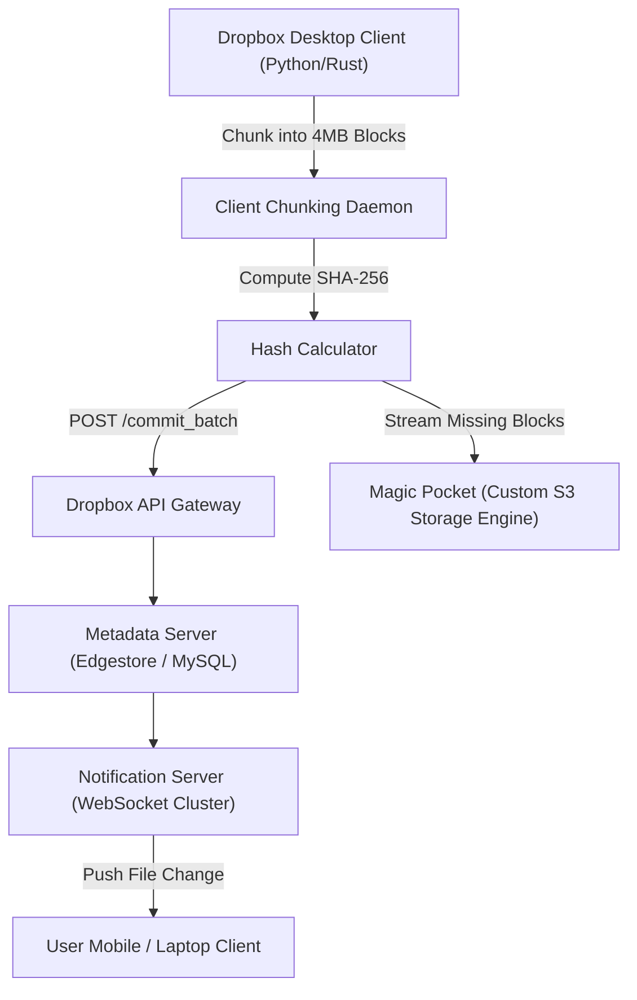
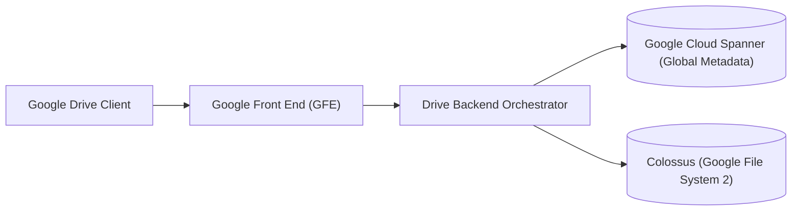

# Real-World Production Implementations: Cloud File Storage

This document explores how Dropbox and Google Drive store, chunk, deduplicate, and synchronize petabytes of user files.

---

## 1. Dropbox: The Magic Pocket & Sync Engine Architecture

### The Architecture
Dropbox syncs files for over **700 million registered users**, storing exabytes of data. Dropbox originally ran on Amazon S3 before migrating to its custom-built storage infrastructure (**Magic Pocket**).

### Key Technical Mechanisms
1. **Magic Pocket (Exabyte Storage Architecture)**:
   - Custom-designed hardware and software storage engine deployed across Dropbox datacenters.
   - Slices files into immutable 4MB blocks, storing them with $8+4$ Reed-Solomon erasure coding across distributed disk storage sleds, achieving $99.9999999999\%$ (12 9's) durability.
2. **Variable-Length Chunking (Rabin Fingerprints)**:
   - Fixed-size chunking suffers from the **byte-shift problem**: inserting 1 byte at the start of a file shifts all subsequent 4MB boundaries, invalidating every block hash.
   - Dropbox implements content-defined variable-length chunking (using Rabin fingerprint rolling hashes) to identify natural boundary cuts, ensuring insertions only modify a single local block.
3. **Rust Sync Engine (Nucleus)**:
   - Dropbox rewrote its desktop synchronization client in Rust to provide formal correctness proofs, eliminating multi-threaded race conditions in local file watching.

---

## 2. Google: Google Drive & Colossus Distributed File System

### The Architecture
Google Drive integrates with Google Docs, Sheets, Gmail, and Android backups, serving over **1 billion users**.

### Key Technical Mechanisms
1. **Colossus Storage Engine**:
   - The successor to Google File System (GFS).
   - Manages block striping, Reed-Solomon encoding, and automatic disk repair across millions of storage nodes.
2. **Global Metadata on Google Cloud Spanner**:
   - File directories, permissions, and sharing ACLs are stored in Google Cloud Spanner.
   - Spanner's TrueTime atomic transactions guarantee that if a user revokes access to a shared folder, permission updates apply globally across all Google datacenters instantaneously without replication lag.
3. **Real-Time Collaborative Operational Transformation (OT)**:
   - For native Google Docs files, Drive does not sync 4MB binary blocks. Instead, it uses **Operational Transformation (OT)** to stream individual keystroke character operations over WebSockets, allowing multiple users to edit the same sentence simultaneously in real-time.
