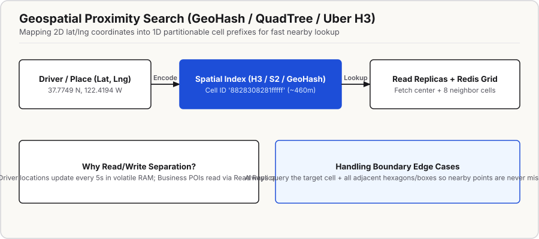
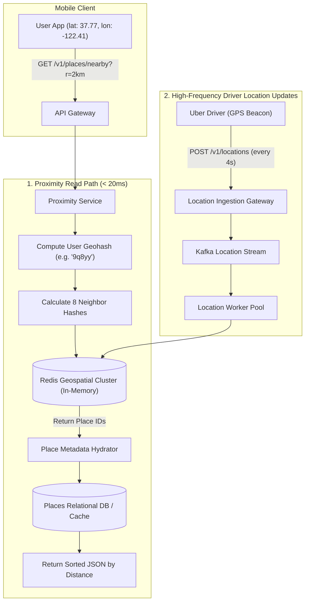

# Module 39: System Design — Proximity Service & Nearby Places (Yelp / Uber)

> Comprehensive architectural breakdown of a Location-Based Proximity Service (Yelp, Google Maps, Uber Nearby), covering Geohash encoding, Quadtrees, Google S2 cells, and sub-50ms radius geospatial queries.

---

## Prerequisites
Before tackling proximity services, review these core modules:
* [09 - Storage Engines & Indexing](../09-storage-engines-and-indexing/README.md) (B-Trees vs spatial indexing)
* [10 - Caching Patterns](../10-caching-patterns/README.md) (Caching static businesses vs dynamic driver locations)
* [16 - Consistent Hashing](../16-consistent-hashing/README.md) (Distributing geospatial shards across Redis nodes)

---

## ELI5 (30-Second Summary)
Imagine you open your phone and search for "pizza near me". Your phone knows your GPS coordinates (Latitude: 37.7749, Longitude: -122.4194).

In the physical world, the Earth is a 2D surface. If you ask a standard SQL database `SELECT * FROM restaurants WHERE lat BETWEEN ... AND lon BETWEEN ...`, the database has to scan millions of rows because standard indexes only sort in 1 dimension.

A **Proximity Service** chops the surface of the Earth into a grid of tiny square patches like a checkerboard, giving each patch a short string code (**Geohash**, like `"9q8yy"`). All restaurants inside that patch share the exact same string code! Now, finding nearby restaurants is as fast as looking up a single word in a dictionary!

---

## Physical Analogy
Think of an **Old-Fashioned City Map Grid Index**:

| City Map Analogy | Proximity Service Concept | Technical Description |
| :--- | :--- | :--- |
| **Grid Square "D-4" on Folded Map** | Geohash (e.g., `dr5ru`) | Hierarchical string encoding 2D latitude/longitude into a 1D string. |
| **Looking up Square D-4 in map index** | Geospatial Index Lookup (Redis `GEO`) | Sub-millisecond lookup of entities sharing the same geohash prefix. |
| **Zooming into Downtown Sub-Grid** | Quadtree / Geohash Precision (Length 6) | Length 6 Geohash covers $\approx 1.2\text{km} \times 0.6\text{km}$; Length 7 covers $150\text{m} \times 150\text{m}$. |
| **Checking the 8 Surrounding Grid Squares** | 8 Neighbor Cell Search | Solves the **Boundary Problem** by querying the central cell plus 8 adjacent neighbors. |
| **Taxi GPS Beacon Every 4 Seconds** | Dynamic Location Stream (Kafka + Redis) | High-write dynamic driver stream separated from static business data. |

---

## The Problem It Solves
Building a proximity service for apps like Yelp, Uber, or Google Maps poses unique geospatial challenges:
1. **The 2D Indexing Problem**: Traditional B-Tree and LSM indexes sort data in 1 dimension. Indexing latitude and longitude independently results in a massive 2D bounding-box table scan ($O(N)$).
2. **High-Write Dynamic GPS Updates (Uber/Lyft)**: Millions of active drivers broadcast GPS coordinates every 3-5 seconds, creating hundreds of thousands of location writes per second.
3. **The Boundary Problem**: If a user stands near the edge of a grid square, a restaurant 50 meters away might be in an adjacent grid square. Systems must query neighboring cells to prevent missing close places.

---

## Visual Architecture

<p align="center">
  
</p>



---

## Real Numbers & System Sizing

Consider a Yelp-like service with **100 Million Active Users** and **200 Million Global Places**:
* **Read Query Volume**:
  - 100M users $\times$ 2 proximity searches/day = $200\text{ million queries/day}$.
  - Average QPS: $200\text{M} / 86,400 \approx 2,300\text{ QPS}$.
  - Peak QPS ($3\times$): $\approx 7,000\text{ QPS}$.
* **Static Place Storage Footprint**:
  - 200 million places globally.
  - Place ID (8 bytes) + Geohash (12 bytes) + Lat/Lon (16 bytes) = 36 bytes.
  - Total spatial index size: $200\text{M} \times 36\text{ bytes} \approx 7.2\text{ Gigabytes}$!
  - 7.2 GB easily fits inside a single Redis node's memory.
* **Geohash Precision Sizing**:

| Geohash Length | Cell Width $\times$ Height | Typical Real-World Use Case |
| :--- | :--- | :--- |
| **4** | $39\text{ km} \times 19\text{ km}$ | Large metropolitan region |
| **5** | $4.9\text{ km} \times 4.9\text{ km}$ | City district / neighborhood |
| **6** | $1.2\text{ km} \times 0.6\text{ km}$ | Proximity search (walk/short drive) |
| **7** | $153\text{ m} \times 153\text{ m}$ | Precise street / building block |
| **8** | $38\text{ m} \times 19\text{ m}$ | Accurate curb / door location |

---

## Deep Dive: Under the Hood

### 1. Geohash Encoding
Geohash interleaves the binary representations of latitude and longitude:
1. Divide Latitude $[-90, +90]$ into binary splits (greater than 0 = 1, less than 0 = 0).
2. Divide Longitude $[-180, +180]$ into binary splits.
3. Interleave bits: `lon[0], lat[0], lon[1], lat[1]...`
4. Encode the combined bitstream into Base-32 (`0-9`, `b-z` excluding `a, i, l, o` to avoid visual confusion).
5. **Key Property**: All points sharing a common prefix belong to the same spatial cell. Prefix matching (`LIKE '9q8yy%'`) performs an instantaneous range query over 2D space!

### 2. Solving the Boundary Problem
If you only query the user's current cell, a restaurant 10 meters away across the grid border will be completely missed.
**The 9-Cell Algorithm**:
- Given the user's Geohash (e.g., `9q8yy`), compute the 8 neighboring cells: North, South, East, West, NW, NE, SW, SE.
- Query all 9 cells in parallel from Redis.
- Filter candidate places by exact Haversine distance from the user's coordinates.

### 3. Spatial Index Comparison: Geohash vs. Quadtree vs. Google S2
* **Geohash**: Simple Base-32 string; supported natively by Redis (`GEOADD`, `GEORADIUS`). Best for static places and fast radius lookups.
* **Quadtree**: In-memory tree where each node splits into 4 quadrants when entity count exceeds a threshold (e.g., $> 100$ places per node). Dynamically adapts to population density (dense in cities, sparse in rural areas).
* **Google S2**: Projects the 3D spherical Earth onto a cube using Hilbert Space-Filling Curves. Produces 64-bit integers with zero distortion at the poles. Preferred by Google Maps and Uber.

---

## Trade-offs & Decision Matrix

| Mechanism | 2D SQL Bounding Box | Geohash (Redis GEO) | Quadtree (In-Memory) | Google S2 Geometry |
| :--- | :--- | :--- | :--- | :--- |
| **Lookup Latency** | Slow ($50-300\text{ ms}$) | Ultra-fast ($< 5\text{ ms}$) | Fast ($5-15\text{ ms}$) | Ultra-fast ($< 3\text{ ms}$) |
| **Memory Footprint** | Low (disk-based) | Moderate | High (node tree pointers) | Minimal (64-bit ints) |
| **High Dynamic Writes** | Terrible (locks tables) | Excellent (Redis in-memory) | Moderate (tree rebalancing) | Excellent |
| **Polar Distortion** | Severe near poles | Noticeable | Moderate | Zero (spherical projection) |

---

## Common Pitfalls & Anti-Patterns

1. **Forgetting the 8 Neighboring Cells**: Querying strictly the user's geohash misses businesses right across the street if they sit on a grid border. Always query the center cell plus 8 neighbors.
2. **Storing Dynamic Moving Targets with Static Businesses**: Storing static restaurants (updated once a year) and moving Uber drivers (updated every 4 seconds) in the same database table leads to index lock contention and performance collapse. *Separate into a static Places DB and an ephemeral Redis/Kafka Driver Location store.*
3. **Calculating Great-Circle Haversine Distance on the Entire Database**: Running `acos(sin(lat)...)` across 200 million rows scans the entire table. *Use spatial indexes to prune candidates down to $< 100$ places before calculating exact Haversine distance.*

---

## Try It Yourself
A runnable, zero-dependency Python simulation demonstrating Geohash encoding, 9-cell boundary neighbor expansion, and Haversine distance radius filtering is included in this directory.

Run the simulation:
```bash
python demo.py
```

---

## Production References & Further Reading
* [Uber Engineering: Geospatial Information Systems and Google S2](https://www.uber.com/blog/h3/)
* [Redis Documentation: Redis Geospatial Commands (GEOADD, GEORADIUS)](https://redis.io/commands/georadius/)
* [Alex Xu: System Design Interview Vol 2 - Chapter 1 (Nearby Friends / Proximity Service)](https://bytebytego.com)

---

## Top 5 Interview Questions with Model Answers

### Q1: How does Geohash convert two-dimensional coordinates (latitude, longitude) into a one-dimensional searchable index?
**Model Answer**: Geohash recursively subdivides the Earth's latitude $[-90, +90]$ and longitude $[-180, +180]$ intervals into binary splits. At each level:
1. If the coordinate falls in the upper half of the range, assign bit `1`; if lower half, assign bit `0`.
2. The alternating bits (longitude bit, latitude bit, longitude bit...) are interleaved into a single continuous bitstream.
3. The bitstream is grouped into 5-bit chunks and encoded into Base-32 characters.
This preserves spatial locality: points located geographically close to each other share long common prefixes in their Geohash strings, enabling fast $O(1)$ prefix range scans.

### Q2: What is the "Boundary Problem" in grid-based spatial systems, and how is it resolved?
**Model Answer**: The boundary problem occurs when a user stands close to the border of their spatial grid cell. A venue only 10 meters away across the boundary will have a completely different Geohash string. If we only query the user's cell, close venues are missed.
We solve this using the **9-Cell Query Technique**:
- Calculate the user's central Geohash cell.
- Derive the 8 adjacent surrounding cells (North, South, East, West, NW, NE, SW, SE).
- Query all 9 cells in parallel, merge the candidates, and apply exact Haversine distance filtering to guarantee zero boundary misses.

### Q3: Why does Uber use Google S2 / H3 instead of standard Geohash?
**Model Answer**:
- **Spherical Geometry**: Geohash is based on a flat equirectangular projection of the Earth, which suffers from severe spatial distortion near the North and South poles. Google S2 projects the spherical Earth onto a 3D cube using Hilbert space-filling curves, eliminating polar distortion.
- **64-Bit Integer Representations**: S2 cells are compact 64-bit integers (`uint64`), allowing ultra-fast bitwise operations and efficient storage in CPU registers and database indexes compared to string manipulation.
- **H3 (Hexagonal Grids)**: Uber created H3 (hexagons) because all 6 neighbors of a hexagon are equidistant from its center, simplifying dynamic ride-surge radius calculations.

### Q4: How do you architecture a system where 1 million active drivers send GPS updates every 4 seconds?
**Model Answer**:
1. **Dedicated Ingestion Highway**: GPS updates bypass the core database and stream directly into an **Apache Kafka** topic partitioned by `geohash_prefix`.
2. **Ephemeral In-Memory Datastore (Redis)**: Stream workers update driver coordinates in Redis clusters using `GEOADD drivers <lon> <lat> <driver_id>` with a 15-second TTL.
3. **Read/Write Separation**: Rider search queries read exclusively from the hot in-memory Redis cluster. Historical trip playback data is asynchronously flushed to cold storage (ClickHouse/S3) without impacting live matching.

### Q5: How do Quadtrees adapt to varying population densities between rural and urban areas?
**Model Answer**: In a **Quadtree**, each spatial node represents a bounding box. When the number of entities within a node exceeds a fixed capacity threshold (e.g., $N > 100$):
- The node dynamically splits into 4 equal quadrant children (NW, NE, SW, SE), re-distributing entities among them.
- In dense urban centers (Manhattan, Tokyo), the Quadtree recursively subdivides into dozens of deep, tiny quadrants.
- In rural areas (Montana, Sahara), a single large node remains un-split.
This guarantees that spatial query complexity remains balanced across both dense cities and sparse rural areas.

---

## Check Yourself Quiz

<details>
<summary><b>1. What mathematical property does Geohash provide for spatial searches?</b></summary>
A) Encrypts GPS coordinates using RSA.<br/>
B) Interleaves latitude and longitude bits so nearby geographic points share identical string prefixes.<br/>
C) Compresses coordinates with MP3 audio encoding.<br/>
D) Guarantees zero network latency.<br/><br/>
<b>Answer: B</b>. Shared string prefixes represent shared bounding boxes, enabling fast prefix lookups.
</details>

<details>
<summary><b>2. How many neighboring cells must be inspected to solve the boundary problem in a grid spatial system?</b></summary>
A) 0 (only the user's cell)<br/>
B) 8 neighboring cells (total 9 cells queried)<br/>
C) 100 cells<br/>
D) 4,000 cells<br/><br/>
<b>Answer: B</b>. The 8 adjacent cells plus the center cell guarantee no boundary misses.
</details>

<details>
<summary><b>3. Approximately what area is covered by a Geohash of length 6?</b></summary>
A) 1,000 km x 1,000 km<br/>
B) 1.2 km x 0.6 km<br/>
C) 1 meter x 1 meter<br/>
D) The entire Earth<br/><br/>
<b>Answer: B</b>. Length 6 covers approximately 1.2km x 0.6km, ideal for neighborhood proximity searches.
</details>

<details>
<summary><b>4. Why are dynamic driver GPS updates separated from static restaurant databases?</b></summary>
A) Because drivers do not eat food.<br/>
B) To prevent high-frequency write updates (every 4 seconds) from degrading read performance and locking static database tables.<br/>
C) Because SQL cannot store numbers.<br/>
D) Because Redis is only for strings.<br/><br/>
<b>Answer: B</b>. Separating dynamic streaming writes from static catalog databases protects availability and throughput.
</details>

<details>
<summary><b>5. Which spatial index uses hexagons where all neighbor centers are equidistant?</b></summary>
A) B-Tree<br/>
B) Uber H3<br/>
C) Hash Table<br/>
D) Linked List<br/><br/>
<b>Answer: B</b>. Uber H3 partitions the globe into hexagonal cells where all 6 neighbors share equal distances.
</details>
