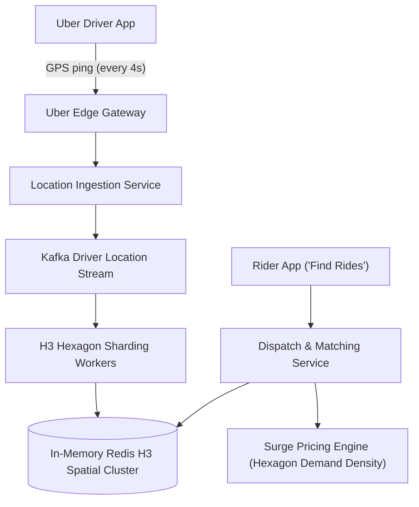
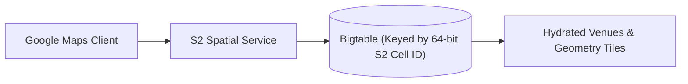

# Real-World Production Implementations: Proximity Services

This document explores how Uber and Google Maps build high-performance geospatial infrastructure.

---

## 1. Uber: Hexagonal Hierarchical Spatial Index (H3)

### The Architecture
Uber coordinates millions of rides and food deliveries in hundreds of cities worldwide. Because Uber deals with dynamic moving vehicles, city-wide surge pricing, and pickup dispatch, it developed **H3 (Hexagonal Hierarchical Spatial Index)**.

### Key Technical Mechanisms
1. **Why Hexagons over Squares (Geohash)?**:
   - In a square grid (Geohash), a cell has two types of neighbors: 4 edge neighbors (distance $D$) and 4 diagonal corner neighbors (distance $\sqrt{2} D \approx 1.414 D$).
   - In a hexagonal grid (**H3**), all **6 neighbors are equidistant** from the center. This makes finding vehicles within a smooth radius and computing dynamic surge-pricing boundaries mathematically consistent and free of diagonal artifacts.
2. **Surge Pricing Aggregation**:
   - Uber aggregates rider pickup requests into H3 resolution-8 hexagons (each $\approx 0.7\text{ km}^2$).
   - If ride requests exceed available driver supply within a hexagon, the surge multiplier increases automatically for that hexagonal cell.
3. **Sub-Second Dispatch Matching**:
   - When a rider requests a pickup, Uber queries the rider's H3 hexagon and the 6 adjacent ring-1 hexagons in Redis, matching the closest available driver in $< 50\text{ ms}$.

---

## 2. Google: Google Maps & S2 Geometry Library

### The Architecture
Google Maps indexes hundreds of millions of businesses, roads, satellite tiles, and transit routes across the globe using the **Google S2 Geometry Library**.

### Key Technical Mechanisms
1. **Hilbert Space-Filling Curve on a Cube**:
   - S2 projects the sphere of the Earth onto the six faces of an enclosing cube.
   - It maps 2D coordinates on the cube faces into a 1D continuous path using the **Hilbert Curve**, which guarantees that points close in 1D space are close in 3D physical reality.
2. **Compact 64-Bit Integer Keys (`uint64`)**:
   - Unlike string-based Geohash, an S2 cell is represented as a single 64-bit unsigned integer.
   - Searching for places in an area translates into an ultra-fast B-Tree integer range query (`min_cell_id <= cell_id <= max_cell_id`) on Google Bigtable.
3. **Dynamic Tile Level of Detail (LoD)**:
   - S2 supports 30 levels of hierarchical cell decomposition: Level 0 covers an entire cube face ($85\text{ million km}^2$), while Level 30 covers $\approx 1\text{ cm}^2$.
   - When zoomed out, Google Maps loads Level-10 cells; when zoomed in to street level, it streams Level-16 cells.
