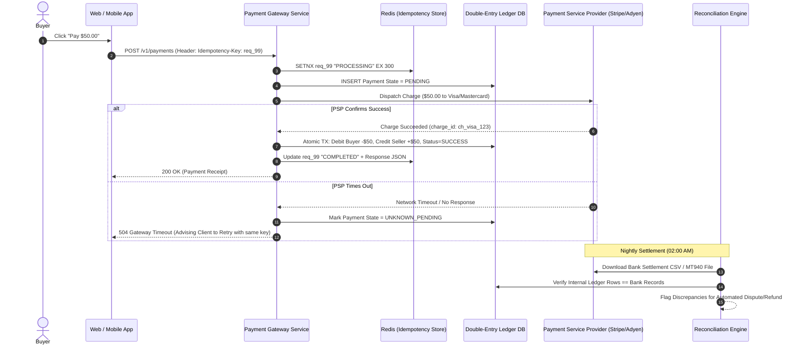

# Module 40: System Design — Digital Wallet & Payment System

> Comprehensive architectural breakdown of an Enterprise Payment and Digital Wallet System (Stripe, PayPal, Adyen), covering Double-Entry Bookkeeping, the Payment State Machine, Idempotency, and End-of-Day Reconciliation.

---

## Prerequisites
Before tackling payment systems, review these core modules:
* [19 - Distributed Transactions](../19-distributed-transactions/README.md) (2PC, Saga pattern, and compensating transactions)
* [20 - Fault Tolerance & Resilience](../20-fault-tolerance-and-resilience/README.md) (Retries, dead letter queues, and exponential backoff)
* [29 - Database Transactions & Isolation](../29-database-transactions-and-isolation/README.md) (ACID guarantees, Serializable isolation, and lost updates)
* [32 - REST API Design & Idempotency](../32-rest-api-design-and-idempotency/README.md) (Idempotency keys preventing double-charges)

---

## ELI5 (30-Second Summary)
Imagine a bank where money is kept in magical locked boxes. If Alice wants to send \$50 to Bob, the bank never just erases \$50 from Alice's account and writes +\$50 in Bob's account. Why? Because if the power cuts out mid-way, Alice loses \$50 and Bob receives nothing!

Instead, banks use **Double-Entry Bookkeeping**, an accounting law invented in the 1400s: every single transaction must have at least two entries where **Total Debits = Total Credits**. Money can never appear or vanish out of thin air.

Even if network cables are cut, external payment gateways (Visa, MasterCard) crash, or servers reboot, a **Payment System** uses strict mathematical ledgers, unique idempotency keys, and automated reconciliation accountants to ensure not a single penny is ever lost or duplicated!

---

## Physical Analogy
Think of a **Physical Two-Pan Balance Scale in a Gold Vault**:

| Gold Vault Analogy | Payment System Concept | Technical Description |
| :--- | :--- | :--- |
| **Gold removed from Left Pan (Debit)** | Account Debit Entry | Reduces asset balance or records an expense. |
| **Gold added to Right Pan (Credit)** | Account Credit Entry | Increases liability or records offsetting credit. |
| **Scale Must Balance to Zero** | Double-Entry Bookkeeping Invariant | $\sum \text{Debits} - \sum \text{Credits} = 0$. Absolute invariant across the ledger. |
| **Embossed Serial Number on Gold Bar** | `Idempotency-Key` Header | Client-assigned token preventing double-charging across network retries. |
| **Vault Guard Checking Balance Log Daily** | End-of-Day Reconciliation | Background auditing service verifying internal DB balances match bank settlement files. |

---

## The Problem It Solves
Payment systems operate under the strictest regulatory and correctness requirements in software engineering:
1. **Zero Data Loss & Zero Double-Charging**: Charging a customer twice or dropping funds results in severe financial fines, fraud audits, and loss of business trust.
2. **Unreliable External Banking Networks**: Card processing networks (Visa, Stripe, Adyen) can take 5 to 30 seconds to confirm charges, or time out entirely. Systems must handle in-flight transactions safely.
3. **Auditability & Traceability**: Every penny entering, moving through, or exiting the platform must be cryptographically auditable for tax authorities and financial compliance (SOX, PCI-DSS).

---

## Visual Architecture



---

## Real Numbers & Financial Throughput

Consider an e-commerce platform processing **\$10 Billion Annually**:
* **Transaction Volume**:
  - Average order value: \$50.
  - Total transactions/year: $10\text{B} / 50 = 200\text{ million transactions/year}$.
  - Daily transactions: $200\text{M} / 365 \approx 550,000\text{ transactions/day}$.
  - Average QPS: $\approx 6.5\text{ transactions/second}$.
  - Peak holiday QPS (Black Friday $50\times$): $\approx 325\text{ transactions/second}$.
* **Data Sizing & High Durability**:
  - Payment systems are write-heavy and append-only (no row is ever deleted or mutated in-place).
  - Average ledger journal entry: $\approx 1\text{ KB}$ (audit timestamps, foreign keys, amount in cents, currency).
  - Annual ledger growth: $200\text{M} \times 1\text{ KB} \approx 200\text{ GB/year}$.
  - Stored across globally replicated relational databases (Google Cloud Spanner / CockroachDB / PostgreSQL with synchronous multi-AZ replication).

---

## Deep Dive: Under the Hood

### 1. Double-Entry Bookkeeping
In financial ledgers, account balances are **never** stored as simple mutable integer columns (`UPDATE users SET balance = balance + 50`).
Instead:
- The ledger consists of immutable **Journal Entries**.
- Every transaction contains at least one **Debit** and at least one **Credit**.
- Core Invariant:

$$\sum \text{Debits} - \sum \text{Credits} = 0$$

- An account balance is simply the historical sum of all its journal entries: `SELECT SUM(amount) FROM ledger_entries WHERE account_id = 'user_alice'`.

### 2. The Payment State Machine
Payment records transition through a strict finite state machine:
`INITIALIZED` $\rightarrow$ `PENDING` $\rightarrow$ `AUTHORIZED` $\rightarrow$ `CAPTURED` (or `FAILED` / `REFUNDED`).
- If an external PSP times out, the payment enters `UNKNOWN_PENDING`.
- An asynchronous worker polls the PSP's status API or waits for incoming PSP webhooks to resolve the terminal state (`SUCCESS` or `FAILED`).

### 3. End-of-Day Reconciliation
No distributed system is immune to network glitches.
At 02:00 AM every night:
1. The Payment Service Provider (e.g., Stripe, Chase Paymentech) generates a settlement file (`settlement_20261123.csv`).
2. The internal **Reconciliation Engine** reads every row in the settlement file and compares it against the internal ledger database.
3. If an entry is missing internally (e.g., PSP charged customer but webhook dropped), the reconciliation engine generates an internal adjusting journal entry.

---

## Trade-offs & Decision Matrix

| Mechanism | Single-Entry Mutable Balances | Double-Entry Immutable Ledger | Distributed Saga Orchestration |
| :--- | :--- | :--- | :--- |
| **Auditability** | Zero (no historical trace of changes) | Perfect (immutable cryptographic trail) | High (event log history) |
| **Data Correctness** | High risk of money creation/loss | Mathematically verified (debit = credit) | Requires compensating transactions |
| **Write Throughput** | High (single row update) | Moderate (append-only rows) | High (asynchronous decoupled services) |
| **Regulatory Compliance** | Fails financial audits (SOX/PCI) | 100% GAAP / IFRS compliant | Compliant with proper ledger service |

---

## Common Pitfalls & Anti-Patterns

1. **Floating-Point Currency Calculations**: Using standard IEEE 754 floats (`float` or `double` in Java/Python/JS) causes precision errors (`0.1 + 0.2 = 0.30000000000000004`). *Always store currency as integers in the lowest fractional unit (cents: $1000 = \$10.00$) or arbitrary-precision SQL types (`NUMERIC(18, 4)`).*
2. **Mutating Balances In-Place**: Executing `UPDATE accounts SET balance = balance - 10` destroys audit history. Ledgers must be append-only.
3. **Trusting Webhooks Blindly Without Signature Verification**: Attackers can spoof PSP webhook calls (`POST /stripe/webhook` with `payment_succeeded`). Always verify the cryptographic HMAC signature (`Stripe-Signature` header) using the secret key before processing.

---

## Try It Yourself
A runnable, zero-dependency Python simulation demonstrating a Double-Entry Bookkeeping ledger, atomic debit/credit balance verification, payment state transitions, and idempotency protection is included in this directory.

Run the simulation:
```bash
python demo.py
```

---

## Production References & Further Reading
* [Stripe Engineering: How Stripe Uses Idempotency to Prevent Double Charges](https://stripe.com/blog/idempotency)
* [Modern Treasury: What is Double-Entry Bookkeeping and Why Do Developers Need It?](https://www.moderntreasury.com/learn/double-entry-bookkeeping)
* [Alex Xu: System Design Interview Vol 2 - Chapter 11 (Payment System)](https://bytebytego.com)

---

## Top 5 Interview Questions with Model Answers

### Q1: Why is Double-Entry Bookkeeping mandatory in payment systems instead of updating account balances directly?
**Model Answer**: Directly updating balances (`UPDATE accounts SET balance = balance - 50`) creates a single point of failure with zero auditability. If an update fails mid-way, money appears or vanishes without trace.
**Double-Entry Bookkeeping** enforces that every movement of money is recorded as an immutable journal entry with matching Debits and Credits ($\sum 	ext{Debits} = \sum 	ext{Credits}$). 
1. It guarantees that money cannot be created or destroyed out of thin air.
2. It provides an unalterable audit trail for financial regulators (SOX, GAAP).
3. Any balance discrepancy can be diagnosed by checking the mathematical sum of historical entries.

### Q2: Why should monetary values never be stored or manipulated using floating-point data types?
**Model Answer**: IEEE 754 floating-point representations (such as `float` or `double`) cannot represent fractional base-10 decimals precisely. For example, adding $0.1 + 0.2$ in floating-point arithmetic results in $0.30000000000000004$. In financial systems handling millions of transactions, rounding errors accumulate into significant financial discrepancies.
Instead:
- Store monetary values as **Integers in the smallest currency unit** (e.g., store \$10.50 as `1050` cents).
- Use arbitrary-precision decimal representations such as `DECIMAL(18, 4)` in SQL or `BigDecimal` in Java / `Decimal` in Python.

### Q3: How do you handle an external Payment Service Provider (PSP) network timeout?
**Model Answer**:
1. When a timeout occurs, the payment must transition to an indeterminate state: `UNKNOWN_PENDING` (never mark it as failed immediately, because the bank may have processed the charge!).
2. Return an advisory status to the client with the instruction that the transaction is in-flight.
3. An asynchronous reconciliation worker queries the PSP's status API (`GET /v1/charges/{idempotency_key}`) or awaits an incoming signed PSP Webhook to learn the definitive outcome.
4. If confirmed successful, finalize the ledger transaction; if confirmed failed, transition to `FAILED` and release any authorization holds.

### Q4: How does End-of-Day Reconciliation work, and what happens when a discrepancy is detected?
**Model Answer**:
Every night, payment processors provide settlement batch files (CSV or MT940 format) listing every settled transaction. The **Reconciliation Engine**:
1. Parses the settlement file and matches each record against the internal ledger database by transaction ID / idempotency key.
2. **Three-Way Matching**: Compares (a) Client Purchase Orders, (b) Internal Ledger Records, and (c) Bank Settlement Records.
3. If a discrepancy is found (e.g., customer was charged by Visa, but internal server crashed before recording the order), the system flags the transaction for automatic remediation (triggering order fulfillment or issuing an automatic refund).

### Q5: How do you prevent replay attacks and fraudulent webhooks from external payment processors?
**Model Answer**:
1. **HMAC Cryptographic Signatures**: PSPs (Stripe/PayPal) compute an HMAC-SHA256 signature of the webhook payload concatenated with a timestamp using a shared secret key, sent in the header (`Stripe-Signature`). The server computes the hash independently and rejects mismatched requests.
2. **Timestamp Tolerance**: Verify that the webhook timestamp is within a 5-minute tolerance window to prevent replay attacks where an attacker captures and re-sends valid historical payloads.
3. **Idempotent Webhook Handlers**: Process webhook IDs inside an atomic idempotency key check so duplicate deliveries are ignored safely.

---

## Check Yourself Quiz

<details>
<summary><b>1. What is the fundamental mathematical equation of Double-Entry Bookkeeping?</b></summary>
A) Assets = Liabilities<br/>
B) Sum of Debits - Sum of Credits = 0<br/>
C) Revenue = Profit<br/>
D) Cash = Debt<br/><br/>
<b>Answer: B</b>. Every financial journal entry must balance exactly to zero: total debits must equal total credits.
</details>

<details>
<summary><b>2. Why must currencies be stored as integers or fixed-point decimals?</b></summary>
A) Because computers cannot store decimal points.<br/>
B) Because floating-point data types suffer from rounding inaccuracies that accumulate into financial errors.<br/>
C) Because banks only accept whole dollar amounts.<br/>
D) Because integers encrypt the balance.<br/><br/>
<b>Answer: B</b>. Binary floating-point cannot accurately represent decimal fractions like 0.1, creating unacceptable rounding discrepancies.
</details>

<details>
<summary><b>3. What should a payment system do when an external card processor times out?</b></summary>
A) Mark the payment as FAILED and refund immediately.<br/>
B) Mark the state as PENDING and resolve the terminal outcome via webhooks or polling.<br/>
C) Delete the customer's account.<br/>
D) Retry 1,000 times in a tight while loop.<br/><br/>
<b>Answer: B</b>. The charge may have succeeded at the bank. Moving to PENDING allows safe asynchronous verification.
</details>

<details>
<summary><b>4. How does an API Idempotency Key prevent double charging?</b></summary>
A) By hashing the customer's credit card number.<br/>
B) By using an atomic key-value check to recognize repeated submissions and return the original cached response.<br/>
C) By disabling the submit button.<br/>
D) By shutting down the API gateway.<br/><br/>
<b>Answer: B</b>. The atomic key check detects repeat submissions and safely returns the prior result without re-executing charges.
</details>

<details>
<summary><b>5. What is the purpose of nightly reconciliation in payment engineering?</b></summary>
A) To back up SQL databases to tape.<br/>
B) To compare internal ledger transactions against bank settlement files and identify any discrepancies.<br/>
C) To calculate employee bonuses.<br/>
D) To wipe out transaction history.<br/><br/>
<b>Answer: B</b>. Nightly reconciliation validates internal data against official banking records to ensure absolute accounting fidelity.
</details>
