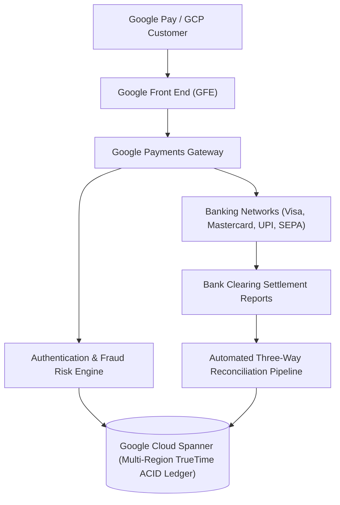
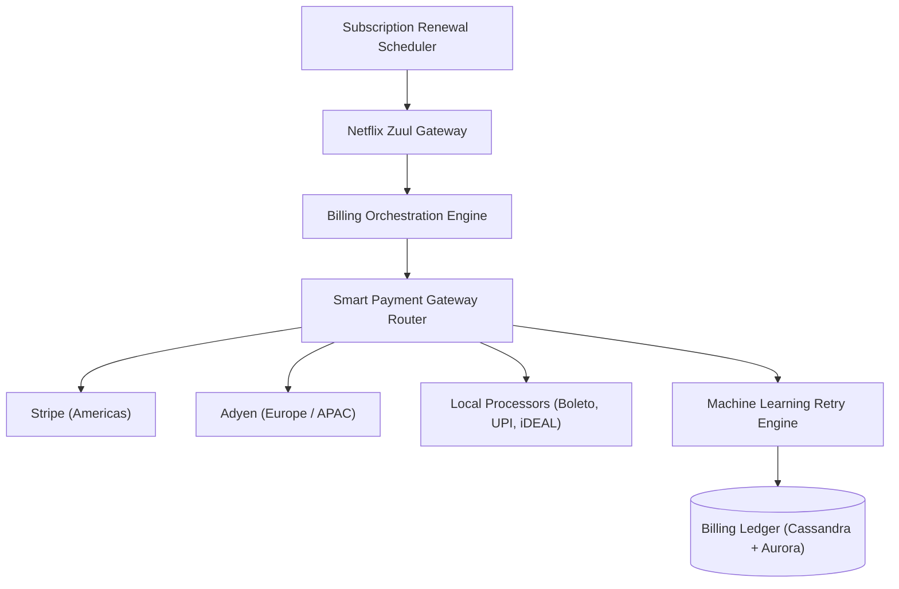
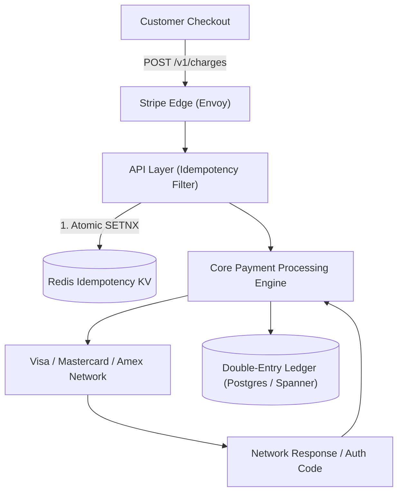

# Real-World Production Implementations: Payment Systems

This document explores how **Google**, **Netflix**, **Stripe**, and **PayPal** process hundreds of billions of dollars with zero data loss, strict idempotency, and automated multi-currency reconciliation.

---

## 1. Google: Google Pay & Google Cloud Billing Infrastructure

### The Architecture
Google processes billions of financial transactions across Google Play, Google Cloud Platform (GCP), YouTube subscriptions, and Google Pay. Google relies on **Google Cloud Spanner** to achieve globally distributed ACID transactions with zero monetary discrepancies.

### Key Technical Mechanisms
1. **TrueTime Hardware-Backed Double-Entry Bookkeeping**:
   - Google maintains double-entry financial journals on multi-region Cloud Spanner instances.
   - TrueTime atomic transactions guarantee that cross-region transfers (e.g., deducting customer currency in London and crediting a GCP project in Iowa) execute with strict Serializable isolation without distributed locking bottlenecks.
2. **Deterministic Idempotency Key Injection**:
   - Google assigns a deterministic cryptographic token to every billing mutation. If a cellular network disconnects during a Google Pay NFC tap, the terminal retries with the original token, guaranteeing that funds are debited exactly once.
3. **Automated Three-Way Bank Reconciliation**:
   - Nightly batch pipelines compare Google's internal ledger transactions against banking settlement clearing files (MT940/CAMT.053 formats) across 150+ international banking partners, automatically surfacing and rectifying discrepancies.

---

## 2. Netflix: Global Subscription Billing & Smart Retry Orchestration

### The Architecture
Netflix manages recurring monthly subscriptions for over **260 million active subscribers** across 190+ countries in dozens of local currencies.

### Key Technical Mechanisms
1. **Dynamic Smart Gateway Routing**:
   - Netflix routes transactions dynamically across multiple Payment Service Providers (Stripe, Adyen, Worldpay, local acquirers) based on real-time transaction approval rates and lowest interchange fees per country.
2. **Machine Learning Smart Retries**:
   - When a recurring card renewal is declined (e.g., "Insufficient funds" or temporary bank outage), naive systems retry blindly every 24 hours, often failing again.
   - Netflix trains machine learning models that predict the optimal hour and day of the month to retry each subscriber's card (e.g., retrying on local payday mornings or after banking maintenance windows), recovering millions of dollars in subscription revenue each month.
3. **Merchant of Record (MoR) Tax & Currency Handling**:
   - Netflix handles localized Value Added Tax (VAT), Goods and Services Tax (GST), and US state sales taxes through decoupled taxation microservices before recording the balanced double-entry ledger entry.

---

## 3. Stripe: The Global Financial Infrastructure Platform

### The Architecture
Stripe processes over **$1 Trillion in annual payment volume** across millions of businesses. Stripe achieves $99.999\%$ availability while adhering strictly to PCI-DSS Level 1 compliance.

### Key Technical Mechanisms
1. **Idempotency Key Protocol**:
   - Every API mutation requires an `Idempotency-Key` header stored in Redis with a 24-hour TTL, preventing duplicate charges across network retries.
2. **Double-Entry Ledger Architecture**:
   - Stripe's internal balance engine uses immutable double-entry ledger journals.
   - Money balances are never updated in-place; every transfer is an append-only transaction linking credit and debit accounts.

---

## 4. PayPal: Distributed Actor Model & Real-Time Risk Engine

- **Real-Time Risk Scoring**: PayPal evaluates thousands of risk features using deep neural networks within 100ms before dispatching transactions to card networks.
- **Actor Model Concurrency**: Powered by Akka, where each user account is represented as an in-memory actor that sequences transactions sequentially, eliminating database row locks and race conditions.
