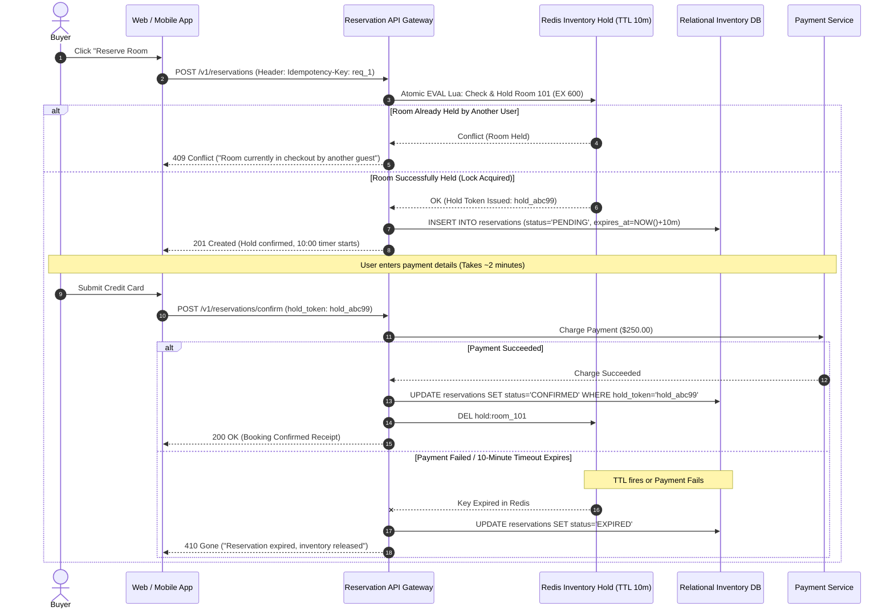

# Module 41: System Design — Hotel & Ticket Reservation System

> Comprehensive architectural breakdown of a high-concurrency Hotel & Concert Ticket Reservation System (Airbnb, Booking.com, Ticketmaster), covering double-booking prevention, 10-minute temporary inventory holds, optimistic vs pessimistic locking, and distributed TTL release.

---

## Prerequisites
Before tackling hotel and ticket reservation systems, review these core modules:
* [19 - Distributed Transactions](../19-distributed-transactions/README.md) (Sagas and compensating transactions)
* [20 - Fault Tolerance & Resilience](../20-fault-tolerance-and-resilience/README.md) (Timeouts, retries, and deadlocks)
* [29 - Database Transactions & Isolation](../29-database-transactions-and-isolation/README.md) (Pessimistic locking vs Optimistic Concurrency Control)
* [32 - REST API Design & Idempotency](../32-rest-api-design-and-idempotency/README.md) (Preventing duplicate booking submissions)
* [40 - Digital Wallet & Payment System](../40-system-design-payment-system/README.md) (Payment state machine and authorization holds)

---

## ELI5 (30-Second Summary)
Imagine there is only **1 hotel room left** in Paris for New Year's Eve. At midnight, 1,000 tourists click **"Book Now"** at the exact same millisecond. 

If your database naively checks `if rooms > 0: book()`, all 1,000 people will receive a confirmation, and 999 furious families will arrive in Paris with no bed to sleep in (**Double-Booking**)!

A modern **Reservation System** solves this using a **Temporary Inventory Hold with a 10-Minute Countdown**. When the first tourist clicks book, the system atomically locks the room and starts a 10-minute timer. The tourist has 10 minutes to type their credit card details. If they pay, the room is permanently confirmed. If they close their laptop or their card is declined, the 10-minute timer expires and the room is instantly returned to the public pool without human intervention!

---

## Physical Analogy
Think of a **Theater Box Office with a Physical Numbered Ticket Pegboard**:

| Theater Analogy | Reservation System Concept | Technical Description |
| :--- | :--- | :--- |
| **Pegboard with Room/Seat Slips** | Inventory Database Table | Tracks state of every seat/room (`AVAILABLE`, `HELD`, `CONFIRMED`). |
| **Customer at Window Holding a Slip** | Temporary Reservation Hold (10m) | In-memory Redis lock reserving the inventory for a limited payment window. |
| **Sand Hourglass on Counter (10 Mins)** | Redis Key TTL / Delayed Queue | Automatically revokes hold if payment confirmation is not received in time. |
| **Customer Swiping Card** | Payment Gateway Call | Dispatches payment processing to Stripe/Adyen. |
| **Stamped Gold Ticket Receipt** | Booking Confirmation (ACID Commit) | Transitions reservation state to `CONFIRMED` and stores booking ID. |
| **Returning Slip to Pegboard if Card Fails** | Automatic Inventory Rollback | Compensating action releasing the seat back to the searchable pool. |

---

## The Problem It Solves
Reservation platforms face extreme concurrency and correctness constraints:
1. **Absolute Double-Booking Prevention**: Two users must never be allowed to reserve or pay for the same room, seat, or rental car on overlapping dates.
2. **Flash-Crowd Concurrency Spikes**: When tickets for a major world tour or World Cup final drop, millions of requests hit a small inventory pool within seconds.
3. **Abandoned Carts & Inventory Lockup**: Users frequently hold rooms, reach the payment screen, and abandon the checkout. Holding rooms indefinitely starves real buyers and costs hotel operators millions in unsold inventory.

---

## Visual Architecture



---

## Real Numbers & Concurrency Sizing

Consider a global hotel booking platform with **5,000 Hotels** and **1 Million Total Rooms**:
* **Inventory Sizing**:
  - 1 million rooms $\times$ 365 days = 365 million room-night inventory slots per year.
  - Average room-night record: 64 bytes.
  - Annual inventory table size: $365\text{M} \times 64\text{ bytes} \approx 23.3\text{ GB}$ of storage (fits comfortably in PostgreSQL).
* **Normal vs Peak Traffic**:
  - Normal day: 200,000 reservations/day $\approx 2.3\text{ bookings/second}$.
  - Peak flash sale (e.g., Black Friday or concert release): **10,000 bookings/second** and **150,000 search queries/second**.
* **Redis Hold Cluster Memory**:
  - Max concurrent in-checkout holds: 50,000 simultaneous users.
  - 50,000 keys $\times$ 256 bytes per hold token $\approx 12.8\text{ MB}$ of RAM.
  - Redis executes sub-millisecond atomic Lua reservation checks ($< 0.8\text{ ms}$).

---

## Deep Dive: Under the Hood

### 1. Database Locking Strategies: Pessimistic vs. Optimistic

#### A. Pessimistic Locking (`SELECT ... FOR UPDATE`)
```sql
BEGIN TRANSACTION;
SELECT * FROM room_inventory 
WHERE hotel_id = 42 AND room_type = 'DELUXE' AND date = '2026-12-31' 
FOR UPDATE;
-- Check available count, decrement, then commit
UPDATE room_inventory SET available_count = available_count - 1 ...;
COMMIT;
```
* **Pros**: 100% prevents race conditions; serializes requests at the database engine level.
* **Cons**: Severe performance bottleneck. Holding row locks during slow payment calls ties up database connections, causing connection pool exhaustion and system-wide timeouts.

#### B. Optimistic Concurrency Control (OCC with `version`)
```sql
UPDATE room_inventory 
SET available_count = available_count - 1, version = version + 1
WHERE hotel_id = 42 AND date = '2026-12-31' AND available_count > 0 AND version = 5;
```
* **Pros**: Zero database locks held during payment; high throughput for moderate concurrency.
* **Cons**: High abort/retry rate under extreme flash sales (if 1,000 users attempt to update version 5 simultaneously, 999 transactions fail).

#### C. Redis Two-Phase Hold Architecture (Industry Standard)
The modern architecture splits reservation into two distinct phases:
1. **Phase 1: In-Memory Atomic Hold (Redis + Lua Script)**:
   - Redis executes an atomic Lua script: verify `available > 0`, decrement counter, and create key `hold:{room_id}` with a 10-minute TTL (`EX 600`).
   - If Redis succeeds, write a `PENDING` record to PostgreSQL.
2. **Phase 2: Payment Confirmation & ACID Commit**:
   - The user executes payment through Stripe/Adyen.
   - Upon successful payment, PostgreSQL updates reservation status to `CONFIRMED`.
   - Redis hold key is cleared.
   - If the 10-minute TTL expires before payment completes, Redis automatically deletes the key, and a background sweeper marks the PostgreSQL row as `EXPIRED`.

---

## Trade-offs & Decision Matrix

| Dimension | Pessimistic Locking (`FOR UPDATE`) | Optimistic Locking (`version`) | Redis Atomic Hold (Two-Phase) |
| :--- | :--- | :--- | :--- |
| **Concurrency Ceiling** | Low (hundreds of QPS) | Moderate (thousands of QPS) | Ultra-high (tens of thousands QPS) |
| **Database Connection Load** | Extreme (locks hold open pools) | Minimal (instantaneous updates) | Zero DB load during checkout window |
| **Checkout Experience** | Blocks other buyers | Fails on conflict | Gives buyer guaranteed 10-min window |
| **System Complexity** | Lowest (native SQL) | Low (SQL where clause) | Moderate (Redis cluster + TTL sync) |

---

## Common Pitfalls & Anti-Patterns

1. **Holding Database Row Locks Across Third-Party Payment Calls**: Keeping a database transaction open while awaiting Stripe/PayPal's network response can lock database connections for 5-10 seconds, causing cascading connection pool exhaustion across all services! *Rule: Acquire temporary holds in Redis or an asynchronous pending status; never hold ACID row locks across external network boundaries.*
2. **Missing Delayed Queue for Expired Holds**: Relying purely on Redis passive key eviction can leave expired reservations lingering in PostgreSQL. Implement an active dead-letter delayed queue or scheduled sweeper to clean up stale pending rows.
3. **Timezone Miscalculations**: Storing booking dates in local timezone strings (e.g., `2026-12-31`) causes room conflicts across boundary timezones. Always store reservation windows as UTC timestamps or standardized date tuples (`hotel_local_date`).

---

## Try It Yourself
A runnable, zero-dependency Python simulation demonstrating 10 concurrent threads attempting to book 2 limited rooms, atomic inventory holds, 10-minute hold expiration, and double-booking prevention is included in this directory.

Run the simulation:
```bash
python demo.py
```

---

## Production References & Further Reading
* [Alex Xu: System Design Interview Vol 2 - Chapter 7 (Hotel Reservation System)](https://bytebytego.com)
* [Airbnb Tech Blog: Avoiding Double-Booking at Global Scale](https://medium.com/airbnb-engineering)
* [Martin Fowler: Patterns of Enterprise Application Architecture - Optimistic & Pessimistic Offline Lock](https://martinfowler.com/eaaCatalog/optimisticOfflineLock.html)

---

## Top 5 Interview Questions with Model Answers

### Q1: How do you completely prevent double-booking under extreme flash-sale concurrency?
**Model Answer**: We prevent double-booking using a two-tier strategy:
1. **Redis Atomic Lua Reservation**: When a user clicks reserve, an atomic Lua script executes inside Redis: it checks whether `available_count > 0`, decrements the count, and creates a hold key with a 10-minute TTL in a single atomic thread execution.
2. **Database Unique Constraints**: In PostgreSQL, we maintain a `room_reservations` table with a unique constraint on `(room_id, reservation_date)` for all records with `status IN ('HELD', 'CONFIRMED')`. Even in the rare event of Redis failure, the relational database guarantees that two concurrent transactions can never commit the same room for the same date.

### Q2: Why should you NOT use Pessimistic Locking (`SELECT FOR UPDATE`) during checkout?
**Model Answer**: In pessimistic locking, the database holds a row lock on the inventory row for the entire duration of the transaction. A typical payment checkout involves the user entering their credit card number, completing 3D-Secure 2FA verification, and awaiting the card acquirer response, taking anywhere from 30 seconds to several minutes. Holding database locks across human interaction and external network calls exhausts database connection pools, causing connection timeouts and crashing the entire platform.

### Q3: How does the 10-minute temporary inventory hold work, and how are expired holds recovered?
**Model Answer**:
1. When the user initiates checkout, the reservation service assigns a unique `hold_token` and writes a key to Redis: `SET hold:room_101 user_alice EX 600` (10-minute TTL).
2. Concurrently, a row is inserted into PostgreSQL with `status='PENDING', expires_at = NOW() + INTERVAL '10 minutes'`.
3. If the user completes payment within 10 minutes, the status transitions to `CONFIRMED`.
4. If the user abandons checkout, Redis automatically evicts the key after 600 seconds. An asynchronous worker polling a delayed message queue (or querying `WHERE status='PENDING' AND expires_at < NOW()`) cleans up the database row and marks it as `EXPIRED`, making the room available again.

### Q4: How do you handle 100% overbooking strategies common in airline and hotel systems?
**Model Answer**: Airlines and hotels deliberately overbook inventory by a statistical factor (e.g., 5-10%) based on historical no-show and cancellation rates. In system design:
- We track two distinct thresholds: `physical_inventory` (e.g., 100 rooms) and `allowed_capacity = physical_inventory * (1 + overbooking_rate)` (e.g., 105 rooms).
- The reservation check verifies `active_reservations < allowed_capacity`.
- If cancellations are lower than anticipated as the arrival date approaches, the system stops accepting reservations and triggers automated upgrade workflows (e.g., bumping guests to luxury suites or sister hotels).

### Q5: How do you design the system to handle multi-day bookings (e.g., booking a room for 5 consecutive nights)?
**Model Answer**:
- Storing a single record with `check_in` and `check_out` dates makes range-overlap queries (`WHERE check_in < new_checkout AND check_out > new_checkin`) complex and slow to lock.
- **Normalized Inventory Ledger**: Instead, we maintain a row for every single calendar day (`room_inventory: (room_id, date, status)`).
- When booking a 5-night stay (Dec 25 to Dec 30), the transaction locks and reserves all 5 individual date rows atomically:
```sql
UPDATE room_daily_inventory 
SET status = 'HELD', hold_token = 'token_abc' 
WHERE room_id = 101 AND date IN ('2026-12-25', '2026-12-26', '2026-12-27', '2026-12-28', '2026-12-29')
AND status = 'AVAILABLE';
```
If the number of affected rows returned is strictly equal to 5, the entire multi-day reservation succeeds; if `< 5`, the transaction rolls back immediately.

---

## Check Yourself Quiz

<details>
<summary><b>1. Why is holding a PostgreSQL row lock during credit card payment processing considered an anti-pattern?</b></summary>
A) Because PostgreSQL does not support row locks.<br/>
B) Because external payment gateways take seconds to respond, exhausting database connection pools and starving other users.<br/>
C) Because credit cards require WebSockets.<br/>
D) Because row locks delete data.<br/><br/>
<b>Answer: B</b>. Holding locks across external network calls causes connection pool exhaustion and severe cascading outages.
</details>

<details>
<summary><b>2. How does an in-memory Redis hold prevent double-booking during checkout?</b></summary>
A) By hashing the user's password.<br/>
B) By using an atomic Lua script to check availability and set a key with a 10-minute expiration TTL in a single operation.<br/>
C) By turning off the web server.<br/>
D) By rebooting the database.<br/><br/>
<b>Answer: B</b>. Atomic Lua execution guarantees that exactly one thread acquires the hold token.
</details>

<details>
<summary><b>3. In Optimistic Concurrency Control, how does the database detect a conflicting concurrent booking?</b></summary>
A) By checking if the client IP address changed.<br/>
B) By verifying that the `version` column in the WHERE clause matches the version read at the start of the transaction.<br/>
C) By encrypting the table.<br/>
D) By pinging Google DNS.<br/><br/>
<b>Answer: B</b>. If another transaction updated the row in the interim, the version number increments, causing the WHERE condition to match 0 rows.
</details>

<details>
<summary><b>4. What happens if a user closes their browser window while on the checkout payment page?</b></summary>
A) The hotel room remains locked forever.<br/>
B) The 10-minute Redis TTL expires and an asynchronous cleaner marks the reservation as EXPIRED, returning the room to the public pool.<br/>
C) The user's credit card is charged anyway.<br/>
D) The database crashes.<br/><br/>
<b>Answer: B</b>. Automated TTL expiration prevents abandoned checkouts from permanently locking inventory.
</details>

<details>
<summary><b>5. For multi-day hotel stays, what database design makes checking availability fastest and most reliable?</b></summary>
A) Storing a single string with all dates.<br/>
B) Normalizing inventory into individual daily records per room and checking all required dates in a single atomic SQL query.<br/>
C) Storing dates in an Excel spreadsheet.<br/>
D) Checking dates with a while loop in JavaScript.<br/><br/>
<b>Answer: B</b>. Individual daily records allow atomic verification that all required consecutive nights are available.
</details>
