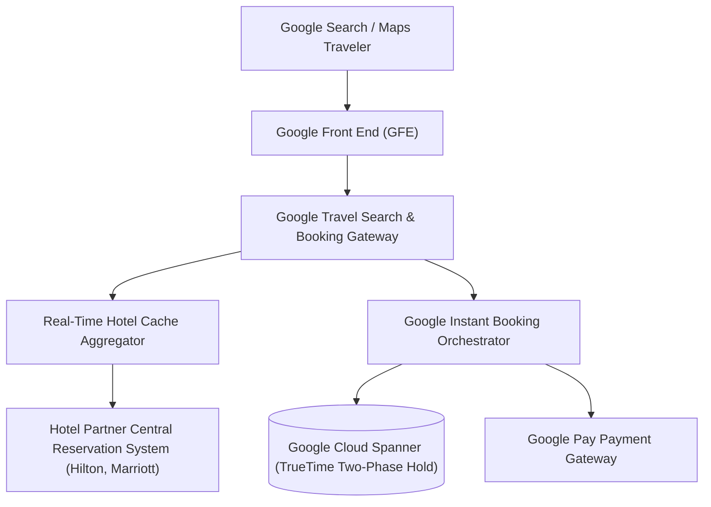
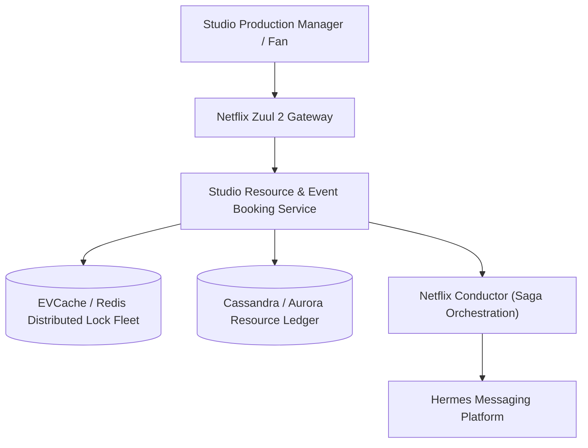
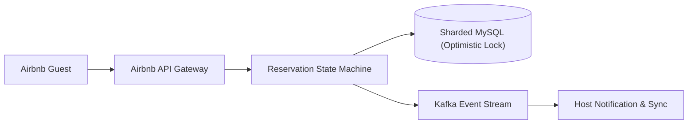

# Real-World Production Implementations: Hotel & Ticket Reservation

This document explores how **Google**, **Netflix**, **Airbnb**, and **Booking.com** architect, scale, and protect reservation pipelines under high concurrency.

---

## 1. Google: Google Hotels & Travel Instant Booking Infrastructure

### The Architecture
Google Hotels indexes millions of hotel properties worldwide, integrating real-time availability feeds from Online Travel Agencies (OTAs) and Central Reservation Systems (CRS) using **Google Cloud Spanner**.

### Key Technical Mechanisms
1. **TrueTime Atomic Inventory Verification**:
   - Google uses **Cloud Spanner TrueTime transactions** to guarantee serializable isolation across multi-region datacenters.
   - When a user clicks "Instant Book", Spanner executes an atomic read-write transaction verifying room allocation across global booking channels without distributed deadlocks.
2. **Dynamic Caching with Asynchronous CRS Polling**:
   - Hotel room rates change dynamically. Google maintains an in-memory cache of room prices and availability that updates via asynchronous webhook streams and real-time pull APIs from hotel chains.
3. **Partner Rollback Handshake**:
   - If Google charges a traveler's card but the hotel partner's CRS fails to confirm the reservation within 5 seconds, Google's orchestrator automatically triggers a compensating transaction (voiding the authorization and notifying the user within seconds).

---

## 2. Netflix: Live Events Ticketing & Global Production Studio Facility Booking

### The Architecture
Beyond video streaming, Netflix operates physical production studios worldwide (studios, soundstages, specialized camera equipment) and broadcasts live interactive global events (e.g., live sports, comedy specials, fan screenings) requiring strict seat and resource reservation.

### Key Technical Mechanisms
1. **Redis Redlock for Soundstage Reservation**:
   - Netflix production managers reserve multi-million-dollar physical soundstages across Los Angeles, London, and Madrid.
   - The booking engine uses distributed **Redis locks (Redlock)** to prevent scheduling conflicts between different film production crews.
2. **Netflix Conductor Saga Orchestration**:
   - Studio booking requires multi-step coordination: reserving the physical soundstage, scheduling audio technicians, allocating high-speed video storage, and provisioning catering.
   - Netflix uses **Conductor** to coordinate these steps as an asynchronous Saga with automated compensating steps if any single dependency fails.

---

## 3. Airbnb: The Reservation State Machine & Dual-Phase Lock

### The Architecture
Airbnb manages millions of unique listings where **every home is one-of-a-kind** (inventory count is strictly 1).

### Key Technical Mechanisms
1. **Optimistic Locking with Strict State Transitions**:
   - Listings cannot be duplicated. Airbnb tracks every calendar date with an immutable state machine: `AVAILABLE` $\rightarrow$ `HELD` $\rightarrow$ `RESERVED`.
   - Every update requires matching the current `version_id`.
2. **Instant Book vs. Host Approval**:
   - For listings with "Instant Book", the reservation hold immediately transitions to payment.
   - For listings requiring host approval, the hold window extends to 24 hours while holding an authorization pre-authorization on the guest's payment method.
