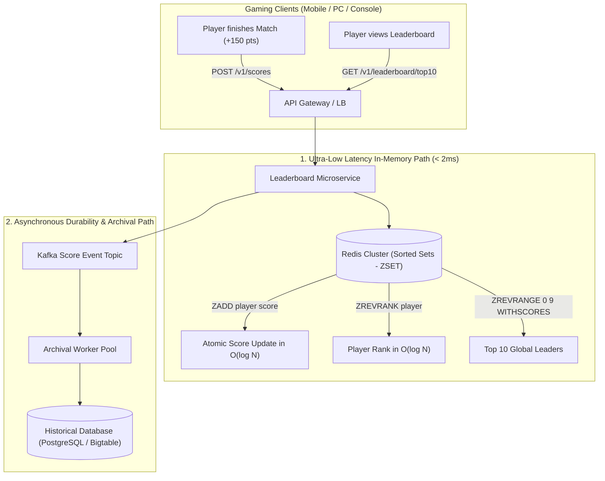

# Module 42: System Design — Real-Time Gaming Leaderboard

> Comprehensive architectural breakdown of a large-scale Real-Time Gaming Leaderboard System (serving 25M+ Daily Active Users), covering Redis Sorted Sets (Skip Lists), logarithmic rank lookups, tie-breaking algorithms, and distributed leaderboard sharding.

---

## Prerequisites
Before tackling real-time gaming leaderboards, review these core modules:
* [09 - Storage Engines & Indexing](../09-storage-engines-and-indexing/README.md) (B-Trees vs In-Memory Skip Lists)
* [10 - Caching Patterns](../10-caching-patterns/README.md) (Write-through vs write-behind caching)
* [16 - Consistent Hashing](../16-consistent-hashing/README.md) (Sharding user rankings across memory partitions)
* [27 - Back-of-the-Envelope Estimation](../27-back-of-the-envelope-estimation/README.md) (Sizing memory and update QPS)

---

## ELI5 (30-Second Summary)
Imagine a marathon with **10 million runners**. Every time a runner crosses a checkpoint, their score changes. When a runner looks at their smartwatch, they want to see: *"You are currently ranked #14,291 in the world"*, and they want to see the Top 10 champions right above them.

If the referee had to look through 10 million paper sheets and re-sort the entire list every time someone scores a point, the referee would collapse. In a relational database, running `COUNT(*) WHERE score > my_score` takes several seconds and locks the database.

A **Real-Time Leaderboard** uses an in-memory **Skip List (Redis Sorted Set)**. It arranges runners like an express subway train with express tracks that skip over thousands of runners at once. Finding your exact global rank or grabbing the Top 10 list takes less than **1 millisecond**!

---

## Physical Analogy
Think of an **Amusement Park Arcade High-Score Board with Multi-Tier Express Escalators**:

| Arcade Analogy | Leaderboard System Concept | Technical Description |
| :--- | :--- | :--- |
| **Flashing Top 10 Screen** | Top-K Leaderboard Query (`ZREVRANGE 0 9`) | $O(\log N + K)$ instant retrieval of the highest-scoring players. |
| **Your Position on the Board** | Exact Rank Lookup (`ZREVRANK user_id`) | $O(\log N)$ logarithmic rank computation in memory. |
| **Express Escalator (Skips 10 Floors)** | Skip List Multi-Level Index Pointers | Underlying probabilistic data structure powering Redis `ZSET`. |
| **Winning by Split-Second Timestamp** | Monotonic Tie-Breaking Score | Packs score and inverse timestamp into a floating-point integer. |
| **Arcade Manager Writing to Book at Night** | Write-Behind Persistence (Kafka $\rightarrow$ PostgreSQL) | Asynchronously flushes in-memory scores to durable disk storage. |

---

## The Problem It Solves
Multiplayer gaming platforms (Fortnite, League of Legends, Clash Royale, Wordle) must satisfy demanding real-time requirements:
1. **High Write Throughput**: Millions of match conclusions generate **50,000 to 100,000 score updates/second** at peak.
2. **Sub-Millisecond Read Latency**: Players expect their updated global rank and surrounding competitors within milliseconds of finishing a game.
3. **The Relational SQL Trap**: Executing `SELECT COUNT(*) FROM scores WHERE points > 2500` across 25 million rows requires an expensive index scan that melts database CPUs under concurrent load.

---

## Visual Architecture



---

## Real Numbers & Concurrency Sizing

Consider a mobile game with **25 Million Daily Active Users (DAU)**:
* **Score Update QPS**:
  - Average matches played per user: 10 matches/day.
  - Total matches: $25\text{M} \times 10 = 250\text{ million matches/day}$.
  - Average write QPS: $250\text{M} / 86,400 \approx 2,900\text{ updates/second}$.
  - Peak write QPS ($5\times$ evening peak): **$\approx 15,000\text{ score updates/second}$**.
* **Leaderboard View QPS**:
  - Players view leaderboard after every match: $\approx 15,000\text{ read QPS}$.
* **Redis Memory Footprint**:
  - 25 million active player entries.
  - Each entry in Redis `ZSET`: Member string (`user_uuid` $\approx 36$ bytes) + 8-byte double-precision score + Skip List node pointer overhead (32 bytes) $\approx 80\text{ bytes}$ per player.
  - Total memory: $25\text{M} \times 80\text{ bytes} \approx 2.0\text{ Gigabytes}$!
  - 2.0 GB of RAM easily fits on a single standard Redis node. Replicating across a 3-node Redis cluster provides both high-availability and read scale.

---

## Deep Dive: Under the Hood

### 1. Redis Sorted Sets (`ZSET`) and Skip Lists
A Redis Sorted Set is backed by two data structures simultaneously:
1. **Hash Table**: Maps `member -> score` for instantaneous $O(1)$ score lookups (`ZSCORE`).
2. **Skip List**: A probabilistic multi-level linked list that sorts members by score:
   - Level 1 links every single node.
   - Level 2 links every 2nd node.
   - Level $k$ links every $2^k$-th node.
- Inserting or updating a player's score (`ZADD`) is $O(\log N)$.
- Finding a player's rank (`ZREVRANK`) traverses the express pointers from top level down, computing rank in $O(\log N)$.
- Fetching the Top-10 players (`ZREVRANGE 0 9`) takes $O(\log N + 10)$ time ($< 0.5\text{ ms}$).

### 2. Tie-Breaking Strategies (First-Come, First-Served)
In gaming tournaments, if Alice and Bob both reach 1,500 points, the player who reached 1,500 points *first* must be ranked higher.
**The Timestamp Packing Formula**:
Instead of storing just points, we store a compound fractional score:

$$\text{Combined Score} = \text{Points} + \left(1 - \frac{\text{Current Timestamp}}{\text{Max Future Timestamp}}\right)$$

Because earlier timestamps produce larger fractional values, Alice (who scored earlier) will mathematically have a slightly higher composite float score than Bob, breaking ties deterministically in $O(1)$ without secondary database queries!

### 3. Sharding Strategies for Massive Scale
When player count reaches 100M+ or update volume exceeds 100,000 QPS:
* **Fixed Partitioning by Score Range**: Shard 1 holds Bronze ($0-1000$), Shard 2 holds Silver ($1001-2000$), Shard 3 holds Masters ($> 2000$).
* **Geographic / Region Sharding**: Separate leaderboards for North America (`na-east`), Europe (`eu-west`), and Asia (`asia-east`).
* **Game Mode Sharding**: Solos, Duos, Squads, and Ranked Seasons each have independent Redis keys.

---

## Trade-offs & Decision Matrix

| Dimension | Relational Database (`ORDER BY`) | Elasticsearch Inverted Index | Redis Sorted Set (`ZSET`) |
| :--- | :--- | :--- | :--- |
| **Write Latency** | Slow ($10 - 50\text{ ms}$) | Moderate ($20 - 40\text{ ms}$) | Ultra-fast ($< 1\text{ ms}$) |
| **Rank Calculation Complexity** | $O(N)$ index scan | $O(N)$ bucket aggregation | $O(\log N)$ Skip List traversal |
| **Memory Footprint** | Low (disk-backed) | High (JVM heap) | Moderate (all in RAM) |
| **Durability Guarantee** | Immediate ACID write | Near-real-time (refresh interval) | In-memory with append-only file (AOF) |

---

## Common Pitfalls & Anti-Patterns

1. **Recalculating Ranks on Every Read with SQL**: Running `SELECT COUNT(*) WHERE score > my_score` across millions of rows causes table locks and CPU spikes under high concurrency. Always use in-memory Skip Lists.
2. **Neglecting Tie-Breaking**: When thousands of players tie at the same score, arbitrary ordering causes players' ranks to fluctuate randomly on page refresh, triggering complaints.
3. **Synchronous Database Writes in the Game Loop**: Writing directly to SQL on every point change introduces database bottlenecks into the game server loop. Decouple writes through Redis and an asynchronous Kafka event topic.

---

## Try It Yourself
A runnable, zero-dependency Python simulation demonstrating Skip List-style logarithmic ranking, fractional tie-breaking, real-time score updates, and Top-K retrieval is included in this directory.

Run the simulation:
```bash
python demo.py
```

---

## Production References & Further Reading
* [Alex Xu: System Design Interview Vol 2 - Chapter 10 (Real-Time Gaming Leaderboard)](https://bytebytego.com)
* [Redis Documentation: Sorted Sets and Skip List Implementation Details](https://redis.io/docs/data-types/sorted-sets/)
* [William Pugh: Skip Lists - A Probabilistic Alternative to Balanced Trees (Communications of the ACM, 1990)](https://15721.courses.cs.cmu.edu/spring2018/papers/07-oltpindexes1/pugh-skiplists-cacm1990.pdf)

---

## Top 5 Interview Questions with Model Answers

### Q1: What is the underlying data structure of Redis Sorted Sets (`ZSET`) and why is it ideal for leaderboards?
**Model Answer**: A Redis Sorted Set is implemented using a dual data structure:
1. A **Hash Table** mapping member strings to double-precision float scores, providing $O(1)$ score lookups.
2. A **Skip List (SkipList)** that maintains members sorted in ascending/descending order. The Skip List uses probabilistic multi-level express pointers that bypass large subsets of elements.
This allows:
- Inserting or updating scores (`ZADD`) in $O(\log N)$ time.
- Computing a player's exact rank (`ZREVRANK`) in $O(\log N)$ time.
- Retrieving the Top-K players (`ZREVRANGE 0 K-1`) in $O(\log N + K)$ time, serving requests in under 1 millisecond.

### Q2: How do you handle tie-breaking when two players achieve the exact same score?
**Model Answer**: In competitive gaming, ties are typically resolved on a **First-Come, First-Served** basis (the player who reached the score first is ranked higher).
We encode tie-breaking directly into the 64-bit IEEE 754 float score:
$$\text{Stored Score} = \text{Base Score} + \left(1 - \frac{\text{Timestamp}}{\text{Max Timestamp}}\right)$$
Because an earlier timestamp yields a larger fraction, the earlier player automatically has a strictly higher numerical score. Redis sorts the entries with zero additional application code or secondary database lookups.

### Q3: How do you design the system if the leaderboard exceeds the memory capacity of a single Redis instance?
**Model Answer**: We partition (shard) the leaderboard using **Score-Tier Partitioning**:
1. Partition the global score space into discrete tiers (e.g., Bronze: 0-999, Silver: 1000-1999, Gold: 2000-2999, Masters: $\ge 3000$).
2. Each tier is stored on an independent Redis cluster node.
3. We maintain an in-memory metadata service tracking total player counts in each tier (`count_gold = 100,000`, `count_masters = 5,000`).
4. To find the global rank of a Gold player ranked #12,000 in the Gold shard:
   $$\text{Global Rank} = \text{count\_masters} + \text{Local Gold Rank} = 5,000 + 12,000 = 17,000$$

### Q4: How do you show "Surrounding Competitors" (e.g., 5 players above and 5 players below me)?
**Model Answer**:
1. Query the player's exact rank using `ZREVRANK leaderboard user_id` $\rightarrow$ returns index $R$.
2. Compute the window bounds: $\text{start} = \max(0, R - 5)$, $\text{stop} = R + 5$.
3. Execute `ZREVRANGE leaderboard start stop WITHSCORES`.
This retrieves the player, their 5 closest superiors, and their 5 closest challengers in a single $O(\log N + M)$ Redis command ($< 1\text{ ms}$).

### Q5: How do you handle end-of-season monthly leaderboard resets without downtime?
**Model Answer**:
1. **Dynamic Key Versioning**: Leaderboard keys include the season identifier: `leaderboard:season_2026_11`.
2. When Season 11 ends at midnight:
   - A background worker takes an atomic snapshot of `leaderboard:season_2026_11` and archives final standings to Bigtable / Amazon S3.
   - The game client configuration updates the active key to `leaderboard:season_2026_12`.
   - Reads and writes seamlessly shift to the fresh Season 12 Redis key without locking or flushing the existing cluster.
   - Historical keys are safely archived to cold storage and deleted after 30 days.

---

## Check Yourself Quiz

<details>
<summary><b>1. What is the time complexity of looking up a player's rank in a Redis Sorted Set?</b></summary>
A) O(1)<br/>
B) O(log N)<br/>
C) O(N)<br/>
D) O(N^2)<br/><br/>
<b>Answer: B</b>. The Skip List structure enables logarithmic traversal down multi-level express pointers.
</details>

<details>
<summary><b>2. Why is using fractional timestamp subtraction useful in leaderboard scores?</b></summary>
A) It encrypts the score.<br/>
B) It breaks ties deterministically: earlier scores receive a slightly larger fractional bonus, ensuring first-come first-served ranking.<br/>
C) It compresses the score into 8 bits.<br/>
D) It prevents cheaters from hacking the game.<br/><br/>
<b>Answer: B</b>. Fractional tie-breaking guarantees deterministic sorting without secondary database queries.
</details>

<details>
<summary><b>3. Which Redis command retrieves the Top 10 players along with their scores in descending order?</b></summary>
A) `GET top_10`<br/>
B) `ZREVRANGE leaderboard 0 9 WITHSCORES`<br/>
C) `HGETALL leaderboard`<br/>
D) `LRANGE leaderboard 0 9`<br/><br/>
<b>Answer: B</b>. `ZREVRANGE` returns members sorted from highest to lowest score.
</details>

<details>
<summary><b>4. How can a leaderboard with 100M+ players be sharded across multiple Redis nodes?</b></summary>
A) By random sampling.<br/>
B) By Score-Tier Partitioning (e.g. Bronze, Silver, Gold shards) combined with tier population count offsets.<br/>
C) By deleting inactive players.<br/>
D) By rebooting the servers every hour.<br/><br/>
<b>Answer: B</b>. Partitioning by score tiers isolates clusters while simple count summation yields global rank.
</details>

<details>
<summary><b>5. Why should score updates be written to Kafka before the permanent SQL database?</b></summary>
A) Because SQL databases cannot store scores.<br/>
B) To buffer and decouple the high-frequency game loop writes (thousands/sec) from slow disk-backed databases.<br/>
C) Because Kafka is an anti-cheat system.<br/>
D) To avoid using Redis.<br/><br/>
<b>Answer: B</b>. Message queues protect relational databases from write saturation during peak gaming hours.
</details>
