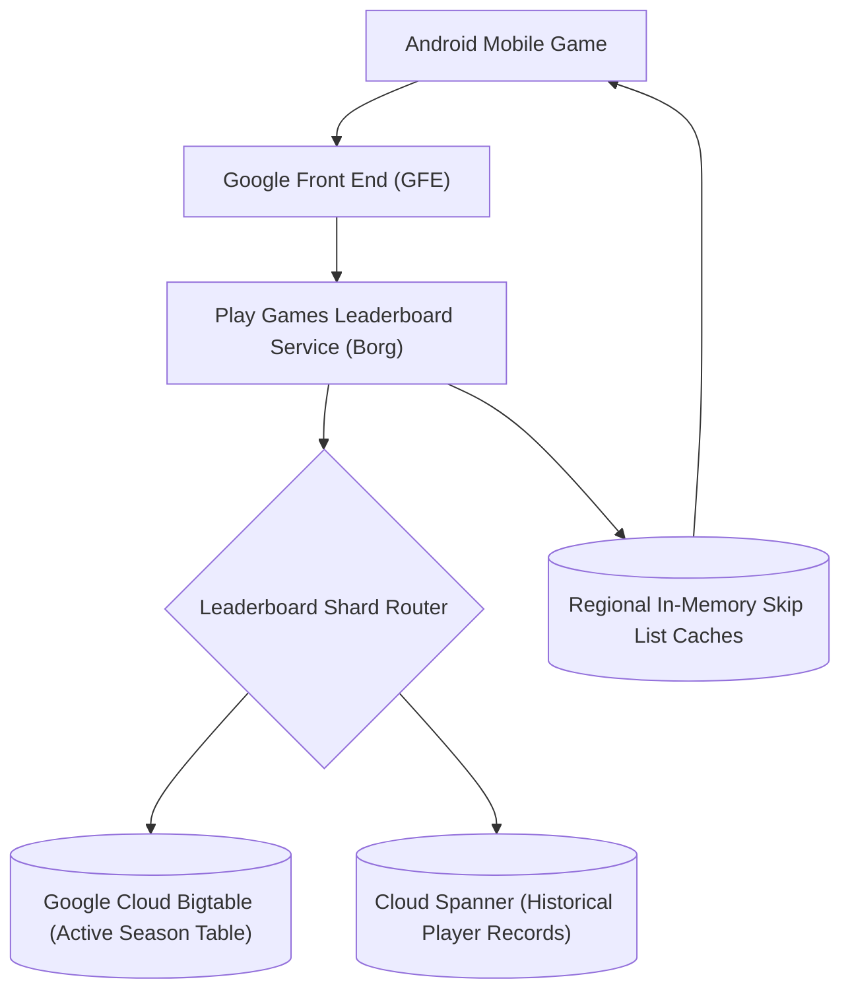
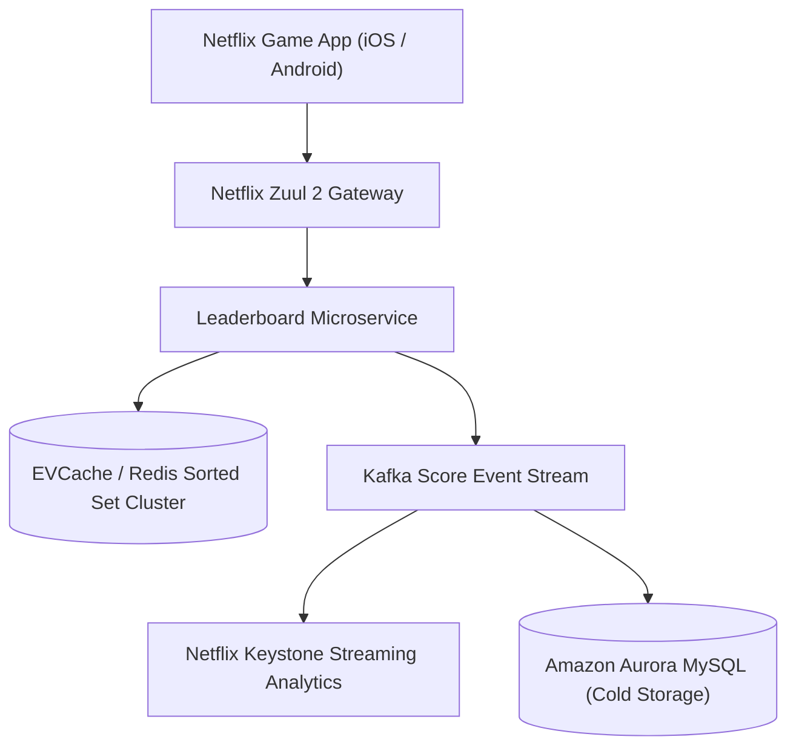

# Real-World Production Implementations: Real-Time Gaming Leaderboards

> ⚠️ **Not yet source-checked.** These case studies summarize public engineering posts and talks, and some details may be simplified or wrong. Before you repeat a specific number or design in an interview, check it against the company's own write-up. Found an error, or a source that confirms a section? [Add it to the tracking issue](https://github.com/Aniketchavan7/system-design-illustrated/issues/9). Sourced fixes are the most welcome contribution here.

This document explores how **Google**, **Netflix**, **Riot Games**, and **Epic Games** architect and operate global real-time leaderboards for tens of millions of concurrent players.

---

## 1. Google: Google Play Games Leaderboard Services

### The Architecture
Google Play Games supports billions of player accounts and hundreds of thousands of Android game titles. Its leaderboard service handles tens of billions of daily score submissions with global consistency.

### Key Technical Mechanisms
1. **Bigtable RowKey Design for Leaderboards**:
   - Google stores leaderboards on **Google Cloud Bigtable**.
   - RowKey format: `leaderboard_id#inverted_score#timestamp#user_id`.
   - By inverting the score (`Integer.MAX_VALUE - score`), Bigtable's natural lexicographical B-Tree sorting automatically arranges high scores at the top of the table. Scanning the Top-100 is an instantaneous single-tablet range scan!
2. **Social vs. Global Leaderboards**:
   - Google maintains two distinct leaderboards: **Public Global** and **Friends Circle**.
   - Friends leaderboards are computed dynamically in-memory by taking the player's Google+ / Contacts social graph and intersecting with Bigtable score records.
3. **Anti-Cheat Heuristics**:
   - Scores that deviate by more than 5 standard deviations from historical gameplay physics are flagged and diverted to a quarantine queue before touching the public leaderboard.

---

## 2. Netflix: Netflix Games Global Player Ranking & Social Challenges

### The Architecture
Netflix has expanded into mobile and cloud gaming, offering titles like *Stranger Things: 1984*, *Oxenfree*, and competitive multiplayer arcade games to over 260 million subscribers.

### Key Technical Mechanisms
1. **Redis Cluster ZSET Partitioning**:
   - Netflix partitions tournament leaderboards by `game_id:tournament_season:country`.
   - Player scores update in Redis Sorted Sets within 2ms.
2. **Profile-Aware Sub-Leaderboards**:
   - Netflix accounts often have multiple household profiles (Kids, Adults).
   - The leaderboard service scopes rankings to profile IDs, ensuring family members have independent rankings while enabling household challenge leaderboards.
3. **Keystone Stream Auditing**:
   - Every score change emits an event to **Netflix Keystone (Kafka)**, which feeds real-time Flink analytics to detect abnormal score velocities (identifying botting and modified APKs).

---

## 3. Riot Games: League of Legends Ranked Tier Distribution

- **Division & LP System**: Rather than a single 100-million player leaderboard, Riot divides players into Tiers (Iron to Challenger) and divisions (I to IV).
- **Matchmaking Rating (MMR) vs. League Points (LP)**: MMR is an internal hidden Elo score; LP is the visible leaderboard representation. This abstraction prevents player churn caused by sudden rank demotions after close losses.
