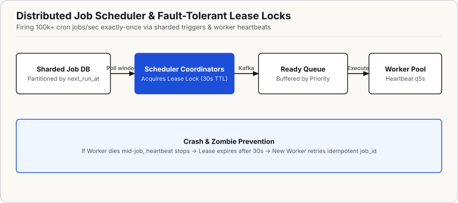
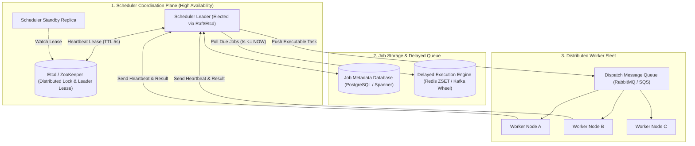

# Module 43: System Design — Distributed Job & Task Scheduler

> Comprehensive architectural breakdown of a large-scale Distributed Job & Task Scheduler (Google Chronos, Netflix Conductor, Quartz, Celery), covering distributed cron coordination, delayed execution engines (Hashed Time Wheels & Redis ZSETs), worker failure failover, and idempotent task execution.

---

## Prerequisites
Before tackling distributed job schedulers, review these core modules:
* [15 - Consensus & Leader Election](../15-consensus-and-leader-election/) (Raft, leader coordination, split-brain avoidance)
* [17 - Message Queues & Streaming](../17-message-queues/) (Delayed queues, dead-letter queues, worker groups)
* [20 - Fault Tolerance & Resilience](../20-fault-tolerance-and-resilience/) (Heartbeats, failure detection, exponential retry)
* [32 - REST API Design & Idempotency](../32-rest-api-design-and-idempotency/) (Idempotent task execution)

---

## ELI5 (30-Second Summary)
Imagine a giant hospital where 1,000 nurses need to administer medicine to 50,000 patients at exact times: *"Patient #42 needs insulin at 2:00 PM; Patient #99 needs antibiotics every 6 hours"*.

If every nurse maintained their own personal paper notebook, two nurses might give Patient #42 two doses of insulin (**Double Execution**), or if a nurse gets sick and faints in the hallway, their patients would receive no medicine at all (**Dropped Tasks**)!

A **Distributed Job Scheduler** uses a single Chief Coordinator (with backup coordinators elected via **Raft**) that places all medicine tasks on a giant automated conveyor belt (**Time Wheel / Priority Queue**). When a task's clock strikes, the coordinator dispatches it to an available nurse. If that nurse doesn't send a radio "I'm alive" ping (**Heartbeat**) within 30 seconds, the task is immediately reassigned to another nurse!

---

## Physical Analogy
Think of a **Mechanical Grandfather Clock with an Automated Factory Dispatch Chute**:

| Factory Analogy | Job Scheduler Concept | Technical Description |
| :--- | :--- | :--- |
| **Rotating Clock Gear (60 Second Tick)** | Hashed Timing Wheel / Tick Loop | Constant-time $O(1)$ timer wheel advancing execution pointers. |
| **Scheduled Work Order Envelope** | Job Metadata Record | Defines payload, trigger timestamp, recurrence interval, and execution timeout. |
| **Factory Shift Foreman** | Scheduler Leader / Coordinator | Node holding master lock via etcd/ZooKeeper, dispatching tasks. |
| **Factory Assembly Line Workers** | Worker Nodes (Execution Fleet) | Stateless compute instances executing containerized jobs. |
| **Worker Clocking in every 10 seconds** | Worker Heartbeat Ping | Ephemeral lease key confirming worker health and processing progress. |
| **Foreman re-assigning task if worker vanishes** | Automatic Task Re-Queueing | Detects missing heartbeats and re-dispatches tasks to healthy nodes. |

---

## The Problem It Solves
Single-server cron daemons (`crontab`) fail at enterprise scale due to critical limitations:
1. **Single Point of Failure (SPOF)**: If the cron machine crashes, power fails, or its disk corrupts, all corporate scheduled workflows stop executing.
2. **Resource Exhaustion**: Running 500 heavy machine learning or database backup jobs simultaneously on one machine spikes CPU/memory to 100%, causing out-of-memory kernel kills.
3. **No Execution History or Retries**: Traditional cron drops failed tasks silently with zero automated retry logic, exponential backoff, or distributed logging.

---

## Visual Architecture

<p align="center">
  
</p>



---

## Real Numbers & Concurrency Sizing

Consider a scheduler managing **100 Million Jobs Daily** (e.g., Uber trip receipts, payment retries, daily summaries):
* **Throughput Sizing**:
  - $100\text{M} / 86,400 \approx 1,160\text{ jobs scheduled & executed/second}$.
  - Peak dispatch bursts (e.g., Top of the Hour at midnight): **$25,000\text{ jobs/second}$**.
* **Job Record Sizing**:
  - Average job record: Job ID (8 bytes) + Next Run Timestamp (8 bytes) + Recurrence Cron (16 bytes) + Target Handler URI (64 bytes) + Payload JSON (500 bytes) $\approx 600\text{ bytes}$.
  - Active scheduled jobs (10 million in queue): $10\text{M} \times 600\text{ bytes} \approx 6.0\text{ Gigabytes}$.
* **Redis Sorted Set Memory**:
  - Store scheduled execution timestamps as scores: `ZADD delayed_jobs <timestamp_ms> <job_id>`.
  - 10 million entries in Redis ZSET: $10\text{M} \times 64\text{ bytes} \approx 640\text{ Megabytes}$ of RAM!
  - Redis can query and pop due jobs (`ZRANGEBYSCORE delayed_jobs 0 <now_ms>`) in sub-millisecond execution times.

---

## Deep Dive: Under the Hood

### 1. Timing Mechanics: Redis ZSET vs. Hashed Timing Wheel
* **Redis Sorted Set Approach**:
  - Score = UTC execution timestamp in milliseconds.
  - Schedulers execute `ZRANGEBYSCORE delayed_jobs 0 <current_time_ms> LIMIT 0 100` every 100ms.
  - Atomic pop is achieved via Redis 6.2+ `ZPOPMIN` or Lua scripts.
* **Hierarchical Hashed Timing Wheel (George Varghese & Tony Lauck Algorithm)**:
  - An array of circular buckets representing time units (e.g., a 60-slot second wheel, a 60-slot minute wheel, a 24-slot hour wheel).
  - A tick pointer advances every second ($O(1)$ time complexity).
  - When the pointer lands on slot 14, all tasks attached to slot 14's linked list are executed immediately!
  - Incurs **zero sort overhead** ($O(1)$ insertion and $O(1)$ retrieval).

### 2. Leader Election & High Availability
To prevent two scheduler nodes from executing the same cron job simultaneously:
- Schedulers compete for a distributed lock lease in **etcd**: `PUT /scheduler/leader node_1 LEASE 10s`.
- Only the node holding the active lease runs the polling loop.
- The leader refreshes its lease every 3 seconds.
- If the leader crashes, etcd's lease expires after 10 seconds; standby followers detect the deletion and elect a new leader automatically.

### 3. Worker Heartbeating & Resiliency
- When Worker A pulls a task, the task status transitions to `RUNNING` with an expiration deadline: `deadline = NOW() + 30s`.
- While processing, Worker A sends periodic heartbeats every 10 seconds: `heartbeat(task_id) -> updates deadline = NOW() + 30s`.
- If Worker A experiences an out-of-memory crash or network split, the heartbeat stops.
- The Scheduler Leader detects that `NOW() > deadline`, transitions the task back to `SCHEDULED`, and re-dispatches it to Worker B.

---

## Trade-offs & Decision Matrix

| Dimension | Standalone Linux Cron | Redis ZSET Delayed Queue | Hierarchical Timing Wheel (In-Memory) |
| :--- | :--- | :--- | :--- |
| **Scalability** | Single machine only | Scales to millions of jobs | Scales to tens of millions of jobs |
| **Retrieval Complexity** | $O(N)$ scan of crontab | $O(\log N + M)$ sorted set range | Constant $O(1)$ circular bucket tick |
| **Fault Tolerance** | Zero (SPOF) | High (Redis replication / AOF) | Requires external persistence checkpoint |
| **Delayed Precision** | 1 Minute | 1 Millisecond | 1 Millisecond / 1 Tick |

---

## Common Pitfalls & Anti-Patterns

1. **Non-Idempotent Tasks**: Assuming a job will only ever execute once. In distributed networks, worker timeouts and network retries guarantee **at-least-once execution**. If a charge job isn't protected by an `Idempotency-Key`, retry recovery will charge customers twice! *Rule: All scheduled job handlers must be idempotent.*
2. **Top-of-the-Hour Thundering Herd**: Every developer schedules batch jobs for `00:00:00` (midnight). At 12:00:00 AM, thousands of heavy jobs hit the worker pool simultaneously, exhausting CPU. *Rule: Introduce random jitter (e.g. `00:00:00` + random offset between 0-300 seconds) to smooth load spikes.*
3. **Database Polling Storms**: 50 scheduler pods polling PostgreSQL `SELECT * FROM jobs WHERE run_at <= NOW()` every 500ms will saturate database connection pools and cause CPU lockups.

---

## Try It Yourself
A runnable, zero-dependency Python simulation demonstrating a distributed task scheduler with priority delay queue, multi-worker pool, heartbeating, and automatic worker failure recovery is included in this directory.

Run the simulation:
```bash
python demo.py
```

---

## Production References & Further Reading
* [Alex Xu: System Design Interview Vol 2 - Chapter 6 (Distributed Job Scheduler)](https://bytebytego.com)
* [George Varghese and Tony Lauck: Hashed and Hierarchical Timing Wheels (ACM TOCS, 1997)](https://www.cs.columbia.edu/~nahum/w6998/papers/ton97-timing-wheels.pdf)
* [Netflix TechBlog: Meson - A Flexible System for Managing Large-Scale Machine Learning Pipelines](https://netflixtechblog.com)

---

## Top 5 Interview Questions with Model Answers

### Q1: How do you guarantee that a scheduled job runs at most once versus at least once?
**Model Answer**: In distributed systems with node crashes and network partitions, mathematically guaranteed "exactly-once execution" is impossible. We achieve effective exactly-once semantics by combining **At-Least-Once Dispatch** with **Idempotent Execution**:
1. The scheduler dispatches the task with a unique `job_execution_id`.
2. The worker executing the job uses an atomic database lock or Redis idempotency check (`SETNX job_exec_id "LOCKED"`).
3. If a network blip causes the scheduler to re-dispatch the job to a second worker, the second worker recognizes the execution ID and returns immediately without repeating side-effects.

### Q2: How does a Hashed Timing Wheel achieve $O(1)$ time complexity for scheduling delayed tasks?
**Model Answer**: A Timing Wheel is a circular buffer of $N$ slots, where each slot represents a unit of time (e.g., 1 second). A hardware or software timer increments a circular pointer every tick (`tick = (tick + 1) % N`).
- When a job is scheduled for $T$ seconds in the future, its target slot is calculated in $O(1)$ time: $\text{slot} = (\text{current\_tick} + T) \pmod N$.
- The job is appended to the linked list at that slot in $O(1)$ time.
- On every tick, the scheduler executes all tasks in the current slot linked list without scanning or sorting the remaining millions of tasks, achieving strictly $O(1)$ amortized insertion and retrieval.

### Q3: What happens when the active Scheduler Leader crashes while jobs are executing?
**Model Answer**:
1. **Leader Failover**: Standby scheduler replicas monitor the leader's lease in etcd. When the lease expires (e.g., after 5-10 seconds), the standby nodes initiate leader election via Raft/etcd; the winner becomes the new active leader.
2. **State Reconciliation**: The new leader inspects the persistent database/Redis store for tasks marked as `RUNNING`.
3. **Heartbeat Evaluation**: The new leader checks the `last_heartbeat_timestamp` of all in-flight jobs. If a task's heartbeat has expired, the new leader marks it as `FAILED` or re-queues it for retry.

### Q4: How do you prevent "Thundering Herd" spikes when thousands of jobs are scheduled for midnight?
**Model Answer**:
1. **Automated Schedule Jitter**: When a cron expression specifies midnight (`0 0 * * *`), the scheduling engine automatically adds a deterministic pseudorandom jitter offset: $\text{offset} = \text{hash}(\text{job\_id}) \pmod{300\text{ seconds}}$.
2. **Backpressure Rate Limiting**: The scheduler dispatches tasks through a token-bucket rate limiter that caps dispatch velocity to match worker pool concurrency capacity.
3. **Priority Queue Separation**: High-priority real-time business jobs (e.g., billing transfers) are placed in isolated queues so low-priority analytical reports cannot starve critical workflows.

### Q5: How do you scale the scheduler when handling millions of delayed events spanning days or weeks?
**Model Answer**: A two-tier tiered storage architecture:
- **Long-Term Tier (Cold Storage)**: Jobs scheduled days or weeks in the future are stored in a distributed relational database (PostgreSQL/Spanner) indexed by `run_at`.
- **Short-Term Tier (Hot Memory / Redis / Time Wheel)**: An asynchronous pre-fetch daemon queries the database in batches every 10 minutes for jobs due in the next 15-minute window (`run_at BETWEEN NOW() AND NOW() + INTERVAL '15 minutes'`), loading them into the in-memory Time Wheel / Redis ZSET for high-precision, sub-millisecond execution.

---

## Check Yourself Quiz

<details>
<summary><b>1. What is the primary role of etcd or ZooKeeper in a distributed job scheduler architecture?</b></summary>
A) To execute Python scripts.<br/>
B) To manage distributed leader election leases and ensure only one active scheduler leader dispatches tasks.<br/>
C) To store multi-gigabyte video files.<br/>
D) To format HTML emails.<br/><br/>
<b>Answer: B</b>. Distributed lock leases prevent split-brain dual-leader scenarios.
</details>

<details>
<summary><b>2. What is the retrieval time complexity of a Hashed Timing Wheel on each tick?</b></summary>
A) O(N log N)<br/>
B) O(N) where N is all future tasks<br/>
C) O(1) constant time to inspect the current circular bucket slot<br/>
D) O(2^N)<br/><br/>
<b>Answer: C</b>. Advancing the circular pointer directly retrieves the bucket's linked list in constant time.
</details>

<details>
<summary><b>3. How does the scheduler detect that a worker node has crashed mid-task?</b></summary>
A) By phoning the worker's engineer.<br/>
B) By monitoring worker heartbeats; if heartbeat stops and deadline expires, the task is marked failed and re-queued.<br/>
C) By restarting the entire cloud cluster.<br/>
D) By deleting the database.<br/><br/>
<b>Answer: B</b>. Heartbeat timeouts detect crashed or partitioned workers automatically.
</details>

<details>
<summary><b>4. Why is schedule jitter necessary for cron jobs scheduled at the top of the hour?</b></summary>
A) To make clocks run faster.<br/>
B) To smooth out execution spikes and prevent the thundering herd problem from overwhelming workers at 00:00.<br/>
C) To encrypt the cron expression.<br/>
D) Because Linux does not support midnight.<br/><br/>
<b>Answer: B</b>. Spreading execution over a small window prevents resource exhaustion.
</details>

<details>
<summary><b>5. How can scheduled tasks achieve "effective exactly-once execution"?</b></summary>
A) By disabling retries.<br/>
B) By combining at-least-once queue dispatch with idempotent task execution handlers.<br/>
C) By using single-threaded CPUs.<br/>
D) By running tasks only on weekends.<br/><br/>
<b>Answer: B</b>. Idempotency guarantees that duplicate dispatches produce identical safe state.
</details>
