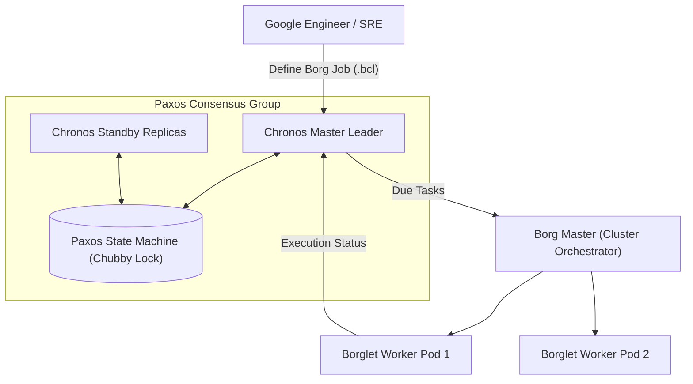
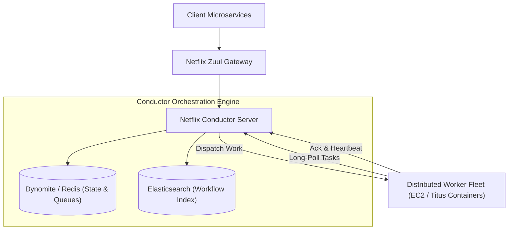

# Real-World Production Implementations: Distributed Job Schedulers

This document explores how **Google**, **Netflix**, **Apache Airflow**, and **Celery** schedule and coordinate billions of background tasks.

---

## 1. Google: Borg Chronos & Distributed Cron Infrastructure

### The Architecture
Inside Google, the cluster management system (**Borg**) runs millions of containers across hundreds of thousands of machines. Google replaced fragile individual machine crontabs with **Chronos**, a fault-tolerant distributed cron service.

### Key Technical Mechanisms
1. **Chubby Paxos Leader Election**:
   - Chronos deploys across multiple datacenter cells.
   - Master nodes maintain a persistent lock lease in **Google Chubby** (Google's Paxos lock service).
   - If the active Chronos master suffers a hardware failure, a standby master takes over within 3 seconds, resuming the scheduler without dropping tasks.
2. **Job Failure Policies & Overload Quotas**:
   - Chronos allows developers to specify backoff policies (exponential backoff with jitter) and concurrent execution caps. If an hourly data pipeline job runs longer than 60 minutes, Chronos can either skip the next run or execute in parallel depending on policy.
3. **Colossus Persistent Logging**:
   - Every job launch, stdout/stderr stream, and return code is stored in Google's distributed file system (**Colossus**), enabling global search and debugging across trillions of historical executions.

---

## 2. Netflix: Meson & Conductor Workflow Orchestration

### The Architecture
Netflix processes billions of asynchronous tasks daily: encoding 4K video files, training machine learning recommendation algorithms, and processing subscriber billing renewals. Netflix built **Meson** and open-sourced **Netflix Conductor** to orchestrate these distributed workflows.

### Key Technical Mechanisms
1. **State Machine Directed Acyclic Graph (DAG)**:
   - Complex business workflows are modeled as JSON-defined **Directed Acyclic Graphs (DAGs)**.
   - Example: *Step 1: Reserve inventory -> Step 2: Charge credit card -> Step 3: Send email confirmation*.
   - If Step 2 fails, Conductor executes automated compensating tasks in reverse order.
2. **Long-Polling Task Decoupling**:
   - Rather than pushing tasks directly to workers (which can overwhelm busy servers), workers long-poll Conductor for work when they have idle compute capacity.
3. **Dynomite Distributed In-Memory Queue**:
   - Conductor uses Netflix's **Dynomite** (distributed Redis wrapper) to manage in-flight task queues and millisecond state transitions with active-active cross-region replication.
