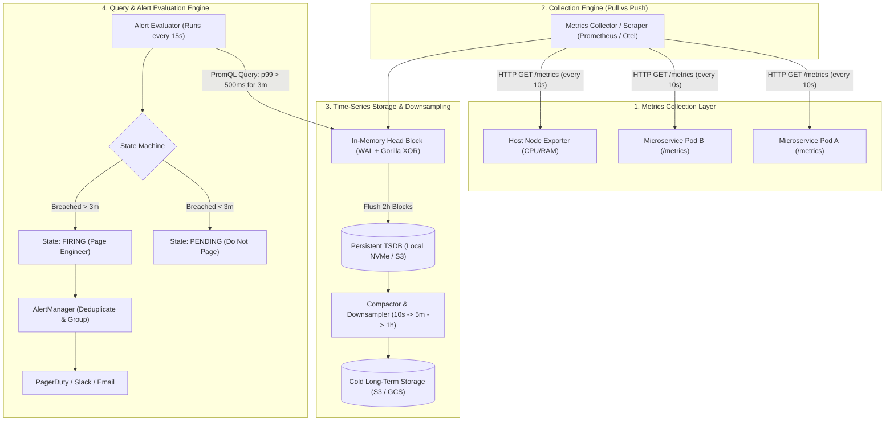

# Module 44: System Design — Metrics Monitoring & Alerting System

> Comprehensive architectural breakdown of a large-scale Metrics Monitoring & Alerting System (Prometheus, Datadog, Google Monarch, Netflix Atlas), covering Time-Series Databases (TSDB), Gorilla compression, Pull vs. Push collection models, and sliding-window alert evaluation.

---

## Prerequisites
Before tackling metrics monitoring systems, review these core modules:
* [09 - Storage Engines & Indexing](../09-storage-engines-and-indexing/) (LSM-trees vs Append-only time-series engines)
* [17 - Message Queues & Streaming](../17-message-queues/) (High-throughput metric ingestion pipelines)
* [20 - Fault Tolerance & Resilience](../20-fault-tolerance-and-resilience/) (Alert deduplication, flapping prevention, on-call paging)
* [35 - Global Notification System](../35-system-design-notification-system/) (PagerDuty, Slack, SMS dispatch)

---

## ELI5 (30-Second Summary)
Imagine an intensive care unit (ICU) hospital with **100,000 patient beds**. Every second, sensors record each patient's heart rate, oxygen level, and blood pressure. That's millions of numbers arriving every minute!

If a doctor's pager buzzed every single time a heart rate dipped for half a second, the doctor would go insane from false alarms (**Alert Fatigue / Flapping**). And if the hospital saved every single millisecond heart beat forever on hard drives, their storage would fill up in days.

A **Metrics Monitoring System** takes millions of numbers per second, compresses them by 90% using mathematical tricks (**Gorilla XOR Compression**), shrinks old data into 1-hour averages (**Downsampling / Rollups**), and triggers alarms only when a patient's numbers stay dangerous for at least 3 minutes straight (**Alert Evaluation Window**)!

---

## Physical Analogy
Think of an **Air Traffic Control Tower Flight Telemetry Dashboard**:

| Air Traffic Analogy | Metrics Monitoring Concept | Technical Description |
| :--- | :--- | :--- |
| **Cockpit Transponder Broadcasting Altitude** | Metric Datapoint (`name`, `tags`, `val`, `ts`) | 4-tuple: Metric string, dimensional labels, float value, Unix timestamp. |
| **Radar Sweeping Planes Every 5 Seconds** | Pull-Based Scraping (Prometheus) | Central collector polling `/metrics` HTTP endpoints on worker pods. |
| **Radar Screen History Log Tape** | Time-Series Database (TSDB) | Specialized storage engine optimized for timestamp-ordered numeric sequences. |
| **Compressing Identical Altitude Readings** | Gorilla Compression (Delta-of-Delta) | Bitwise compression reducing 16 bytes per datapoint to $\approx 1.37\text{ bytes}$. |
| **Alarm Buzzer when Plane Altitude < 1,000ft for 30s** | Alert Rule Evaluation (`PENDING` $\rightarrow$ `FIRING`) | Evaluates rules over sliding time windows before triggering PagerDuty. |

---

## The Problem It Solves
Operating thousands of microservice instances across multi-region cloud clusters presents massive observability challenges:
1. **Unprecedented Data Volume**: 50,000 microservice pods emitting 100 metrics every 10 seconds generates **500,000 datapoints/second** ($43.2\text{ billion datapoints/day}$).
2. **Heavy Read vs Write Asymmetry**: Ingestion is 99% writes, while human engineers and dashboards execute complex aggregations (p99 latency over 7 days).
3. **Storage Cost**: Storing billions of uncompressed 64-bit float numbers in standard SQL databases consumes hundreds of terabytes and results in query timeouts.

---

## Visual Architecture



---

## Real Numbers & Concurrency Sizing

Consider a system monitoring **50,000 Microservice Pods**:
* **Data Ingestion Volume**:
  - Each pod emits 100 unique metrics (CPU, RAM, request latency, error count, connection pools).
  - Metrics collected every 10 seconds:
  - Metric streams: $50,000 \times 100 = 5\text{ million time series}$.
  - Ingestion rate: $5\text{M} / 10\text{ s} = 500,000\text{ metric datapoints/second}$.
  - Daily datapoints: $500,000 \times 86,400 \approx 43.2\text{ billion datapoints/day}$.
* **Gorilla Compression Sizing**:
  - Raw uncompressed datapoint: 8-byte Unix timestamp + 8-byte IEEE 754 float = 16 bytes.
  - Raw daily volume: $43.2\text{B} \times 16\text{ bytes} \approx 691.2\text{ Gigabytes/day}$.
  - With **Gorilla XOR Compression** ($\approx 1.37\text{ bytes/datapoint}$ $\approx 12\times$ compression):
  - Compressed daily volume: $43.2\text{B} \times 1.37\text{ bytes} \approx 59.2\text{ Gigabytes/day}$!
  - 59.2 GB fits easily on modern high-speed NVMe SSD drives.

---

## Deep Dive: Under the Hood

### 1. The Pull vs. Push Metrics Model

| Dimension | Pull Model (Prometheus) | Push Model (Datadog / Graphite) |
| :--- | :--- | :--- |
| **How it works** | Central scraper queries HTTP `/metrics` on targets | Agents/apps push metrics to collector via UDP/HTTP |
| **Health Detection** | Automatic (if scrape fails, target is DOWN) | Difficult (silence could mean idle or dead) |
| **Network & Security** | Requires collector access to pod network | Firewall friendly (outbound traffic from pods) |
| **Ephemeral Jobs** | Needs Pushgateway for short-lived batch jobs | Ideal for short-lived AWS Lambda / serverless |

### 2. Gorilla TSDB Compression (Facebook Engine)
Modern TSDBs (Prometheus, InfluxDB, M3DB) use Facebook's **Gorilla** compression algorithms:
* **Timestamp Compression (Delta-of-Delta)**:
  - Metrics arrive at predictable intervals (every 10s: $T_0, T_0+10, T_0+20$).
  - The first delta is $D = T_n - T_{n-1} = 10$.
  - The delta-of-delta is $\Delta = D_n - D_{n-1} = 10 - 10 = 0$.
  - If $\Delta = 0$, store a single bit `0`! 95%+ of timestamps compress down to a single bit.
* **Value Compression (XOR Floating Point)**:
  - Metric values rarely fluctuate wildly (e.g., CPU 42.1%, then 42.15%).
  - XOR the current float with the previous float: $V_n \oplus V_{n-1}$.
  - Most leading and trailing bits are identical zeroes, allowing variable-length bit packing.

### 3. Downsampling & Retention Policies
To keep query times fast across months of data:
* **Raw Tier (10-second resolution)**: Retained for 14 days for live incident debugging.
* **5-Minute Rollups (avg, min, max, count)**: Retained for 90 days.
* **1-Hour Rollups**: Retained for 15 months for year-over-year capacity planning.

---

## Trade-offs & Decision Matrix

| Dimension | Relational DB (PostgreSQL / Timescale) | Centralized SaaS (Datadog) | Open-Source TSDB (Prometheus + Thanos) |
| :--- | :--- | :--- | :--- |
| **Ingestion Scale** | Moderate (tens of thousands / sec) | Unlimited (cloud managed) | High (millions / sec with sharding) |
| **Operational Overhead** | High (table vacuuming, partition maintenance) | Zero (SaaS) | Moderate (managing Kubernetes clusters) |
| **Cost at Scale** | Predictable infrastructure cost | Catastrophically expensive at scale | Low infrastructure cost |
| **Query Language** | SQL | Datadog UI | PromQL (powerful vector math) |

---

## Common Pitfalls & Anti-Patterns

1. **High Cardinality Explosions**: Adding raw User IDs or IP addresses as metric labels (e.g., `http_requests_total{user_id="12345"}`). Generating 10 million distinct label combinations creates 10 million distinct time-series streams in memory, causing out-of-memory crashes! *Rule: Labels must have bounded low cardinality (e.g., `status_code`, `method`, `endpoint`).*
2. **Missing Evaluation Window ("Alert Flapping")**: Triggering alerts on single instantaneous spikes causes engineers' phones to ring every time a GC pause occurs. Always require a sustained duration (`FOR 5m`).
3. **Missing Downsampling**: Querying 1 year of raw 10-second datapoints requires loading 3.1 million floats into memory per dashboard panel, freezing browser tabs.

---

## Try It Yourself
A runnable, zero-dependency Python simulation demonstrating time-series metric ingestion, Gorilla-style delta compression, downsampling rollups, and rule-based alert state transitions (`OK` $\rightarrow$ `PENDING` $\rightarrow$ `FIRING`) is included in this directory.

Run the simulation:
```bash
python demo.py
```

---

## Production References & Further Reading
* [Alex Xu: System Design Interview Vol 2 - Chapter 5 (Metrics Monitoring and Alerting System)](https://bytebytego.com)
* [Pelkonen et al.: Gorilla - A Fast, Scalable, In-Memory Time Series Database (VLDB 2015)](https://www.vldb.org/pvldb/vol8/p1816-teller.pdf)
* [Prometheus Architecture & Storage Engine Internals](https://prometheus.io/docs/prometheus/latest/storage/)

---

## Top 5 Interview Questions with Model Answers

### Q1: How does Gorilla compression achieve a 10x reduction in time-series storage size?
**Model Answer**: Gorilla compresses timestamps and floating-point values independently:
1. **Delta-of-Delta for Timestamps**: Because metrics are scraped at regular intervals (e.g., every 10s), the difference between consecutive time deltas ($\Delta = (T_n - T_{n-1}) - (T_{n-1} - T_{n-2})$) is zero most of the time. When $\Delta = 0$, Gorilla stores a single bit `0`.
2. **XOR Floating-Point Compression**: Successive float values (e.g., CPU percentage) have similar binary representations. By computing $V_n \oplus V_{n-1}$, identical leading and trailing bits become zeros. Gorilla only encodes the number of leading and trailing zeros followed by the meaningful bits.
Together, these techniques compress 16-byte datapoints down to an average of **1.37 bytes**.

### Q2: What is the "High Cardinality Problem" in metrics monitoring, and how do you prevent it?
**Model Answer**: In time-series databases, a unique time-series stream is created for every unique combination of metric name and key-value label pairs. 
- If a developer adds a high-cardinality tag like `user_id` ($10	ext{M}$ values) or `order_id` ($100	ext{M}$ values) to a metric, the system must allocate 10 million independent time-series streams in memory.
- This results in memory exhaustion, massive index bloat, and TSDB crashes.
- **Prevention**: Enforce strict admission control and linting rejecting UUIDs or dynamic strings in label keys. High-cardinality attributes belong in distributed tracing (OpenTelemetry) or structured logs, never metric labels.

### Q3: What is the difference between Pull and Push metrics architectures, and when should you use each?
**Model Answer**:
- **Pull Architecture (Prometheus)**: The central monitoring server polls `/metrics` HTTP endpoints on target nodes. It provides automatic health detection (if the scrape fails, the target is known to be dead), eliminates backpressure from targets, and centralizes scrape frequencies.
- **Push Architecture (Datadog/CloudWatch)**: Target services push metrics to a monitoring gateway. It is firewall-friendly (requires only outbound connections), ideal for ephemeral serverless workloads (AWS Lambda) that terminate before a scraper can poll them, and handles high-frequency event pushes.

### Q4: How do you prevent "Alert Fatigue" and flapping alerts?
**Model Answer**:
1. **Sustained Duration Condition (`FOR` clause)**: Require the metric to breach the threshold continuously for $M$ minutes (e.g., `CPU > 90% FOR 5m`) before advancing from `PENDING` to `FIRING`.
2. **AlertManager Deduplication & Grouping**: Group related alerts into a single notification (e.g., if a datacenter switch fails, group 50 individual server unreachable alerts into *"Datacenter Switch Offline: 50 pods affected"*).
3. **Inhibit Rules**: Suppress downstream alerts when a root dependency has already triggered (e.g., if the entire database cluster is down, mute downstream API latency alerts).

### Q5: How do you scale Prometheus across thousands of Kubernetes clusters?
**Model Answer**: Single-node Prometheus instances cannot handle global enterprise scale. We implement a distributed architecture using **Thanos** or **Cortex/M3DB**:
1. **Local Prometheus per Cluster**: Each Kubernetes cluster runs a local Prometheus instance with a short retention window (e.g., 24 hours).
2. **Thanos Sidecar**: Runs alongside Prometheus, streaming immutable 2-hour TSDB blocks directly to durable object storage (Google Cloud Storage / Amazon S3).
3. **Thanos Query & Store Gateway**: A centralized querier evaluates global PromQL queries by fanning out across regional sidecars and object storage, providing unified multi-cluster dashboards with unlimited historical retention.

---

## Check Yourself Quiz

<details>
<summary><b>1. Why does Gorilla compression use XOR for floating-point values?</b></summary>
A) Because XOR encrypts passwords.<br/>
B) Because consecutive metric readings share identical leading and trailing bits, allowing variable-length encoding of the remaining bits.<br/>
C) Because XOR turns floats into integers.<br/>
D) Because XOR is faster than addition.<br/><br/>
<b>Answer: B</b>. XORing similar floats yields many leading and trailing zero bits, achieving massive compression.
</details>

<details>
<summary><b>2. What happens if a developer adds `user_id` as a metric label?</b></summary>
A) The dashboard loads 10x faster.<br/>
B) High Cardinality Explosion: creates millions of unique time-series streams, causing TSDB out-of-memory crashes.<br/>
C) The database automatically converts to SQL.<br/>
D) The network cable overheats.<br/><br/>
<b>Answer: B</b>. Millions of label permutations multiply time-series streams, exhausting RAM.
</details>

<details>
<summary><b>3. What is the alert state transition sequence in Prometheus?</b></summary>
A) FIRING -> PENDING -> OK<br/>
B) OK -> PENDING (during evaluation window) -> FIRING (if condition persists)<br/>
C) ERROR -> WARNING -> CRITICAL<br/>
D) SLEEP -> WAKE -> RUN<br/><br/>
<b>Answer: B</b>. The intermediate PENDING state ensures transient blips do not page engineers.
</details>

<details>
<summary><b>4. Why are short-lived serverless functions (like AWS Lambda) difficult to monitor via Pull scraping?</b></summary>
A) Because Lambda does not use Python.<br/>
B) Because Lambda instances spin up, execute in milliseconds, and terminate before a periodic scraper can initiate an HTTP connection.<br/>
C) Because Lambda has no memory.<br/>
D) Because Lambda is encrypted.<br/><br/>
<b>Answer: B</b>. Ephemeral functions require push-based metrics emission before shutdown.
</details>

<details>
<summary><b>5. What process reduces raw 10-second metrics into 1-hour historical rollups?</b></summary>
A) Encryption<br/>
B) Downsampling and Compaction<br/>
C) Sharding<br/>
D) Consistent Hashing<br/><br/>
<b>Answer: B</b>. Downsampling averages historical intervals to keep long-term queries fast and storage affordable.
</details>
