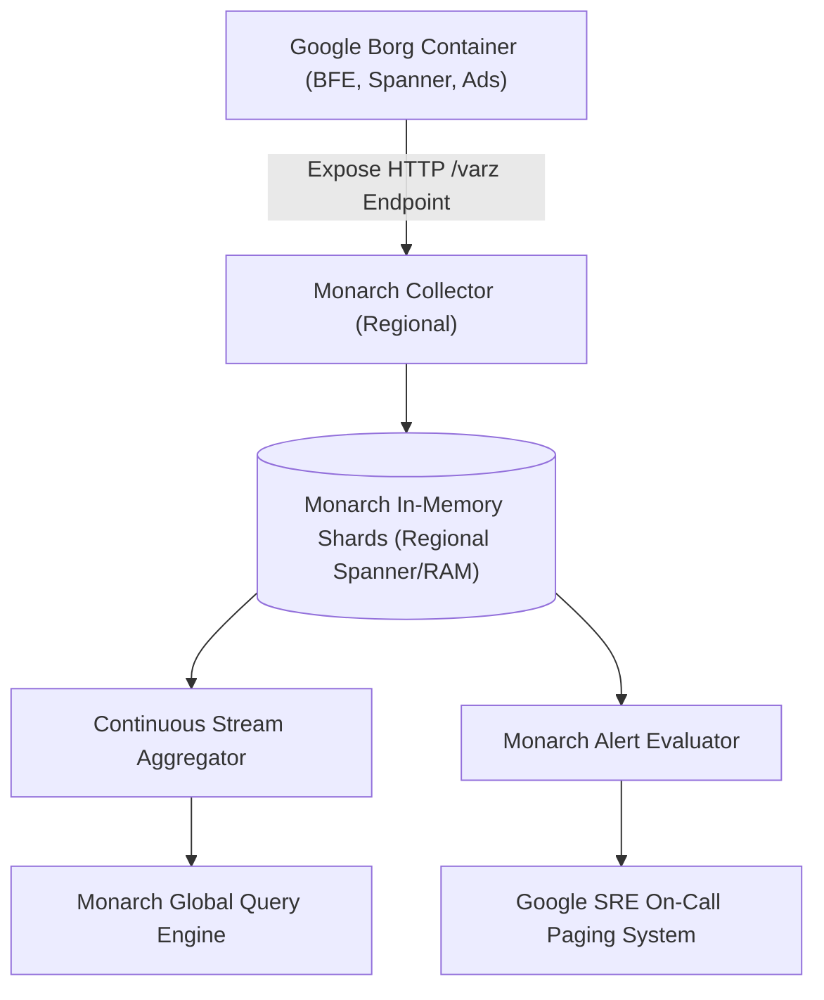
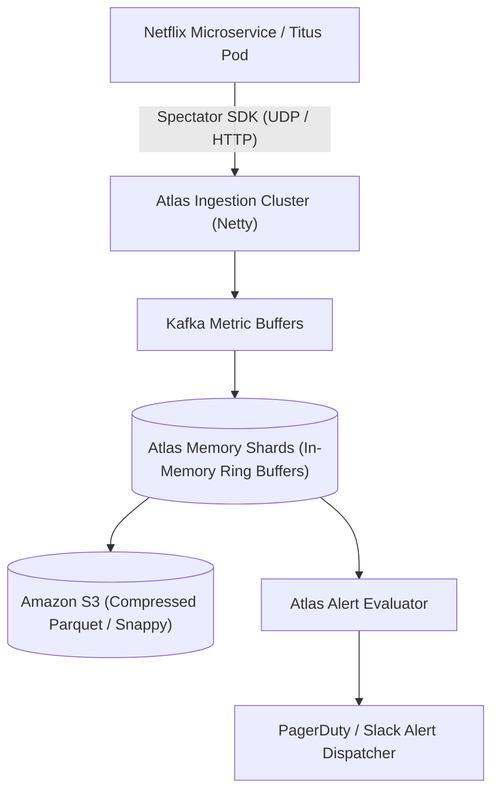

# Real-World Production Implementations: Metrics Monitoring & Alerting

This document explores how **Google**, **Netflix**, **Prometheus**, and **Datadog** ingest, compress, and alert on trillions of time-series data points.

---

## 1. Google: Borgmon & Monarch Planetary Time-Series Infrastructure

### The Architecture
Google pioneered internal site reliability engineering (SRE) monitoring using **Borgmon** (the predecessor to Prometheus) and subsequently built **Monarch**, a multi-region, in-memory distributed time-series database monitoring Google's entire global fleet.

### Key Technical Mechanisms
1. **The `/varz` Scraping Convention**:
   - Google originated the pull-based monitoring convention. Every binary running on Borg exposes an internal HTTP `/varz` endpoint returning current metric counters.
   - Borgmon/Monarch collectors scrape these endpoints every 10-30 seconds, maintaining a global target directory using Borg service discovery.
2. **Pushdown Query Evaluation in Monarch**:
   - To query CPU percentiles across 100,000 servers, Monarch pushes computation down to regional in-memory shards. Each region calculates its local summary, returning only aggregated vectors to the central dashboard in milliseconds.
3. **Automated Alert Silencing during Canary Rollouts**:
   - Monarch integrates directly with Google's deployment infrastructure. When a canary rollout begins, alerts for known expected restart behaviors are automatically silenced to avoid false pages.

---

## 2. Netflix: Atlas In-Memory Dimensional Time-Series Engine

### The Architecture
Netflix operates over **1,000 microservices** across tens of thousands of AWS EC2 instances. Netflix open-sourced **Atlas**, a custom-built dimensional time-series engine capable of processing over **100 million real-time metrics per second**.

### Key Technical Mechanisms
1. **Spectator Client-Side Pre-Aggregation**:
   - Rather than pushing raw events, Netflix applications use the **Spectator SDK** to aggregate metric counts locally in memory over a 1-minute window before publishing to Atlas, reducing network bandwidth by 95%.
2. **In-Memory Ring Buffers**:
   - Atlas stores active metric series (last 6-12 hours) in off-heap in-memory ring buffers. Because memory is pre-allocated, Atlas achieves predictable sub-second query latency for live incident debugging without garbage collection pauses.
3. **Multi-Dimensional Tag Filtering**:
   - Every metric in Atlas is a dimensional key-value map (`app=playback`, `region=us-east-1`, `node=i-12345`). Atlas's expressive stack-based query language allows on-call engineers to slice, dice, and group by any dimension in real-time.
