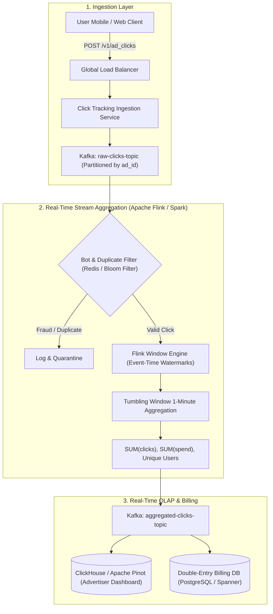

# Module 45: System Design — Ad Click Aggregation & Event Analytics

> Comprehensive architectural breakdown of a Real-Time Ad Click Aggregation and Analytics System (Google Ads, Meta Ads, TikTok), covering stream processing (Flink/Spark), windowing strategies (Tumbling, Hopping, Sliding), Watermark heuristics for late-arriving events, and click-fraud deduplication.

---

## Prerequisites
Before tackling ad click aggregation, review these core modules:
* [17 - Message Queues & Event Streaming](../17-message-queues/) (Kafka topics, consumer groups, partitions)
* [27 - Back-of-the-Envelope Estimation](../27-back-of-the-envelope-estimation/) (Calculating click throughput and aggregation storage)
* [31 - Time, Clocks & Ordering](../31-time-clocks-and-ordering/) (Event time vs Processing time vs Ingestion time)
* [32 - REST API Design & Idempotency](../32-rest-api-design-and-idempotency/) (Idempotent tracking endpoints)

---

## ELI5 (30-Second Summary)
Imagine a busy highway with **1 billion cars driving past billboard ads** every day. Every time a driver looks at an ad or visits a store, a penny is transferred from the advertiser to the billboard owner.

If your accounting system counted every single click on a separate piece of paper and billed advertisers one by one, your computers would melt under the paperwork. Even worse: what if a mischievous competitor writes a bot that clicks your billboard 10,000 times in 10 seconds (**Click Fraud**)? Or what if a driver drives through a mountain tunnel with no cell service, and their click arrives 15 minutes late (**Late-Arriving Events**)?

An **Ad Click Aggregation System** groups clicks into tidy 1-minute buckets (**Tumbling Windows**), filters out robotic duplicate clicks, and uses an intelligent clock (**Watermarks**) to count late-arriving clicks accurately so advertisers are billed fairly to the exact penny!

---

## Physical Analogy
Think of a **Rain Gauge Measuring Rainfall During a Storm**:

| Rain Gauge Analogy | Ad Click Aggregation Concept | Technical Description |
| :--- | :--- | :--- |
| **Individual Raindrops Falling** | Raw Ad Click Events | High-velocity click streams ingested into Apache Kafka. |
| **Marked 1-Minute Measurement Beaker** | Tumbling Window (1-Minute) | Non-overlapping fixed time window aggregating metric counts. |
| **Water Splashing from Shaken Trees (Delayed Drops)** | Late-Arriving Events (Watermark Lag) | Events delayed by mobile cell handoffs or airplane offline modes. |
| **Mesh Filter Straining Leaves and Debris** | Click Fraud & Bot Filter (Bloom Filter) | Identifies duplicate or robotic clicks from the same IP/Device. |
| **Logging Total Inches in the Farm Logbook** | Analytical OLAP DB (ClickHouse / Druid) | Stores summarized aggregation tables for real-time advertiser dashboards. |

---

## The Problem It Solves
Digital advertising engines (Google Search Ads, Instagram Sponsored Posts) power multi-billion dollar ecosystems:
1. **Financial Integrity**: Advertisers pay real money per click (Cost-Per-Click: CPC). Over-counting due to network retries causes advertiser lawsuits; under-counting loses revenue.
2. **Massive Scale**: Platforms process **10 billion ad impressions and 1 billion clicks daily** ($> 50,000\text{ clicks/second}$ peak).
3. **Event Time vs. Processing Time Discrepancies**: A user clicks an ad at `14:00:00` on a subway train; their phone loses signal and delivers the click payload at `14:12:30`. The system must attribute the click to the `14:00:00` window for accurate analytics.

---

## Visual Architecture



---

## Real Numbers & Concurrency Sizing

Consider an ad network handling **1 Billion Ad Clicks Daily**:
* **Throughput Sizing**:
  - $1\text{B} / 86,400 \approx 11,570\text{ clicks/second}$ average.
  - Peak click throughput ($3\times$): **$35,000\text{ clicks/second}$**.
* **Storage Reduction via 1-Minute Aggregation**:
  - Raw click event: `(click_id, ad_id, campaign_id, user_id, ip, timestamp, bid_price)` $\approx 200\text{ bytes}$.
  - Raw daily storage: $1\text{B} \times 200\text{ bytes} = 200\text{ Gigabytes/day}$.
  - If 50,000 active ad campaigns receive clicks every minute:
  - 1-minute aggregation produces $50,000 \times 60 \times 24 = 72\text{ million rows/day}$.
  - Aggregated row: `(ad_id, minute_timestamp, click_count, total_cost)` $\approx 32\text{ bytes}$.
  - Aggregated daily storage: $72\text{M} \times 32\text{ bytes} \approx 2.3\text{ Gigabytes/day}$!
  - **98.8% storage reduction** while powering sub-100ms dashboard queries!

---

## Deep Dive: Under the Hood

### 1. Three Types of Streaming Windows
* **Tumbling Windows (Fixed, Non-Overlapping)**:
  - Example: `[12:00 - 12:01]`, `[12:01 - 12:02]`, `[12:02 - 12:03]`.
  - Every event belongs to exactly one window. Best for financial billing and hourly stats.
* **Hopping Windows (Fixed Length, Overlapping Step)**:
  - Example: 5-minute window advancing every 1 minute (`[12:00 - 12:05]`, `[12:01 - 12:06]`).
  - Best for moving averages and trendline detection.
* **Sliding Windows (Dynamic Event-Driven)**:
  - Bounded by time intervals relative to events (e.g., maximum 5 clicks from the same IP within any 10-second span).
  - Best for real-time fraud and bot detection.

### 2. Event Time vs. Processing Time & Watermarks
* **Event Time**: The timestamp when the user physically tapped the screen (recorded by the mobile client).
* **Processing Time**: The timestamp when the stream processor (Flink) processes the event.
* **The Watermark Algorithm**:
  - A Watermark $W(t)$ is a declaration: *"We assert that all events with Event Time $\le t$ have arrived"*.
  - To handle network delays, we set **Bounded Out-of-Orderness** (e.g., 5 minutes):
    $$W(t) = \max(\text{Event Time seen so far}) - 5\text{ minutes}$$
  - When the Watermark passes `12:05:00`, the `[12:00 - 12:05]` window closes and outputs final numbers.
  - Events arriving *after* the watermark are either processed via **Side Outputs** or dropped as late anomalies.

### 3. Click-Fraud & Bot Detection
Fraudulent networks generate fake clicks to drain competitor ad budgets.
- **Deduplication Window**: If the same `(user_id, ad_id)` or `(ip_address, ad_id)` generates multiple clicks within 5 seconds, only the first click is charged; subsequent clicks are flagged as invalid clicks and discarded from billing.
- **IP Rate Limiting**: Track clicks per IP subnet using Redis sliding window logs.

---

## Trade-offs & Decision Matrix

| Dimension | Lambda Architecture (Batch + Stream) | Kappa Architecture (Pure Streaming - Flink) |
| :--- | :--- | :--- |
| **Code Maintenance** | Painful (must maintain dual codebases in Spark & Flink) | Elegant (single processing logic in Flink) |
| **Historical Reprocessing** | Easy (re-run MapReduce batch on raw files) | Requires replaying Kafka historical retention |
| **Real-Time Accuracy** | High (batch job corrects streaming inaccuracies nightly) | High (watermarks handle late events cleanly) |
| **System Complexity** | Very High | Moderate |

---

## Common Pitfalls & Anti-Patterns

1. **Relying on Processing Time for Billing**: If Kafka experiences an ingestion backlog, 2 hours of queued clicks will all be processed within 1 minute. Using processing time attributes 2 hours of clicks to a single 1-minute billing bucket, corrupting advertiser analytics. Always aggregate on **Event Time**.
2. **Missing Late-Event Side Outputs**: Closing windows strictly and dropping late clicks causes under-counting for mobile users on intermittent transit Wi-Fi. Always configure side outputs in Flink to route late events to reconciliation tables.
3. **Synchronous Database Writes per Click**: Writing 35,000 individual SQL inserts per second overwhelms relational databases. Ingest through Kafka, aggregate in memory with Flink, and bulk-insert minute-level summaries into ClickHouse.

---

## Try It Yourself
A runnable, zero-dependency Python simulation demonstrating tumbling window click aggregation, event-time watermark evaluation, late-event side output handling, and bot click deduplication is included in this directory.

Run the simulation:
```bash
python demo.py
```

---

## Production References & Further Reading
* [Alex Xu: System Design Interview Vol 2 - Chapter 4 (Ad Click Aggregation)](https://bytebytego.com)
* [Tyler Akidau et al.: The Dataflow Model (VLDB 2015)](https://www.vldb.org/pvldb/vol8/p1792-Akidau.pdf)
* [Apache Flink Documentation: Timely Stream Processing & Watermarks](https://nightlies.apache.org/flink/flink-docs-stable/docs/concepts/time-and-watermarks/)

---

## Top 5 Interview Questions with Model Answers

### Q1: What is the difference between Event Time, Ingestion Time, and Processing Time?
**Model Answer**:
- **Event Time**: The timestamp when the action occurred on the client device (e.g., when the user tapped the ad).
- **Ingestion Time**: The timestamp when the message arrived at the message queue broker (e.g., when Kafka recorded the event).
- **Processing Time**: The local system clock of the stream processing node (e.g., Apache Flink worker) executing the aggregation code.
For financial billing and business analytics, **Event Time** is mandatory because network lags and queue buffering introduce random delays between event occurrence and stream processing.

### Q2: How do Watermarks handle late-arriving events in Apache Flink or Google Cloud Dataflow?
**Model Answer**: A Watermark is a monotonically increasing timestamp emitted into the stream that acts as a completion horizon: $W(t) = \max(	ext{Event Time seen}) - 	ext{Allowed Latency } \Delta$.
- A Watermark $W(12:05)$ guarantees to downstream operators that no further events with timestamp $\le 12:05$ are expected to arrive.
- When $W(t)$ passes the end of a window (e.g., 12:00), the window closes and emits its final aggregated output.
- If a late event arrives with $t < W$, Flink handles it using an **Allowed Lateness Policy**: it can either update the window via a retraction stream or divert the event to a **Side Output** for manual reconciliation.

### Q3: How do you achieve Exactly-Once Processing in an ad click aggregation pipeline?
**Model Answer**: Exactly-once processing is achieved through end-to-end alignment across three pipeline stages:
1. **Replay-able Source**: Apache Kafka retains raw click offsets.
2. **Stateful Stream Processing with Checkpointing (Chandy-Lamport Algorithm)**: Flink periodically saves consistent snapshots of aggregation state and Kafka read offsets to durable storage (S3/GCS). If a worker crashes, Flink restores state and rewinds Kafka to the last checkpoint.
3. **Idempotent / Transactional Sink**: When writing aggregated summaries to ClickHouse or PostgreSQL, writes use **Upserts** on compound keys (`ad_id, window_start_time`) or two-phase commit sinks (`TwoPhaseCommitSinkFunction`).

### Q4: How do you detect and filter Click-Fraud in real time?
**Model Answer**: Click fraud is filtered in a multi-tier pipeline:
1. **Deduplication Filter (Fast Layer)**: When a click arrives, hash `(user_id, ad_id, ip)` and check an atomic Redis key with a 5-second TTL. Duplicate clicks within 5 seconds are marked invalid and excluded from billing.
2. **Behavioral Sliding Window (Anomaly Detection Layer)**: Flink maintains a sliding window tracking click velocity per IP subnet and user agent. If an IP exceeds 50 clicks/minute, subsequent clicks are routed to a fraud queue.
3. **Offline Machine Learning Classifier**: A nightly batch job analyzes click-to-conversion rates, IP geolocation hops, and known botnet IP blacklists, issuing retroactive billing credits to advertisers for fraudulent clicks that bypassed real-time filters.

### Q5: Why is ClickHouse or Apache Pinot preferred over PostgreSQL for storing aggregated ad analytics?
**Model Answer**:
- **Columnar Storage**: Aggregated analytics queries calculate aggregate functions over specific columns (`SELECT ad_id, SUM(clicks), SUM(cost) WHERE date = '2026-11-23' GROUP BY ad_id`). Columnar databases only read the requested columns off disk, scanning $10	imes$ to $50	imes$ less data than row-oriented PostgreSQL.
- **Vectorized Query Execution**: ClickHouse processes SIMD vector CPU instructions across column arrays, aggregating hundreds of millions of rows per second per core.
- **Massive Compression**: Columnar compression (DoubleDelta, Zstandard) achieves $5	imes$ to $10	imes$ higher compression ratios than row-based storage engines.

---

## Check Yourself Quiz

<details>
<summary><b>1. Which windowing strategy produces non-overlapping, fixed-duration time buckets?</b></summary>
A) Sliding Window<br/>
B) Tumbling Window<br/>
C) Session Window<br/>
D) Hopping Window<br/><br/>
<b>Answer: B</b>. Tumbling windows have fixed size and zero overlap (e.g. 12:00-12:01, 12:01-12:02).
</details>

<details>
<summary><b>2. Why is Event Time preferred over Processing Time for calculating advertiser ad charges?</b></summary>
A) Because Processing Time cannot be stored in Kafka.<br/>
B) Because network delays and queue buffering would incorrectly shift clicks to later minutes, distorting billing attribution.<br/>
C) Because Event Time is always in UTC.<br/>
D) Because Processing Time requires GPS.<br/><br/>
<b>Answer: B</b>. Event Time represents the true moment of user engagement, independent of network transit delays.
</details>

<details>
<summary><b>3. What does a Watermark timestamp W(t) signify to a stream processing operator?</b></summary>
A) That the database is full.<br/>
B) That no further events with timestamp earlier than t are expected to arrive, triggering window completion.<br/>
C) That the server should reboot.<br/>
D) That the user clicked twice.<br/><br/>
<b>Answer: B</b>. Watermarks provide a temporal progress indicator that allows windows to close and emit results.
</details>

<details>
<summary><b>4. How does 1-minute click aggregation reduce database storage costs?</b></summary>
A) By deleting all ad clicks after 1 hour.<br/>
B) By combining thousands of raw click events for an ad into a single summary row per minute, achieving 95%+ storage reduction.<br/>
C) By compressing data with MP3.<br/>
D) By disabling SQL indexes.<br/><br/>
<b>Answer: B</b>. Summarizing thousands of clicks into periodic count/sum rows drastically shrinks data footprint.
</details>

<details>
<summary><b>5. Which database type is best suited for real-time advertiser analytics dashboards?</b></summary>
A) Relational Row Store (PostgreSQL / MySQL)<br/>
B) Distributed Columnar OLAP Store (ClickHouse / Apache Pinot)<br/>
C) Redis String Key-Value<br/>
D) MongoDB Document Store<br/><br/>
<b>Answer: B</b>. Columnar OLAP stores provide sub-second aggregations (`SUM`, `AVG`, `GROUP BY`) across billions of rows.
</details>
