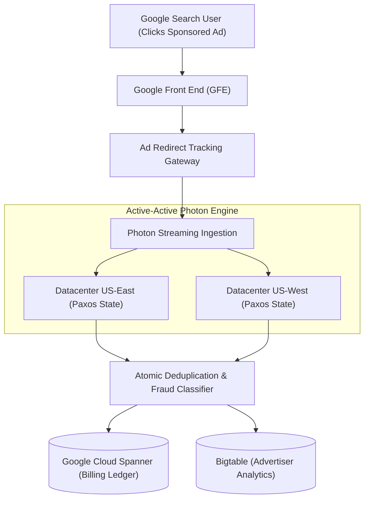
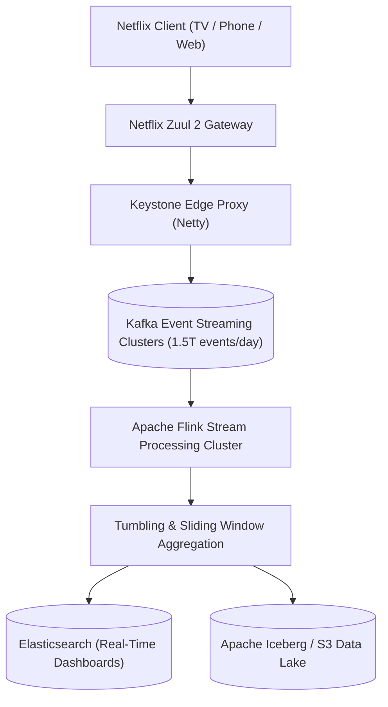

# Real-World Production Implementations: Ad Click Aggregation

This document explores how **Google**, **Netflix**, and **Meta** process, aggregate, and attribute trillions of streaming events daily.

---

## 1. Google: Google Ads & Photon Real-Time Streaming Architecture

### The Architecture
Google generates over **$200 Billion annually** in ad revenue from Google Search, YouTube, and the Google Display Network. Because advertisers are billed per click, Google developed **Photon**, a globally distributed streaming system designed for continuous high-throughput event aggregation.

### Key Technical Mechanisms
1. **Photon Active-Active Multi-Datacenter Streaming**:
   - Photon runs across geographically separated datacenters in parallel.
   - Using Paxos-coordinated event tokens, Photon guarantees that even if an entire US-East datacenter goes dark mid-stream, US-West resumes processing without duplicate click billing or dropped transactions.
2. **Real-Time Click-Fraud Detection (Spider & Botnet Filters)**:
   - Google analyzes hundreds of features per click: IP address reputation, mouse-movement velocity, screen touch cadence, and referrer patterns.
   - Fraudulent clicks are filtered in real-time; the click is logged for machine learning analysis, but the advertiser's budget is never debited.
3. **Hourly & Daily MapReduce Reconciliation**:
   - Google pairs Photon's real-time streaming layer with batch MapReduce jobs that audit raw logs overnight, correcting any discrepancies caused by extreme multi-hour mobile network disconnects.

---

## 2. Netflix: Keystone Real-Time Event Streaming Pipeline

### The Architecture
Netflix's streaming infrastructure relies on **Keystone**, a real-time event streaming pipeline processing over **1.5 Trillion events per day** (tens of petabytes daily), supporting telemetry, user interaction analytics, and personalized recommendation updates.

### Key Technical Mechanisms
1. **Apache Flink Stream Aggregation**:
   - Netflix uses **Apache Flink** to aggregate subscriber interactions (playback pauses, bitrate fluctuations, title impressions) into 1-minute and 5-minute tumbling windows.
2. **Watermarking with Event-Time Alignment**:
   - Cellular devices streaming movies frequently lose connectivity when passing through dead zones. Keystone uses bounded-lateness watermarks to attribute playback diagnostic events to the exact moment playback stalled, rather than when the phone reconnected to LTE.
3. **Dynamic Stream Routing with Apache Iceberg**:
   - Aggregated metrics are written in parallel to **Elasticsearch** (for live real-time SRE dashboards) and **Apache Iceberg** table format on Amazon S3 (for long-term historical machine learning and business intelligence).
