# 📐 System Design Back-of-the-Envelope Master Cheat Sheet

> The ultimate mathematical reference, latency handbook, capacity planning formulas, and hardware limits for system design interviews and production infrastructure sizing.

---

## 📑 Table of Contents
1. [Powers of Two & Data Scale](#1-powers-of-two--data-scale)
2. [Latency Numbers Every Programmer Must Know](#2-latency-numbers-every-programmer-must-know)
3. [Traffic & QPS Quick Conversions](#3-traffic--qps-quick-conversions)
4. [Standard Data Size Estimates](#4-standard-data-size-estimates)
5. [The Universal 5-Step Sizing Formulas](#5-the-universal-5-step-sizing-formulas)
6. [High Availability: "The Nines" & Downtime](#6-high-availability-the-nines--downtime)
7. [Production Hardware & Technology Benchmarks](#7-production-hardware--technology-benchmarks)
8. [Mental Math Tricks for the Interview](#8-mental-math-tricks-for-the-interview)

---

## 1. Powers of Two & Data Scale

Computers operate in base 2. In system design, memory, disk, and network throughput are calculated using powers of 2.

| Power of 2 | Exact Value (Bytes) | Approximation | Shorthand | Real-World Scale Equivalent |
| :---: | :---: | :---: | :---: | :--- |
| **$2^{10}$** | 1,024 | $1,000$ | **1 KB** (Kilobyte) | 1-page plain text file ($\approx 2\text{ KB}$) |
| **$2^{20}$** | 1,048,576 | $1,000,000$ ($10^6$) | **1 MB** (Megabyte) | 1 smartphone photo compressed ($\approx 2\text{ MB}$) |
| **$2^{30}$** | 1,073,741,824 | $1,000,000,000$ ($10^9$) | **1 GB** (Gigabyte) | 1 pickup truck filled with books |
| **$2^{40}$** | 1,099,511,627,776 | $1,000,000,000,000$ ($10^{12}$) | **1 TB** (Terabyte) | All books in a major university library |
| **$2^{50}$** | 1,125,899,906,842,624 | $10^{15}$ | **1 PB** (Petabyte) | 13.3 years of HD video streaming |
| **$2^{60}$** | 1,152,921,504,606,846,976 | $10^{18}$ | **1 EB** (Exabyte) | 50% of all words spoken by humans in history |
| **$2^{70}$** | 1,180,591,620,717,411,303,424 | $10^{21}$ | **1 ZB** (Zettabyte) | Annual global internet data traffic |
| **$2^{80}$** | 1,208,925,819,614,629,174,706,176 | $10^{24}$ | **1 YB** (Yottabyte) | All digital data on planet Earth |

> **Pro Tip (Binary vs Decimal prefixes)**:
> In networking: $1\text{ Gbps} = 10^9\text{ bits/sec}$ (Decimal).
> In RAM/Storage: $1\text{ GiB} = 2^{30}\text{ bytes} = 1,073,741,824\text{ bytes}$ (Binary).
> In an interview, using $10^3, 10^6, 10^9$ approximations is standard practice.

---

## 2. Latency Numbers Every Programmer Must Know

Originally compiled by Google Fellow Jeff Dean and updated for modern hardware (DDR5, PCIe Gen5 NVMe, 100GbE cloud datacenters).

| Operation | Real Latency | Normalized to Human Scale (1 ns = 1 sec) | Architectural Takeaway |
| :--- | :---: | :---: | :--- |
| **L1 CPU Cache Reference** | 0.5 - 1 ns | **1 second** | Single heartbeat. Always keep hot variables in CPU registers/L1. |
| **Branch Mispredict** | 3 - 5 ns | **4 seconds** | CPU instruction pipeline stalls. |
| **L2 CPU Cache Reference** | 3 - 7 ns | **5 seconds** | Fast on-die lookup. |
| **Mutex Lock / Unlock** | 15 - 25 ns | **20 seconds** | Low cost, but concurrent thread contention destroys scale. |
| **Main Memory (RAM) Access** | 50 - 100 ns | **1.5 minutes** | RAM is fast, but $100\times$ slower than L1 cache. |
| **Read 1 MB Sequentially from RAM** | 3 - 5 µs | **1 hour** | Sequential memory reads are blazing fast ($\approx 25\text{ GB/s}$). |
| **Modern NVMe SSD Random Read** | 10 - 30 µs | **6 hours** | Fast, but $1,000\times$ slower than RAM! |
| **Read 1 MB Sequentially from NVMe** | 100 - 250 µs | **2 days** | High throughput ($\approx 4-7\text{ GB/s}$); sequential disk is cheap. |
| **Intra-Datacenter RTT (Same Rack / AZ)** | 250 - 500 µs | **5 days** | Network RPC overhead within the same cloud data hall. |
| **Read 1 MB Sequentially from HDD** | 5 - 15 ms | **5 months** | Spinning magnetic disks must physically move arm heads. |
| **HDD Disk Seek (Random Read)** | 8 - 10 ms | **3 months** | Random disk I/O on magnetic drives kills throughput ($< 150\text{ IOPS}$). |
| **US Cross-Country RTT (SF to NY)** | 40 - 65 ms | **1.5 years** | Speed of light in fiber optic glass ($\approx 200,000\text{ km/s}$). |
| **Transatlantic RTT (NY to London)** | 75 - 90 ms | **2.5 years** | Undersea fiber cable crossing the Atlantic. |
| **Transpacific RTT (SF to Singapore)** | 160 - 200 ms | **5.5 years** | High latency. Requires Edge CDNs and regional databases. |

```mermaid
gantt
    title Latency on a Logarithmic Time Scale (Nanoseconds to Milliseconds)
    dateFormat X
    axisFormat %s
    section Memory
    L1 Cache (1ns)          :0, 1
    RAM Access (100ns)       :0, 100
    section Storage
    NVMe SSD Read (20µs)     :0, 20000
    HDD Random Seek (10ms)   :0, 10000000
    section Network
    Same AZ RTT (500µs)      :0, 500000
    Cross-Country RTT (50ms) :0, 50000000
```



---

## 3. Traffic & QPS Quick Conversions

There are **$86,400$ seconds in one day**. In interviews, approximate to **$100,000$ ($10^5$)** for quick mental math, or use $86,400$ for exact numbers.

| Daily Request Volume | Exact Average QPS ($/ 86,400$) | Mental Math Approximation ($/ 100,000$) | Peak QPS ($2\times$) | Peak QPS ($5\times$) |
| :---: | :---: | :---: | :---: | :---: |
| **1 Million** | $11.6\text{ QPS}$ | $10\text{ QPS}$ | $23\text{ QPS}$ | $58\text{ QPS}$ |
| **5 Million** | $58\text{ QPS}$ | $50\text{ QPS}$ | $116\text{ QPS}$ | $290\text{ QPS}$ |
| **10 Million** | $116\text{ QPS}$ | $100\text{ QPS}$ | $232\text{ QPS}$ | $580\text{ QPS}$ |
| **50 Million** | $579\text{ QPS}$ | $500\text{ QPS}$ | $1,158\text{ QPS}$ | $2,895\text{ QPS}$ |
| **100 Million** | $1,157\text{ QPS}$ | $1,000\text{ QPS}$ | $2,314\text{ QPS}$ | $5,785\text{ QPS}$ |
| **500 Million** | $5,787\text{ QPS}$ | $5,000\text{ QPS}$ | $11,574\text{ QPS}$ | $28,935\text{ QPS}$ |
| **1 Billion** | $11,574\text{ QPS}$ | $10,000\text{ QPS}$ | $23,148\text{ QPS}$ | $57,870\text{ QPS}$ |
| **10 Billion** | $115,740\text{ QPS}$ | $100,000\text{ QPS}$ | $231,480\text{ QPS}$ | $578,700\text{ QPS}$ |

### Peak Multiplier Heuristics:
* **$2\times$ Peak**: Standard baseline web application with global users evenly spread across timezones.
* **$3\times$ to $5\times$ Peak**: Single-country or regional application (e.g., food delivery lunch rush or ride-sharing commute hours).
* **$10\times$ to $50\times$ Peak**: Event-driven flash sales (Black Friday, Ticketmaster stadium tour drops, Super Bowl ad).

---

## 4. Standard Data Size Estimates

Unless explicitly specified by the interviewer, use these standard industry sizing rules:

| Data Type | Typical Size | Notes & Description |
| :--- | :---: | :--- |
| **Boolean** | 1 byte | True / False flag |
| **32-bit Integer (`INT`)** | 4 bytes | Handles values up to $\pm 2.14\text{ billion}$ |
| **64-bit Integer (`BIGINT`)** | 8 bytes | Snowflake IDs, Unix Epoch timestamps in ms, financial cents |
| **Float / Double** | 4 / 8 bytes | IEEE 754 precision |
| **UUID (String)** | 36 bytes | `123e4567-e89b-12d3-a456-426614174000` (16 bytes if stored binary) |
| **SHA-256 Hash** | 32 bytes binary (64 chars hex) | Block deduplication, cryptographic checksums |
| **Short Text / Username** | 30 - 64 bytes | Usernames, category tags |
| **Email Address** | 50 - 100 bytes | Average user email |
| **User Profile Metadata** | $500\text{ bytes} - 1\text{ KB}$ | ID, name, email, avatar URL, preferences JSON |
| **Short Message / Tweet** | 250 - 500 bytes | Text message + author ID + timestamp metadata |
| **Compressed Web Image** | 200 KB - 500 KB | Optimized JPEG / WebP image |
| **High-Resolution Photo** | 2 MB - 5 MB | Original camera capture |
| **Audio Voice Note (1 min)** | 1 MB - 2 MB | Compressed AAC / Opus |
| **1080p Video Stream (1 min)** | 20 MB - 30 MB | H.264 / H.265 encoded at 3-4 Mbps |
| **4K Video Stream (1 min)** | 100 MB - 150 MB | AV1 / HEVC encoded at 15-20 Mbps |

---

## 5. The Universal 5-Step Sizing Formulas

Every system design calculation follows these 5 sequential steps:

```
[ Step 1: Throughput (QPS) ]
              │
              ▼
[ Step 2: Storage (5-Year Capacity) ]
              │
              ▼
[ Step 3: Network Bandwidth (Ingress / Egress) ]
              │
              ▼
[ Step 4: Memory / Cache (80/20 Rule) ]
              │
              ▼
[ Step 5: Server Cluster Count ]
```

### Step 1: Throughput & QPS
$$\text{Average Read QPS} = \frac{\text{Daily Active Users (DAU)} \times \text{Reads per User per Day}}{86,400}$$

$$\text{Average Write QPS} = \frac{\text{DAU} \times \text{Writes per User per Day}}{86,400}$$

$$\text{Peak QPS} = \text{Average QPS} \times \text{Peak Multiplier } (2\times \text{ to } 5\times)$$

---

### Step 2: Storage Sizing (5-Year Capacity)
Calculate raw daily storage, scale to 5 years, add $3\times$ database replication, and include a $70\%$ storage headroom safety buffer:

$$\text{Daily Raw Storage} = \text{Daily Writes} \times \text{Average Payload Size}$$

$$\text{5-Year Raw Storage} = \text{Daily Raw Storage} \times 365 \times 5$$

$$\text{Total Production Storage} = \frac{\text{5-Year Raw Storage} \times \text{Replication Factor (typically 3)}}{0.70\text{ (Headroom Factor)}}$$

*Rule of thumb: $365 \times 5 \approx 1,825 \approx 2,000\times\text{ daily storage}$.*

---

### Step 3: Network Bandwidth
Network cards measure in **bits per second (bps)**, while data storage is measured in **bytes (B)**. 
Always convert bytes to bits by multiplying by 8:

$$\text{Ingress Bandwidth (Bytes/s)} = \text{Write QPS} \times \text{Average Write Payload Size}$$

$$\text{Egress Bandwidth (Bytes/s)} = \text{Read QPS} \times \text{Average Read Payload Size}$$

$$\text{Network Line Bandwidth (bps)} = \text{Bandwidth (Bytes/s)} \times 8$$

*Example: $12.5\text{ MB/s} \times 8 = 100\text{ Mbps}$.*

---

### Step 4: Memory & Cache Sizing (80/20 Rule)
According to the **Pareto Principle**, $20\%$ of entities (popular posts, active users, top videos) generate $80\%$ of traffic.
We cache that $20\%$ hot working set in RAM:

$$\text{Daily Read Working Set} = \text{Daily Read Requests} \times \text{Payload Size}$$

$$\text{Target Cache Size (RAM)} = \text{Daily Read Working Set} \times 0.20$$

*Add a $25\%$ safety margin for Redis key overhead and memory fragmentation.*

---

### Step 5: Server Cluster Sizing
$$\text{Required Servers} = \left\lceil \frac{\text{Peak QPS}}{\text{Single Server QPS Capacity}} \right\rceil \times \text{Redundancy Factor } (1.5\text{ to } 2.0)$$

---

## 6. High Availability: "The Nines" & Downtime

Service Level Agreements (SLAs) determine allowable downtime:

| Availability Level | Downtime per Year | Downtime per Month (30d) | Downtime per Week | Downtime per Day | Typical System Classification |
| :---: | :---: | :---: | :---: | :---: | :--- |
| **90%** ("One Nine") | 36.5 days | 72.0 hours | 16.8 hours | 2.4 hours | Batch prototype, non-critical cron |
| **99%** ("Two Nines") | 3.65 days | 7.20 hours | 1.68 hours | 14.4 minutes | Internal tooling, dev environments |
| **99.9%** ("Three Nines") | 8.76 hours | 43.8 minutes | 10.1 minutes | 1.44 minutes | Standard SaaS, consumer apps |
| **99.99%** ("Four Nines") | 52.6 minutes | 4.38 minutes | 1.01 minutes | 8.64 seconds | Cloud infrastructure (AWS S3, Stripe) |
| **99.999%** ("Five Nines") | 5.26 minutes | 25.9 seconds | 6.05 seconds | 864 ms | Telco carriers, core banking, hospitals |
| **99.9999%** ("Six Nines") | 31.5 seconds | 2.59 seconds | 605 ms | 86.4 ms | Google TrueTime, aerospace avionics |

### Error Budget Formula:
$$\text{Error Budget} = 100\% - \text{SLO}$$
*If your SLO is $99.9\%$ over 30 days, your error budget is $43.8\text{ minutes}$ of downtime. If breached, deployments are frozen to focus on reliability.*

---

## 7. Production Hardware & Technology Benchmarks

Realistic throughput limits for individual bare-metal or cloud instances (e.g., AWS `c6i.4xlarge` or `r6i.4xlarge` with 16 vCPU, 64 GB RAM):

| Technology / Component | Single Node Safe Capacity | Bottleneck Constraint | Scaling Technique |
| :--- | :---: | :--- | :--- |
| **Reverse Proxy (Nginx / Envoy)** | $50,000 - 100,000\text{ req/s}$ | Network socket limits & TLS handshake CPU | L4 Load Balancer (Maglev / AWS NLB) |
| **Stateless API Server (Go / Java)** | $5,000 - 15,000\text{ req/s}$ | CPU execution & JSON serialization | Horizontal Auto-Scaling Groups |
| **Stateless API Server (Node / Python)** | $1,000 - 3,000\text{ req/s}$ | Single-thread event loop & GIL limits | Process workers (Gunicorn/PM2) + Horizontal |
| **Redis (Single Thread / Core)** | $50,000 - 100,000\text{ ops/s}$ | Single-threaded memory pipeline | Redis Cluster Sharding (Hash Slots) |
| **Memcached (Multi-Threaded)** | $200,000 - 500,000\text{ ops/s}$ | Multi-core CPU & 25GbE network throughput | Consistent Hashing Ring |
| **PostgreSQL / MySQL (Reads)** | $5,000 - 10,000\text{ QPS}$ | Disk I/O & Buffer Pool RAM hit ratio | Read Replicas + Caching |
| **PostgreSQL / MySQL (Writes)** | $1,000 - 3,000\text{ TPS}$ | WAL sync to disk (`fsync`) & row locks | Database Sharding (Citus, Vitess) |
| **Cassandra / ScyllaDB (Writes)** | $20,000 - 50,000\text{ writes/s}$ | Sequential append-only CommitLog & LSM | Horizontal Peer Nodes (Leaderless) |
| **Apache Kafka (Per Partition)** | $10 - 25\text{ MB/s}$ ($\approx 20,000\text{ msgs/s}$) | OS PageCache memory & disk controller bus | Add Partitions across broker nodes |
| **Elasticsearch (Per Shard)** | $1,000 - 2,500\text{ queries/s}$ | Lucene inverted index segment memory | Shard replicas + query caching |

---

## 8. Mental Math Tricks for the Interview

1. **The $10^5$ Day Trick**:
   $86,400\text{ seconds/day} \approx 10^5\text{ seconds/day}$.
   To find QPS from daily requests: divide by $100,000$.
   *Example: $500\text{M requests/day} / 100,000 = 5,000\text{ QPS}$ (exact is $5,787$; within $15\%$, completely acceptable).*

2. **The Exponent Addition Rule**:
   $$10^A \times 10^B = 10^{A+B}$$
   *Example: $200\text{ bytes } (2 \times 10^2) \times 1\text{ Billion writes } (10^9) = 2 \times 10^{11}\text{ bytes} = 200\text{ GB}$.*

3. **Mega- to Giga- to Tera-**:
   * $\text{Million } (10^6) \times \text{Kilobyte } (10^3) = \text{Gigabyte } (10^9)$.
   * $\text{Million } (10^6) \times \text{Megabyte } (10^6) = \text{Terabyte } (10^{12})$.
   * $\text{Billion } (10^9) \times \text{Kilobyte } (10^3) = \text{Terabyte } (10^{12})$.
   * $\text{Billion } (10^9) \times \text{Megabyte } (10^6) = \text{Petabyte } (10^{15})$.

4. **Bandwidth Byte-to-Bit Conversion**:
   $$\text{Bytes/s} \times 8 = \text{bits/s}$$
   * $1\text{ MB/s} = 8\text{ Mbps}$
   * $125\text{ MB/s} = 1\text{ Gbps}$
   * $1.25\text{ GB/s} = 10\text{ Gbps}$
