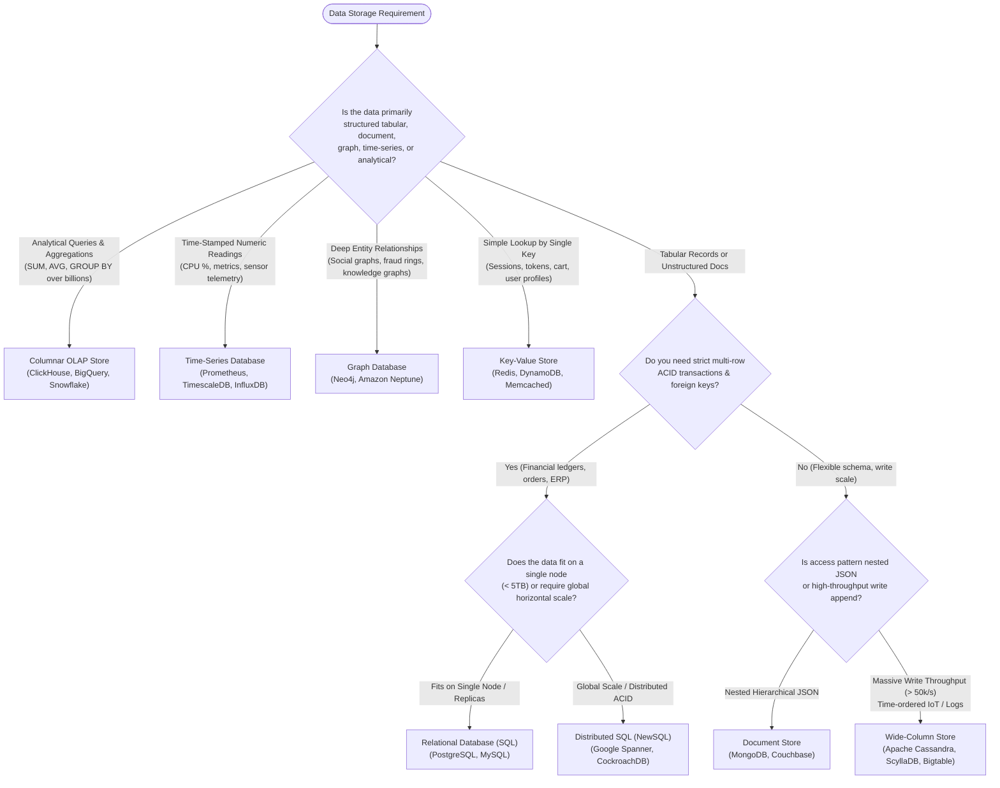
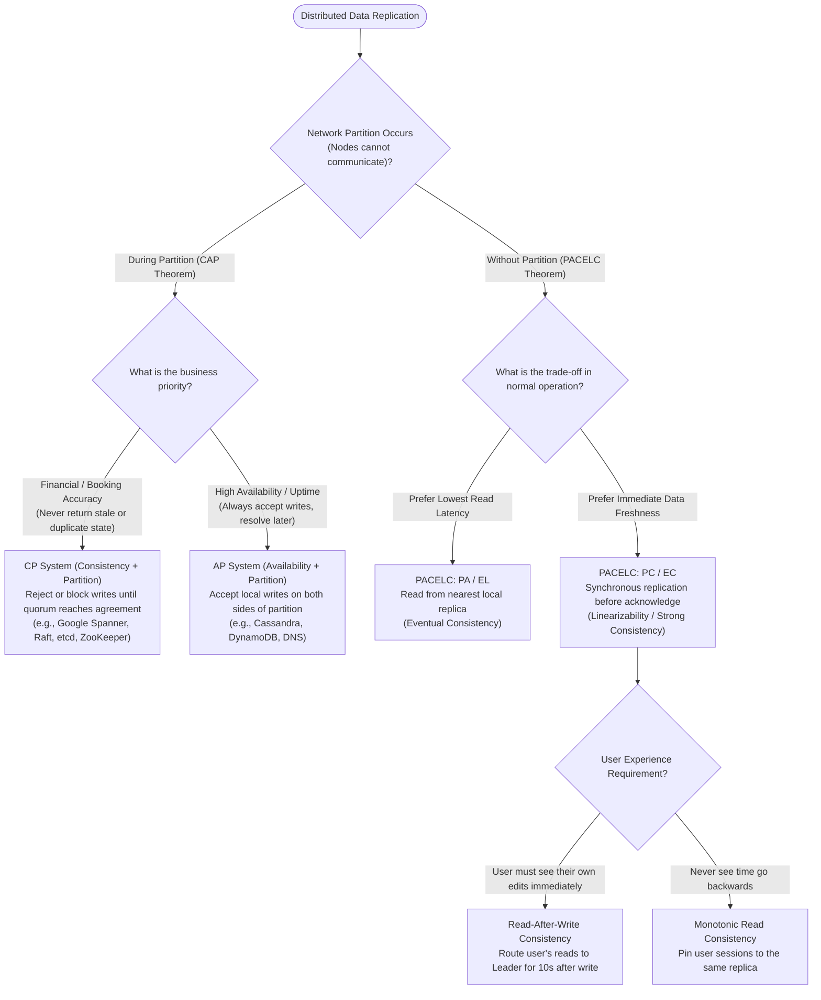
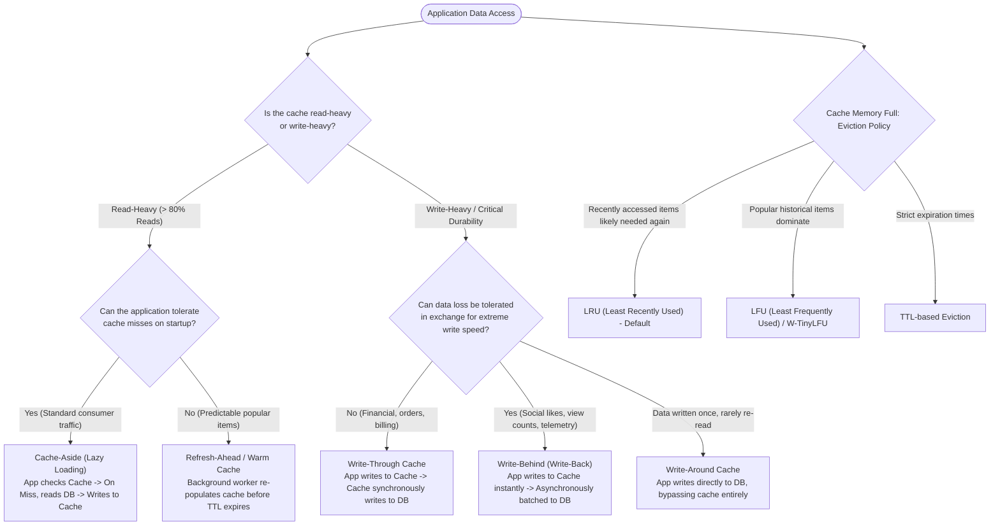
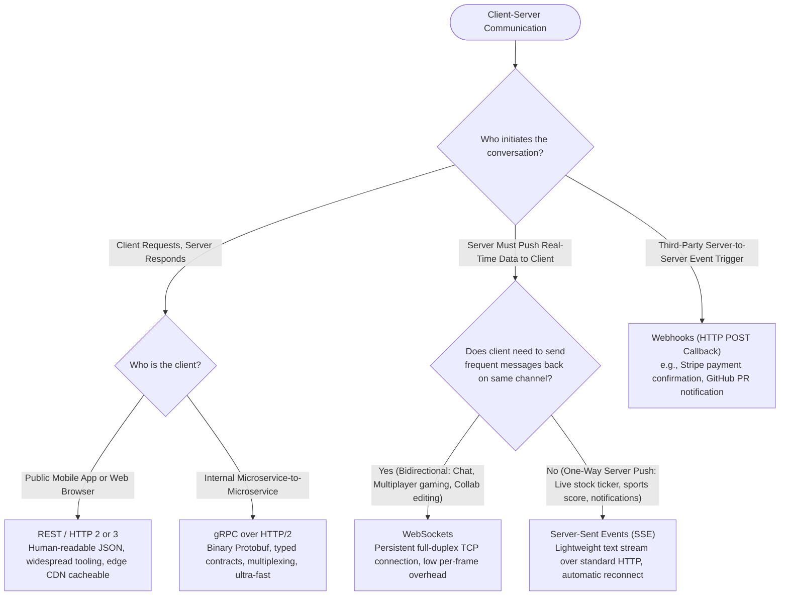
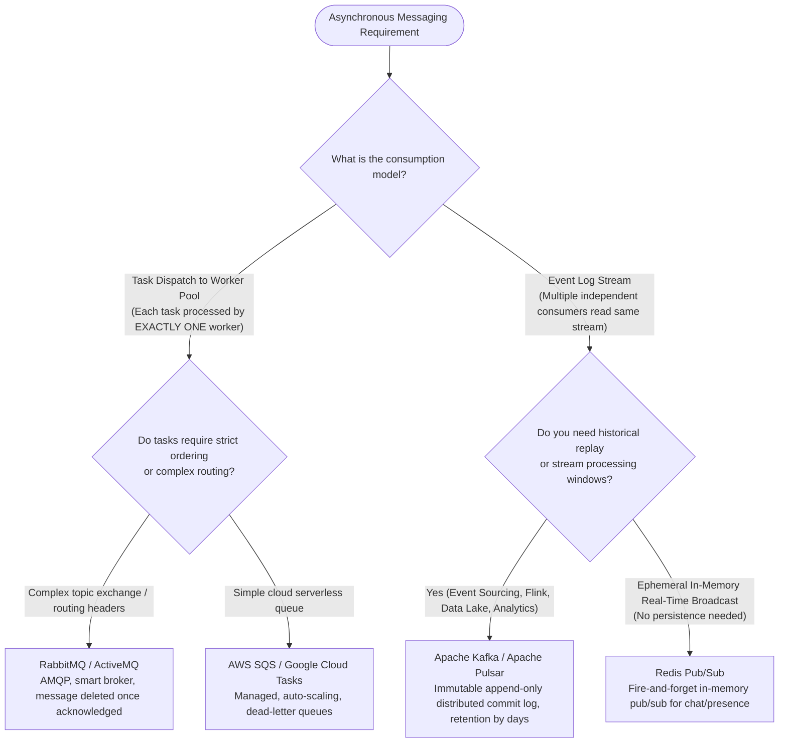
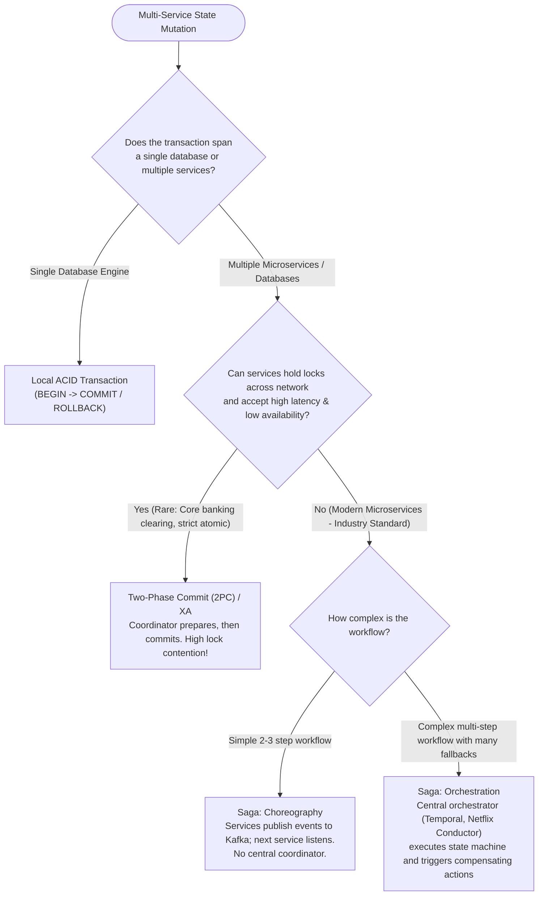
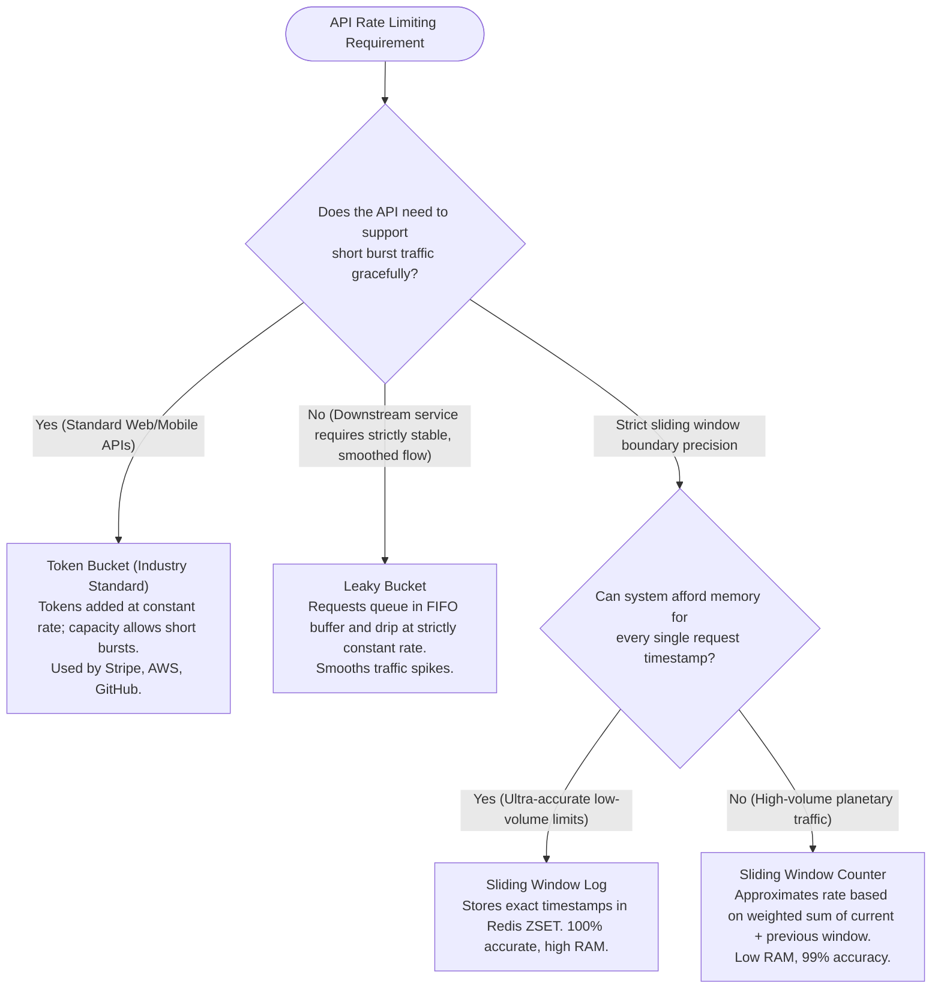
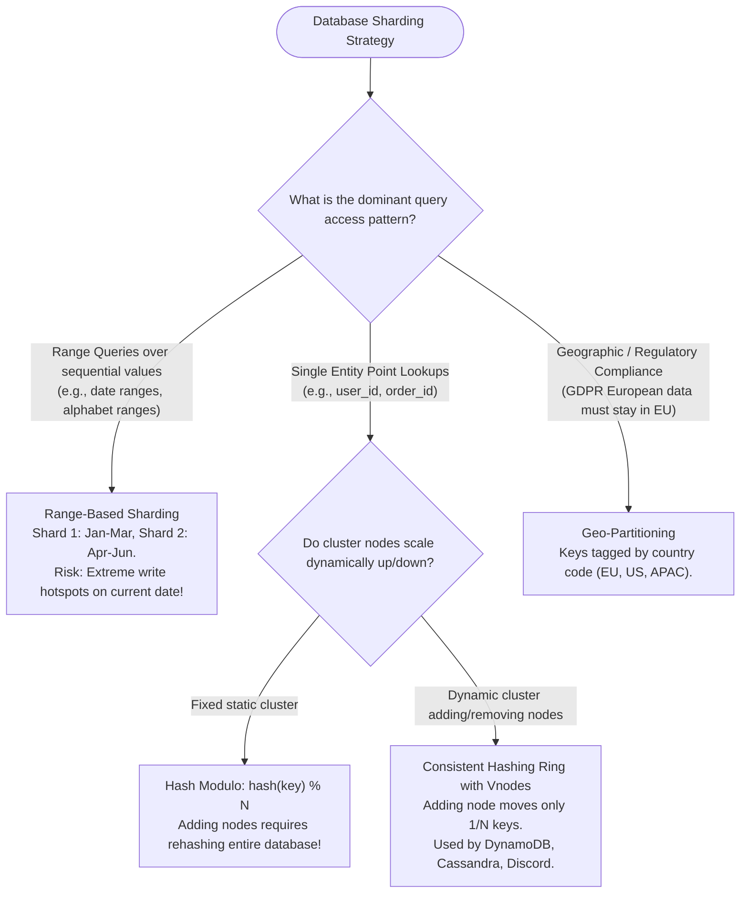
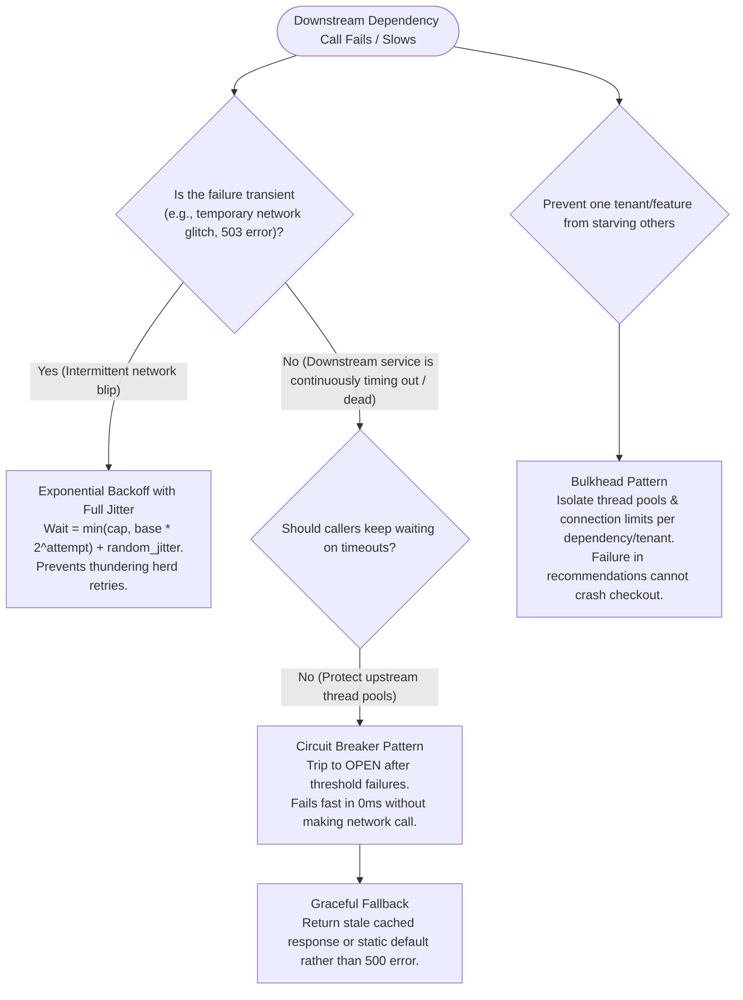

# 🔀 System Design Master Decision Flowcharts

> Architectural decision trees, evaluation flowcharts, and trade-off matrices to navigate complex system design forks during technical interviews and production RFC designs.

---

## 📑 Table of Contents
1. [Database Selection Master Flowchart](#1-database-selection-master-flowchart)
2. [Consistency Models & CAP Theorem Flowchart](#2-consistency-models--cap-theorem-flowchart)
3. [Caching Strategy & Eviction Flowchart](#3-caching-strategy--eviction-flowchart)
4. [Client-Server Communication Protocol Flowchart](#4-client-server-communication-protocol-flowchart)
5. [Message Queues vs. Event Streaming Flowchart](#5-message-queues-vs-event-streaming-flowchart)
6. [Distributed Transactions & Concurrency Flowchart](#6-distributed-transactions--concurrency-flowchart)
7. [API Rate Limiting Algorithm Flowchart](#7-api-rate-limiting-algorithm-flowchart)
8. [Database Sharding & Partition Key Flowchart](#8-database-sharding--partition-key-flowchart)
9. [Fault Tolerance & System Resilience Flowchart](#9-fault-tolerance--system-resilience-flowchart)

---

## 1. Database Selection Master Flowchart

Choosing the correct datastore is the single most critical architectural decision.

### Database Decision Summary Matrix

| Requirement | Recommended Technology | Why Pick It? |
| :--- | :--- | :--- |
| **ACID Financial Transactions** | PostgreSQL, MySQL | Strong consistency, foreign keys, rollback guarantees. |
| **Global Distributed ACID** | Google Cloud Spanner, CockroachDB | Multi-region linearizability without manual sharding. |
| **High-Throughput Append Writes** | Apache Cassandra, ScyllaDB | Masterless peer-to-peer ring; zero single point of failure. |
| **Sub-Millisecond Read Caching** | Redis, Memcached | Stored directly in RAM; $100\text{k}+ \text{ ops/sec}$ per node. |
| **Flexible JSON Catalog** | MongoDB, DynamoDB | Dynamic schema, fast nested indexing, document model. |
| **Social / Knowledge Graph** | Neo4j, Amazon Neptune | Traverses multi-hop edges ($N$-degrees) without expensive SQL joins. |
| **Analytical Reporting & BI** | ClickHouse, Snowflake, BigQuery | Columnar compression scans billions of rows in milliseconds. |

---

## 2. Consistency Models & CAP Theorem Flowchart

Navigating consistency vs. availability during network partitions.

---

## 3. Caching Strategy & Eviction Flowchart

Choosing when to load and update cache entries.

---

## 4. Client-Server Communication Protocol Flowchart

Choosing the transport mechanism between clients and backend microservices.

---

## 5. Message Queues vs. Event Streaming Flowchart

Choosing between message brokers and distributed commit logs.

---

## 6. Distributed Transactions & Concurrency Flowchart

Managing transactional boundaries across microservices.

---

## 7. API Rate Limiting Algorithm Flowchart

Selecting the right rate limiting algorithm.

---

## 8. Database Sharding & Partition Key Flowchart

Distributing data across database shards.

---

## 9. Fault Tolerance & System Resilience Flowchart

Handling network failures, slow dependencies, and service outages.

