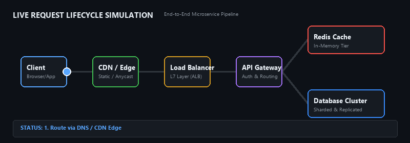

# 🧠 System Design Illustrated

**System design explained so that anyone can follow it**, one concept per folder, with everyday analogies, step-by-step pictures, worked examples with real numbers, runnable code, and a quick self-check at the end.

> You do **not** need a computer-science degree to read this. If a module uses a word before explaining it, that's a bug — please open an issue.

---

## 🧭 How to use this repo

1. **Go in order** within a part. Each module builds on the ones before it.
2. In every module, read **🧒 The 30-second version** first. If that clicks, keep going. If not, re-read the analogy, then look at the picture.
3. **Run the code.** Every upgraded module has a small `demo.py` you can play with.
4. Finish with **✅ Check yourself**. If you can answer the questions without peeking, you've got it.

### 🚦 Status legend

| Badge | Meaning |
| :-: | :--- |
| ✅ | **Deep** — full beginner-friendly module (analogy, pictures, worked numbers, mistakes, quiz) |
| 🟡 | **Draft** — folder exists but still needs to be upgraded to the full template |
| ⬜ | **Planned** — on the syllabus, folder not created yet |

New topics are added **one at a time, as we run into them**. See [Adding a new concept](#-adding-a-new-concept).

---

## 🗺️ The big picture

  

Almost every large web app is some combination of the boxes below. Each part of the syllabus zooms into one area of this picture.

---

## 📚 Books this syllabus follows

All explanations here are written from scratch in plain language. The books are listed so you can go deeper. Please buy or borrow them; they're worth it.

| Short name | Book |
| :--- | :--- |
| **DDIA** | *Designing Data-Intensive Applications* — Martin Kleppmann |
| **SDI-1 / SDI-2** | *System Design Interview: An Insider's Guide*, Volumes 1 & 2 — Alex Xu (Vol. 2 with Sahn Lam) |
| **UDS** | *Understanding Distributed Systems* — Roberto Vitillo |
| **WSSE** | *Web Scalability for Startup Engineers* — Artur Ejsmont |

---

## 📖 Syllabus

### Part 0 · Foundations (start here)

| # | Concept | Status | What you'll learn | Read more |
| :-: | :--- | :-: | :--- | :--- |
| — | Scaling from one server to millions | ⬜ | Why one box stops being enough, and the usual order things get added | SDI-1 ch 1 · WSSE ch 1 |
| — | Back-of-the-envelope estimation | ⬜ | Turning "100M users" into requests/sec, storage and bandwidth | SDI-1 ch 2 |
| — | Reliability, scalability, maintainability | ⬜ | What "a good system" actually means and how to measure it (latency percentiles, SLOs) | DDIA ch 1 |
| — | How to approach a design interview | ⬜ | A repeatable 4-step framework | SDI-1 ch 3 |

### Part 1 · Networking & traffic

| # | Concept | Status | What you'll learn | Read more |
| :-: | :--- | :-: | :--- | :--- |
| 01 | [Client–server networking](./01-client-server-networking/) | ✅ | TCP vs UDP, HTTP/1.1 → 2 → 3, WebSockets, gRPC | UDS: reliable & secure links, APIs |
| 02 | [DNS](./02-domain-name-system/) | ✅ | How `google.com` turns into an IP address | UDS: discovery |
| 03 | [Load balancing](./03-load-balancing/) | ✅ | L4 vs L7, round-robin, least-connections, health checks | UDS: network load balancing · WSSE ch 3 |
| 04 | [API gateways & proxies](./04-api-gateways-and-proxies/) | ✅ | Reverse proxies, TLS termination, auth at the edge | WSSE ch 4 |
| 05 | [Rate limiting](./05-rate-limiting/) | ✅ | Token bucket, leaky bucket, fixed & sliding windows | SDI-1 ch 4 · UDS: upstream resiliency |

### Part 2 · Storing data

| # | Concept | Status | What you'll learn | Read more |
| :-: | :--- | :-: | :--- | :--- |
| 06 | [SQL vs NoSQL](./06-relational-and-non-relational-databases/) | ✅ | Relational, document, key-value, column, graph — when to use which | DDIA ch 2 · WSSE ch 5 |
| 09 | [Storage engines & indexes](./09-storage-engines-and-indexing/) | ✅ | B-trees vs LSM-trees, WAL, Bloom filters | DDIA ch 3 |
| — | Encoding & schema evolution | ⬜ | JSON vs Protobuf/Avro, changing a schema without breaking old clients | DDIA ch 4 |
| — | Transactions & isolation levels | ⬜ | ACID, dirty reads, lost updates, write skew, serializability | DDIA ch 7 · UDS: transactions |
| 07 | [Replication](./07-database-replication/) | ✅ | Leader–follower, multi-leader, leaderless; replication lag | DDIA ch 5 · UDS: replication |
| 08 | [Partitioning / sharding](./08-database-partitioning/) | ✅ | Range vs hash partitioning, hot spots, rebalancing | DDIA ch 6 · UDS: partitioning |
| — | Blob / object storage | ⬜ | How S3-style storage keeps huge files durable | SDI-2 ch 9 · UDS: file storage |

### Part 3 · Caching & edge

| # | Concept | Status | What you'll learn | Read more |
| :-: | :--- | :-: | :--- | :--- |
| 10 | [Caching patterns](./10-caching-patterns/) | ✅ | Cache-aside, write-through, write-behind, write-around | WSSE ch 6 · UDS: caching |
| 11 | [Eviction & invalidation](./11-cache-eviction-and-invalidation/) | ✅ | LRU, LFU, TTLs, cache stampedes | WSSE ch 6 |
| 12 | [CDNs](./12-content-delivery-networks/) | ✅ | Edge locations, pull vs push, HTTP cache headers | UDS: HTTP caching, CDNs · WSSE ch 3 |

### Part 4 · Distributed-systems thinking

| # | Concept | Status | What you'll learn | Read more |
| :-: | :--- | :-: | :--- | :--- |
| — | What goes wrong in distributed systems | ⬜ | Lost messages, slow networks, paused processes, partial failure | DDIA ch 8 · UDS: system models, failure detection |
| — | Time & clocks | ⬜ | Why clocks lie; logical & vector clocks | DDIA ch 8 · UDS: time |
| 13 | [CAP & PACELC](./13-cap-and-pacelc-theorems/) | ✅ | The real trade-off during (and without) a network partition | DDIA ch 9 |
| 14 | [Consistency models](./14-consistency-models/) | ✅ | Linearizable, causal, eventual — in pictures | DDIA ch 9 · UDS: replication |
| 15 | [Consensus & leader election](./15-consensus-and-leader-election/) | ✅ | Raft in plain language, quorums | DDIA ch 9 · UDS: leader election |
| 16 | [Consistent hashing](./16-consistent-hashing/) | ✅ | Hash rings and virtual nodes | SDI-1 ch 5 |
| — | Unique ID generation | ⬜ | Auto-increment vs UUID vs Snowflake IDs | SDI-1 ch 7 |

### Part 5 · Async processing & microservices

| # | Concept | Status | What you'll learn | Read more |
| :-: | :--- | :-: | :--- | :--- |
| 17 | [Message queues & logs](./17-message-queues/) | ✅ | Queues vs logs, consumer groups, at-least-once vs exactly-once | DDIA ch 11 · UDS: messaging · WSSE ch 7 · SDI-2 ch 4 |
| 18 | [Event sourcing & CQRS](./18-event-sourcing-and-cqrs/) | ✅ | Storing events instead of state; separate read models | DDIA ch 11–12 |
| 19 | [Distributed transactions](./19-distributed-transactions/) | ✅ | Two-phase commit vs sagas | DDIA ch 9 · UDS: asynchronous transactions |
| 20 | [Fault tolerance & resilience](./20-fault-tolerance-and-resilience/) | ✅ | Timeouts, retries with backoff, circuit breakers, bulkheads | UDS: downstream & upstream resiliency |
| — | Batch vs stream processing | ⬜ | MapReduce-style jobs vs real-time pipelines | DDIA ch 10–11 |
| — | Microservices & service boundaries | ⬜ | When to split, and what it costs | UDS: microservices |
| — | Search & indexing | ⬜ | Inverted indexes, how a search box works | WSSE ch 8 |

### Part 6 · Running it in production

| # | Concept | Status | What you'll learn | Read more |
| :-: | :--- | :-: | :--- | :--- |
| — | Monitoring & observability | ⬜ | Metrics, logs, traces; what to alert on | UDS: monitoring, observability · SDI-2 ch 5 |
| — | Deployments & testing | ⬜ | CI/CD, canaries, rollbacks | UDS: testing, continuous delivery |

### Part 7 · Full system designs (case studies)

| # | Concept | Status | What you'll learn | Read more |
| :-: | :--- | :-: | :--- | :--- |
| 21 | [URL shortener](./21-system-design-url-shortener/) | ✅ | Base62 IDs, read-heavy caching, redirects | SDI-1 ch 8 |
| 22 | [Distributed key-value store / cache](./22-system-design-in-memory-cache/) | ✅ | Consistent hashing + replication + eviction together | SDI-1 ch 6 |
| 23 | [Chat app](./23-system-design-chat-app/) | 🟡 | WebSockets, presence, message storage | SDI-1 ch 12 |
| 24 | [Video streaming](./24-system-design-video-streaming/) | 🟡 | Upload, transcoding, adaptive bitrate | SDI-1 ch 14 |
| 25 | [Distributed rate limiter](./25-system-design-rate-limiter/) | 🟡 | Module 05's algorithms across many servers | SDI-1 ch 4 |
| — | News feed | ⬜ | Fan-out on write vs read | SDI-1 ch 11 |
| — | Notification system | ⬜ | Push, SMS, email at scale | SDI-1 ch 10 |
| — | Web crawler | ⬜ | Politeness, dedup, URL frontier | SDI-1 ch 9 |
| — | Search autocomplete | ⬜ | Tries and top-k suggestions | SDI-1 ch 13 |
| — | File sync (Google Drive) | ⬜ | Chunking, sync conflicts | SDI-1 ch 15 |
| — | Proximity service / nearby friends | ⬜ | Geohash, quadtrees | SDI-2 ch 1–2 |
| — | Payment system & wallet | ⬜ | Idempotency, reconciliation, double-entry ledgers | SDI-2 ch 11–12 |
| — | Hotel / ticket reservation | ⬜ | Avoiding double-booking | SDI-2 ch 7 |
| — | Real-time leaderboard | ⬜ | Sorted sets at scale | SDI-2 ch 10 |

**Progress:** 22 deep · 3 draft · 24 planned

---

## ➕ Adding a new concept

1. Copy [`TEMPLATE.md`](./TEMPLATE.md) into a new folder: the next free number plus a short name, e.g. `26-back-of-the-envelope-estimation/README.md`.
2. Fill in every section. The non-negotiables: **an analogy, at least one picture, one worked example with real numbers, and a quiz**.
3. Put any runnable code in the same folder as `demo.py`.
4. Update the row in the syllabus above: add the link, set the status, update the progress line.

Upgrading a 🟡 draft follows the same template. Flip it to ✅ when every section is done.

---

## 📝 License

[MIT](./LICENSE) © Aniket Chavan. Book titles are referenced for further reading only. No text or figures are reproduced from them.
