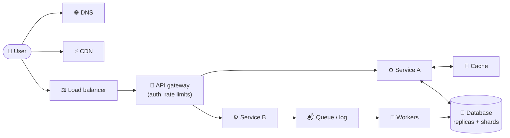

# 🧠 System Design Illustrated

**System design explained so that anyone can follow it**, one concept per folder, with everyday analogies, step-by-step pictures, worked examples with real numbers, runnable code, and a quick self-check at the end.

> You do **not** need a computer-science degree to read this. If a module uses a word before explaining it, that's a bug — please open an issue.

---

## 🧭 How to use this repo

1. **Go in order** within a part. Each module builds on the ones before it.
2. In every module, read **🧒 The 30-second version** first. If that clicks, keep going. If not, re-read the analogy, then look at the picture.
3. **Run the code.** Every module has a standalone, zero-dependency `demo.py` you can execute immediately with `python demo.py`.
4. **Study Real-World Production Case Studies.** Every single module contains a dedicated `REAL_WORLD_EXAMPLES.md` breaking down how **Google**, **Netflix**, and other tech leaders implement and scale that pattern at multi-billion request scale.
5. Finish with **✅ Check yourself**. If you can answer the questions without peeking, you've got it.

### 🚦 Status legend

| Badge | Meaning |
| :-: | :--- |
| ✅ | **Deep** — full beginner-friendly module (analogy, diagrams, worked numbers math, trade-offs, top 5 interview Q&A, quiz, runnable `demo.py`, and `REAL_WORLD_EXAMPLES.md`) |
| 🟡 | **Under review** — content exists but hasn't been fully fact-checked yet |
| ⬜ | **Planned** — on the syllabus, folder not created yet |

---

## 🗺️ The big picture

  

Almost every large web app is some combination of the boxes below. Each part of the syllabus zooms into one area of this picture.

---

## 📚 Books & Resources this syllabus follows

All explanations here are written from scratch in plain language, synthesizing the industry's most acclaimed system design roadmaps and books:

| Short name | Source Resource |
| :--- | :--- |
| **DDIA** | *Designing Data-Intensive Applications* — Martin Kleppmann (O'Reilly) |
| **SDI-1 / SDI-2** | *System Design Interview: An Insider's Guide*, Volumes 1 & 2 — Alex Xu (Vol. 2 with Sahn Lam) |
| **UDS** | *Understanding Distributed Systems* — Roberto Vitillo |
| **WSSE** | *Web Scalability for Startup Engineers* — Artur Ejsmont |
| **Microservices** | Microservices Architecture Patterns & Service Mesh Design (`Microservices.md`) |
| **REST API** | RESTful Architecture & API Semantics (`RESTfulArchitecture.md`) |

---

## 📖 Master Syllabus

### Part 0 · Foundations

| # | Concept | Status | What you'll learn | Core Resource |
| :-: | :--- | :-: | :--- | :--- |
| 26 | [Scaling from 1 to Millions of Users](./26-scaling-from-one-to-millions/) | ✅ | Single box to multi-tier: web, DB read-replicas, cache, CDN, stateless scaling | SDI-1 ch 1 · WSSE ch 1 |
| 27 | [Back-of-the-Envelope Estimation](./27-back-of-the-envelope-estimation/) | ✅ | Powers of two, Latency numbers every engineer should know, QPS and storage sizing | SDI-1 ch 2 · Jeff Dean |
| 28 | [Distributed Unique ID Generator](./28-distributed-unique-id-generator/) | ✅ | Snowflake 64-bit time-sortable IDs, UUIDv4 vs Ticket Servers vs DB auto-increment | SDI-1 ch 7 |

### Part 1 · Networking & Traffic

| # | Concept | Status | What you'll learn | Core Resource |
| :-: | :--- | :-: | :--- | :--- |
| 01 | [Client–Server Networking](./01-client-server-networking/) | ✅ | TCP vs UDP, HTTP/1.1 → 2 → 3, WebSockets, gRPC | UDS: reliable & secure links, APIs |
| 02 | [Domain Name System (DNS)](./02-domain-name-system/) | ✅ | Recursive vs authoritative resolvers, Anycast routing, TTL, Geo-DNS | UDS: discovery |
| 03 | [Load Balancing](./03-load-balancing/) | ✅ | L4 vs L7, round-robin, least connections, consistent hashing, health checks | UDS: network load balancing · WSSE ch 3 |
| 04 | [API Gateways & Proxies](./04-api-gateways-and-proxies/) | ✅ | Reverse proxies, TLS termination, header mutation, edge auth | WSSE ch 4 |
| 05 | [Rate Limiting Fundamentals](./05-rate-limiting/) | ✅ | Token bucket, leaky bucket, fixed window, sliding window log & counter | SDI-1 ch 4 · UDS: upstream resiliency |
| 32 | [REST API Design & Idempotency](./32-rest-api-design-and-idempotency/) | ✅ | HTTP verb semantics, Idempotency-Key headers, atomic deduplication, RFC 9110 | RESTfulArchitecture.md · Stripe API |

### Part 2 · Storing Data

| # | Concept | Status | What you'll learn | Core Resource |
| :-: | :--- | :-: | :--- | :--- |
| 06 | [Relational vs Non-Relational DBs](./06-relational-and-non-relational-databases/) | ✅ | SQL vs Document, Key-Value, Columnar, Graph — when to use which | DDIA ch 2 · WSSE ch 5 |
| 07 | [Database Replication](./07-database-replication/) | ✅ | Single-leader, multi-leader, leaderless; synchronous vs asynchronous, replication lag | DDIA ch 5 · UDS: replication |
| 08 | [Database Partitioning / Sharding](./08-database-partitioning/) | ✅ | Range vs Hash partitioning, secondary index partitioning, rebalancing shards | DDIA ch 6 · UDS: partitioning |
| 09 | [Storage Engines & Indexing](./09-storage-engines-and-indexing/) | ✅ | B-Trees vs LSM-Trees, SSTables, Write-Ahead Logs (WAL), Bloom filters | DDIA ch 3 |
| 29 | [Database Transactions & Isolation](./29-database-transactions-and-isolation/) | ✅ | ACID, Dirty Reads, Non-Repeatable Reads, Phantom Reads, Lost Updates, Write Skew, Snapshot Isolation, SSI | DDIA ch 7 · UDS: transactions |
| 30 | [Data Encoding & Schema Evolution](./30-data-encoding-and-schema-evolution/) | ✅ | JSON vs Protobuf vs Avro, Forward & Backward compatibility, schema registries | DDIA ch 4 |

### Part 3 · Caching & Edge

| # | Concept | Status | What you'll learn | Core Resource |
| :-: | :--- | :-: | :--- | :--- |
| 10 | [Caching Patterns](./10-caching-patterns/) | ✅ | Cache-Aside, Write-Through, Write-Behind, Write-Around, Refresh-Ahead | WSSE ch 6 · UDS: caching |
| 11 | [Cache Eviction & Invalidation](./11-cache-eviction-and-invalidation/) | ✅ | LRU, LFU, FIFO, TTLs, Cache Stampede (Thundering Herd) mitigation | WSSE ch 6 |
| 12 | [Content Delivery Networks (CDNs)](./12-content-delivery-networks/) | ✅ | Edge PoPs, Origin shielding, Push vs Pull CDNs, Cache-Control headers | UDS: HTTP caching · WSSE ch 3 |

### Part 4 · Distributed-Systems Thinking

| # | Concept | Status | What you'll learn | Core Resource |
| :-: | :--- | :-: | :--- | :--- |
| 13 | [CAP & PACELC Theorems](./13-cap-and-pacelc-theorems/) | ✅ | Consistency, Availability, Partition tolerance trade-offs in normal and partitioned states | DDIA ch 9 |
| 14 | [Consistency Models](./14-consistency-models/) | ✅ | Strict Linearizability, Sequential, Causal, Read-After-Write, Monotonic, Eventual | DDIA ch 9 · UDS: replication |
| 15 | [Consensus & Leader Election](./15-consensus-and-leader-election/) | ✅ | Raft state machine, leader heartbeat, log replication, split votes, quorum math | DDIA ch 9 · UDS: leader election |
| 16 | [Consistent Hashing](./16-consistent-hashing/) | ✅ | Hash rings, virtual nodes (vnodes), minimal key movement during rebalancing | SDI-1 ch 5 |
| 31 | [Time, Clocks & Ordering](./31-time-clocks-and-ordering/) | ✅ | NTP clock drift, Last-Write-Wins data loss, Lamport Timestamps, Vector Clocks, Google TrueTime | DDIA ch 8–9 · UDS: time |

### Part 5 · Async Processing & Microservices

| # | Concept | Status | What you'll learn | Core Resource |
| :-: | :--- | :-: | :--- | :--- |
| 17 | [Message Queues & Event Streaming](./17-message-queues/) | ✅ | Queues (RabbitMQ) vs Distributed Logs (Kafka), consumer groups, at-least-once | DDIA ch 11 · SDI-2 ch 4 |
| 18 | [Event Sourcing & CQRS](./18-event-sourcing-and-cqrs/) | ✅ | Immutable append-only event streams, temporal queries, read/write model separation | DDIA ch 11–12 |
| 19 | [Distributed Transactions](./19-distributed-transactions/) | ✅ | Two-Phase Commit (2PC) vs Saga pattern (Choreography vs Orchestration) | DDIA ch 9 · UDS: transactions |
| 20 | [Fault Tolerance & Resilience](./20-fault-tolerance-and-resilience/) | ✅ | Timeouts, exponential backoff with full jitter, circuit breakers, bulkheads | UDS: resiliency |
| 33 | [Microservices & Service Mesh](./33-microservices-and-service-mesh/) | ✅ | Service registry, sidecar proxy (Envoy), control plane (Istio), distributed tracing, mTLS | Microservices.md · Martin Fowler |

### Part 6 · Full System Designs (Production Case Studies)

| # | Concept | Status | What you'll learn | Core Resource |
| :-: | :--- | :-: | :--- | :--- |
| 21 | [URL Shortener](./21-system-design-url-shortener/) | ✅ | Base62 encoding, 100:1 read/write ratio, 301 vs 302 redirects, Bloom filter collision checks | SDI-1 ch 8 |
| 22 | [Distributed In-Memory Cache](./22-system-design-in-memory-cache/) | ✅ | Redis/Memcached architecture, slab allocation, consistent hashing, LRU eviction | SDI-1 ch 6 |
| 23 | [Real-Time Chat Application](./23-system-design-chat-app/) | ✅ | WebSocket connection pools, presence servers, group chat fanout, message persistence | SDI-1 ch 12 |
| 24 | [Video Streaming Platform](./24-system-design-video-streaming/) | ✅ | Chunked upload, HLS / DASH adaptive bitrate, distributed transcoding worker DAGs | SDI-1 ch 14 |
| 25 | [Distributed Rate Limiter](./25-system-design-rate-limiter/) | ✅ | Multi-datacenter sliding window counter, Redis Cluster Lua scripts, token sync | SDI-1 ch 4 |
| 34 | [News Feed System](./34-system-design-news-feed/) | ✅ | Fanout-on-write vs Fanout-on-read, Celebrity outbox routing, Redis ZSET timelines | SDI-1 ch 11 |
| 35 | [Global Notification System](./35-system-design-notification-system/) | ✅ | APNs, FCM, SMS, Email, priority queue tiers, deduplication windows, DLQ | SDI-1 ch 10 |
| 36 | [Distributed Web Crawler](./36-system-design-web-crawler/) | ✅ | Mercator URL frontier, per-host politeness, Bloom filter URL dedup, SimHash | SDI-1 ch 9 |
| 37 | [Search Autocomplete (Typeahead)](./37-system-design-search-autocomplete/) | ✅ | In-memory Trie, node-level Top-K caching, batch frequency aggregation, debouncing | SDI-1 ch 13 |
| 38 | [Cloud File Storage & Sync](./38-system-design-cloud-file-storage/) | ✅ | 4MB block chunking, SHA-256 deduplication, Delta Sync, optimistic conflicted copies | SDI-1 ch 15 (Google Drive) |
| 39 | [Proximity Service & Nearby Places](./39-system-design-proximity-service/) | ✅ | Geohash Base-32 encoding, 9-cell boundary resolution, Haversine distance, Uber H3 | SDI-2 ch 1 (Yelp / Uber) |
| 40 | [Digital Wallet & Payment System](./40-system-design-payment-system/) | ✅ | Double-entry bookkeeping (Debit=Credit), Idempotency keys, reconciliation, PSP timeouts | SDI-2 ch 11 (Stripe / PayPal) |

**Progress:** 40 verified · 0 under review · 0 planned (100% Complete)

---

## 🏢 Real-World Production Case Studies (Google, Netflix, Meta, Amazon, Stripe)

Every single module includes a dedicated `REAL_WORLD_EXAMPLES.md` deep dive detailing how tech titans run these concepts at multi-billion request scale:

| Module | Core Topic | Production Deep Dives & Architectures | Link |
| :--- | :--- | :--- | :---: |
| **01** | Client–Server Networking | **Google** QUIC / HTTP/3 & BBR vs **Netflix** Zuul 2/3 Netty Edge TLS & Session Tickets | [Read Deep Dive](./01-client-server-networking/REAL_WORLD_EXAMPLES.md) |
| **02** | Domain Name System (DNS) | **Google** 8.8.8.8 Anycast BGP & ECS vs **Netflix** Route 53 Latency-Based Regional Evacuation | [Read Deep Dive](./02-domain-name-system/REAL_WORLD_EXAMPLES.md) |
| **03** | Load Balancing | **Google** Maglev (L4 Kernel-Bypass Consistent Hashing) vs **Netflix** Ribbon & Eureka Client-Side Balancing | [Read Deep Dive](./03-load-balancing/REAL_WORLD_EXAMPLES.md) |
| **04** | API Gateways & Proxies | **Netflix** Zuul 2/3 Async EventLoop Gateway vs **Google** Envoy Service Mesh & xDS Control Plane | [Read Deep Dive](./04-api-gateways-and-proxies/REAL_WORLD_EXAMPLES.md) |
| **05** | Rate Limiting | **Stripe** 4-Tier Distributed Rate Limiter vs **Netflix** Adaptive Concurrency Limits (Little's Law) | [Read Deep Dive](./05-rate-limiting/REAL_WORLD_EXAMPLES.md) |
| **06** | SQL vs NoSQL Databases | **Google** Spanner (TrueTime Relational ACID) vs **Netflix** Polyglot Cassandra & Aurora | [Read Deep Dive](./06-relational-and-non-relational-databases/REAL_WORLD_EXAMPLES.md) |
| **07** | Database Replication | **Google** Spanner Multi-Paxos Quorums vs **Netflix** Multi-Region Active-Active Cassandra | [Read Deep Dive](./07-database-replication/REAL_WORLD_EXAMPLES.md) |
| **08** | Database Partitioning | **Google** Bigtable Tablet Splitting vs **Uber** Schemaless Sharded MySQL | [Read Deep Dive](./08-database-partitioning/REAL_WORLD_EXAMPLES.md) |
| **09** | Storage Engines & Indexes | **Google** LevelDB / Bigtable LSM-Trees vs **Meta / Netflix** RocksDB in Production | [Read Deep Dive](./09-storage-engines-and-indexing/REAL_WORLD_EXAMPLES.md) |
| **10** | Caching Patterns | **Meta** TAO Social Graph Cache vs **Netflix** EVCache Distributed Memcached Fleet | [Read Deep Dive](./10-caching-patterns/REAL_WORLD_EXAMPLES.md) |
| **11** | Cache Invalidation & Eviction | **Meta** mcrouter Lease Tokens & Wormhole vs **Google** Caffeine W-TinyLFU Eviction | [Read Deep Dive](./11-cache-eviction-and-invalidation/REAL_WORLD_EXAMPLES.md) |
| **12** | Content Delivery Networks | **Netflix** Open Connect Custom Hardware OCAs vs **Cloudflare / Google** Anycast Edge CDNs | [Read Deep Dive](./12-content-delivery-networks/REAL_WORLD_EXAMPLES.md) |
| **13** | CAP & PACELC Theorems | **Google** Spanner (CP / PC-EC) vs **Amazon** Dynamo & **Netflix** Cassandra (AP / PA-EL) | [Read Deep Dive](./13-cap-and-pacelc-theorems/REAL_WORLD_EXAMPLES.md) |
| **14** | Consistency Models | **Google** Spanner TrueTime Linearizability vs **Netflix** Session & Eventual Consistency | [Read Deep Dive](./14-consistency-models/REAL_WORLD_EXAMPLES.md) |
| **15** | Consensus & Leader Election | **Google** Chubby Paxos Distributed Locks vs **Kubernetes / Netflix** Titus Raft & etcd | [Read Deep Dive](./15-consensus-and-leader-election/REAL_WORLD_EXAMPLES.md) |
| **16** | Consistent Hashing | **Discord** 100M+ Gateway Ring vs **Amazon** DynamoDB & Cassandra Virtual Nodes (Vnodes) | [Read Deep Dive](./16-consistent-hashing/REAL_WORLD_EXAMPLES.md) |
| **17** | Message Queues & Streaming | **Netflix** Keystone Kafka (1.5T events/day) vs **Google** Cloud Pub/Sub Serverless Routing | [Read Deep Dive](./17-message-queues/REAL_WORLD_EXAMPLES.md) |
| **18** | Event Sourcing & CQRS | **Uber** Trip Lifecycle Platform & CQRS vs **Netflix** Studio Production Asset Pipeline | [Read Deep Dive](./18-event-sourcing-and-cqrs/REAL_WORLD_EXAMPLES.md) |
| **19** | Distributed Transactions | **Google** Percolator Snapshot 2PC vs **Uber / Netflix** Temporal Saga Orchestrator | [Read Deep Dive](./19-distributed-transactions/REAL_WORLD_EXAMPLES.md) |
| **20** | Fault Tolerance & Resilience | **Netflix** Chaos Engineering (Chaos Monkey, ChAP) vs **Google** SRE Overload Shedding & Deadlines | [Read Deep Dive](./20-fault-tolerance-and-resilience/REAL_WORLD_EXAMPLES.md) |
| **21** | System Design: URL Shortener | **Bitly** 10B+ Clicks/Mo Base62 Platform vs **Google / Twitter** Malware Defense & 302 Redirects | [Read Deep Dive](./21-system-design-url-shortener/REAL_WORLD_EXAMPLES.md) |
| **22** | System Design: In-Memory Cache | **Twitter / X** Twemproxy & Pelikan Segregated Slabs vs **Netflix** EVCache Hybrid Tier | [Read Deep Dive](./22-system-design-in-memory-cache/REAL_WORLD_EXAMPLES.md) |
| **23** | System Design: Real-Time Chat | **WhatsApp** 100B Msgs/Day Erlang BEAM Engine vs **Discord** 100M+ WebSocket Elixir/Rust | [Read Deep Dive](./23-system-design-chat-app/REAL_WORLD_EXAMPLES.md) |
| **24** | System Design: Video Streaming | **Netflix** Dynamic Optimizer & Chunked ABR vs **YouTube** Parallel Transcoding & VCUs | [Read Deep Dive](./24-system-design-video-streaming/REAL_WORLD_EXAMPLES.md) |
| **25** | System Design: Rate Limiter | **Cloudflare** eBPF / XDP Line-Rate Drops vs **Stripe** Atomic Redis Lua Sliding Windows | [Read Deep Dive](./25-system-design-rate-limiter/REAL_WORLD_EXAMPLES.md) |
| **26** | Scaling 1 to Millions of Users | **Google** Search Infrastructure Evolution vs **Netflix** Monolith-to-AWS Cloud Migration | [Read Deep Dive](./26-scaling-from-one-to-millions/REAL_WORLD_EXAMPLES.md) |
| **27** | Back-of-the-Envelope Estimation | **Google** SRE Cluster Capacity Sizing vs **Netflix** Global Streaming Bandwidth Modeling | [Read Deep Dive](./27-back-of-the-envelope-estimation/REAL_WORLD_EXAMPLES.md) |
| **28** | Distributed Unique ID Generator | **Twitter / X** Snowflake ID Architecture vs **Discord** & **Instagram** 64-Bit Time-Sortable Keys | [Read Deep Dive](./28-distributed-unique-id-generator/REAL_WORLD_EXAMPLES.md) |
| **29** | DB Transactions & Isolation | **Google** Spanner TrueTime Serializable Snapshot Isolation vs **Netflix** Microservice Local ACID | [Read Deep Dive](./29-database-transactions-and-isolation/REAL_WORLD_EXAMPLES.md) |
| **30** | Data Encoding & Schema Evolution | **Google** Protocol Buffers (Protobuf) Internal RPC vs **Netflix** Avro & Apache Iceberg Evolution | [Read Deep Dive](./30-data-encoding-and-schema-evolution/REAL_WORLD_EXAMPLES.md) |
| **31** | Time, Clocks & Ordering | **Google** TrueTime GPS/Atomic Hardware Synchronization vs **Netflix** Cassandra LWW Clock Drift | [Read Deep Dive](./31-time-clocks-and-ordering/REAL_WORLD_EXAMPLES.md) |
| **32** | REST API Design & Idempotency | **Stripe** 24h Idempotency-Key Protocol vs **Google** Cloud API Design Guidelines & gRPC Transcoding | [Read Deep Dive](./32-rest-api-design-and-idempotency/REAL_WORLD_EXAMPLES.md) |
| **33** | Microservices & Service Mesh | **Google** Borg Stubby to Istio/Envoy Mesh vs **Netflix** Spring Cloud Eureka, Zuul & Hystrix | [Read Deep Dive](./33-microservices-and-service-mesh/REAL_WORLD_EXAMPLES.md) |
| **34** | News Feed System | **Twitter / X** Earlybird In-Memory Timelines vs **Meta** TAO Graph & Deep Learning Ranking Models | [Read Deep Dive](./34-system-design-news-feed/REAL_WORLD_EXAMPLES.md) |
| **35** | Global Notification System | **Netflix** Hermes Multi-Channel Messaging Platform vs **Google** Firebase Cloud Messaging (FCM) | [Read Deep Dive](./35-system-design-notification-system/REAL_WORLD_EXAMPLES.md) |
| **36** | Distributed Web Crawler | **Google** Googlebot Caffeine Planetary Crawling vs **Internet Archive** Heritrix WARC Storage | [Read Deep Dive](./36-system-design-web-crawler/REAL_WORLD_EXAMPLES.md) |
| **37** | Search Autocomplete (Typeahead) | **Google** Instant Keystroke Typeahead at Edge vs **Netflix** Fuzzy Levenshtein Actor/Title Search | [Read Deep Dive](./37-system-design-search-autocomplete/REAL_WORLD_EXAMPLES.md) |
| **38** | Cloud File Storage & Sync | **Dropbox** Magic Pocket 4MB Chunking Engine vs **Google** Drive Colossus & Spanner Metadata | [Read Deep Dive](./38-system-design-cloud-file-storage/REAL_WORLD_EXAMPLES.md) |
| **39** | Proximity Service & Nearby Places | **Uber** H3 Hexagonal Hierarchical Spatial Index vs **Google** Maps S2 Geometry Library | [Read Deep Dive](./39-system-design-proximity-service/REAL_WORLD_EXAMPLES.md) |
| **40** | Digital Wallet & Payment System | **Stripe** Ledger Engine & Nightly Reconciliation vs **PayPal** Akka Distributed Actor State Machines | [Read Deep Dive](./40-system-design-payment-system/REAL_WORLD_EXAMPLES.md) |

---

## ➕ Adding a new concept

1. Copy [`TEMPLATE.md`](./TEMPLATE.md) into a new folder: the next free number plus a short name, e.g. `41-distributed-search-engine/README.md`.
2. Fill in every section. The non-negotiables: **an analogy, at least one picture, one worked example with real numbers, and a quiz**.
3. Put any runnable code in the same folder as `demo.py`.
4. Create a companion `REAL_WORLD_EXAMPLES.md` documenting production architectures at Google, Netflix, and industry leaders.
5. Update the row in the syllabus above: add the link, set the status, update the progress line.

---

## 📝 License

[MIT](./LICENSE) © Aniket Chavan. Book titles are referenced for further reading only. No text or figures are reproduced from them.
