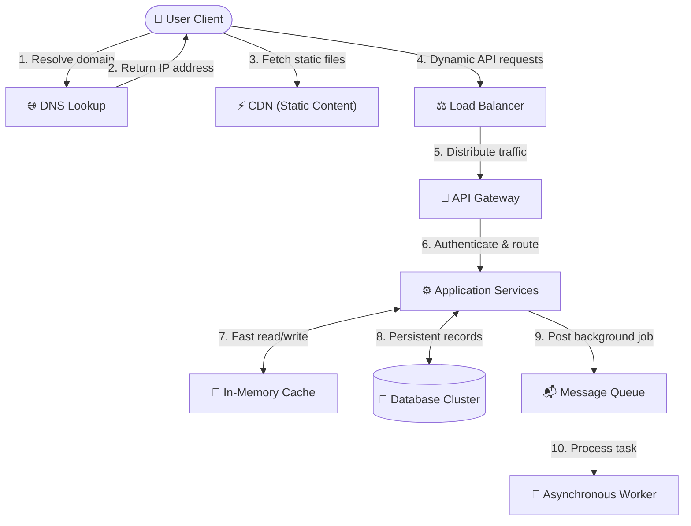

# 🧠 System Design Illustrated: An Interactive Visual Guide

A beginner-friendly, visual, and practical guide to designing large-scale distributed systems. Every concept is broken down from first principles using intuitive real-world analogies, clean architecture diagrams, and runnable code examples.

---

## 🗺️ Visual Map: The End-to-End System

Below is an overview of how components interact when a user communicates with a modern web application:

---

## 🧭 Syllabus & Concept Index

Each module in this repository contains:
- 💡 **Real-World Analogy**: An intuitive metaphor to understand the core idea.
- 🎯 **What & Why**: The fundamental problem being solved.
- 📊 **Visual Flow Diagrams**: Step-by-step Mermaid diagrams.
- ⚙️ **Under the Hood**: How the algorithms and protocols function.
- ⚖️ **Trade-Offs**: Pros, cons, and architectural considerations.
- 💻 **Hands-On Code**: Practical Python implementation.

---

### 🌐 Module 1: Networking & Traffic Routing
- [`01-client-server-networking`](./01-client-server-networking/README.md): HTTP/1.1, HTTP/2, HTTP/3, WebSockets, gRPC, and TCP vs UDP.
- [`02-domain-name-system`](./02-domain-name-system/README.md): Domain name resolution, recursive resolvers, authoritative nameservers, and Anycast routing.
- [`03-load-balancing`](./03-load-balancing/README.md): Layer 4 vs Layer 7 routing, round-robin, least-connections, and health checks.
- [`04-api-gateways-and-proxies`](./04-api-gateways-and-proxies/README.md): Reverse proxies, request aggregation, authentication offloading, and SSL termination.
- [`05-rate-limiting`](./05-rate-limiting/README.md): Token bucket, leaky bucket, sliding window counters, and distributed rate limiting.

### 💾 Module 2: Data Storage & Scaling
- [`06-relational-and-non-relational-databases`](./06-relational-and-non-relational-databases/README.md): Relational schemas, document stores, key-value stores, columnar databases, and graph databases.
- [`07-database-replication`](./07-database-replication/README.md): Single-leader, multi-leader, and leaderless replication with failover mechanics.
- [`08-database-partitioning`](./08-database-partitioning/README.md): Horizontal vs vertical sharding, range vs hash partitioning, and cross-shard queries.
- [`09-storage-engines-and-indexing`](./09-storage-engines-and-indexing/README.md): B+ trees, Log-Structured Merge (LSM) trees, Write-Ahead Logs (WAL), and Bloom filters.

### ⚡ Module 3: Caching & Edge Delivery
- [`10-caching-patterns`](./10-caching-patterns/README.md): Cache-aside, write-through, write-behind, and write-around patterns.
- [`11-cache-eviction-and-invalidation`](./11-cache-eviction-and-invalidation/README.md): LRU, LFU, FIFO, and handling cache stampedes and thundering herds.
- [`12-content-delivery-networks`](./12-content-delivery-networks/README.md): Points of Presence (PoPs), edge caching, and cache invalidation.

### ⚖️ Module 4: Distributed Systems Principles
- [`13-cap-and-pacelc-theorems`](./13-cap-and-pacelc-theorems/README.md): Consistency vs Availability during network partitions, and latency trade-offs.
- [`14-consistency-models`](./14-consistency-models/README.md): Strong consistency, linearizability, causal consistency, and eventual consistency.
- [`15-consensus-and-leader-election`](./15-consensus-and-leader-election/README.md): Distributed agreement, leader election, and state machine replication.
- [`16-consistent-hashing`](./16-consistent-hashing/README.md): Virtual nodes, ring topology, and minimal key redistribution during cluster resizing.

### 📬 Module 5: Asynchronous Processing & Microservices
- [`17-message-queues`](./17-message-queues/README.md): Publish/subscribe, message queues, consumer groups, and delivery semantics.
- [`18-event-sourcing-and-cqrs`](./18-event-sourcing-and-cqrs/README.md): Event sourcing, Command Query Responsibility Segregation, and Change Data Capture.
- [`19-distributed-transactions`](./19-distributed-transactions/README.md): Two-phase commit vs the Saga pattern (choreography and orchestration).
- [`20-fault-tolerance-and-resilience`](./20-fault-tolerance-and-resilience/README.md): Circuit breakers, bulkheads, retries with exponential backoff and jitter.

### 🏗️ Module 6: End-to-End System Designs
- [`21-system-design-url-shortener`](./21-system-design-url-shortener/README.md): Designing a scalable URL shortening service with Base62 encoding and cache-aside reads.
- [`22-system-design-in-memory-cache`](./22-system-design-in-memory-cache/README.md): Designing an in-memory distributed key-value store with consistent hashing and LRU eviction.
- [`23-system-design-chat-app`](./23-system-design-chat-app/README.md): Designing a multi-user real-time chat application with WebSockets and message fan-out.
- [`24-system-design-video-streaming`](./24-system-design-video-streaming/README.md): Designing a video streaming platform with chunking, transcoding pipelines, and adaptive bitrate delivery.
- [`25-system-design-rate-limiter`](./25-system-design-rate-limiter/README.md): Designing a multi-tier distributed rate limiter using sliding window algorithms.

---

## 🛠️ Contributing New Concepts

This syllabus is designed to grow. When adding new modules:
1. Create a numbered folder (e.g. `26-new-concept/`).
2. Follow the standard template with an intuitive real-world analogy, visual Mermaid diagram, deep dive explanation, and working code.
3. Add the module to the syllabus index above.

---

## 📝 License

Distributed under the MIT License. Created by [Aniketchavan7](https://github.com/Aniketchavan7).
