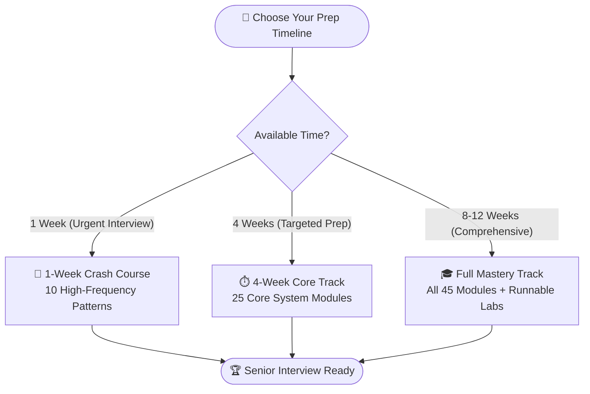
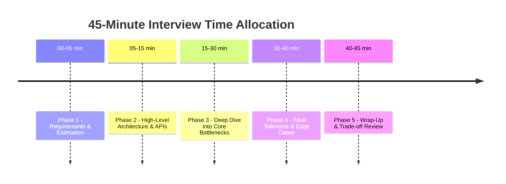

# 🧭 System Design Interview Study Guide & Practice Framework

> A battle-tested preparation blueprint, structured study tracks, and a 45-minute timed interview execution framework for senior engineering roles at FAANG / Tier-1 tech companies.

---

Start with one of these routes. The reading and paper exercises are free and need only a browser.

- **First pass** · Follow one fictional website through [networking](./01-client-server-networking/#first-pass), [DNS](./02-domain-name-system/#first-pass), and [load balancing](./03-load-balancing/#first-pass). Finish by tracing a request through a server failure. Then draw a [URL shortener](./21-system-design-url-shortener/) and estimate its traffic.
- **Interview prep** · Review the [estimation cheat sheet](./CHEATSHEET.md) and [decision flowcharts](./DECISION_FLOWCHARTS.md), then try the [timed mock interviews](#timed-mock-interviews).
- **Production reliability** · Read about [queues](./17-message-queues/) and [idempotency](./32-rest-api-design-and-idempotency/), run the [order lab](./labs/order-processing/), and work through [regional recovery](./advanced/multi-region-recovery.md) and [tenant authorization](./advanced/authentication-and-authorization.md).

## 🎯 The 3 Study Tracks

Choose the track that fits your preparation timeline:

---

### Track 1: 🚀 1-Week Crash Course (10 Highest-Yield Modules)
*Best for: Candidates with an interview scheduled this week.*

Focus strictly on the concepts tested in 80%+ of senior system design interviews:

| Day | Focus Topic | Core Modules | Key Interview Question |
| :-: | :--- | :--- | :--- |
| **Day 1** | **Estimation & Traffic** | [27 - Estimation](./27-back-of-the-envelope-estimation/) · [03 - Load Balancing](./03-load-balancing/) | *"How many servers do you need for 100k QPS?"* |
| **Day 2** | **Databases & Sharding** | [06 - SQL vs NoSQL](./06-relational-and-non-relational-databases/) · [08 - Partitioning](./08-database-partitioning/) | *"How would you shard user data when 1 node runs out of disk?"* |
| **Day 3** | **Replication & Consensus** | [07 - Replication](./07-database-replication/) · [13 - CAP/PACELC](./13-cap-and-pacelc-theorems/) | *"Why can't a distributed database guarantee both strong consistency and 100% availability?"* |
| **Day 4** | **Caching & Rate Limiting** | [10 - Caching](./10-caching-patterns/) · [05 - Rate Limiting](./05-rate-limiting/) | *"How do you prevent a cache stampede during a hot-key write spike?"* |
| **Day 5** | **Async & Queues** | [17 - Message Queues](./17-message-queues/) · [20 - Resilience](./20-fault-tolerance-and-resilience/) | *"How does Kafka guarantee message ordering across consumer instances?"* |
| **Day 6** | **Full System Design #1** | [34 - News Feed](./34-system-design-news-feed/) · [21 - URL Shortener](./21-system-design-url-shortener/) | Fanout-on-write vs Fanout-on-read trade-offs. |
| **Day 7** | **Full System Design #2** | [40 - Payment System](./40-system-design-payment-system/) · [39 - Proximity Service](./39-system-design-proximity-service/) | Double-entry bookkeeping, idempotency keys, and spatial indexing. |

---

### Track 2: ⏱️ 4-Week Core Track (25 Core Modules)
*Best for: Systematic preparation with balanced theory and architecture.*

- **Week 1 · Foundations & Networking**:
  - Modules 26, 27, 28, 01, 02, 03, 04, 05
  - Learn capacity estimation formulas, L4 vs L7 load balancing, Anycast DNS, and distributed unique ID generation.
- **Week 2 · Storage, Replication & Caching**:
  - Modules 06, 07, 08, 09, 29, 10, 11, 12
  - Deep-dive into B-Trees vs LSM-Trees, multi-region replication lag, cache-aside vs write-through, and CDN edge PoPs.
- **Week 3 · Distributed Consistency & Resilience**:
  - Modules 13, 14, 15, 16, 31, 17, 18, 19, 20
  - Master PACELC, linearizability vs eventual consistency, Raft leader election, Snowflake IDs, and 2PC vs Saga transactions.
- **Week 4 · End-to-End System Designs**:
  - Modules 21, 23, 24, 34, 39, 40, 41, 42
  - Practice designing real-time chat, video streaming, nearby driver matching, and hotel reservation systems under timed conditions.

---

### Track 3: 🎓 8-Week Complete Mastery (All 45 Modules)
*Best for: Staff / Principal engineer candidates aiming for top-band offers.*

- Complete every module in sequential order from `01` to `45`.
- Execute all 45 runnable `demo.py` scripts to verify internal state machines and failure handling.
- Study both **Google** and **Netflix** production case studies in every module's `REAL_WORLD_EXAMPLES.md`.
- Run the [Event-Driven Order Processing Lab](./labs/order-processing/) in Docker Compose to master the Transactional Outbox pattern.

---

## ⏱️ The 45-Minute Timed Interview Framework

In senior system design interviews, pacing determines whether you pass or fail. Use this structured 5-phase framework:

### Phase 1: Clarify Requirements & Scope (00:00 – 05:00)
- **Functional Requirements**: Pick the top 2–3 core features. Explicitly state what is *out of scope*.
- **Non-Functional Requirements**:
  - Latency SLA (e.g. p99 < 100ms)
  - Availability target (e.g. 99.99% = 52.6 minutes downtime/year)
  - Read-to-Write ratio and consistency needs (Strong Linearizable vs Eventual)
- **Back-of-the-Envelope Math**:
  - QPS (Average & Peak): $\text{DAU} \times \text{Ops/Day} / 86,400$
  - Ingress/Egress Bandwidth: $\text{Peak QPS} \times \text{Payload Size}$
  - 5-Year Storage Capacity: $\text{Daily Storage} \times 365 \times 5 \times 3 \text{ (rep factor)}$
  - Use the repository [Master Cheat Sheet](./CHEATSHEET.md) formulas.

### Phase 2: High-Level Architecture & API Design (05:00 – 15:00)
- Draft clean REST/gRPC endpoints with request/response payloads.
- Draw the end-to-end data flow: Client $\to$ DNS $\to$ CDN/LB $\to$ API Gateway $\to$ Stateless Services $\to$ Caches $\to$ DBs.
- Identify read and write paths clearly on the whiteboard or diagram.

### Phase 3: Deep Dive into Core Bottlenecks (15:00 – 30:00)
- The interviewer will pivot here. Focus on the hard distributed systems challenges:
  - **Data Model & Partitioning**: Choose partition keys (`user_id`, `geohash`, `time_bucket`) to avoid hot spots.
  - **Caching Strategy**: Cache-Aside vs Write-Through; invalidation rules; TTL jitter to prevent thundering herd.
  - **Concurrency Control**: Optimistic locking (`version` column) vs Distributed Locks (Redis/ZooKeeper).

### Phase 4: Fault Tolerance, Failure Modes & Edge Cases (30:00 – 40:00)
- What happens when a primary database crashes? (Leader election, replica promotion, split-brain mitigation).
- What happens when network partitions isolate a region? (PACELC trade-off, multi-region active-active vs active-passive).
- How do you handle cascade failures? (Circuit breakers, exponential backoff with full jitter, bulkheads).

### Phase 5: Wrap-Up & Trade-off Review (40:00 – 45:00)
- Summarize the top 3 architectural trade-offs made (e.g., opted for eventual consistency in timeline feeds to maximize write availability).
- Propose monitoring metrics (p99 latency, error rates, queue consumer lag).
- Answer any remaining interviewer questions.

---

## 📋 Senior Interview Readiness Checklist

Before your on-site interview, ensure you can confidently answer and draw diagrams for:

- [ ] **Quant sizing**: Can you convert 100M daily requests to average QPS in 30 seconds without a calculator?
- [ ] **Database choice**: Can you articulate why MongoDB or Cassandra fits high write-throughput, but Postgres fits transactional billing?
- [ ] **Replication**: Can you explain why async replica lag can lead to stale reads and how to implement "Read-Your-Own-Writes"?
- [ ] **Consensus**: Can you explain why Raft requires a minimum of 3 nodes for single failure tolerance ($2F+1$ quorum)?
- [ ] **Sharding**: Can you explain why resharding a hash-modulo ($N \pmod M$) database requires moving 90%+ of keys, and how Consistent Hashing fixes it?
- [ ] **Idempotency**: Can you draw how Stripe or payment systems prevent double-charges using an idempotency key and a durable record of the operation?
- [ ] **Flashcards**: Can you explain the cards you marked for review in the [Interactive Flashcard Web App](https://aniketchavan7.github.io/system-design-illustrated/)?

## Timed mock interviews

For each prompt, spend five minutes clarifying requirements and five estimating load. Divide the remaining time between drawing the design and explaining its failure modes. Give yourself one point per rubric item you address concretely.

### URL shortener · 25 minutes

Design for 100 million redirects and 2 million new links per day. Links must work during a cache outage. Explain custom aliases and how a link owner can disable a link.

Rubric and walkthrough

- Estimate read and write rates separately and state a peak assumption.
- Define create and redirect APIs and explain identifier collisions.
- Trace cache hits, misses, and an outage.
- Explain how disabling a link reaches caches and how long a stale redirect could survive.
- Choose a latency or availability objective and justify one trade-off.

[URL shortener walkthrough](./21-system-design-url-shortener/)

### Notifications · 35 minutes

Design email and push notifications for five million recipients. Users can opt out of promotions. A provider begins timing out during a campaign. Explain how alerts and promotions share capacity.

Rubric and walkthrough

- Separate transactional and promotional requirements and size a burst.
- Draw the producer, queue, workers, and delivery state.
- Explain when preferences are enforced and how updates affect queued work.
- Bound retries and describe how duplicate deliveries and provider outages are handled.
- Explain priority or isolation and name a metric that reveals backlog.

[Notification walkthrough](./35-system-design-notification-system/)

### Hotel reservation · 40 minutes

Two people try to book the last suitable room over three nights. A payment succeeds, but the response times out. Design inventory, holds, and payment confirmation.

Rubric and walkthrough

- Clarify room type versus specific room assignment and model the full stay.
- Choose a transaction rule that prevents partial holds and overbooking.
- Describe expiry and what happens when confirmation races with it.
- Use a stable payment idempotency key and explain how an unknown outcome is reconciled.
- Draw the reservation states and show what support can inspect after a failure.

[Hotel reservation walkthrough](./41-system-design-hotel-reservation/)

