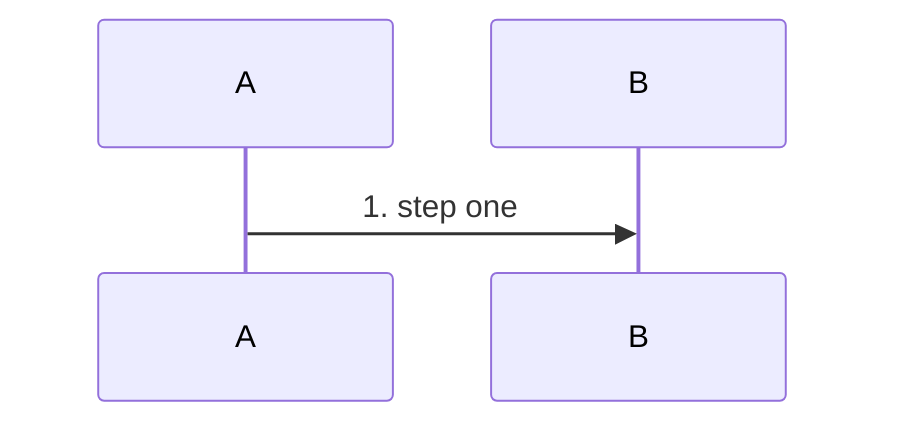

# NN · Concept name

> **Part X · Topic area** · ⏱️ ~15 min read · Prerequisites: [NN · Other concept](../NN-other-concept/)

## 🧒 The 30-second version

Two or three sentences a 12-year-old could follow. No jargon. If you must use a technical word, explain it in the same sentence.

## 🍕 Everyday analogy

A concrete, physical situation (a shop, a queue, a library…) that behaves the same way. Then map it explicitly:

| In the analogy | In the system |
| :--- | :--- |
| the shopkeeper | the server |
| … | … |

## 🧩 The problem it solves

A short story with real numbers. *"Your app has 10,000 users, then a post goes viral and 2 million arrive in an hour. What breaks first?"*

## 🖼️ Picture it

At least one Mermaid diagram (flowchart, sequence or state). Number the steps and explain each one under the diagram.

1. **Step one:** what happens and why.

## 🔢 Walk-through with real numbers

Trace one concrete example by hand: a table, a timeline or ASCII art. This is where most "aha" moments happen.

## ⚙️ How it works (a bit deeper)

The mechanism, the variants and the important details. Still plain language, using short sub-headings.

## ⚖️ Trade-offs

Specific to **this** concept. A comparison table is ideal.

## 🚫 Common mistakes

- Mistake → why it hurts → what to do instead.

## 💻 Try it yourself

A small, runnable `demo.py` in this folder. Explain what to change and what to watch for.

## 🌍 Where you'll see it

Real products and tools that use this idea.

## ✅ Check yourself

1. Question?

Answer

Answer.

## 📚 Go deeper

- **Book short-name** ch N, *Chapter title*: what that chapter adds beyond this module.

## 🔗 Related

- [NN · Related concept](../NN-related/): how it connects.
