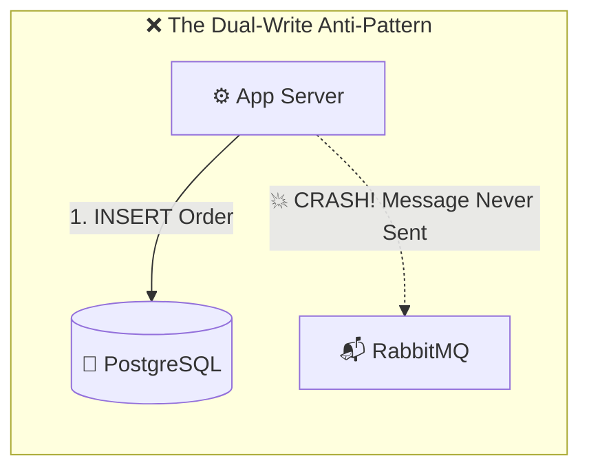
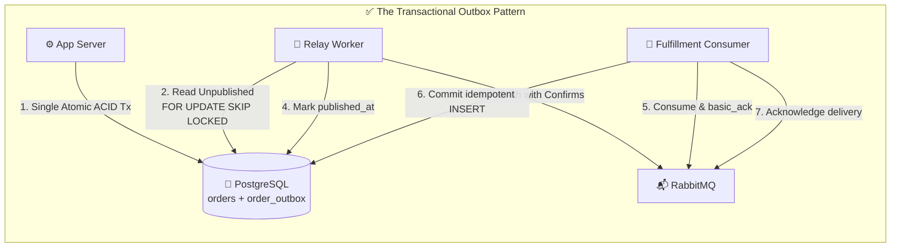

# 🧪 Hands-On Lab: Event-Driven Order Processing with Transactional Outbox

> Practical, runnable Docker Compose lab demonstrating the **Transactional Outbox Pattern**, **At-Least-Once Delivery**, and **Idempotent Consumers** using PostgreSQL 17 and RabbitMQ 4.

---

## 🎯 Architectural Problem Solved

When an application creates an order and sends a message to an event broker, two separate systems are involved (PostgreSQL + RabbitMQ).

If the database write succeeds but the app crashes before publishing to RabbitMQ, the message is permanently lost. If we publish to RabbitMQ first and the database write fails, downstream workers fulfill non-existent orders.

### The Solution: The Transactional Outbox Pattern
Write the business entity (`orders`) and the event payload (`order_outbox`) in the **same local ACID database transaction**. A separate background relay worker reads the outbox table and reliably publishes to RabbitMQ.

---

## Run the verification

From the repository root, run these commands with a local container runtime that supports Docker Compose. The lab uses no hosted service and exposes no host ports.

~~~sh
cd labs/order-processing
docker compose up -d --wait postgres rabbitmq
docker compose run --rm --build lab verify
docker compose down
~~~

The verifier uses a unique order and queue. It creates the same order twice, crashes the relay and the worker in separate processes, and checks the recovered database and queue state. The database volume retains order records between runs.

## Walk through the failures

Start the services as shown above. Pick a fresh UUID each time you repeat this exercise.

~~~sh
docker compose run --rm --build lab create 00000000-0000-4000-8000-000000000001
docker compose run --rm lab relay 00000000-0000-4000-8000-000000000001 --crash-after-publish
docker compose run --rm lab status 00000000-0000-4000-8000-000000000001
docker compose run --rm lab relay 00000000-0000-4000-8000-000000000001
docker compose run --rm lab worker --crash-after-commit
docker compose run --rm lab worker
docker compose run --rm lab worker
docker compose run --rm lab worker
docker compose run --rm lab status 00000000-0000-4000-8000-000000000001
~~~

| Step | Expected result | Why |
| --- | --- | --- |
| Relay exits with code 41 | RabbitMQ confirmed publication and the outbox remains pending | The process exited before committing the outbox update. Rerunning the relay publishes a second copy. |
| Worker exits with code 42 | PostgreSQL contains one fulfillment | The process exited after committing but before acknowledging. RabbitMQ requeues the delivery. |
| Worker runs again | Two deliveries print “Skipped duplicate,” then the queue is empty | Both copies carry the same order ID. The database unique constraint protects the fulfillment. |

An external side effect, such as calling a carrier, would need its own idempotency contract or a durable handoff. A production worker also needs bounded retries, a dead-letter policy, and monitoring for old unpublished rows.

[Message queues](../../17-message-queues/) · [API idempotency](../../32-rest-api-design-and-idempotency/) · [PostgreSQL locking](https://www.postgresql.org/docs/17/sql-select.html#SQL-FOR-UPDATE-SHARE) · [RabbitMQ confirms and acknowledgements](https://www.rabbitmq.com/docs/confirms)
